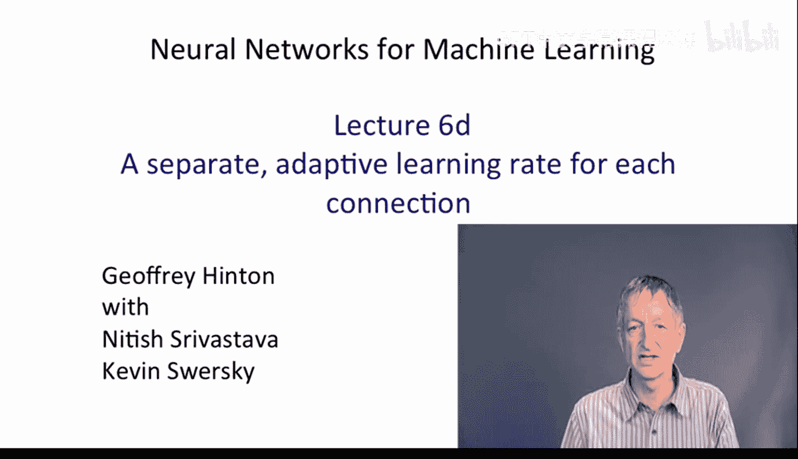
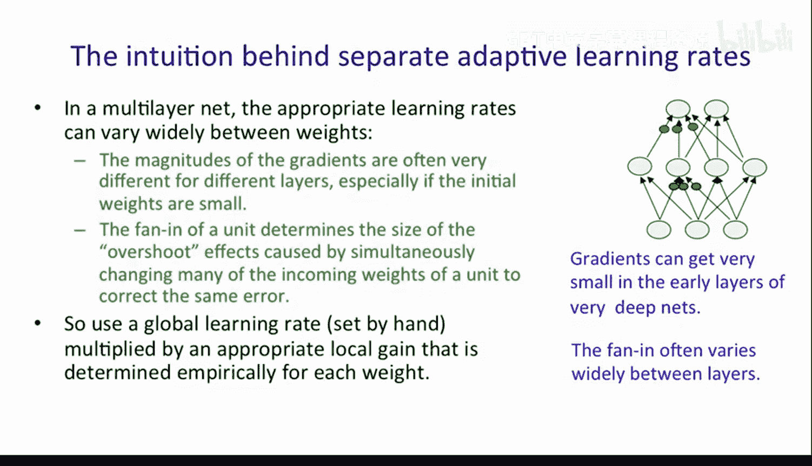
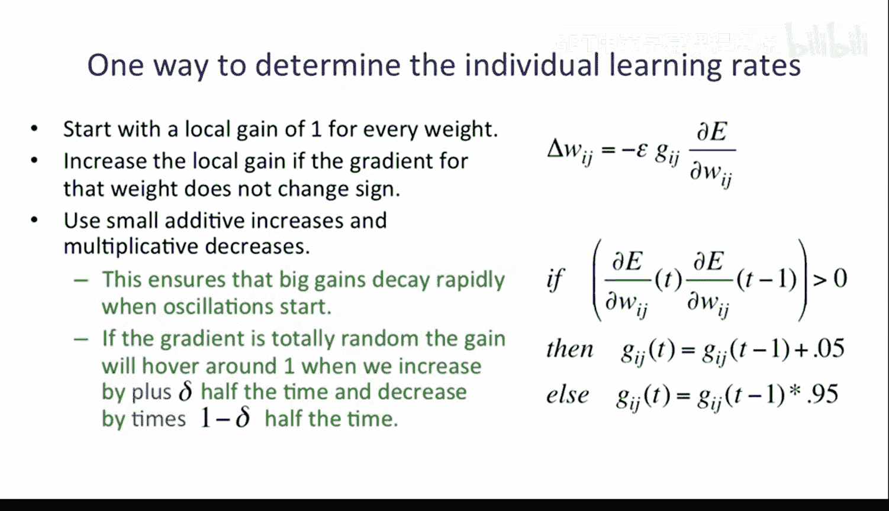
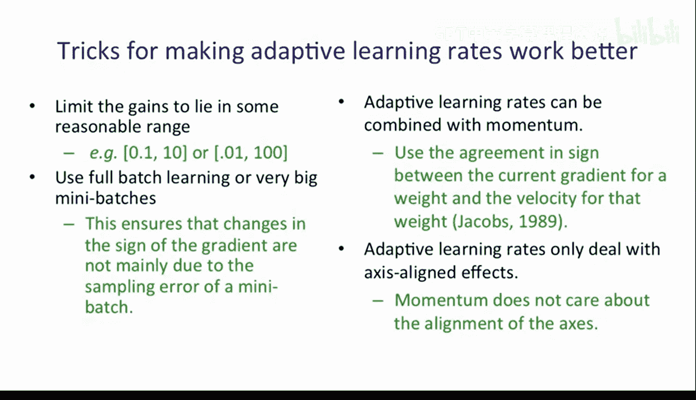

# Hinton@多伦多大学《机器学习的神经网络｜Neural Networks for Machine Learning 2016》claude-4s p28 -28-Lecture 6.4 — Adaptive learning rates for each connection  -Neural Networks -BV1HtkUB2EZD_p28-

In this video， we're going to look at a method that was developed in the late 1980s by Robbie Jacobs and then improved by a number of other people。

The idea is that each connection in the neural net。Should have its own adaptive learning rate。

Which we set empirically by observing what happens to the weight on that connection when we update it。

So that if the weight。Keeps reversing its gradient， we turn down the learning rate。

 and if the gradient stays consistent， we turn up the learning rate。

So let's start by thinking why。Having separate adaptive learning rates on each connection is a good idea。

The problem is that in a deep multi layer net， the learning rates can vary widely between different weights。

 especially between weights in different layers。So if， for example， we start with small weights。

The gradients are often much smaller in the initial layers than in the later layers。

Another factor that causes it to want different learning rates for different weights is the fanon of a unit。

The fanin determines the size of the overshoot effects that you get when you simultaneously change many of the different incoming weights to fix up the same error。

It may be that the unit didn't get enough input。When you change all these weights at the same time to fix up the error。

 it now gets too much input。Obviously， that effect's going to be bigger if there's a bigger fanion。

So the net in the diagram on the right。Has the same fanning for both layers。

More or less the same found in both letters， but that's very different in somenets。

So the idea is that we're going to use a global learning rate， which we set by hand。

And then we're going to multiply it by a local gain that's determined empirically for each weight。

A simple way to determine what those local gains should be。

Is to start with a local gain of one for every weight so that initially we're going to change the weight W I J by the learning rate。

Times the gain of one， G I J。Times the error derivative for that weight。

Then what we're going to do is we're going to adapt GIJ。We're going to increase G journey。

If the gradient for the weight does not change sign。

And we're going to use small additive increases and multiplicative decreases。

So if the gradient for the weight at time t has the same sign as the gradient for the weight at time t 1。

Where T refers to weight updates。Then when you take their product， it'll be positive。

Cause you ready to get two negative gradients or two positive gradients。

And then what we're going to do。Is increased G I J by a small， additive amount。

If the gradients have opposite signs， we're going to decrease GIJ。

 and because we want to damp down GIJ quickly if it's already big。

 we're going to decrease it multiupplicatively。That ensures that big gains will decay very rapidly。

 if oscillation start。It's interesting to ask what would happen if the gradient was totally random。

So on each update of the weights， pick a random gradient。

Then you'll get an equal number of increases and decreases because it will equally often be the same sign as the previous gradient or the opposite sign。

And so you'll get a bunch of additive 。05 increases， and multiplicative 0。95 decreases。

 and they have an equilibrium point， which is when the gain is1。 If the gain is bigger than 1。

 the multiplying by 。95 will reduce it by more than adding 。05。If the gains smaller than one。

 adding 0。05 will increase it more than multiplying by 0。95 decreases it。So with random gradients。

 we'll hover around one。And if the gradient is consistently in the same direction。

 we can get much bigger than one。 If the gradient is consistently in opposite directions。

 which means we're oscillating across a ravine， we can get much smaller than one。

There's a number of tricks for making the adaptive learning rates work better。

It's important to limit the size of the gains。A reasonable range is 01 to 10 or 0。01 to 100。

 You don't want the gains to get huge because then you can easily get into an instability and they won't die down fast enough。

 and you'll destroy all the weights。The adaptive learning rates was designed for full batch learning。

You can also apply it with mini batches， but they better be pretty big mini batches。

 That'll ensure that the change in signs of gradients aren't due to the sampling error of mini batches。

 They really are due to going to the other side of a ravine。

There's nothing to prevent you combining adaptive learning rates with momentum。

So Jacob suggests that instead of using the agreement in sign between the current gradient and the previous gradient。

Use the agreement in sign between the current gradient。And the velocity for that weight。

 So the accumulated gradient。And if you do that， you get a nice combination of the advantages of momentum and the advantages of adaptive learning rates。

So adaptive learning rates only deal with acts as a aligned effect。

Whereas momentum doesn't care about the alignment of the axes。

 Moment can deal with these diagonal ellipses and going in that diagonal direction quickly。

Which adaptive learning rates can't do。