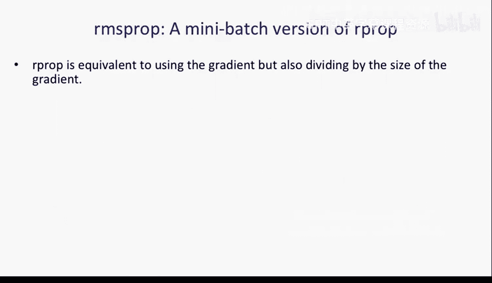
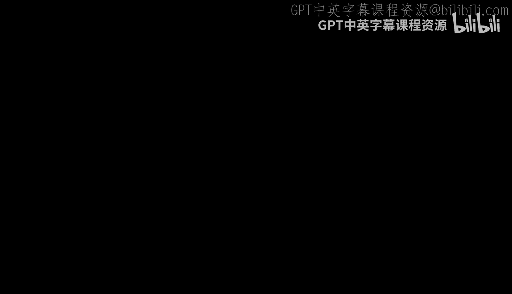
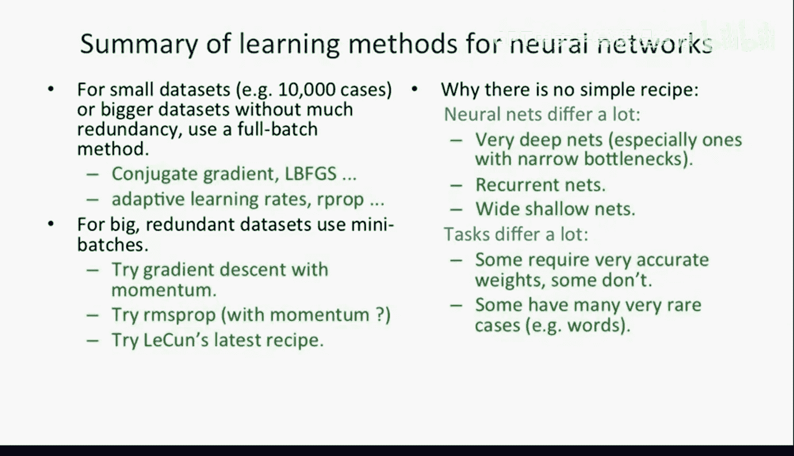

# Hinton@多伦多大学《机器学习的神经网络｜Neural Networks for Machine Learning 2016》claude-4s p29 -29-Lecture 6.5 — Rmsprop_ normalize the gradient -Neural Networks for Machine L -BV1HtkUB2EZD_p29-

In this video。I'm first going I introduce a method called Rrop。

That is used for full batchche learning。It's like Robby Jacobs's method， but not quite the same。

I'm then going to show how to extend our prop so that it works for mini batches。

This gives you the advantages of Rrop， and it also gives you the advantage of mini batch learning。

 which is essential for large redundant data sets。The method that we end up with called IMS Pro is currently my favorite method as a sort of basic method for learning the weights in a large neural network。

With a large， redundant data set。I'm now going to describe Rrop。

 which is an interesting way of trying to deal with the fact that gradients vary widely in their magnitudes。

Some gradients can be tiny， and others can be huge。

 and that makes it hard to choose a single global learning rate。If we're doing full batch learning。

We can cope with this big variation ingredients by just using the sign of the gradient。

That makes all of the weight updates be the same size。

For issues like escaping from plateaus with very small gradients， this is a great technique。

Because even with tiny gradients， willll take quite big steps。

We couldn't achieve that just by turning up the learning rate。

 because then the steps we took for weights that had big gradients would be much too big。

Our prop combines the idea of just using the sign of the gradient。

With the idea of making the step size。Depend on which weight it is。

So to decide how much to change your weight， you don't look at the magnitude of the gradient。

 You just look at the sign of the gradient。But you do look at the step size that you've decided on for that weight。

 and that step size adapts over time。Again， without looking at the magnitude of the gradient。

So we increase the step size for a weight multiplicatively。For example， by a factor of 1。2。

If the signs of the last two gradients agree。This is like in Robby Jacob's adaptive weights methods。

 except that we're going to do a multiplicative increase here。

If the signs of the last two gradients disagree， we decrease the step size multiplicatively。

And in this case， we'll make that more powerful than the increase so that we can die down faster than we grow。

We need to limit the step sizes。Mike Schhuusster's advice was to limit them between 50 and a millionth。

I think it depends a lot on what problem you're dealing with。If， for example， you have。

A problem with some tiny inputs。 You might need very big weights on those inputs for them to have an effect。

I suspect that if you're not dealing with that kind of problem。

Having an upper limit on the weight changes that's much less than 50 would be a good idea。

So one question is， why doesn't our prop work with mini batches。

 People have tried it and found it hard to get it to work。

You can get it to work with very big mini batches where you use much more conservative changes to the step sizes。

But， it's difficult。So， the reason it。Doesn't work。

Is it violates the central idea behind stochastic gradient descent。

Which is that when we have a small learning rate。The gradient gets effectively averaged over successive mini batches。

So consider a weight that gets a gradient of plus 0。1 on 9 mini batches， and then a gradient of -。

9 on the 10th mini batch。What we'd like is those gradients will roughly average out。

 so the weight will stay where it is。Our prop won't give us that。

Our prop would increment the weight 9 times by whatever its current step size is and decrement it only once。

 and that will make the weight get much bigger。We're assuming here that the step sizes adapt much slower than the time scale of these mini batches。

 So the question is， can we combine。The robustness that you get from our prop by just using the sign of the gradient。

The efficiency that you get from money batches。And this averaging of gradients over mini batches。

 which is what allows mini batches to combine gradients in the right way。That leads to a method。

 which I'm calling R M S prop。

And you can consider it to be a mini batch version of R prop。

Our prop is equivalent to using the gradient， but also dividing by the magnitude of the gradient。

 And the reason it has problems with mini batches。Is that。

We divide the gradient by a different magnitude for each mini batch。

So the idea is that we're going to force the number we divide by to be pretty much the same for nearby mini batches。

 We do that by keeping a moving average of the squared gradient for each weight。

So mean square W T means this moving average for weight W at time T。

Where time is an indicator of weight updates， time increments by one each time we update the weights。

The numbers I put in of0ugh。9 and0ughaught 。1 for computing moving average are just examples。

 but they're reasonably sensible examples。So the mean square is the previous mean square times 0。9。

Plus， the value of the squared gradient for that weight at time T。Times0 。1。

 We then take that mean square。We take its square root， which is right， has the name R M S。And then。

 we divide the gradient。By that， R M S。And make an update proportional to that。

That makes the learning work much better。 Notice that we're not adapting the learning rate separately for each connection here。

This is a simpler method where we simply， for each connection。

 keep a running average of the root mean square gradient。And divide by that。

There's many further developments one can make for Im S Pro。

You could combine it with standard momentum。My experiment so far suggests that doesn't help as much as momentum normally does。

And that needs more investigation。You could combine Rm S prop with Neov momentum。

Where you first make the jump and then make a correction。And Eli Sskiva has tried that recently。

 and got good results。He's discovered that it works best if the R M S of the recent gradients is used to divide the correction term you make。

 rather than the large jump you make in the direction of the accumulated corrections。Obviously。

 you could combine R M S prop with adaptive learning rates on each connection。

Which will make it much more like our prop。That just needs a lot more investigation。

 I just don't know at present。 How helpful that will be。

And then there's a bunch of other methods related to our mess prop that have a lot in common with it。

Yanakanhan's group has an interesting paper called No More pesky Learn ratess that came out this year。

And。Some of the terms in that look like are mess prop。But it has many other terms。

 I suspect at present that most of the advantage that comes from this complicated method recommended by Yaakan's group。

Comes from the fact that it's similar to Rm S Pro。But I don't really know that。

A summary of the learning methods for neural networks。Goes like this。If you've got a small data set。

Say 10000 cases or less。Or a big data set， without much redundancy。

You should consider using a full batch method。Thuss full batch methods adapted from the optimization literature。

Like non nonlinear conduit gradient。Or LB FGS or Lenburg Markhart。

 And one advantage of using those methods is they typically come with a package。

 And when you report the results in your paper， you just have to say。

 I use this package and here's what it did。You don't have to justify all sorts of little decisions。

Alternatively， you could use the adaptive learning rates I described in another video or RP。

 which are both essentially full batch methods。But they're methods that were developed for neural networks。

If you have a big redundant data set， it's essential to use mini batches。

 It's a huge waste not to do that。The first thing to try is just standard gradienting descent with momentum。

You're going to have to choose a global learning rate。

 and you might want to write a little loop to adapt that global learning rate based on whether the gradients change sign。

 But to begin with， don't go for anything as fancy as adapting individual learning rates for individual weights。

The next thing to try is R M S Pro。 That's very simple to implement。If you do it without momentum。

And in my experiment so far， that seems to work， as well as gradient descent with momentum。

 I would be better。You can also consider all sorts of ways of improving R M S prop by adding momentum or adaptive step sizes for each weight。

 But that's still basically uncharted territory。 Finally。

 you could find out whatever Yalican's latest recipe is and try that。

He's probably the person who's tried most different ways of getting stochastic gradient descent to work well。

 And so it's worth keeping up with whatever he's doing。One question you might ask is。

 why is the no simple recipe。We've been messing around with neural nets。

 including deep neural nets for more than 25 years now。

And you'd have thought we'd have come up with an agreed way of doing the learning。

There's really two reasons， I think， why there isn't a simple recipe。First， neural lets differ a lot。

Very deep networks， especially ones that have narrow bottlenecks in them。

 which I'll come to in later lectures。Are very hard things to optimize。

 And they need methods that can be very sensitive to very small gradients。

Recurrent nets are another special case。 They're typically very hard to optimize If you want them to notice things that ham a long time in the past and change the weights based on these things that ham a long time ago。

Then there's wide shallow networks， which are quite different in flavour and are used a lot in practice。

They often can be optimized with methods that are not very accurate because we stop the optimization early before it starts overfitting。

So for these different kinds of networks， theres very different methods are probably appropriate。

The other consideration is that tasks differ a lot。Some tasks require very accurate weights。

Some tasks don't require weights to be very accurate at all。Also。

 there's some tasks that have weird properties。Like， if your inputs are words。

Rare words may only occur on one case in 100000。That's a very。

 very different flavor from what happens if your inputs are pixels。So， to summarize。

We really don't have nice clear cut advice for hydrotrain in neural net。

We have a bunch of rules of thumb。It's not entirely satisfactory。

 but just think how much better neural nets will work once we've got this sorted out。

 and they already work pretty well。

