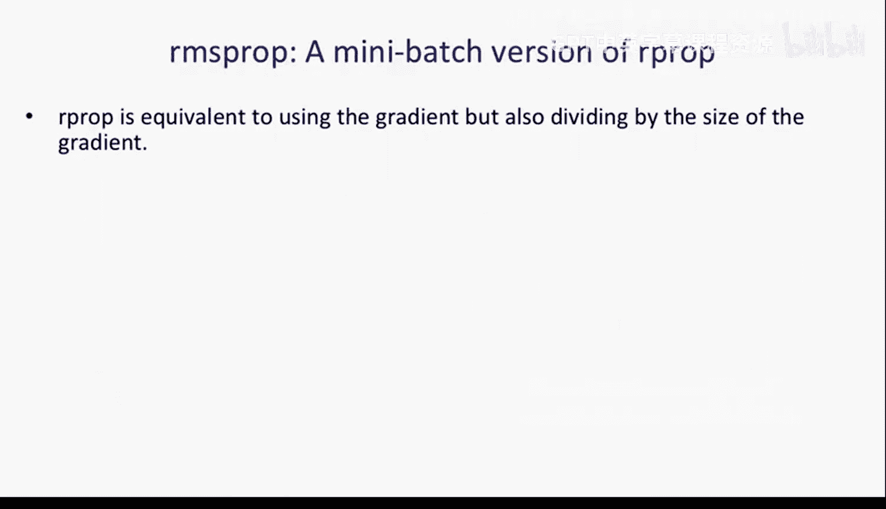
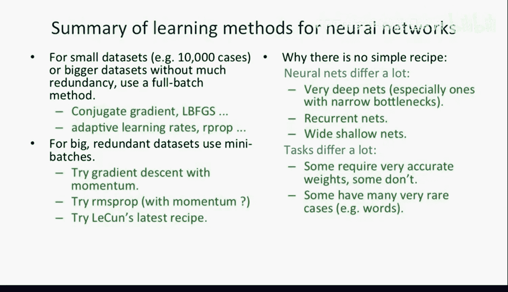

# 神经网络优化算法：6.5：RMSprop - 梯度归一化方法 🚀

在本节课中，我们将学习两种重要的神经网络权重优化方法：Rprop及其改进版本RMSprop。我们将重点理解它们如何通过处理梯度幅度的巨大差异来提升学习效率，特别是RMSprop如何将Rprop的思想成功应用于小批量学习场景。

## Rprop方法介绍

上一节我们讨论了梯度下降的变体，本节中我们来看看Rprop方法。这是一种专为全批量学习设计的优化技术。

Rprop旨在解决梯度幅度差异巨大的问题。某些梯度可能极小，而另一些可能极大，这使得选择单一的全局学习率变得困难。在全批量学习中，我们可以通过仅使用梯度的符号来应对这种变化，这使得所有权重更新具有相同的大小。对于逃离梯度极小的平台区域，这是一项优秀的技术。

Rprop结合了仅使用梯度符号的思想，以及让步长依赖于具体权重的理念。决定如何改变权重时，我们不关注梯度的大小，只关注梯度的符号。但我们会关注为该权重确定的步长，该步长会随时间自适应调整。

以下是Rprop更新步长的规则：

*   如果最近两次梯度的符号一致，则以乘法方式增加该权重的步长（例如乘以因子1.2）。
*   如果最近两次梯度的符号不一致，则以乘法方式减少该权重的步长，且减少的力度通常大于增加的力度，以便能比增长更快地衰减。

我们需要限制步长的范围。Mike Schhuusster的建议是将步长限制在50和百万分之一之间。具体上限取决于处理的问题类型。

## 从Rprop到小批量学习

那么，为什么Rprop不适用于小批量学习呢？人们尝试过但发现难以使其生效。其根本原因在于它违背了随机梯度下降的核心思想。

随机梯度下降的核心思想是，当学习率较小时，梯度会在连续的小批量上被有效地平均。考虑一个权重，它在9个小批量上获得+0.1的梯度，然后在第10个小批量上获得-0.9的梯度。我们希望这些梯度大致平均，从而使权重保持原位。但Rprop无法实现这一点。

Rprop会根据其当前步长将该权重增加9次，仅减少1次，这将导致权重变得非常大。这里我们假设步长的自适应速度远慢于这些小批量的时间尺度。

因此，问题在于：我们能否结合Rprop仅使用梯度符号带来的鲁棒性、小批量学习带来的效率、以及小批量间梯度平均的优势？这引出了RMSprop方法。

## RMSprop方法详解

RMSprop可以被视为Rprop的小批量版本。Rprop等效于使用梯度，但同时除以梯度的大小。它在小批量上出现问题，是因为我们为每个小批量除以了不同的梯度幅度值。

RMSprop的核心思想是：强制要求相邻小批量所除的数值大致相同。我们通过为每个权重保持一个平方梯度的移动平均来实现这一点。

以下是RMSprop的关键计算公式：

`mean_square(w, t) = decay_rate * mean_square(w, t-1) + (1 - decay_rate) * (gradient(w, t))^2`

其中，`mean_square(w, t)`表示在时间t（即第t次权重更新时）对于权重w的移动平均。视频中以0.9和0.1作为计算移动平均的衰减率示例，这是合理的选择。

然后，我们取该均方值的平方根（即RMS，均方根），并用梯度除以这个RMS值，最后进行与该结果成比例的更新。

`weight_update = -learning_rate * (gradient(w, t) / sqrt(mean_square(w, t) + epsilon))`

这种方法使学习效果更好。请注意，这里我们没有为每个连接单独调整学习率，而是一种更简单的方法：仅为每个连接保持一个均方根梯度的运行平均值，然后除以它。

## RMSprop的扩展与比较

关于RMSprop，可以进行许多进一步的开发。可以将其与标准动量结合，但目前的实验表明其帮助不如动量通常那么大，这需要更多研究。也可以将其与Nesterov动量结合，Eli Sskiva最近尝试了这种方法并取得了良好结果。

显然，还可以将RMSprop与每个连接的自适应学习率结合，这将使其更像Rprop，但这需要大量进一步的研究。

还有一些其他方法与RMSprop有很多共同之处。Yann LeCun的团队今年发表了一篇有趣的论文《No More Pesky Learning Rates》，其中的一些项看起来很像RMSprop。

## 神经网络学习方法总结

神经网络学习方法的总结如下：

如果你有一个小数据集（例如少于10000个样本）或一个冗余不多的大数据集，应考虑使用全批量方法。例如来自优化文献的全批量方法（如非线性共轭梯度、L-BFGS或Levenberg-Marquardt），或者使用之前视频中描述的自适应学习率或Rprop。

如果你有一个大型冗余数据集，则必须使用小批量学习。首先可以尝试带动量的标准梯度下降。你可能需要选择一个全局学习率，并可能编写一个小循环来根据梯度是否改变符号来调整该全局学习率。

接下来可以尝试RMSprop。如果不使用动量，它实现起来非常简单。根据我目前的实验，它的效果似乎与带动量的梯度下降一样好，甚至更好。

你也可以考虑通过添加动量或为每个权重添加自适应步长等方法来改进RMSprop，但这基本上仍是未知领域。最后，你可以查找Yann LeCun的最新方案并尝试它。

## 为何没有万能配方？

你可能会问，为什么没有简单的通用配方？我们认为主要有两个原因。

首先，神经网络差异很大。非常深的网络，特别是其中包含狭窄瓶颈的网络，是非常难以优化的，它们需要能对非常小的梯度非常敏感的方法。循环网络是另一个特例。如果你想让它注意到很久以前发生的事情并根据这些很早以前的事情改变权重，那么它们通常很难优化。还有宽而浅的网络，它们在实践中被大量使用，通常可以用不太精确的方法进行优化。

其次，任务差异也很大。有些任务需要非常精确的权重，有些则完全不需要权重非常精确。此外，有些任务具有奇怪的特性。例如，如果你的输入是单词，稀有词可能每10万个样本中只出现一次，这与输入是像素时的情况截然不同。

## 课程总结

本节课中我们一起学习了Rprop和RMSprop这两种优化算法。我们了解到Rprop通过仅使用梯度符号和自适应步长来处理全批量学习中的梯度幅度差异，而RMSprop通过维护梯度平方的移动平均并将其用于归一化，成功地将这一思想扩展到了小批量学习场景，从而结合了小批量学习的效率与梯度归一化的鲁棒性。

总而言之，对于如何训练神经网络，我们确实没有清晰明确的建议，只有一些经验法则。虽然这并不完全令人满意，但请想想，一旦我们解决了这个问题，神经网络将会工作得多么好——而它们现在已经工作得相当不错了。