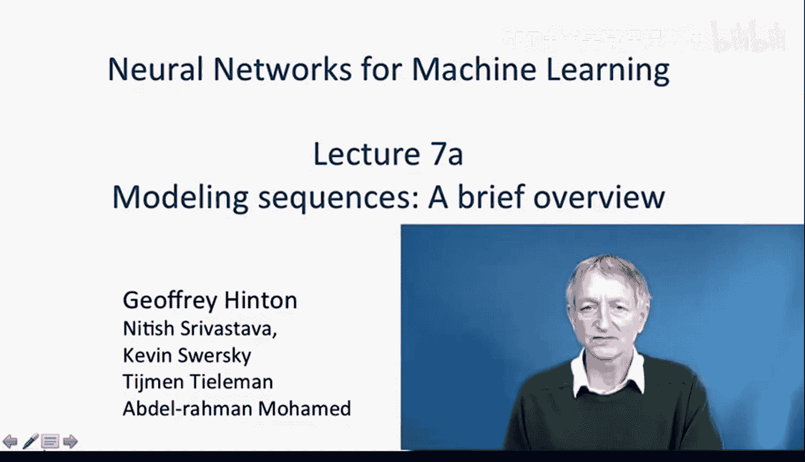
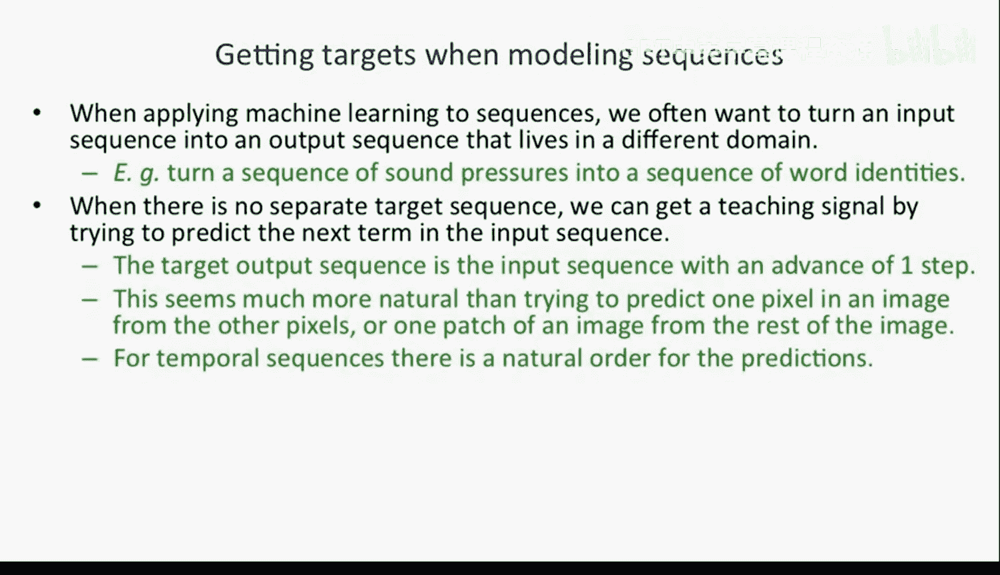
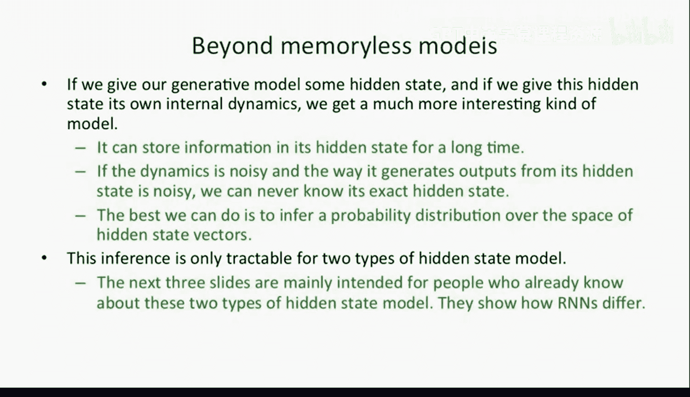
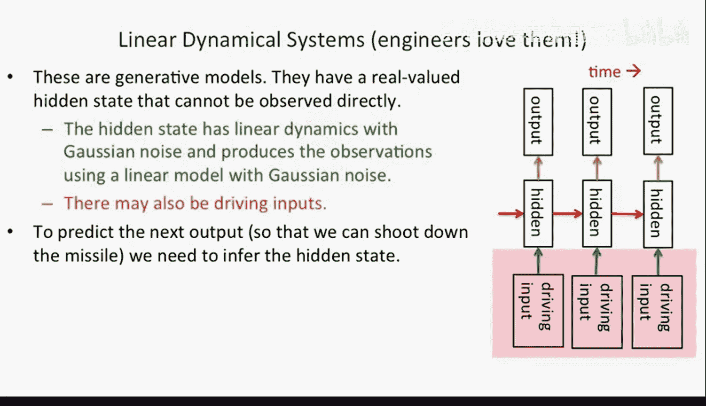
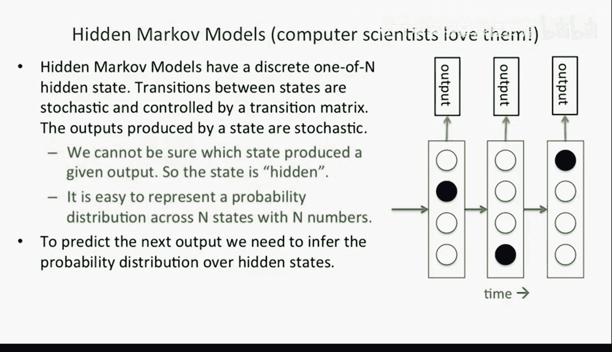
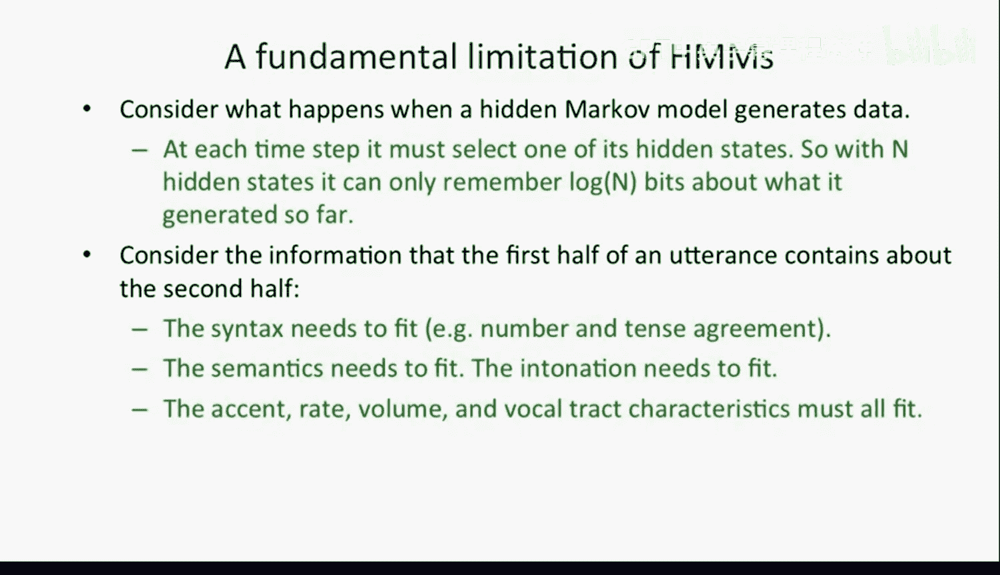
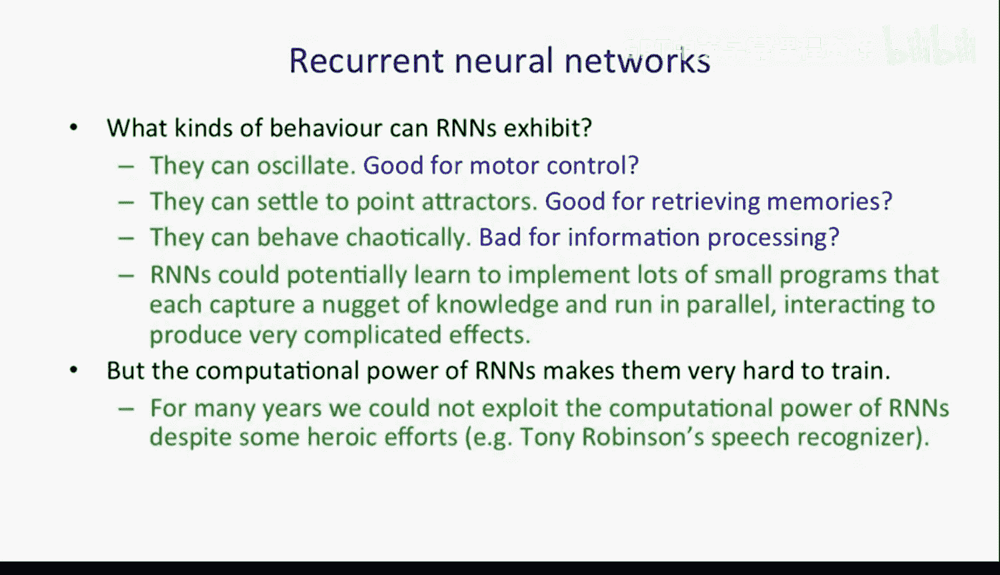

# Hinton@多伦多大学《机器学习的神经网络｜Neural Networks for Machine Learning 2016》claude-4s p30 -30-Lecture 7.1 — Modeling sequences_ a brief overview  -Neural Networks for Mac -BV1HtkUB2EZD_p30-

In this video。I am going to give an overview of various types of models that have been used for sequences。

I'll start with the simplest kinds of models， which are autoaggressive models。

That just try and predict the next term in a sequence from some previous terms。

I'll talk about more elaborate variants of them， using hidden units。

And then I'll talk about more interesting kinds of models。That have hidden state and hidden dynamics。

These include linear a systems， and hidden markov models。

Both of these are quite complicated kinds of models。

 and I don't expect you to understand all the details of them。

The main point of mentioning them is to be able to show how recurrent neural networks are related to models of that kind。

When were using machine learning to model sequences。

 we often want to turn one sequence into another sequence。For example。

 we might want to turn English words into French words。

Or we might want to take a sequence of sound pressures and turn it into a sequence of word identities。

 which is what's happening in speech recognition。Sometimes we don't have a separate target sequence。

 And in that case， we can get a teaching signal by trying to predict the next term in the input sequence。

So the target output sequence is simply the input sequence with an advance of one time step。

This seems much more natural than trying to predict one pixel in an image from all the other pixels。

Or one patch of an image from the rest of the image。

One reason it probably seems more natural is that for temporal sequences。

There's a natural order to do the predictions in， Whereas for images。

 it's not clear what you should predict from what。But， in fact。

 a similar approach works very well for images。

When we predict the next term a sequence， it blurs the distinction。

Between supervised and unsupervised learning that I made at the beginning of the course。

So we used methods that were designed for supervised learning to predict the next term。

But we don't require a separate teaching signal。 So in that sense， it's unsupervised。

I'm now going to give a quick review of some of the other models of sequences before we get on to using recurrent neural nets to model sequences。

So a nice， simple model for sequences that doesn't have any memory is an auto aggressivegressive model。

What that does is take some previous terms in the sequence。And tra predict the next term。Basically。

 as a weighted average of previous terms。The previous terms might be individual values。

Or they might be whole vectors。And a linear auto aggressive model would just take a weighted average of those to predict the next term。

We can make that considerably more complicated。By adding hidden units。

 So in a feed forward neural net， we might take some previous input terms。

Put them through some hidden units， and predict the next term。

Memory list models are only one subclass of models that can be used for sequences。

We can think about ways of generating sequences。And one very natural way to generate a sequence is to have a model that has some hidden state。

 which has its own internal dynamics。So the hidden state evolves according to its internal dynamics。

 and the hidden state also produces observations。And we get to see those observations。

That's a much more interesting kind of model。It can store information in its hidden state for a long time。

Unlike the memoryless models， there's no simple bound to how far we have to look back before we can be sure it's not affecting things。

If the dynamics of the hidden state is noisy and the way it generates outputs from its hidden state is noisy。

Then by observing the output of a generative model like this。

 you can never know for sure what its hidden state was。

The best you can do is to infer a probability distribution over the space of all possible hidden state vectors。

You can know that it's probably in some part of the space and not another part of the space。

 but you can't pin it down exactly。So with a generative model like this。If you get to observe。

What it produces。 And you now try to infer what the hidden state was In general， that's very hard。

 But there's two types of hidden state model for which the computation is tractable。That is。

 there's a fairly straightforward computation that allows you to infer the probability distribution over the hidden state vectors that might have caused the data。

Of course， when we do this and apply it to real data。

 were assuming that the real data is generated by our model。

So that's typically what we do when we're modeling things。

 We assume the data was generated by the model， and then we infer what state the model must have been in in order to generate that data。

The next three slides are mainly intended for people who already know about the two types of hidden state model I am going to describe。

The point of the slides is so that I make it clear how recurrent neural networks differ from those standard models。

If you can't follow the details of the two standard models， don't worry too much。

 That's not the main point。So one standard model is a linear dynamical system。

It's very widely used in engineering。This is a generative model that has real valued hidden state。

The hidden state has line dynamics shown by those red arrows on the right。

And the dynamics has Gaussian noise so that the hidden state evolves probabilistically。

There may also be driving inputs shown at the bottom there。

 which directly influence the hidden state。So， the inputs。Influence the hidden state directly。

The hidden state determines the output。To predict the next output of a system like this。

We need to be able to infer its hidden state。And these kinds of systems are used， for example。

 for tracking missiles。In fact， one of the earliest uses of Gaing distributions。

Was for trying to track planets from noisy observations。

 Gaus actually figured out that if you assume Gaussian noise， you could do a good job of that。

One nice property that A Gaussian has is that if you linearly transform a Gaussian。

 you get another Gaussian。Because all the noise in a linear dynamical system is Gaussian。

It turns out that the distribution over the hidden state。

 given the observations so far that is given the output so far， is also a Gaussian。

It's a full covariance Scsian， and it's quite complicated to compute what it is。

 but it can be computed efficiently。 And there's a technique called carmen filtering。

 that's an efficient， recursive way。Of updating your representation of the hidden state。

 given a new observation。So， to summarize。Given observations of the output of the system。

 we can't be sure what hidden states it was in， but we can estimate a Gaussian distribution over the possible hidden states it might have been in。

Always assuming， of course。That our model is a correct model of the reality we're observing。

A different kind of hidden state model that uses discrete distributions rather than Gasian distributions。

 is a hidden markov model。And because it's based on discrete mathematics。

 computer scientists love these ones。In hidden Markov model。

The hidden state consists of a one of end choice。So there are a number of things called states。

 and the system is always in exactly one of those states。

The transitions between states are probabilistic。 They're controlled by transition matrix。

 which is simply a bunch of probabilities that say， if you're in state1 at time 1。

 what's the probability of you going to state 3 at time 2。The output model is also stochastic。

So the state that the system is in doesn't completely determine what output it produces。

 There's some variation in the output that each state can produce。Because of that。

 we can't be sure which state produced to given output。In a sense。

 the states are hidden behind this probabilistic veil。And that's why they're called hidden。

Historically， the reason hidden units in a neural network are called Hidden。

Is because I like this term。 It sounded mysterious。 So I stole it for neural networks。

It is easy to represent a probability distribution across N states with N numbers。

 So the nice thing about a hidden Markov model is we can represent the probability distribution across its discrete states。

So even though we don't know what state is in for sure。

 we can easily represent the probability distribution。

And to predict the next output from a hidden Markov model。

We need to infer what hidden state it's probably in。

And so we need to get our hands on that probability distribution。

It turns out there's an easy method based on dynamic programming that allows us to take the observations we've made。

And from those， compute the probability distribution across the hidden states。

Once we have that distribution， there's a nice， elegant learning algorithm v Markov models。

 And that's what made them so appropriate for speech。 And in the 1970s。

 they took over speech recognition。There's a fundamental limitation of H M Ms。

It's easiest to understand this limitation if we consider what happens when a hidden markov model generates data。

At each time step when it's generating， it selects one of its hidden states。

So if it's got N hidden states。The total information stored in the hidden state is at most log n bits。

So that's all it knows about what it's done so far。

So now let's consider how much information a hidden Markov model can convey to the second half of an utterance it produces from the first half。

So imagine it's already produced the first half of an utterance。

 and now it's going to have to produce the second half。And remember， it's memory。

Of what it said for the first half。Is in which of the N states it's in。

So its memory only has log n bits of information in it。

To produce a second half that's compatible with the first half。It must make the syntax fit。So。

 for example， the number and1 must agree。It also needs to make the semantics fit。

 They can't have the second half of the sentence be about something totally different from the first half。

Also， the intonation needs to fit。So it would look very silly if the intonation contour completely changed halfway through a sentence。

There's a lot of other things that also have to fit The accent of the speaker。

 the rate they're speaking at， how loudly they're speaking。

And the vocal tracted characteristics of the speaker。

All of those things must fit between the second half of the sentence and the first half。

And so if you wanted a hidden Markov model to actually generate a sentence。

The hidden state has to be able to convey that information from the first half to the second half。

Now， the problem is that all of those aspects could easily come to 100 bits of information。

So the first half of the sentence needs to convey 100 bits of information to the second half。

And that means the hidden Markov model needs two to the hundred states。 And that's just too many。

So that brings us to recurrent neural networks。They have a much more efficient way of remembering information。

They're very powerful because they combine two properties。They have distributed hidden state。

That means several different units can be active at once。

So they can remember several different things at once。They don't just have one active unit。

They're also nonlinear。You see， a linear dynamic system has a whole hidden state vector。

 So it's got more than one value at a time。But those values are constrained to act in a linear way so as to make inference easy and in a recurrent neural network。

We allow the dynamics to be much more complicated。With enough neurons and enough time。

 a recurrent neural network can compute anything that can be computed by your computer。

It's a very powerful device。So line dynamic systems and hidden markov models are both stochastic models。

That is the dynamics and the production of observations from the underlying state。

 both involve intrinsic noise。The question is， do models need to be like that。Well。

 one thing to notice is that the posterior probability distribution over hidden states in either a linear dynamic system or a hidden markov model is a deterministic function of the data you've seen so far。

That is， the inference algorithm for these systems ends up with a probability distribution。

 and that probability distribution is just a bunch of numbers。

 And those numbers are a deterministic function of the data so far。In a recurrent neural network。

You get a bunch of numbers that are a deterministic function of the data so far。

And it might be a good idea to think of those numbers that constitute the hidden state of a currentren neural network。

They're very like the probability distribution for these simpler stochastic models。

So what kinds of behaviour can recurrent neural networks exhibit。Well， they can oscillate。

That's obviously good for things， like motor control。Where when you're walking， for example。

 you want a nice regular oscillation， which is your stride。They can settle to pointer tractors。

That might be good for retrieving memories。And later on， in a course。

 we'll look at hopfield Nes where they use the settling to point attractors to store memories。

So the idea is you have a sort of rough idea of what you're trying to retrieve。

 You then let the system settle down to a stable point。

 and those stable points correspond to the things you know about。

 And so by settling to that stable point， you retrieve a memory。

They can also behave chaotically if you set the weights in the appropriate regime。Often。

 chaotic behaviour is bad for information processing。Because in information processing。

 you want to be able to behave reliably。 You want to achieve something。

There are some circumstances where it's a good idea。If you're up against a much smarter adversary。

You probably can't outwi them。 So it might be a good idea just to behave randomly。

 And one way to get the appearance of randomness is to behave chaotically。One nice thing about R Ns。

Which a long time ago， I thought was going to make them very powerful。

Is that an R And N could learn to implement lots of little programmes using different subsets of its hidden state。

And each of these little programme could capture nugget of knowledge。

And all of these things could run in parallel and interact with each other in complicated ways。

Unfortunately， the computational power of recurrent neural networks makes them very hard to train。

For many years， we couldn't exploit the computational power of recurrent neural networks。

There were some heroic efforts。 For example， Tony Robinson managed to make quite a good speech recogniser using recurrent nets。

He had to do a lot of work implementing them on a parallel computer built out of transputs。

 And it was only recently that people managed to produce recurrent neural networks that had performed Tony Robinson's once。

