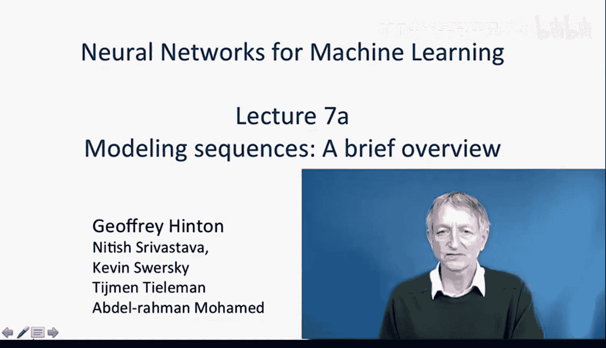
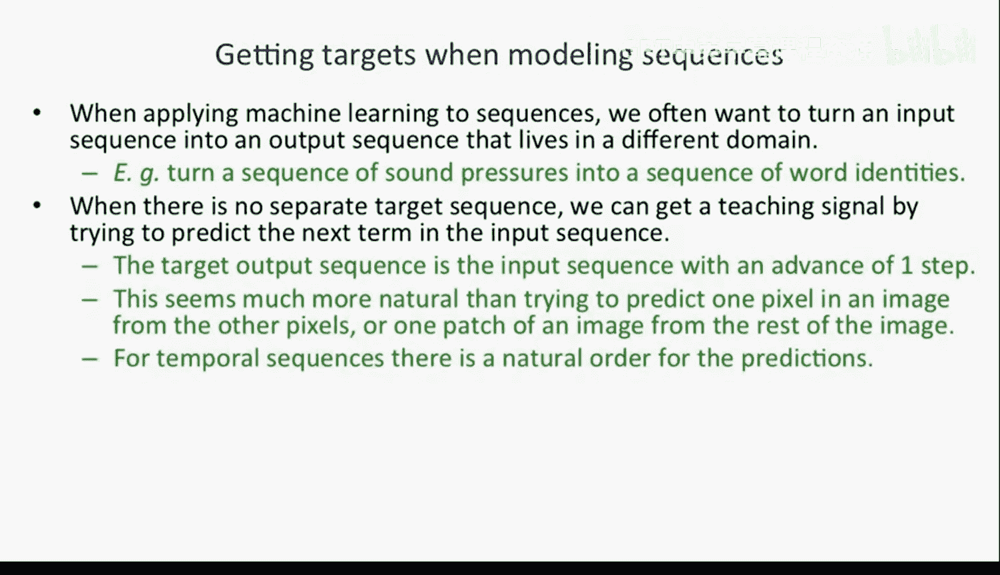
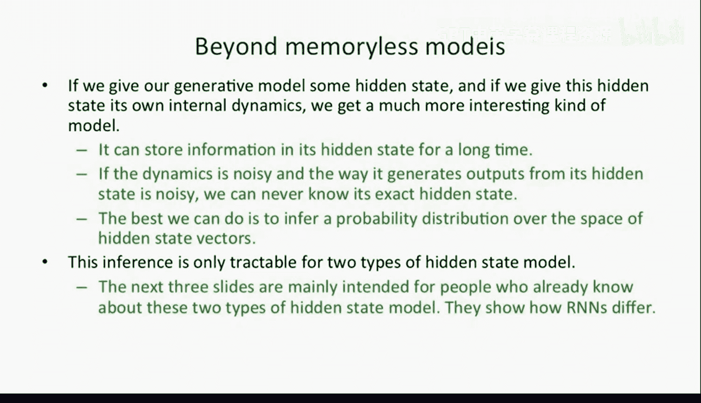
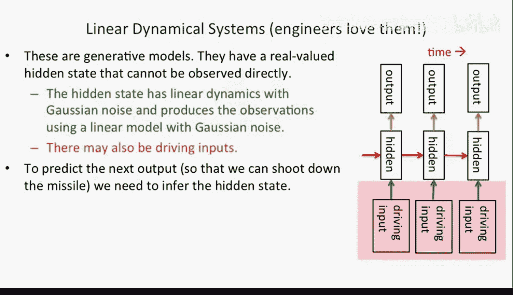
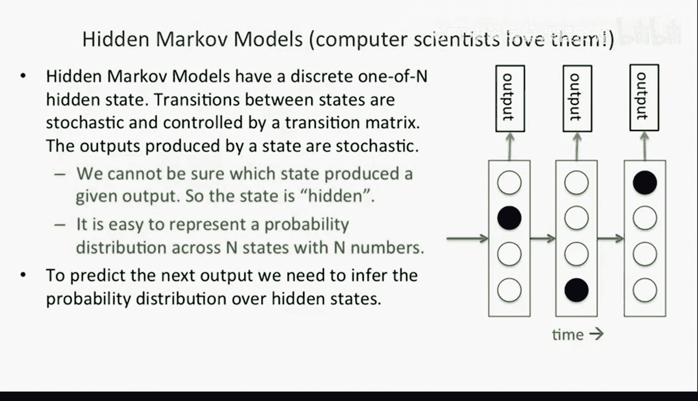
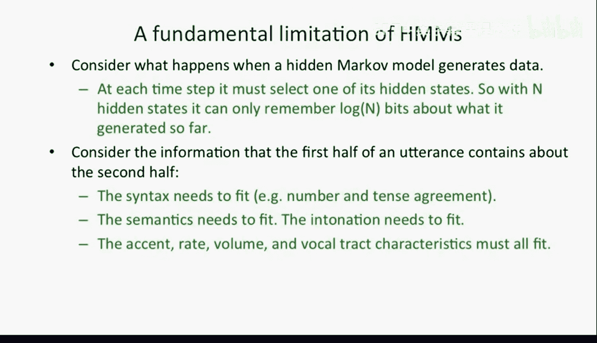
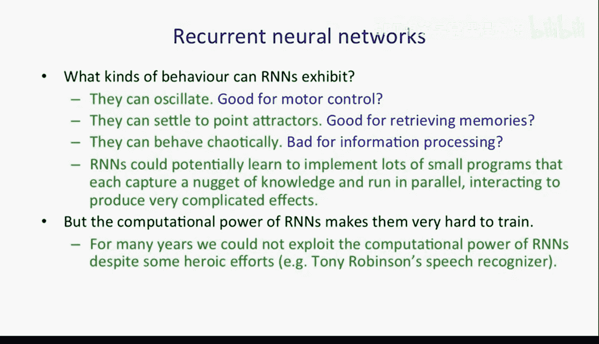

# 神经网络与机器学习：第7.1讲：序列建模概述 🧠

在本节课中，我们将要学习用于序列建模的各种模型。我们将从最简单的自回归模型开始，逐步深入到包含隐藏状态和隐藏动态的更复杂模型，如线性动态系统和隐马尔可夫模型。最后，我们将探讨循环神经网络如何克服这些传统模型的局限性，并成为强大的序列建模工具。

---

## 序列建模的目标

当我们使用机器学习来建模序列时，通常希望将一个序列转换为另一个序列。例如，将英语单词序列转换为法语单词序列，或将声压序列转换为单词身份序列（如语音识别）。有时，我们没有单独的目标序列。在这种情况下，可以通过尝试预测输入序列中的下一个项来获得教学信号。因此，目标输出序列就是输入序列向前移动一个时间步。

这种方法比在图像中从所有其他像素预测一个像素，或从图像的其余部分预测一个图像块显得更自然。一个可能的原因是，对于时间序列，预测有一个自然的顺序；而对于图像，则不清楚应该从什么预测什么。但实际上，类似的方法在图像处理中效果也很好。

---

## 预测与学习类型的模糊

当我们预测序列中的下一个项时，它模糊了本课程开始时区分的监督学习和无监督学习之间的界限。我们使用为监督学习设计的方法来预测下一个项，但我们不需要单独的教学信号。从这个意义上说，它是无监督的。

在开始使用循环神经网络建模序列之前，我们先快速回顾一些其他序列模型。

---

## 自回归模型

一个简单且没有记忆的序列模型是自回归模型。它的作用是获取序列中的一些先前项，并尝试预测下一个项。基本上，它是先前项的加权平均值。先前项可以是单个值，也可以是整个向量。线性自回归模型将只取这些项的加权平均值来预测下一个项。

我们可以通过添加隐藏单元使其变得更加复杂。因此，在前馈神经网络中，我们可能会取一些先前的输入项，通过一些隐藏单元，然后预测下一个项。

---

## 具有隐藏状态的模型

无记忆模型只是可用于序列的模型的一个子类。我们可以考虑生成序列的方法。一种非常自然的生成序列的方法是拥有一个具有隐藏状态的模型，该状态具有其自身的内部动态。因此，隐藏状态根据其内部动态演化，并且隐藏状态也产生观测值。我们能够看到这些观测值。

这是一种更有趣的模型。它可以在其隐藏状态中长期存储信息。与无记忆模型不同，在确定其不再影响事物之前，没有简单的界限来限制我们需要回溯多远。

如果隐藏状态的动态是嘈杂的，并且它从其隐藏状态生成输出的方式也是嘈杂的，那么通过观察像这样的生成模型的输出，你永远无法确定其隐藏状态是什么。你最多只能推断出所有可能隐藏状态向量空间上的概率分布。你可以知道它可能在空间的某个部分，而不是另一个部分，但你无法精确定位它。

因此，对于像这样的生成模型，如果你观察它产生的结果，并尝试推断隐藏状态是什么，通常这是非常困难的。但有两种类型的隐藏状态模型，其计算是易于处理的。也就是说，存在一种相当直接的计算方法，允许你推断出可能导致数据的隐藏状态向量的概率分布。

当然，当我们这样做并将其应用于真实数据时，我们假设真实数据是由我们的模型生成的。这通常是我们建模时所做的事情。我们假设数据是由模型生成的，然后推断模型必须处于什么状态才能生成该数据。

接下来的内容主要面向已经了解我将要描述的两种隐藏状态模型的人。这些内容的目的是为了明确循环神经网络与这些标准模型有何不同。如果你无法理解这两种标准模型的细节，请不要过于担心，这不是重点。

---

## 线性动态系统

一个标准模型是线性动态系统。它在工程中应用非常广泛。这是一个具有实值隐藏状态的生成模型。隐藏状态具有线性动态（如右侧红色箭头所示），并且动态具有高斯噪声，因此隐藏状态以概率方式演化。可能还有驱动输入（如底部所示），直接影响隐藏状态。因此，输入直接影响隐藏状态，隐藏状态决定输出。

要预测像这样的系统的下一个输出，我们需要能够推断其隐藏状态。这类系统被用于例如跟踪导弹。事实上，高斯分布最早的应用之一就是试图从嘈杂的观测中追踪行星。高斯本人发现，如果假设噪声为高斯噪声，就可以很好地完成这项工作。

高斯分布的一个优点是，如果你对高斯分布进行线性变换，你会得到另一个高斯分布。由于线性动态系统中的所有噪声都是高斯的，因此，给定迄今为止的观测（即迄今为止的输出），隐藏状态上的分布也是高斯的。它是一个全协方差高斯分布，计算它是什么相当复杂，但可以高效计算。有一种称为卡尔曼滤波的技术，它是一种高效的递归方法，用于在给定新观测的情况下更新你对隐藏状态的表示。

**总结**：给定系统输出的观测，我们无法确定它处于什么隐藏状态，但我们可以估计它可能处于的可能隐藏状态的高斯分布。当然，这总是假设我们的模型是我们所观察现实的正确模型。

---

## 隐马尔可夫模型

另一种使用离散分布而非高斯分布的隐藏状态模型是隐马尔可夫模型。因为它基于离散数学，所以计算机科学家很喜欢这种模型。在隐马尔可夫模型中，隐藏状态由N个选择中的一个组成。因此，有许多称为状态的东西，系统总是恰好处于这些状态之一。状态之间的转移是概率性的，它们由转移矩阵控制，转移矩阵只是一组概率，表示如果你在时间1处于状态1，那么在时间2进入状态3的概率是多少。输出模型也是随机的。因此，系统所处的状态并不完全决定它产生什么输出。每个状态可以产生的输出存在一些变化。因此，我们无法确定哪个状态产生了给定的输出。从某种意义上说，状态隐藏在这个概率面纱后面。这就是为什么它们被称为“隐藏”。

历史上，神经网络中隐藏单元被称为“隐藏”的原因是因为我喜欢这个术语。它听起来很神秘，所以我把它借用于神经网络。

用N个数字来表示N个状态上的概率分布很容易。因此，隐马尔可夫模型的一个优点是，我们可以表示其离散状态上的概率分布。因此，即使我们不确定它处于什么状态，我们也可以轻松地表示概率分布。

要预测隐马尔可夫模型的下一个输出，我们需要推断它可能处于什么隐藏状态。因此，我们需要掌握那个概率分布。事实证明，有一种基于动态规划的简单方法，允许我们根据所做的观测来计算隐藏状态上的概率分布。一旦我们有了那个分布，隐马尔可夫模型就有一个优雅的学习算法，这就是为什么它们如此适合语音识别。在20世纪70年代，它们接管了语音识别领域。

---

## 隐马尔可夫模型的局限性

隐马尔可夫模型有一个根本性的局限性。如果我们考虑隐马尔可夫模型生成数据时会发生什么，就最容易理解这个局限性。在生成的每个时间步，它选择其隐藏状态之一。因此，如果它有N个隐藏状态，隐藏状态中存储的总信息最多为log N比特。这就是它对自己迄今为止所做事情的全部了解。

现在，让我们考虑隐马尔可夫模型可以从其产生的语句的前半部分向后半部分传达多少信息。想象它已经产生了语句的前半部分，现在它将必须产生后半部分。请记住，它对前半部分所说内容的记忆在于它处于N个状态中的哪一个。因此，它的记忆只有log N比特的信息。

要产生与前半部分兼容的后半部分，它必须使语法匹配。例如，数字和必须一致。它还需要使语义匹配。句子的后半部分不能与前半部分完全无关。此外，语调也需要匹配。因此，如果语调轮廓在句子中途完全改变，那会显得很傻。还有许多其他事情也必须匹配：说话者的口音、说话速度、说话音量以及说话者的声道特征。所有这些事情都必须在句子的后半部分和前半部分之间匹配。

因此，如果你想要一个隐马尔可夫模型实际生成一个句子，隐藏状态必须能够将信息从前半部分传达到后半部分。问题是，所有这些方面加起来很容易达到100比特的信息。因此，句子的前半部分需要向后半部分传达100比特的信息，这意味着隐马尔可夫模型需要2的100次方个状态。这实在是太多了。

---

## 循环神经网络

这就引出了循环神经网络。它们有一种更有效的方式来记忆信息。它们非常强大，因为它们结合了两个特性。它们具有分布式隐藏状态。这意味着几个不同的单元可以同时激活。因此，它们可以同时记住几件不同的事情。它们不仅仅有一个活跃的单元。它们也是非线性的。你看，线性动态系统有一个完整的隐藏状态向量，因此它一次有多个值。但这些值被限制以线性方式作用，以便使推断变得容易。而在循环神经网络中，我们允许动态变得更加复杂。只要有足够的神经元和足够的时间，循环神经网络可以计算你的计算机可以计算的任何东西。它是一个非常强大的设备。

因此，线性动态系统和隐马尔可夫模型都是随机模型。也就是说，动态和从底层状态产生观测都涉及内在噪声。问题是，模型需要这样吗？嗯，需要注意的一点是，无论是线性动态系统还是隐马尔可夫模型，其隐藏状态的后验概率分布都是迄今为止所见数据的确定性函数。也就是说，这些系统的推断算法最终会得到一个概率分布，而这个概率分布只是一堆数字，这些数字是迄今为止数据的确定性函数。在循环神经网络中，你得到一堆数字，这些数字是迄今为止数据的确定性函数。将这些构成循环神经网络隐藏状态的数字视为类似于这些更简单随机模型的概率分布，可能是一个好主意。

---

## 循环神经网络的行为

那么，循环神经网络可以表现出什么样的行为呢？它们可以振荡。这对于像运动控制这样的事情显然是有益的。例如，当你走路时，你需要一个良好的规则振荡，那就是你的步伐。它们可以收敛到点吸引子。这对于检索记忆可能是有益的。在本课程后面，我们将研究霍普菲尔德网络，它们利用收敛到点吸引子来存储记忆。其思想是，你对你试图检索的内容有一个大致的概念，然后让系统稳定到一个稳定点，这些稳定点对应于你知道的事物。因此，通过收敛到那个稳定点，你检索了一个记忆。

如果你将权重设置在适当的范围内，它们也可能表现出混沌行为。通常，混沌行为对信息处理不利，因为在信息处理中，你希望能够可靠地行为，你想要实现某个目标。但在某些情况下，这可能是一个好主意。如果你面对一个更聪明的对手，你可能无法智胜他们。因此，表现得随机可能是一个好主意。而获得随机性表象的一种方式就是表现得混沌。

循环神经网络的一个优点是，很久以前，我认为这将使它们非常强大，那就是循环神经网络可以学会使用其隐藏状态的不同子集来实现许多小程序。每个小程序都可以捕捉一小块知识。所有这些都可以并行运行，并以复杂的方式相互交互。不幸的是，循环神经网络的计算能力使它们非常难以训练。多年来，我们无法利用循环神经网络的计算能力。有一些英勇的努力。例如，托尼·罗宾逊设法使用循环网络制作了一个相当好的语音识别器。他必须做很多工作，在由transputer构建的并行计算机上实现它们。直到最近，人们才设法生产出性能与托尼·罗宾逊曾经相当的循环神经网络。

---

## 总结

在本节课中，我们一起学习了序列建模的多种方法。我们从简单的自回归模型开始，了解了其基本思想是使用序列的先前项预测下一个项。接着，我们探讨了包含隐藏状态和内部动态的更复杂模型，包括线性动态系统和隐马尔可夫模型，理解了它们如何通过概率分布来描述不确定的隐藏状态。最后，我们重点介绍了循环神经网络，它结合了分布式隐藏状态和非线性动态，拥有强大的记忆和计算能力，能够克服传统模型（如HMM）在信息容量上的根本限制，尽管其训练颇具挑战性。这些模型构成了我们理解和处理序列数据的基础。