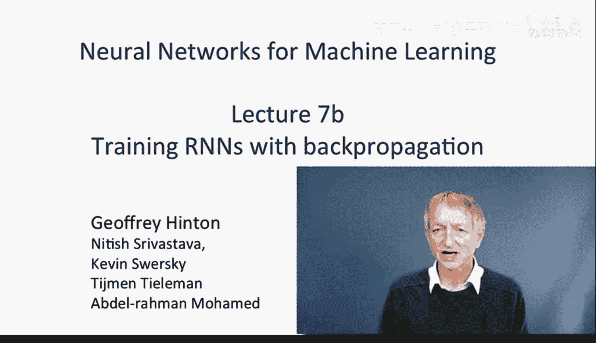
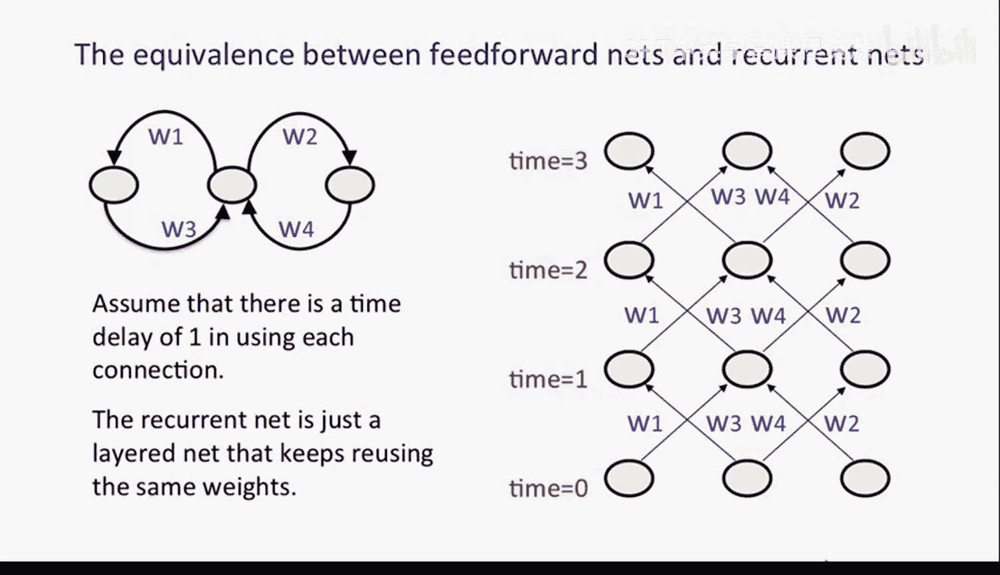
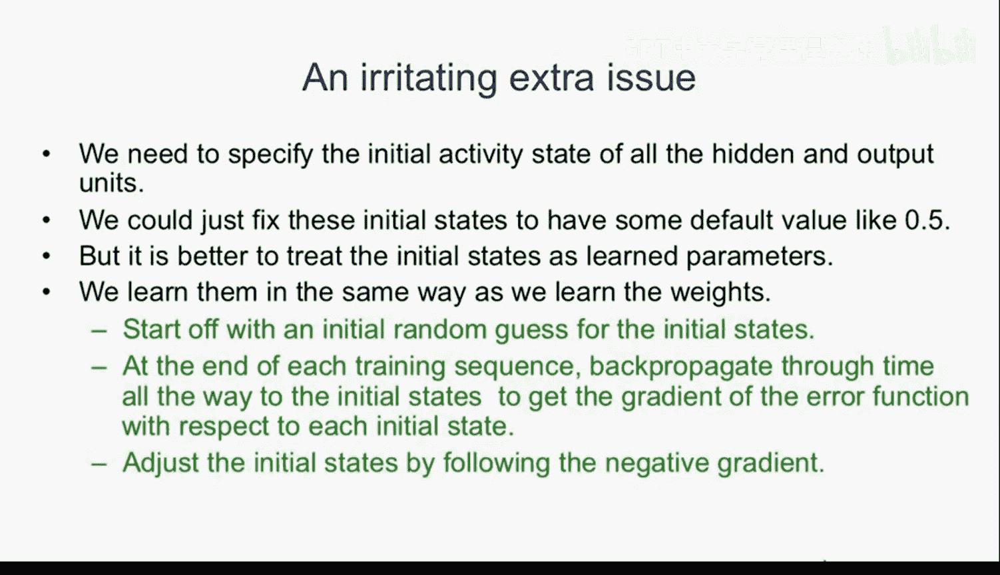
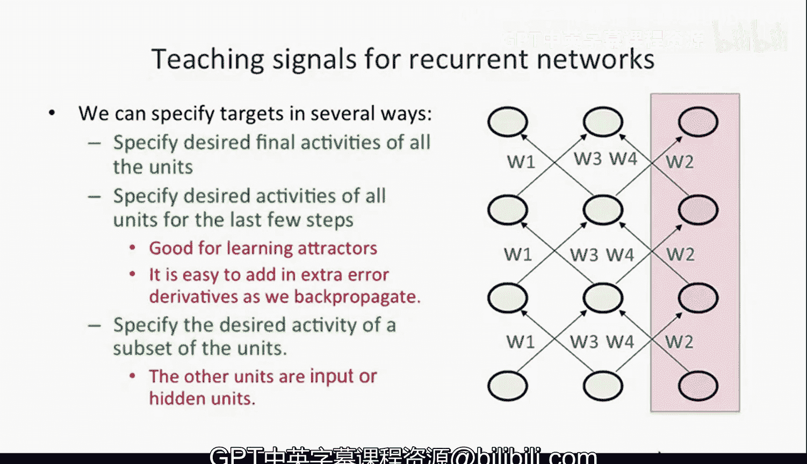

# Hinton@多伦多大学《机器学习的神经网络｜Neural Networks for Machine Learning 2016》claude-4s p31 -31-Lecture 7.2 — Training RNNs with back propagation  -Neural Networks for Mach -BV1HtkUB2EZD_p31-

In this video， I'm going to talk about the back propagation through time algorithm。

This is the standard way to train a recurrent neural network。

The algorithm is really quite simple once you've seen the equivalence between a recurrent neural network and a feed forward neural network that has one layer for each time step。

I'll also talk about ways of providing input and desired outputs to our currentrent neural networks。

So the diagram shows a simple recurrent net。With three interconnected neurons。

We're going to assume there's a time delay of one。😔。

In using each of those connections and that the network runs in discrete time。

So there's a clock that has integer ticks。The key to understanding how to train a recurrent network。

Is to see that our recurrent network。Is really just the same as a feed forward network。

Where you've expanded their current network in time。

So the recurrent network starts off in some initial state。Shown at the bottom there， time 0。

And then it uses the weights on its connections to get a new state。Shar it time 1。

It then uses the same weights again to get another new state。

And it uses the same weights again to get another new state and so on。

So it's really just a layer feed forward network where the weights are constrained to be the same at every layer。

Now， back prop is good at learning when there are awake constraints。

 We saw this for convolutional nets。 And just to remind you。

We can actually incorporate any linear constraint quite easily in back prop。

So we compute the gradients as usual， as if the weights were not constrained。

And then we modify the gradients so that we maintain the constraints。So if we want W1 to equal W2。

We start off with an equal， and then we need to make sure that the change in W1 is equal to the change in W2。

And we do that by simply taking the derivative of the error with respect to W1。

 the derivative with respect to W2， and adding or averaging them and then applying the same quantity for updating both W1 and W2。

So if the weight started off satisfying the constraints， they'll continue to satisfy the constraints。

The back propagation through time algorithm is just the name for what happens when you think of current net as a lead feet forward net。

With shared weights， and you train it with back propagation。

So we can think of that algorithm in the time domain。

The forward pass builds up a stack of activities， at each time slice。

And the backward pass peels activities off that stack and computes error derivatives。Each time。

 step backwards。That's why it's called back propagation through time。After the backward pass。

We can add together the derivatives at all the different time steps for each particular weight。

And then change all the copies of that weight by the same amount。

 which is proportional to the sum or average of all those derivatives。

There's an irritating extra issue。If we don't specify the initial state of all the units。For example。

 if some of them are hidden output units。Then we have to start them off in some particular state。

We could just fix those initial states to have some default value， like 0ugh 。5。

But that might make the system work not quite as well as it would otherwise work if it had some more sensible initial venue。

So we can actually learn the initial states。 We treat them like parameters， rather than activities。

And we learn them the same way as we learn the weights。

We start off with an initial random guess for the initial states。

That is the initial states of all the units that aren't input units。

And then at the end of each training sequence， we back propagate through time all the way back to the initial states。

And that gives us the gradient of the error function with respect to the initial state。

We then just adjust the initial states by following that gradient。 We go downhill in the gradient。

And that gives us new initial states that are slightly different。

There's many ways in which we can provide the input to our current neural net。We could， for example。

 specify the initial state of all the units。That's the most natural thing to do when we think of a current net。

 like a feed forward net with constrained weights。We could specify the initial state of just a subset of the units。

 or we could specify the states at every time step of a subset of the units。

And that's probably the most natural way to input sequential data。Similarly。

 there's many ways we can specify the targets for a recurrent network。

When we think of it as a feed forward network with constrained weights， the natural thing to do。

Is to specify the desired final states for all of the units。

If we're trying to train it to settle to some attractor。We might want to specify the desired states。

 not just for the final time step， but for several time steps。

That will cause it to actually settle down there， rather than passing through some state going off somewhere else。

So by specifying several states at the end， we can force it to learn attractors。

And it's quite easy as we back propagate to add in derivatives that we get from each time step。

So the back propagation starts at the top with the derivatives for the final time step。

 And then as we go back through the layer before the top。

We add in the derivatives for that layer and so on。

So it's really very little extra effort to have derivatives at many different layers。

Or we could specify the desired activity of a subset of units。

 which you might think of as output units。And that's a very natural way to train a recurrent neural network that is meant to be providing continuous output。

