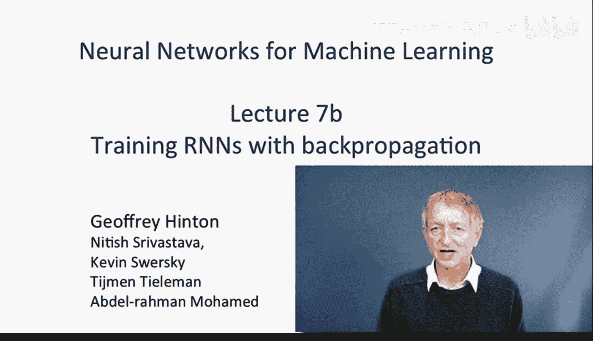
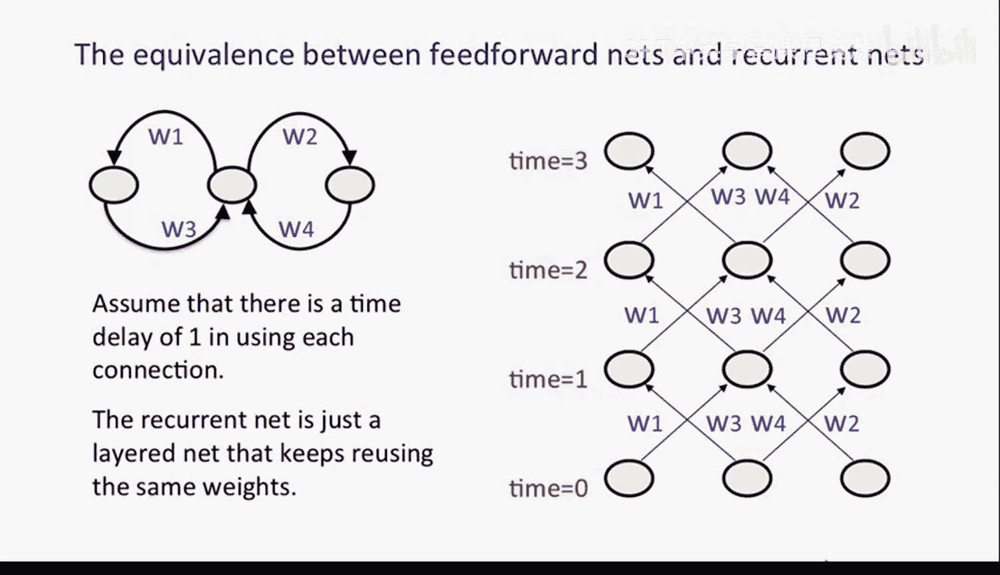
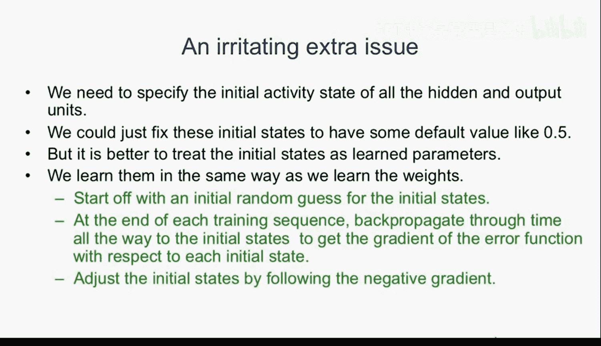
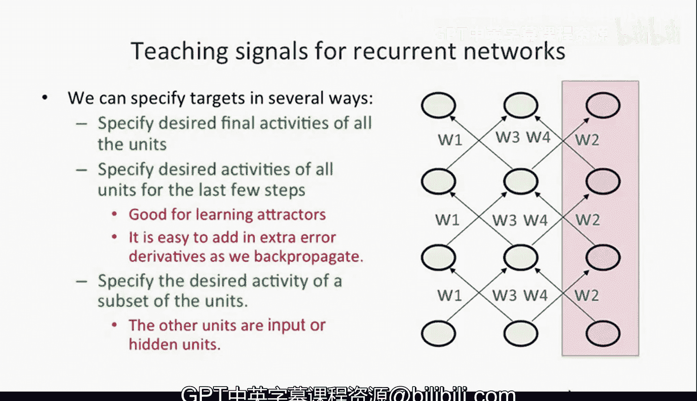

# 神经网络与机器学习：7.2：通过时间反向传播训练RNN 🧠

在本节课中，我们将要学习如何训练循环神经网络，核心方法是“通过时间反向传播”算法。我们将看到RNN如何被展开成一个前馈网络，并理解如何利用权重共享和梯度计算来有效地训练它。

---

上一节我们介绍了循环神经网络的基本概念，本节中我们来看看如何具体地训练它们。

## 理解RNN与前馈网络的等价性 🔄

理解如何训练循环神经网络的关键，在于认识到一个循环神经网络，实际上等同于一个在时间上展开的前馈网络。

循环网络从某个初始状态开始，然后使用其连接上的权重来获得一个新的状态。接着，它再次使用相同的权重来获得另一个新状态，并如此反复。因此，它本质上就是一个多层前馈网络，只不过每一层的权重都被约束为相同。

**公式表示**： 如果我们用 `s_t` 表示时间步 `t` 的状态，`W` 表示共享的权重矩阵，`f` 表示激活函数，那么状态更新可以表示为：
`s_t = f(W * s_{t-1})`

## 通过时间反向传播算法 ⏳

反向传播算法擅长处理存在权重约束的情况，我们在卷积网络中已经见过这一点。为了处理线性约束，我们可以先像权重没有约束一样正常计算梯度，然后修改梯度以维持约束。

**算法核心**： 如果我们希望 `W1` 等于 `W2`，我们开始时让它们相等。然后，我们需要确保 `W1` 的变化量等于 `W2` 的变化量。我们通过计算误差对 `W1` 的导数和对 `W2` 的导数，将它们相加或取平均，然后用这个相同的量来同时更新 `W1` 和 `W2`。这样，如果权重开始时满足约束，它们将继续满足约束。

通过时间反向传播算法，正是将循环网络视为具有共享权重的前馈网络，并用反向传播进行训练时所发生的过程。

我们可以从时间域来思考这个算法：
*   **前向传播**：在每个时间片累积构建一个活动堆栈。
*   **反向传播**：从堆栈中逐层剥离活动，并计算误差导数。每一步都向后传播，因此得名“通过时间反向传播”。

在反向传播之后，我们可以将每个特定权重在所有不同时间步的导数相加，然后按照与所有这些导数之和或平均值成比例的量，来改变该权重的所有副本。

## 处理初始状态 🚦

这里有一个额外的棘手问题。如果我们没有指定所有单元的初始状态，例如，其中一些是隐藏单元或输出单元，那么我们必须以某种特定状态启动它们。

我们可以简单地将这些初始状态固定为某个默认值，比如0.5。但这可能无法让系统发挥出拥有更合理初始值时的最佳性能。

实际上，我们可以**学习初始状态**。我们将它们视为参数，而不是活动值，并像学习权重一样学习它们。我们从一个对初始状态的随机猜测开始，然后在每个训练序列结束时，通过时间反向传播一直传播到初始状态。这为我们提供了误差函数关于初始状态的梯度。我们只需沿着该梯度方向调整初始状态，即沿着梯度下降，从而得到略有不同的新初始状态。

## 输入与目标输出的指定方式 🎯

有多种方式可以为我们的循环神经网络提供输入。

以下是几种常见的输入指定方式：
*   **指定所有单元的初始状态**：当我们将循环网络视为具有约束权重的前馈网络时，这是最自然的方式。
*   **仅指定部分单元的初始状态**。
*   **在每一个时间步指定部分单元的状态**：这可能是输入序列数据最自然的方式。

同样，指定循环网络的目标输出也有多种方式。

以下是几种常见的目标指定方式：
*   **指定所有单元的期望最终状态**：当我们将它视为具有约束权重的前馈网络时，这是自然的方式。
*   **指定多个时间步的期望状态**：如果我们试图训练它收敛到某个吸引子，我们可能不仅想指定最终时间步的期望状态，还想指定多个时间步的期望状态。这将促使它真正稳定在那里，而不是经过某个状态后跑到别处。通过指定末尾的几个状态，我们可以强制它学习吸引子。
*   **指定部分单元的期望活动**：你可以将这些单元视为输出单元。这是一种非常自然的方式来训练旨在提供连续输出的循环神经网络。

在反向传播时，从最顶层（最终时间步）的导数开始，然后当我们回到顶层之前的层时，加入该层的导数，依此类推。因此，在多个不同层拥有导数只需要很少的额外努力。

---

本节课中我们一起学习了训练循环神经网络的核心算法——通过时间反向传播。我们理解了RNN在时间上展开后与前馈网络的等价性，掌握了如何处理共享权重的约束、如何学习网络的初始状态，并了解了为RNN指定输入和目标输出的多种灵活方式。这些是构建和训练能够处理序列数据的强大神经网络模型的基础。