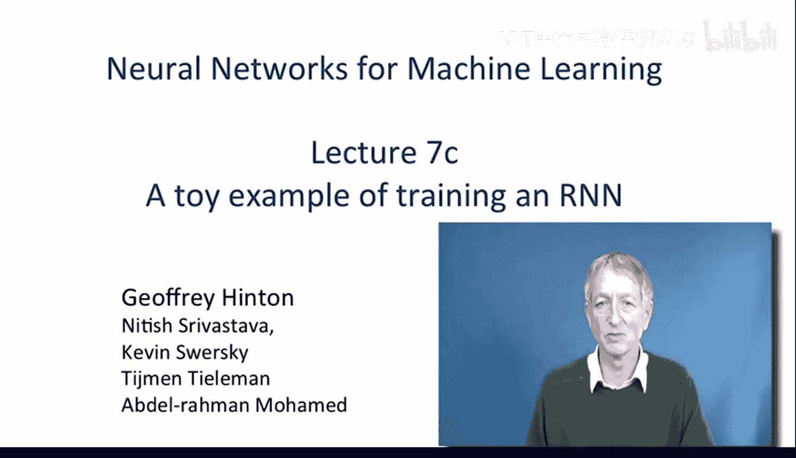
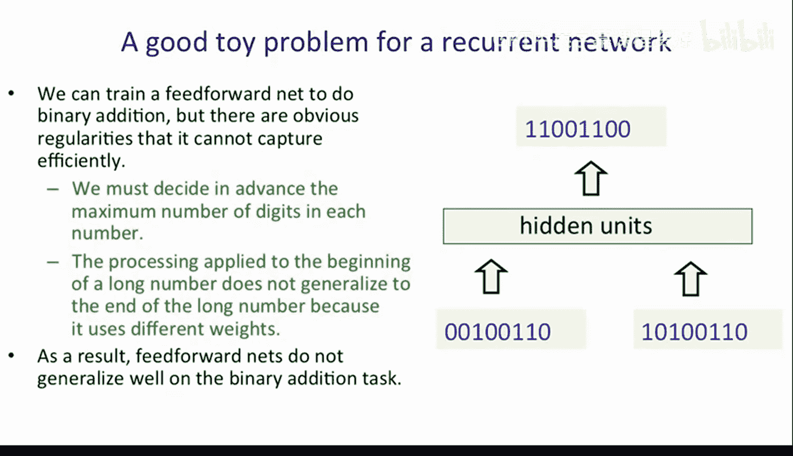
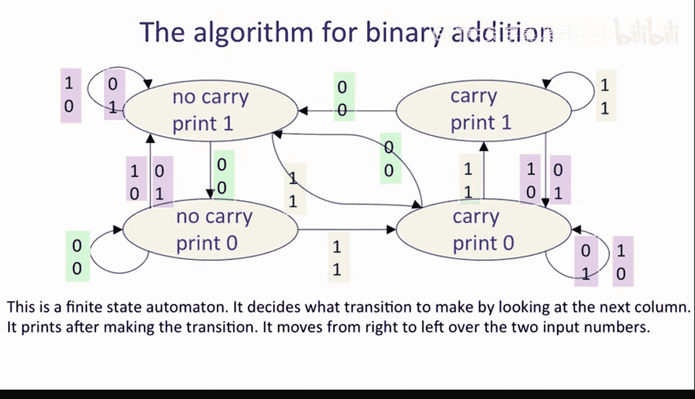
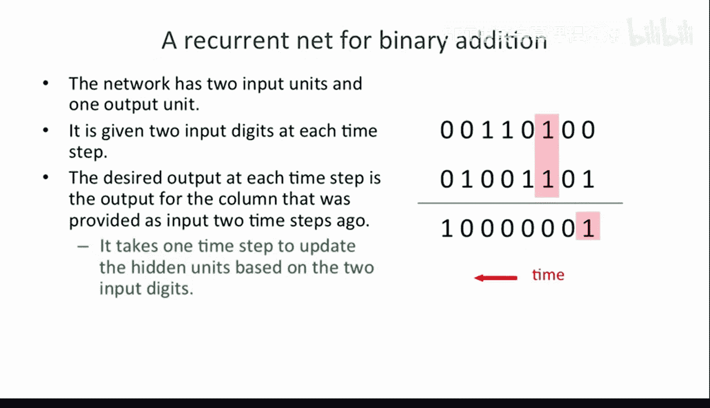
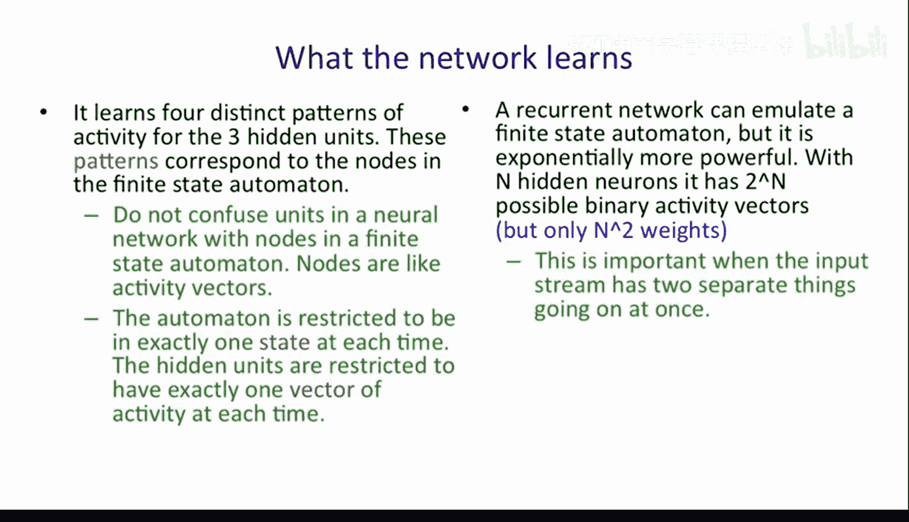

# Hinton@多伦多大学《机器学习的神经网络｜Neural Networks for Machine Learning 2016》claude-4s p32 -32-Lecture 7.3 — A toy example of training an RNN  -Neural Networks for Machine -BV1HtkUB2EZD_p32-

In this video。I'm going to describe how a recurrent neural network solves a toy problem。

It's a problem that's chosen to demonstrate what it is you can do with recurrent neural networks that you cannot do conveniently with feed forward neural networks。

The problem is adding up two binary numbers。After the recurrent neural network has learned to solve the problem。

It's interesting to look at its hidden states and see how they relate to the hidden states in a finite state automaton that's solving the same problem。

So consider the problem of adding up two binary numbers。

We could train a fee for neural network to do that。

And the diagram on the right shows a network that gets some inputs。And produces some outputs。

But there's problems with using a feed forward neural network。

We have to decide in advance what the maximum number of digits is。For both of the input numbers。

And for the output number。And more importantly。The processing that we apply to different bits of the input numbers。

 doesn't generalize。That is， when we learn how to add up the last two digits and deal with the carries。

 that knowledge is in some weights。And as we go to a different part of a long binary number。

The knowledge will have to be in different wayss。So we won't get automatic generalization。

As a result， although you can train a neural P forwardd neural network and it will eventually learn to do binary addition on fixed length numbers。

 it's not an elegant way to solve the problem。

This is a picture of the algorithm for binary edition。

The states shown here are like the states in a hidden Markov model。

 except that they're not really hidden。The system is in one state at a time。When it enters a state。

 it performs an action。So it either prints a1 or prints a 0。And when it's in a state。

It gets some input。Which is the two numbers in the next column。

And that input causes it to go into a new state。So if you look on the top right。

It's in the carry station and it's just printed a one。If it sees a11。

He goes back into the same state， and prints another one。If however， it sees a 1，0 or a 01。

It goes into the carryry state， but prints is 0。If it sees a zero zero。

He goes into the no carry state and prints a won。And so on。

So a recurrent neural net for binary addition needs to have two input units and one output unit。

It's given two input digits at each time step。And it also has to produce an output at each time step。

And the output is the output for the column that it took in two time steps ago。

The reason we need a delay of two time steps is that it takes one time step to update the hidden units based on the inputs。

And another time step to reduce the output from the hidden state。

So， the net looks like this。I only gave it three hidden units。 That's sufficient to do the job。

It would learn faster with more hidden units， but it can do it with three。

The three hidden units are fully interconnected， and they have connections in both directions that don't necessarily have the same weight。

In fact， in general， they don't have the same weight。

The connections between hidden units allow the pattern at one time step。

To influence the hidden activity pattern of the next time step。

The input units have feed forward connections to the hidden units。

And that's how it sees the two digits in a column。And similarly。

 the hidden units have feed for connections to the output unit。

 and that's how it produces its output。It's interesting to look at what the recurrent neural network learns。

It learns four distinct patterns of activity in its three hidden units。

And these patterns correspond to the nodes in the finite state automaton for binary addition。

We must confuse the units in a neural network with the nodes in a finite state automaton。

The nodes in the finite state automaton correspond to the activity vectors of the recurrent neural network。

The automaton is restricted to be an exactly one stated each time。And similarly。

 the hidden units are restricted to have exactly one activity vector at each time in the recurrent neural network。

So recurrent neural network。Can emulate a finite state auto tomain。

But it's exponentially more powerful in its representation。With N hidden neurons。

 it has two to the n possible binary activity vectors。Of course， it only has n squared weights。

 so it can't necessarily make full use of all that representational power。

But if the bottleneck is in the representation， a recurrent neural network can do much better than a finite state automaton。

This is important when the input stream has two separate things going on at once。

A finite state automaton needs to square its number of states in order to deal with the fact that there's two things going on at once。

A recurrent neural network only needs to double its number of hidden units。

By doubling the number of units， it does， of course。

 square the number of binary vector states that it has。

