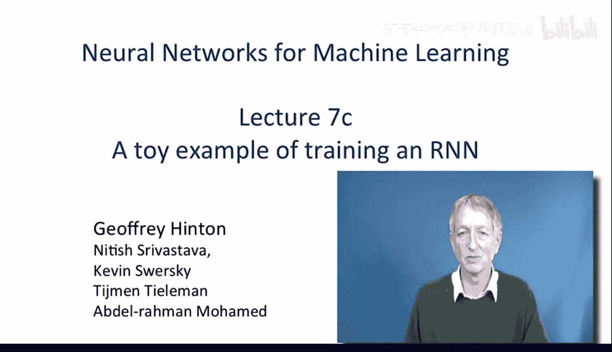
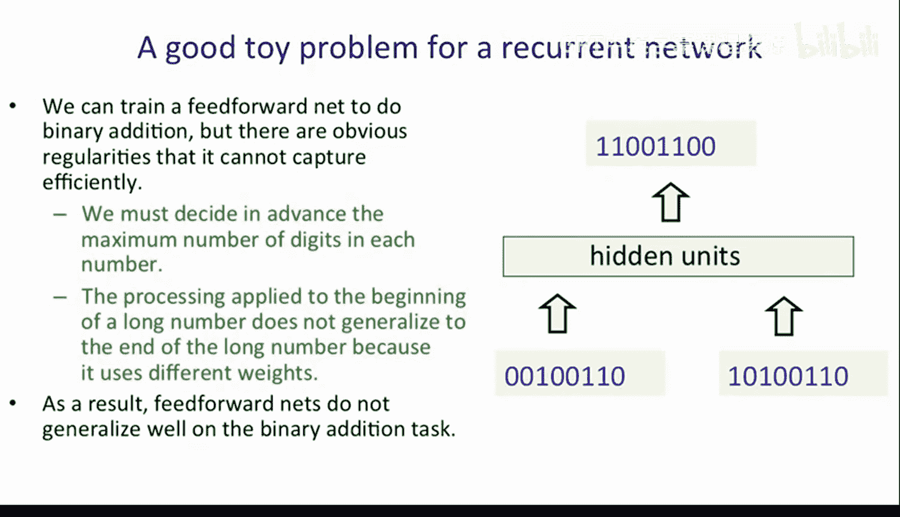
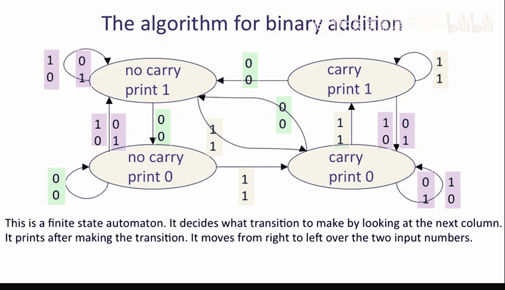
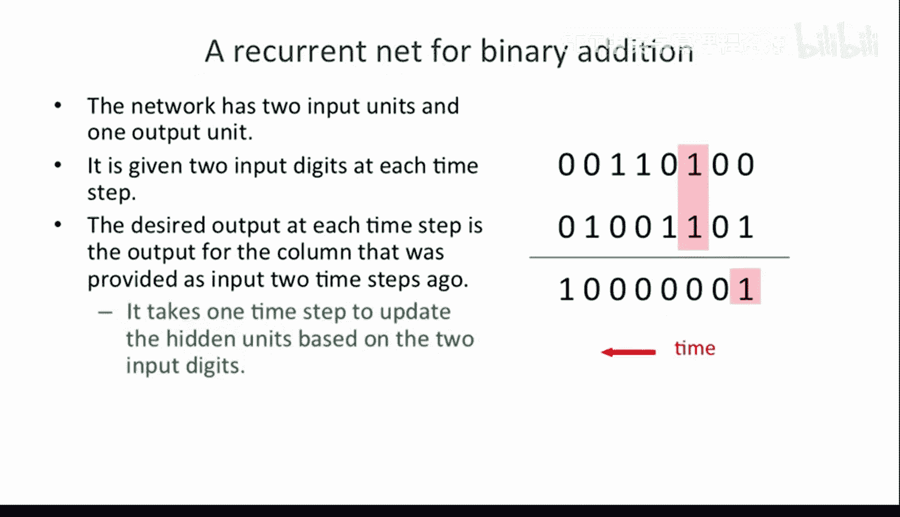
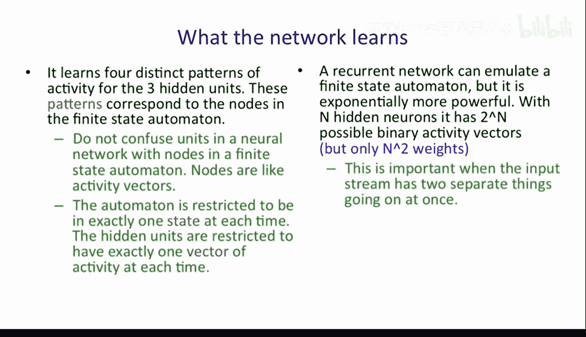

# 神经网络与机器学习：第7.3讲：循环神经网络训练示例 🧮

在本节课中，我们将学习循环神经网络如何解决一个简单的示例问题。这个示例旨在展示循环神经网络相对于前馈神经网络的优势。我们将以二进制加法为例，探讨RNN的工作原理，并分析其隐藏状态与有限状态自动机中状态的对应关系。

---

## 二进制加法问题

考虑两个二进制数相加的问题。理论上，我们可以训练一个前馈神经网络来完成这个任务。右侧的图表展示了一个接收输入并产生输出的网络结构。

然而，使用前馈神经网络存在一些问题。我们必须预先确定输入数字和输出数字的最大位数。更重要的是，我们对输入数字不同位的处理无法实现泛化。例如，当我们学习如何处理最后两位的加法及进位时，这些知识被编码在特定的权重中。在处理长二进制数的其他部分时，相同的知识需要由不同的权重来编码，因此无法实现自动泛化。

因此，尽管可以训练前馈神经网络使其最终学会对固定长度的数字进行二进制加法，但这并非一个优雅的解决方案。

---

## 二进制加法算法

下图展示了二进制加法的算法流程。图中显示的状态类似于隐马尔可夫模型中的状态，但它们并非完全隐藏。系统在任一时刻处于一个状态，进入状态时会执行一个动作，即输出一个1或0。当系统处于某个状态时，它会接收输入（即下一列的两个数字），该输入会使其进入一个新的状态。

例如，在右上角，系统处于进位状态并刚刚输出一个1。如果它看到输入为`(1, 1)`，它会保持在同一状态并再次输出一个1。如果它看到输入为`(1, 0)`或`(0, 1)`，它会进入进位状态但输出一个0。如果看到输入为`(0, 0)`，它会进入无进位状态并输出一个1，依此类推。

---

## 循环神经网络的结构

用于二进制加法的循环神经网络需要两个输入单元和一个输出单元。在每个时间步，它接收两个输入数字，并需要产生一个输出。输出对应的是它**两个时间步之前**接收的列的结果。

之所以需要两个时间步的延迟，是因为需要一个时间步来根据输入更新隐藏单元，另一个时间步来从隐藏状态生成输出。

因此，网络结构如下所示。我们只使用了三个隐藏单元，这足以完成任务。使用更多隐藏单元会学得更快，但三个也能完成。

三个隐藏单元完全互连，它们之间的连接是双向的，且权重不一定相同（通常确实不同）。隐藏单元之间的连接允许一个时间步的模式影响下一个时间步的隐藏活动模式。输入单元通过前馈连接连接到隐藏单元，这是它“看到”一列中两个数字的方式。同样，隐藏单元通过前馈连接连接到输出单元，从而产生输出。

---

## 学习到的模式与有限状态自动机

观察循环神经网络学习到的内容很有趣。它在三个隐藏单元中学会了四种不同的活动模式。这些模式对应于二进制加法有限状态自动机中的节点。

我们不应将神经网络中的单元与有限状态自动机中的节点混淆。有限状态自动机中的节点对应于循环神经网络的活动向量。自动机被限制为每次只处于一个状态。类似地，循环神经网络中的隐藏单元在每个时间点也只具有一个活动向量。

因此，循环神经网络可以模拟有限状态自动机，但其表示能力呈指数级增长。对于N个隐藏神经元，它有`2^N`个可能的二进制活动向量。当然，它只有`N^2`个权重，因此不一定能充分利用所有这些表示能力。但如果瓶颈在于表示，循环神经网络可以比有限状态自动机做得更好。这在输入流中同时存在两个独立事物时尤为重要。

---

## 表示能力的对比

有限状态自动机需要将其状态数量平方，以处理同时发生的两件事情。而循环神经网络只需要将其隐藏单元数量加倍。通过将单元数量加倍，它确实将其拥有的二进制向量状态数量平方了。

---

## 总结

本节课中，我们一起学习了循环神经网络如何通过一个二进制加法的玩具示例进行训练。我们探讨了其相对于前馈网络的优势，分析了其网络结构和工作原理，并将其隐藏状态与有限状态自动机的状态进行了对比，理解了循环神经网络在表示复杂、并发模式时的强大能力。