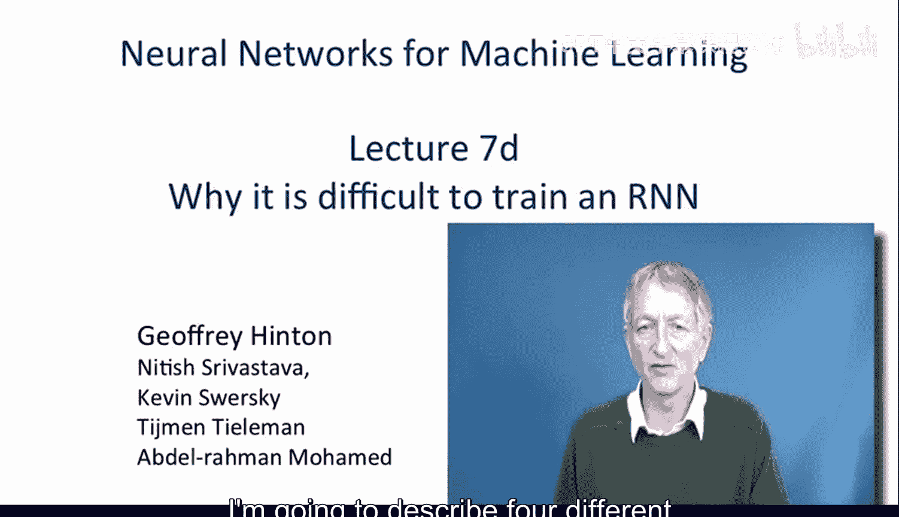
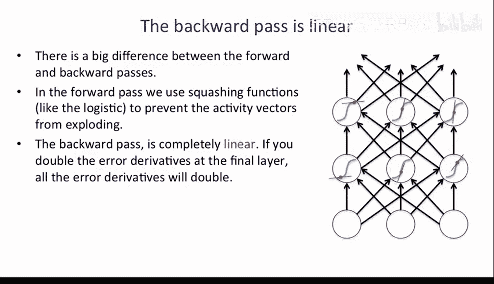
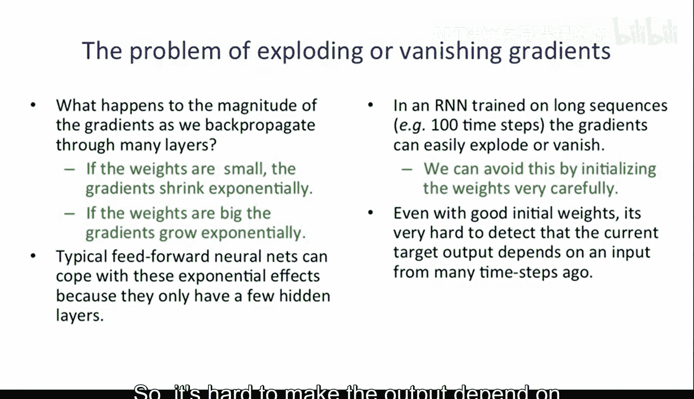
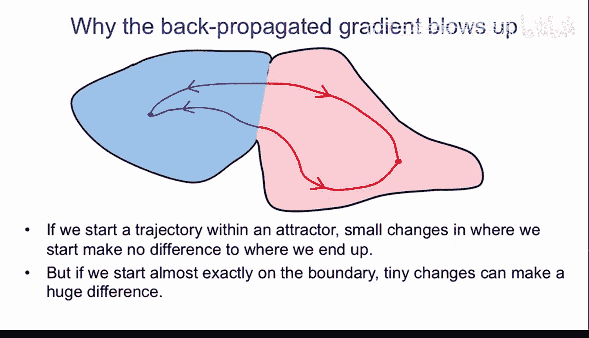
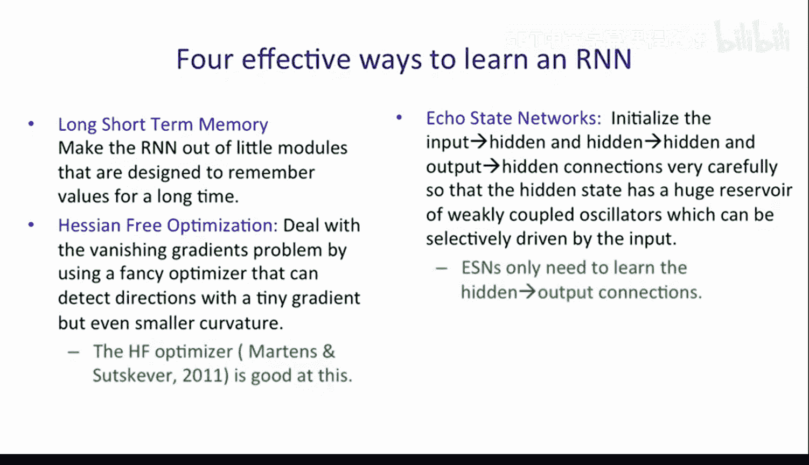

# Hinton@多伦多大学《机器学习的神经网络｜Neural Networks for Machine Learning 2016》claude-4s p33 -33-Lecture 7.4 — Why it is difficult to train an RNN_  -Neural Networks for Mac -BV1HtkUB2EZD_p33-

In this video。I'm going to talk about the exploding and vanishing ingredients problem。

Which is what makes it difficult to train recurrent neural networks。For many years。

 researchers in neural networks thought they would never be able to train these networks to model dependencies over long time periods。

But at the end of this video。I can describe four different ways in which that can now be done。

To understand why it's so difficult to train recurrent neural networks。

 we have to understand a very important difference between the forward and backward passes in a recurrent neural net。

In the forward pass， we use squashing functions like the logistic to prevent the activity vectors from exploding。

So if you look at the picture on the right， each neuron is using a logistic unit shown by that blue curve。

 and it can't output any value greater than  one or less than 0。So that stops explosions。

The backward pass， however， is completely linear。Most people find this very surprising。

If you double the errors ros at the final layer of this net。

All the a derivatives will double when you back propagate。

So if you look at the red dots that I put on the blue curves。

 well suppose those are the activity levels of the neurons on the forward pass。

And so when you back propagate， you're using the gradients of the blue curves at those red dots。

So the red lines are meant to tear the tangents to the blue curves at the red dots。

And once you finish the forward pass， the slope of that tangent is fixed。You now back propagate。

 and the back propagation is like going forwards through a linear system in which the slope of the linearity has been fixed。

Of course， each time you back propagate， the slopes will be different because they were determined by the forward pass。

But during the back propagation， it's a linear system。

 And so it suffers from a problem of linear systems， which is when you iterate。

 they tend to either explode or die。

So when we back propagate through many layers。If the weights are small。

 the gradients will shrink and become exponentially small。

 And that means that when you back propagate through time。

 gradients that are many steps earlier than the targets arrive will be tiny。Similarly。

 if the weights are big， the gradients will explode。

 and that means when you back propate through time。

 the gradients will get huge and wipe out all your knowledge。In a feet forward neural net。

 unless it's very deep。These problems aren't nearly as bad because we typically only have a few hidden layers。

But as soon as we have a recurrent neural network trained on a long sequence， for example。

100 times steps， then if the gradients are growing as we back propagate。

 we'll get whatever that growth rate is to the power of 100。 And if they're dying。

 we'll get whatever that decay is to the power of 100。And so they'll either explode or vanish。

We might be able to initialize the weights very carefully to avoid this。

 and more recent work shows that， indeed， careful initialization of the weights does make things work much better。

But even with good initial weights， it's hard to detect the dependency of the current output on an input from many time steps ago。

 So it's hard to make the output depend on things that happened a long time ago。

R NNs have difficulty dealing with long range dependencies。

Here's an example of exploding and dying gradients for a system that's trying to learn attractors。

So suppose we try and train a recurrent neural network so that whatever state we started in。

 it ends up in one of these two attractor states。So we're going to learn a blue basin of attraction and a pink basin of attraction。

And if we start anywhere within the blue basin of attraction， we will end up at the same point。

What that means is that small differences in our initial state make no difference to where we end up。

So the derivative of the final state with respect to changes in the initial state is0。

That's vanish ingredients。When we back propagate through the dynamics of this system。

 we'll discover there's no gradients for where you start。

And the same with the pink basin of attraction。If， however。

 we start very close to the boundary between the two attractors。

Then a tiny difference in where we start that's the other side of the watershed makes a huge difference to where we end up。

That's the exploding gradient problem。And so whenever you're trying to use a recurrent neural network to learn attractors like this。

 you're bound to get vanishing or exploding gradients。

It turns out there's at least four effective ways to learn a recurrent neural network。

The first is a method called long short term memory。 and I'll talk about that more in this lecture。

The idea is we actually change the architecture of the neural network to make it good at remembering things。

The second method is to use a much better optimizer that can deal with very small gradients。

I'll talk about that， in the next lecture。The real problem in optimization。

East to detect small gradients that have an even smaller curvature。

Hessian free optimization tailored to neural nets， is good at doing that。

The third method really kind of evades the problem。

What we do is we carefully initialize the input to hidden weights。

 and we very carefully initialize the hidden to hidden weights and also feedback weights from the outputs to the hidden units。

And the idea of this careful initialization。Is to make sure that the hidden state has a huge reservoir of weakly coupled oscillators。

So if you hit it with an input sequence， it'll reverberate for a long time。

And those reverberations are remembering what happened in the input sequence。

You then try and couple those reverberations to the output you want。

And so the only thing that learns in an echostate network。

Is the connections between the hidden units and the outputs。 And if the output units are linear。

That's very easy to train。So this hasn't really learned the recurrent bit。Is used a fixed。

 random recurrent bit， but a carefully chosen one， and then just learned the hidden out connections。

And the final method is to use momentum。But to use momentum with the kind of initialization that was being used for echostate networks。

 And that makes them work even better。So it was very clever to find out how to initialize these recurrent networks so they'd have interesting dynamics。

But they work even better if you now modify that dynamic slightly in the direction that will help with the task at hand。

