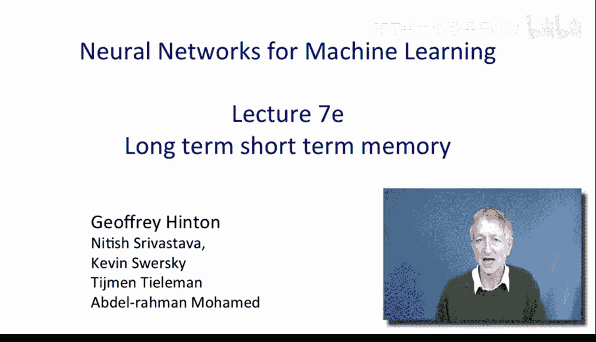
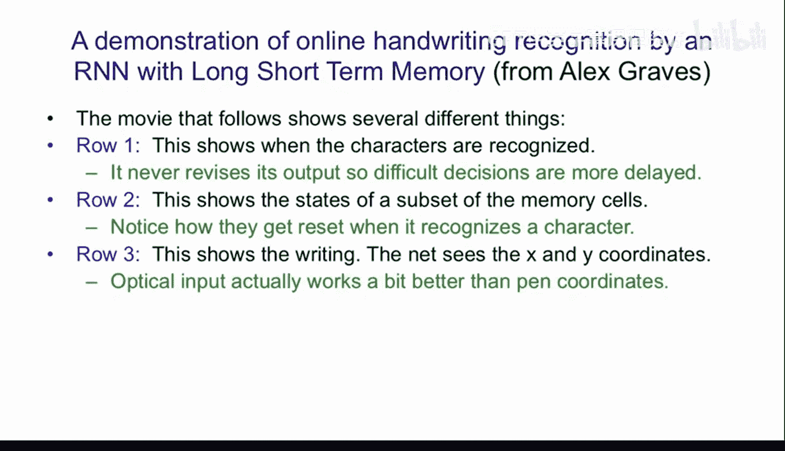
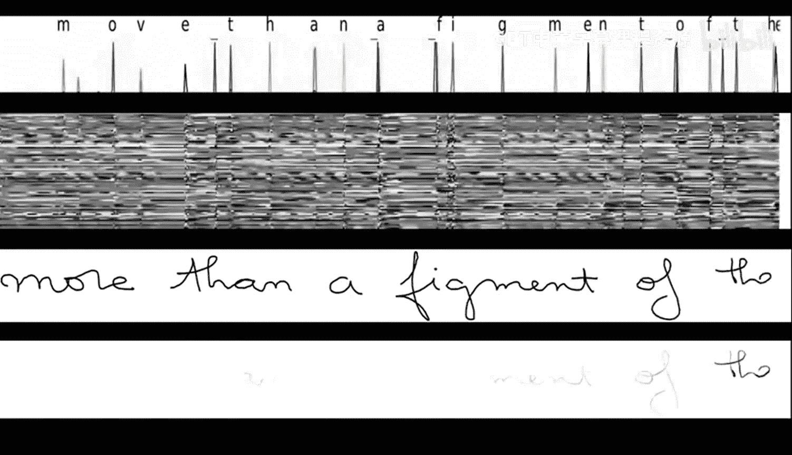

# Hinton@多伦多大学《机器学习的神经网络｜Neural Networks for Machine Learning 2016》claude-4s p34 -34-Lecture 7.5 — Long term Short term memory -Neural Networks for Machine Learn -BV1HtkUB2EZD_p34-

In this video。I'm going to describe an approach to training recurrent neural networks that's called long short term memory。

You can consider the dynamic state of a neural network to be a short term memory。

And the idea is we want to make that short term memory last for a long time。

This is done by creating special modules that are designed to allow information to be gated in。

And then information to be gated out when needed。And in the intermediate period。

 the gate is closed so that stuff that arrives in the intermediate period doesn't interfere with the remembered state。

Long short term memory has been very successful for tasks like recognizing handwriting。

 where it's won a number of competitions。😊。

In 1997， Hoch writer and Schmidt Hoer published a paper in neural computation that solved the problem of getting a recurrent neural network to remember things for a long time。

Their occurrencecurrent nets could remember things for hundreds of time steps。

 They did this by designing a memory cell that used logistic and linear units with multiplicative interactions。

So， information gets into the memory cell。Whenever a logistic right gate is turned on。

The rest of the recurrent network determines the state of that right gate。

 And when the rest of the recurrent network wants information to be stored。

 it turns the right gate on。 and whatever the current input from the rest of the net to the memory cell is gets stored in the memory cell。

The information stays in the memory cell so long as its keep gate is on。So again。

 the rest of the system is determining the state of a logistic keep gate。 And if it keeps it on。

 then the information will sta there。And finally， the information gets read from the memory cell。

So that it then goes off to the rest of the recurrent neural network and influences future states。

And it's read by turning on a reed gate， which， again。

 is a logistic unit controlled by the rest of the neural network。The memory cell。

Actually stores an analog value。 so we can think of it as a linear neuron that has an analog value and keeps writing that value to itself at each time step via a weight of one。

 So the information just stays there。The weight of one is determined by a keep gate。

 So the rest of the system determines the state of that logistic keep gate。

 And if it puts it into a state of one or close to one， the information just cycles around。

 and that value of 1。73 will stay there。As soon as the rest of the system wants to get rid of that value。

 all it has to do is set the keep gate to have a value of 0， and the information will disappear。

To store the information in the memory cell。The rest of the system has to turn on the right gate。

And then whatever input is being provided to the memory cell from the rest of the system will get written into the memory cell。

Similarly to read the information from the memory cell。

 the rest of the system turns on the logistic readgate。

And then the value in the memory cell comes out and affects the rest of the recurrent neural network。

The point of using logistic units。Is that we can back propagate through them because they have nice derivatives。

And that means we can learn to use this kind of circuit over many time steps。

So I'm gonna show you now a picture of what back propagation through a memory cell looks like。First。

 we're going to do a forward pass。So at the initial time。

 let's suppose that the keep gate was set to zero， so we wiped out whatever information was in the memory cell before。

And the right gate is set to one。So the value of 1。

7 that is coming from the rest of the recurrent neural network gets written into the memory cell。

And we're not going to read it at this time。 So the regate set to 0。We then set the keep gate to one。

 or rather， the rest of the neural network has to set the keep gate to one。

And that means that the value is written back into the memory cell。 It's stored。

At the next time step。We going to set the right gate to 0 and the regate to 0。

 So the information isn't influenced by what's going on in the rest of the net。

 and it doesn't influence what's going on in the rest of the net。 It's insulated。Again。

 at the next time step。The keep gate is set to one。

 so the information is stored for one more time step。And then。We're going set the right gate to at 0。

 So no information is written in。But we're now going to retrieve the information by setting the reedgate to one。

The value of 1。7 then comes out of the memory cell and goes off to influence the rest of the network。

And if we don't need it any more。Then the keep gate can be set to0。

 and the information will be removed。Now， if you look at the 1。

7 that comes out when we do the retrieve。And you look at the path back to the 1。7 that came in。

Along that path， there's these little triangular symbols。 And next to each triangular symbol。

 there's a one。That means that。The effective weight on that connection is a one。

So as we go back along that path， whatever error derivative we have for the 1。

7 when it's retrieved gets back propagated to the 1。7 when it's stored。

So if you'd rather have retrieved a bigger value to make the right things happen now。

You can send the information back and tell that it should have stored a bigger value。

And notice that as long as the relevant gates have values of one。

 there's no attenuation in this back propated signal。 It's got just the properties we want。

 Of course， if they're logistic gates， there will be some slight attenuation。

 but it can be very small， and so information can travel back through hundreds of time steps。Now。

 let's look at a task that a recurrent neural network with long short term memory is very good at。

It's a very natural task for our current neural network。 It's reading cursive handwriting。

The input is just a sequence of the X and Y coordinates of the tip of the pen。Plus。

 some information about whether the pen is on the paper or not。

The output is going to be a sequence of recognized characters。

Graves and Schchmidt Hoop in 2009 showed that recurrent neural networks with long。

 short term memory are extremely good at this task。 So far as I know。

 they're currently the best systems there are。And I believe Canada Post is starting to use them for reading。

 handwriting。Graceson Schmidt who， in 2009。Didn't use pen coordinates as input。

 They used a sequence of small images。And that means they can deal with optical input where the timing of the pen isn't known。

They can look at images after they've been written and read them。

So I'm now going to show you a demonstration of Alex graverave system。Working on pen coordinates。

And in the movie that follows， you're going to see four streams of information。

The top row shows the characters， as they're recognized。The system never revises its output。

 So if it has to make a difficult decision， it delays it for a little bit so that it can see a little distance into the future to help it resolve ambiguities。

The second row shows the states of a subset of the memory cells。

And you should notice how they get reset when it recognises a character。

The third row shows the actual writing。And all the net sees is the X and Y coordinateance of the tip of the pen。

 just two numbers。 plus some information about whether the pen is up or down。

Finally， the fourth row shows something much more complicated。

It shows the gradient back propagated all the way to the X， Y locations。

 So what you get to see is for the most active character。If you back propagate from that character。

And ask what would make that most active character more active。

 You get to see which bits of the input are affecting the probability that it's that character。

 So that lets you see how the decisions are depending on things that happened in the past。So。

 here's the movie。

