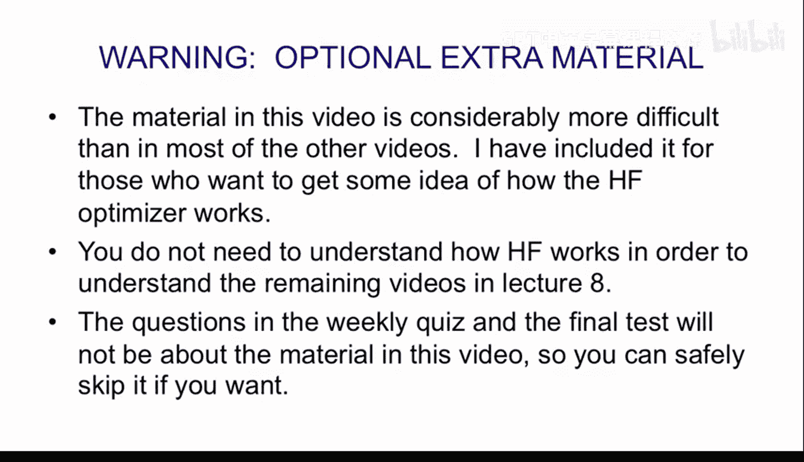
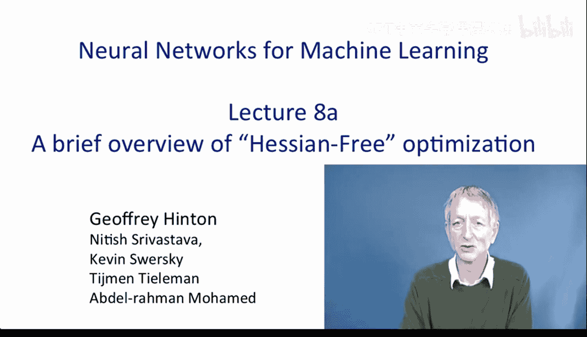
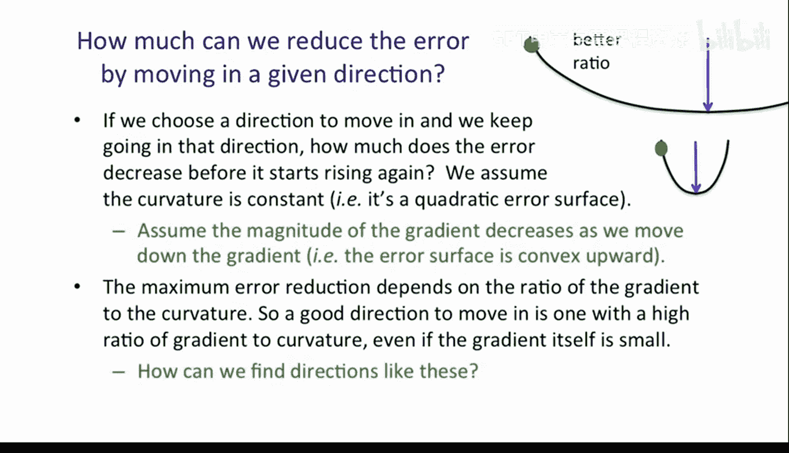
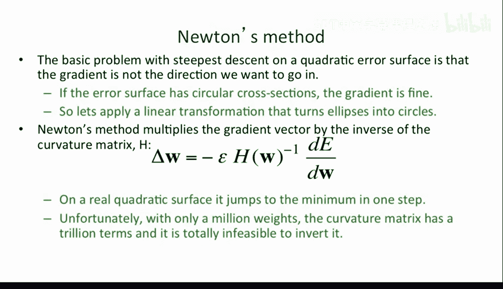
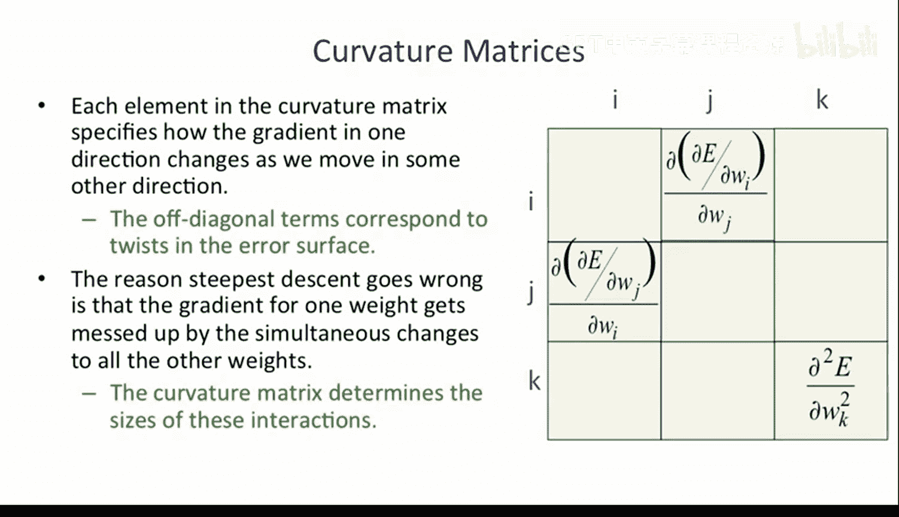
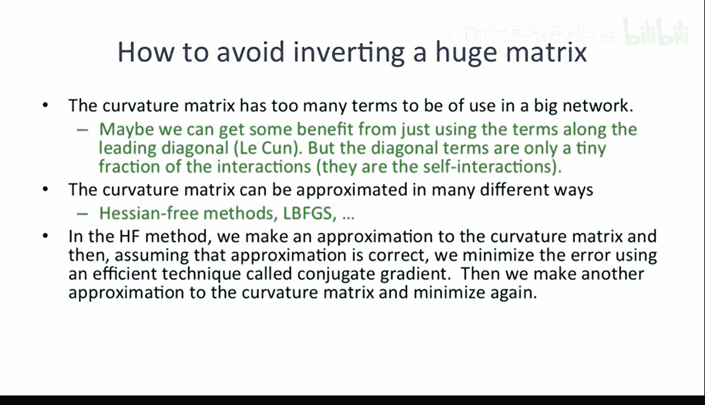
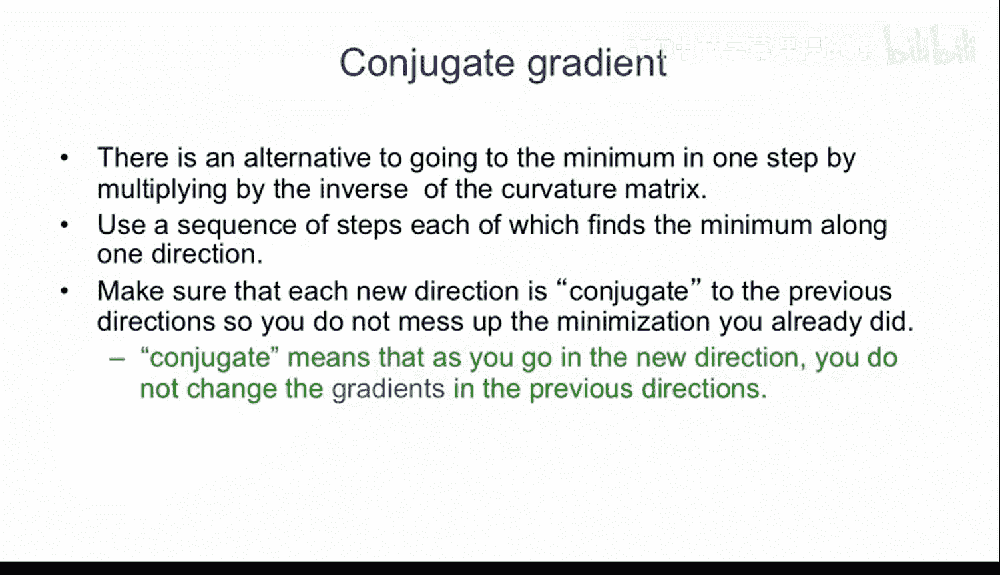
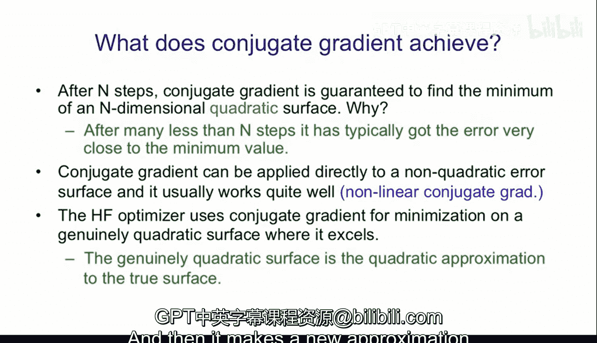

# Hinton@多伦多大学《机器学习的神经网络｜Neural Networks for Machine Learning 2016》claude-4s p35 -35-Lecture 8.1 — A brief overview of Hessian-free optimization  -Neural Network -BV1HtkUB2EZD_p35-

In this video， I'm going to give a brief overview of the Hessian free Opr that can be used to train recurrent neural networks very effectively。

This is a very complicated optimizer， and I don't expect you to get all the details of it from this video。

I just want you to have a general feel for how it works。And then in the next video。

 we'll see how well it does on an interesting problem。

When we're training the weights of a neural network。

We're trying to get as far down the error surface as possible。So one question is。

 if we choose a given direction to go in， how much reduction in the error can we achieve by going just the right distance in that direction。

How much does the error decrease before it starts rising again？

And here we assume that the curvage is constant。I will assume it really is a quadratic error surface。

We can assume that the magnitude of the gradient decreases as we move down the gradient。

That amounts to assuming that the air surface is concave upward， like a bowl。

The maximum reduction that we can get in the error by going in a particular direction depends on the ratio of the gradient to the curvature。

So we want to move in directions that have a good ratio。Even if the gradient is quite small。

 we want the curvature to be even smaller。So here's an example of a direction we could move in。

Where the vertical axis corresponds to the error， the horizontal axis corresponds to the weights in the direction we're moving in。

 and the blue arrow corresponds to the reduction we get If we start at that red point。

Here's a surface that has a gentler gradient。 But because it's got a better ratio of the gradient to the curvature。

 we get a bigger reduction in the error by the time we get to the minimum。The question is。

 how can we find directions like that second one， directions in which。

 even though the gradient may be small， the curvature is even smaller。

So let's start with Newton's method。Newton's method addresses the basic problem with steepest descent。

 which is that the gradient isn't the direction you really want to go in。

If the a surface has circular cross sections， and it' quadratic。

The gradient is a good direction to go in。 It'll point straight at the minimum。

So the idea of Newton's method is to apply a linear transformation that turns ellipses into circles。

If we apply that transformation to the gradient vector。

 it will be as if we were going downhill in a circular error surface。To do this。

 we need to multiply the gradient to E by GW。By the inverse of the curvature matrix。

 So H is the curvature matrix， sometimes called dehessian。It's a function of the weights we have。

And we need to take its inverse and multiply the gradient by that。

Then we need to go some distance in that direction。If it's a truly quadratic surface。

 then we choose Epsilon correctly。Which is quite easy to do。

Well arrive at the minimum of the surface， in a single step。Of course。

 that single step involved something complicated， which was inverting that Hessian matrix。

The problem with this is that even if we only have a million weights in our neural network。

The curvature matrix， the Hessian。Will have a trillion terms。

 It's completely infeasible to invert it。

So curvature matrices look like this。For each weight， W I or W J。

They tell you how the gradient in one direction changes as you change in another direction。

In other words， as I change weight I。How does the gradient of the error with respect to weight J change。

That's what a typical off diagonal term tells you。The terms on the diagonal tell you how the gradient of the error changes in the direction of a weight as you change that weight。

So， the off diagonal terms。In a curvature matrix correspond to twists in thearrow surface。

A twist means when you travel in one direction， the gradient in another direction changes。

If we have a nice circular bowl， all those off diagonal terms are 0。As we travel in one direction。

 the gradient in other directions doesn't change。So what's going wrong with steepest descent when you have an elliptical error surface。

Is that as we travel in one direction， the gradient in another direction changes。

And so if I update one of the weights at the same time as I' am updating all the other weights。

All those other updates will cause a change in the gradient for the first weight。

 And that means when I update it， I may actually make things worse。

 The gradient may have actually reversed sign due to the changes in all the other weights。

And so as we get more and more weights， we need to be more and more cautious about changing each one of them。

 because the simultaneous changes in all the other weights can change the gradient of a weight。

The curvature matrix determines the size of those interactions。

So we have to deal with the curvature。 We can't just ignore it。

 And we'd like to deal with it without actually inverting a huge matrix。

Because the matrix has too many terms in a big neural mat。

One thing we can do is to just look at the leading diagonal of the curvature matrix and make our step size depend on that leading diagonal。

That helps a bit。It will get us to make different step sizes for different weights。

But the diagonal terms is only a tiny fraction of the interactions。

 So we're ignoring most of the terms in the curvature matrix when we do that。 In fact。

 we're ignoring nearly all of them。Another thing we could do is try and approximate the curvature matrix with a matrix of much lower rank that captures the main aspects of the curvature matrix。

Buts what's done in Hessem free methods and L B FGS and many other methods that try and do an approximate second order method for minimizing the error。

In the Hessum free method， we make an approximation to the curvature matrix。

 and then we assume that the approximation is correct。

So we assume we know what the curvature is and that the error surface really is quadratic。

And then starting from wherever we are now， we minimize the error using an efficient technique called conjugate gradient。

Once we've done that， once we got close to a minimum on this approximation to the curvature。

We then make another approximation to the curvature matrix。

 and we use conjugate gradient to minimize again。

It's also important in recurrent neural networks。Tide a penalty for changing any of the hidden activities too much。

 that will prevent us， for example， from changing a weight early on that causes huge effects later on in the sequence。

We don't want to get effects that are too big。 And if we look at the changes in the hidden activities。

 we can prevent that by penalising those changes。If we put a quadratic penalty on those changes。

 we can combine that with the rest of the Hessem free method。

The last thing I need to explain is conjugate gradient。 And I'm just going to explain that briefly。

Conjugate gradient is a very clever method that instead of trying to go straight to the minimum。

 like in Newton's method， tries to minimize in one direction at a time。

So it starts off by taking the direction of steepest descent and goes to the minimum in that direction。

That might involve reevaluating the gradient or reevaluating the error a few times to find the minimum in that direction。

Once it's done that， it now finds another direction and goes to the minimum in that second direction。

The clever thing about the technique is it chooses its second direction in such a way that it doesn't mess up the minimization it already did in the first direction。

That's called a conjugate direction。Conjugate means that as you go in the new direction。

 you don't change the gradients in the previous directions。It's a funny idea。

 It's like the idea of a twist in an narrow surface。 A twist means when you go in one direction。

 you change the gradient in another direction。And a conjugate direction is one you can go in that。

 in a sense， doesn't have a twist。 You go in that direction。

 and the gradient in the first direction doesn't change。

So here's a picture of an aipse。And the red line is the major axis of the elect。

We start off by doing one step of steepest descent all the way to the minimum in that direction。

And if you think about it a bit。You can see that the minimum won't actually lie on the red line。

On the red line， the gradient will be 0 at right angles to that red line。

 because it's the bottom of the ravine。But the direction we're going in isn't actually at right angles to that。

We can make a little bit more progress by making a small step at right angles， to the red line。

And then a small step along the red line。Since the red line sloped down towards the middle of the ellipse。

 that's going to make some progress for us。So when we minimize in the first direction。

 we'll go slightly across the bottom of the else。And when we reach that point， there's a minimum。

There's an interesting property of all the points that lie on the green line。On that green line。

 the gradient in the direction of that black arrow is 0。So we can go anywhere along that green line。

And we won't destroy the fact。That we're at a minimum in the direction of the black arrow。

If we can keep doing that for many directions。In a high dimensional error surface。

Will eventually be at a minimum in many different directions。

And if we're at a minimum in as many different directions as there are dimensions in the space well be at the global minimum。

So we take this first step of steepest descent。We then figure out。

 and I'm not going to explain how we do that。 We figure out the direction of that green line。

And then we do a search along the green line to find how far we should go。

In order to minimize the error along the green line， and we take our second step。Like this。And now。

 in this two dimensional space。Will be at the minimum。

Because we're at the minimum in the direction of the first step。

 and we're now at a minimum in the direction of the second step。

 while still being at a minimum in the direction of the first step。

And so that must be the global minimum。What conjugate gradient into achieves is that it gets to the global minimum of an n dimensional quadratic surface in only N steps。

 It's very efficient。It does that because it manages to get the gradient to be 0 in n different directions。

They're not orthogonnal directions， but they are independent of one another。

 And so that's sufficient to be at the global minimum。More importantly。

In many less than end steps on a typical quadratic surface。

It will have reduced the error very close to the minimum value。And that's why we use it。

We're not going to do the full end steps。 That would be as expensive as inverting the whole matrix。

We're going to do many less than end steps， and we're going to get quite close to the minimum。

You can apply conjuggate gradient directly to a non quadratic error surface。

 like the error surface for a multi layerir nonlinear neural net。And it usually works quite well。

It's essentially a batch method， but you can apply it to large mini batches。 And when you do that。

 you do many steps of conjugate gradient on the same large mini batch。

 And then you move on to the next large mini batch。That's called non nonlinear conjuggate gradient。

The hessum free optr uses conjugate gradient for minimization on a genuinely quadratic surface。

 And that's what conjugate gradient is best at。 He works much better for that than for a no nonlinear surface。

This genuinely quadratic surface that H F is using it for is the quadratic approximation to the true surface that was made by the Hessian free method。

So， it makes that approximation。It uses conjuggate gradient to get close to a minimum for the first approximation。

And then it makes a new approximation to the curvature and does it again。

