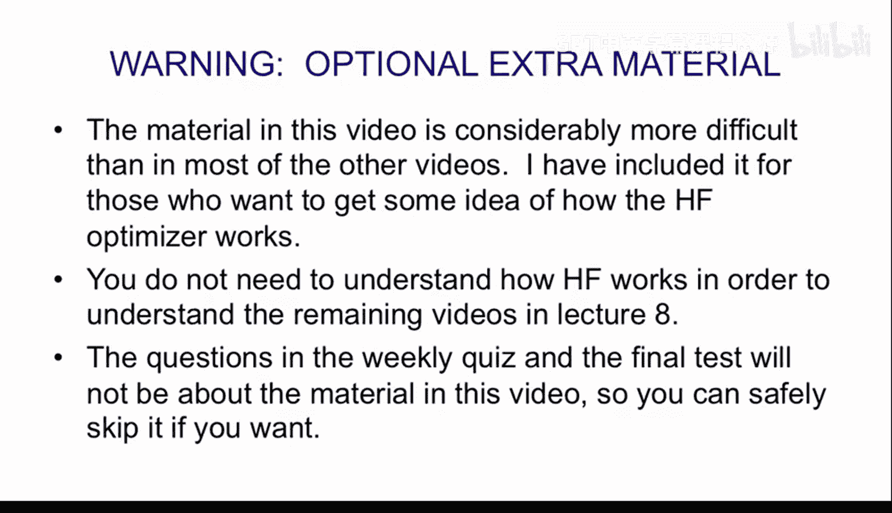
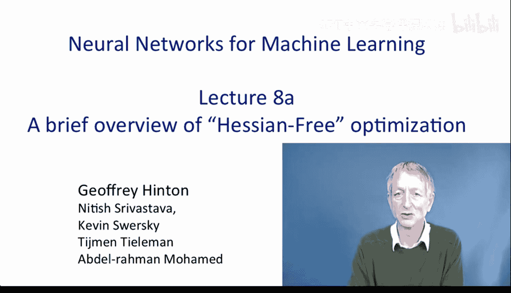
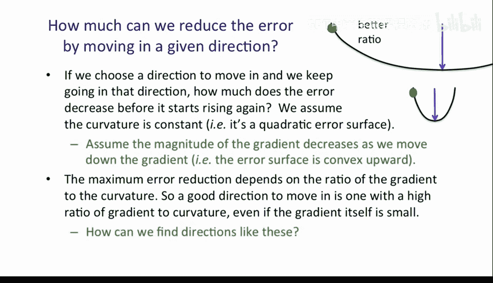
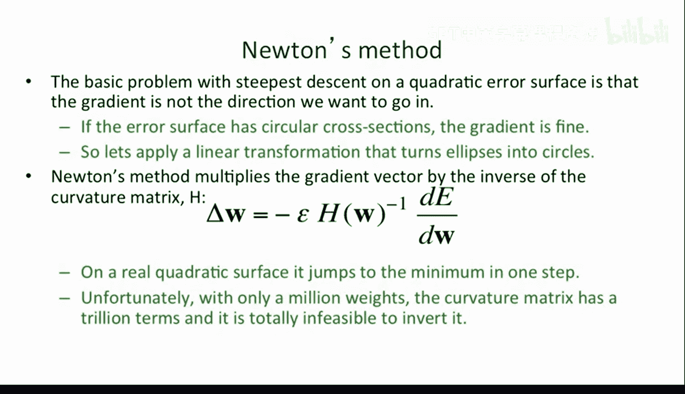
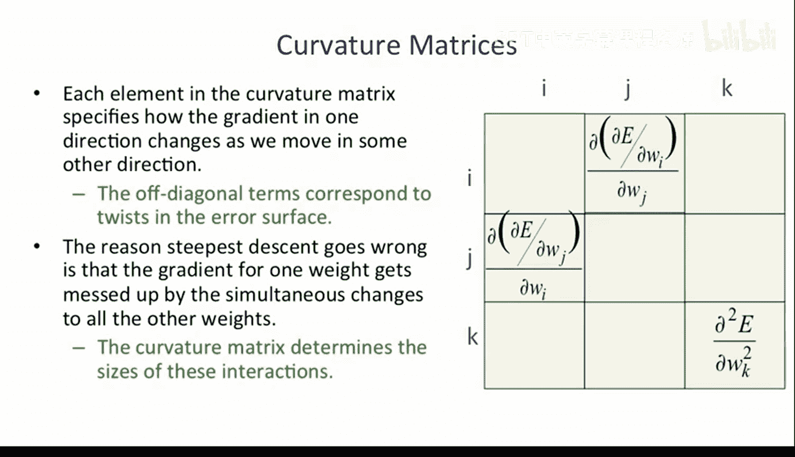
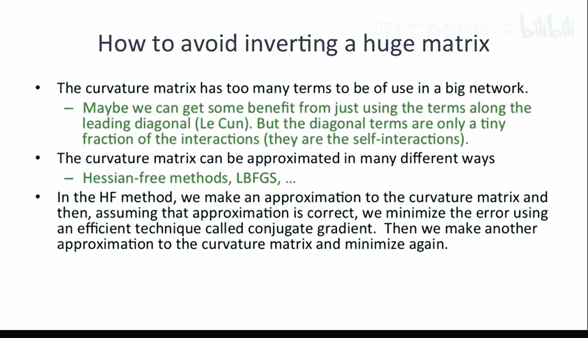
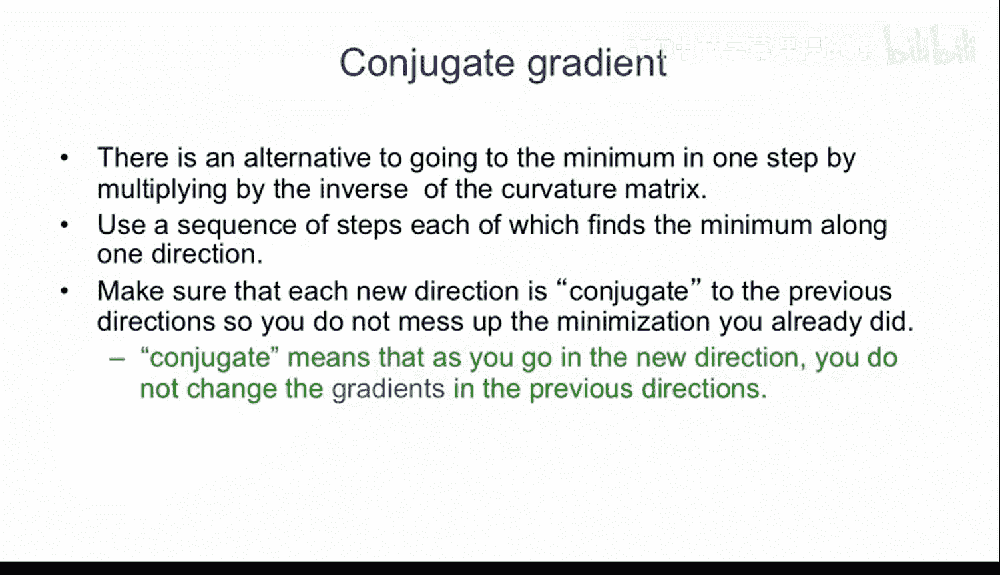
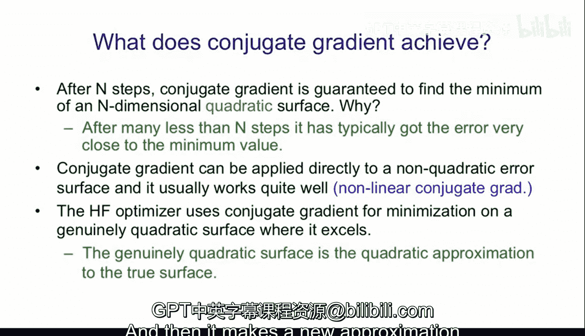

# 神经网络与机器学习：第8.1讲：Hessian-Free优化方法概述 🧠

在本节课中，我们将学习一种名为Hessian-Free的优化方法，它能够非常有效地训练循环神经网络。这是一种非常复杂的优化器，我们不期望你通过这个视频掌握所有细节，但希望你能对其工作原理有一个总体的了解。在下一讲中，我们将看到它在解决一个有趣问题上的表现。

## 优化目标与方向选择 📈

当我们训练神经网络的权重时，目标是尽可能降低误差曲面上的值。一个关键问题是：如果我们选择了一个特定的移动方向，沿着这个方向移动合适的距离，误差能减少多少？在误差开始回升之前，误差能下降多少？

这里我们假设曲率是恒定的，即误差曲面确实是二次的。我们可以假设梯度的幅度会随着我们沿着梯度方向移动而减小，这相当于假设误差曲面是向上凹的，像一个碗。

通过沿特定方向移动所能获得的最大误差减少量，取决于**梯度与曲率的比值**。因此，我们希望移动到那些具有良好比值的方向上。即使梯度很小，我们也希望曲率更小。

以下是两个方向的例子：
*   **方向一**：梯度较大，但曲率也较大，导致误差减少有限。
*   **方向二**：梯度较平缓，但由于梯度与曲率的比值更好，到达最小值时误差减少得更多。

问题在于，我们如何找到像第二个那样的方向？在这些方向上，即使梯度可能很小，曲率却更小。

## 牛顿法及其挑战 ⚙️

上一节我们讨论了方向选择的重要性，本节中我们来看看牛顿法。牛顿法解决了梯度下降的一个基本问题：梯度方向并不总是你真正想移动的方向。

如果误差曲面具有圆形横截面且是二次的，那么梯度就是一个好的移动方向，它会直接指向最小值。牛顿法的思想是应用一个线性变换，将椭圆变成圆形。如果我们对这个变换后的梯度向量进行操作，就好像我们在一个圆形的误差曲面上向下移动。

为了实现这一点，我们需要将误差E关于权重W的梯度乘以曲率矩阵的逆。这里，**H** 是曲率矩阵，有时也称为Hessian矩阵。它是我们当前权重的函数。我们需要取其逆矩阵，并用它乘以梯度。

然后，我们需要沿着这个方向移动一段距离。如果是一个真正的二次曲面，我们可以很容易地选择正确的步长 **ε**，从而一步就到达曲面的最小值。

当然，这一步涉及复杂的操作，即**求那个巨大的Hessian矩阵的逆**。问题在于，即使我们的神经网络只有一百万个权重，曲率矩阵（Hessian）也将有一万亿个项，完全无法求逆。

## 理解曲率矩阵 🔄

曲率矩阵看起来是这样的。对于每一对权重 **W_i** 和 **W_j**，它告诉你一个方向上的梯度如何随着你在另一个方向上移动而变化。换句话说，当我改变权重 **i** 时，误差关于权重 **j** 的梯度如何变化？这就是典型的非对角线项告诉你的信息。

对角线项则告诉你，当你改变某个权重时，误差在该权重方向上的梯度如何变化。因此，曲率矩阵中的非对角线项对应于误差曲面中的“扭曲”。扭曲意味着当你沿一个方向移动时，另一个方向上的梯度会发生变化。

如果我们有一个漂亮的圆形碗，所有这些非对角线项都是0。当我们沿一个方向移动时，其他方向上的梯度不会改变。所以，当你在一个椭圆形误差曲面上使用最速下降法时，问题在于：当你沿一个方向移动时，另一个方向上的梯度会发生变化。

因此，如果我在更新所有权重的同时更新其中一个权重，所有其他权重的更新都会导致第一个权重的梯度发生变化。这意味着当我更新它时，我实际上可能使情况变得更糟——由于所有其他权重的变化，梯度实际上可能已经反号了。随着我们拥有越来越多的权重，我们需要对改变每一个权重都越来越谨慎，因为所有其他权重的同时变化会改变一个权重的梯度。曲率矩阵决定了这些相互作用的强度。

## Hessian-Free方法的思路 💡

既然我们必须处理曲率，不能忽视它，但又无法实际求逆一个巨大的矩阵，我们该怎么办？

一种方法是只关注曲率矩阵的主对角线，并根据该对角线调整我们的步长。这有一点帮助，能使我们对不同的权重使用不同的步长。但**对角线项只是相互作用中的一小部分**，当我们这样做时，我们忽略了曲率矩阵中的大部分项，事实上，我们忽略了几乎所有的项。

另一种方法是尝试用一个**低秩矩阵来近似曲率矩阵**，以捕捉曲率矩阵的主要特征。这就是Hessian-Free方法、L-BFGS以及许多其他试图使用近似二阶方法来最小化误差的方法所做的事情。

在Hessian-Free方法中，我们对曲率矩阵做一个近似，并假设这个近似是正确的。因此，我们假设我们知道曲率是多少，并且误差曲面确实是二次的。然后，从我们当前所在位置开始，我们使用一种称为**共轭梯度**的高效技术来最小化误差。一旦我们完成了这一步，即在这个近似的曲率上接近了一个最小值，我们就对曲率矩阵做另一个近似，并再次使用共轭梯度进行最小化。

## 共轭梯度法简介 🧭

现在我们需要解释一下共轭梯度法。我将简要地解释一下。

共轭梯度法是一种非常聪明的方法，它不像牛顿法那样试图直接到达最小值，而是**一次在一个方向上最小化**。

它首先沿着最速下降的方向，并移动到该方向上的最小值。这可能涉及多次重新评估梯度或误差，以找到该方向上的最小值。完成这一步后，它找到另一个方向，并移动到第二个方向上的最小值。

这项技术的巧妙之处在于，它选择第二个方向的方式不会破坏它已经在第一个方向上完成的最小化。这被称为**共轭方向**。“共轭”意味着当你沿着新方向移动时，你不会改变先前方向上的梯度。这是一个有趣的概念，类似于误差曲面中“扭曲”的想法。扭曲意味着当你沿一个方向移动时，你会改变另一个方向上的梯度。而共轭方向是你可以沿着移动的方向，在某种意义上没有扭曲——你沿着那个方向移动，第一个方向上的梯度不会改变。

## 共轭梯度法的工作原理 🎯

这是一个椭圆的图示。红线是椭圆的长轴。我们首先沿着最速下降方向做一步，一直移动到该方向上的最小值。稍微思考一下，你会发现最小值实际上并不在红线上。在红线上，梯度在垂直于红线的方向上为0，因为那是谷底。但我们移动的方向实际上并不垂直于红线。

我们可以通过沿着垂直于红线方向做一小步，然后再沿着红线方向做一小步，来取得更多进展。由于红线向椭圆的中心倾斜，这将为我们带来一些进展。因此，当我们在第一个方向上最小化时，我们会稍微穿过椭圆的底部。当我们到达那个点时，存在一个最小值。

绿线上的所有点都有一个有趣的性质：在该绿线上，沿着黑色箭头方向的梯度为0。因此，我们可以沿着那条绿线移动到任何位置，而不会破坏我们在黑色箭头方向上已达到最小值的事实。

如果我们在许多方向上都能做到这一点，在一个高维误差曲面上，我们最终将在许多不同的方向上达到最小值。如果我们在与空间维度数量一样多的不同方向上达到最小值，那么我们就处于全局最小值。

因此，我们采取最速下降的第一步。然后我们计算出（这里不解释如何计算）那条绿线的方向。接着，我们沿着绿线搜索，以找到我们应该移动多远，从而最小化绿线上的误差，然后我们采取第二步。现在，在这个二维空间中，我们将处于最小值。因为我们在第一步的方向上处于最小值，并且现在我们在第二步的方向上也处于最小值，同时仍然保持在第一步方向上的最小值。所以那必定是全局最小值。

共轭梯度法实现的是：它只需 **N步** 就能到达一个N维二次曲面的全局最小值，非常高效。它之所以能做到这一点，是因为它设法让梯度在N个不同的方向上为0。这些方向不是正交的，但它们是彼此独立的，这足以达到全局最小值。

更重要的是，在一个典型的二次曲面上，**远少于N步** 就能将误差降低到非常接近最小值。这就是我们使用它的原因。我们不会做完整的N步，那将和求逆整个矩阵一样昂贵。我们将做远少于N步的迭代，并相当接近最小值。

## 在神经网络中的应用 🔗

你可以将共轭梯度法直接应用于非线性多层神经网络的非二次误差曲面，它通常效果很好。它本质上是一种批量方法，但你可以将其应用于大型小批量。当你这样做时，你在同一个大型小批量上执行多次共轭梯度步骤，然后转到下一个大型小批量。这被称为非线性共轭梯度。

Hessian-Free优化器使用共轭梯度在**一个真正的二次曲面**上进行最小化，而这是共轭梯度最擅长的。对于这种任务，它比用于非线性曲面时效果要好得多。Hessian-Free方法所使用的这个真正的二次曲面，正是它对真实曲面所做的二次近似。

因此，它的流程是：先做出那个近似，然后使用共轭梯度在第一个近似上接近最小值，接着对曲率做出新的近似，并再次重复这个过程。

---

本节课中我们一起学习了Hessian-Free优化方法的核心思想。我们了解到，直接使用牛顿法处理高维神经网络的曲率矩阵是不可行的。Hessian-Free方法通过**低秩近似曲率矩阵**，并利用**共轭梯度法**在这个近似的二次曲面上高效寻找下降方向，从而巧妙地规避了直接求逆巨大Hessian矩阵的难题。这种方法特别适合训练像循环神经网络这样复杂的模型。在下一讲中，我们将看到它在实际问题上的具体表现。