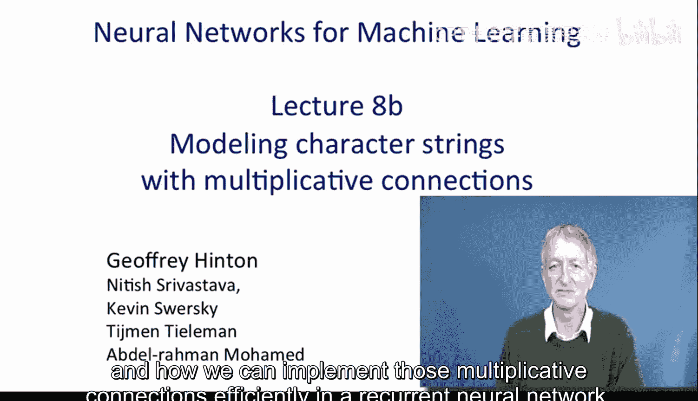
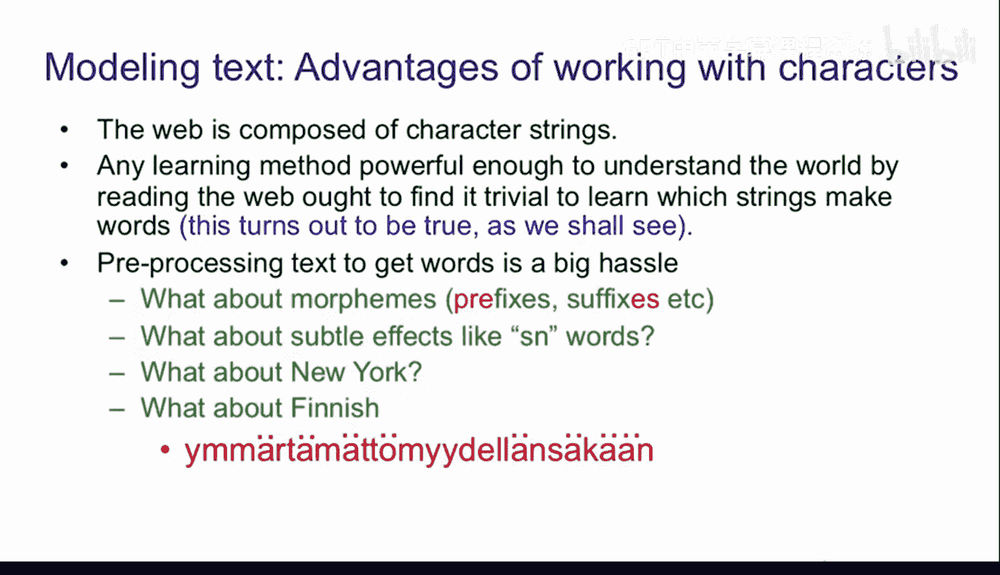
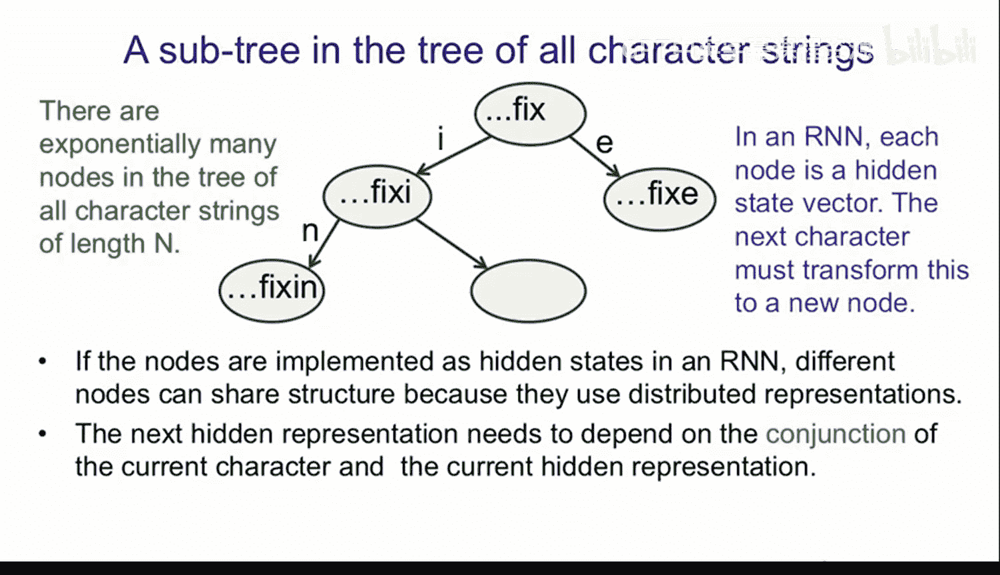
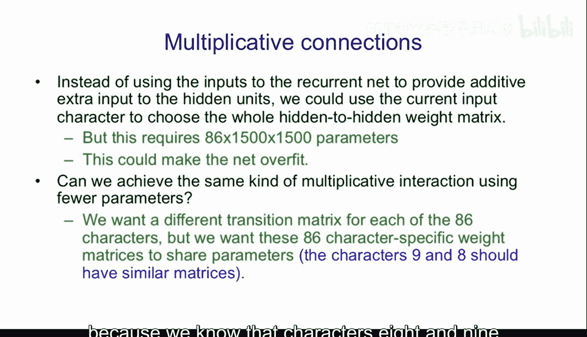
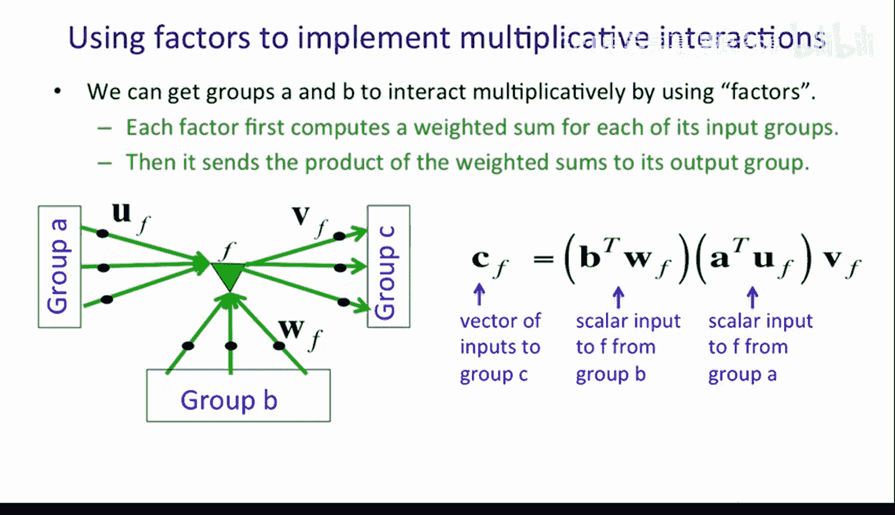
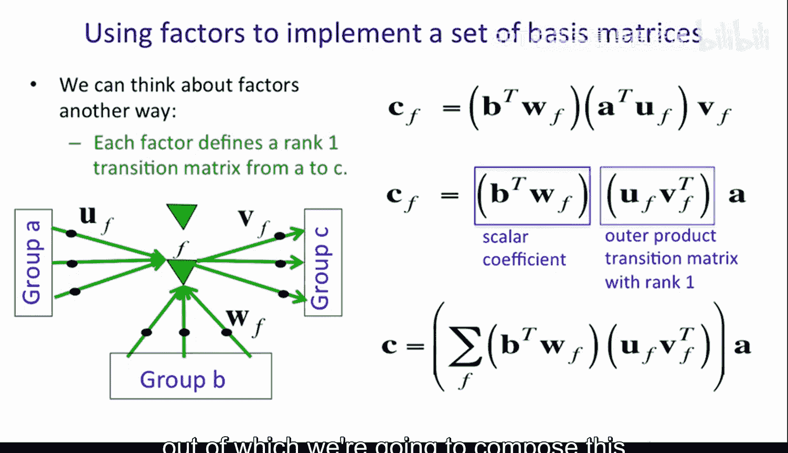
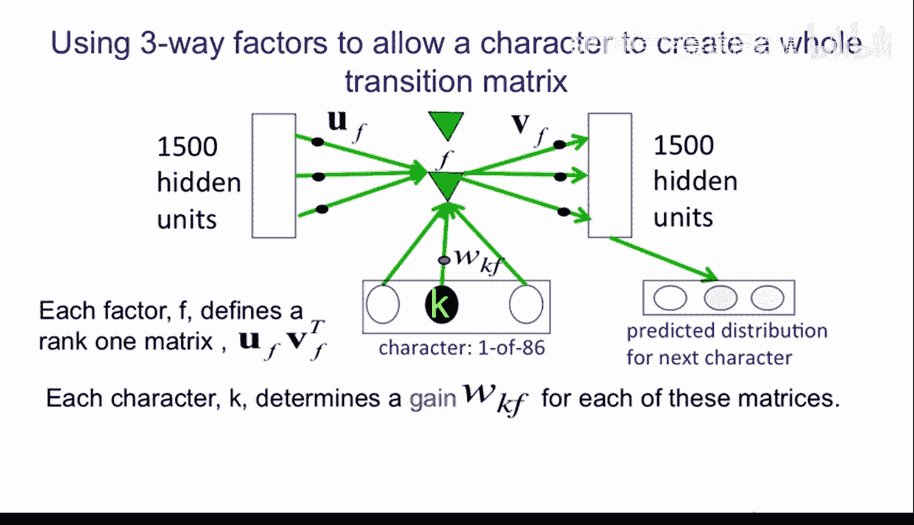

# Hinton@多伦多大学《机器学习的神经网络｜Neural Networks for Machine Learning 2016》claude-4s p36 -36-Lecture 8.2 — Modeling character strings -Neural Networks for Machine Learni -BV1HtkUB2EZD_p36-

We're now going to apply hessum free optimization。To the task of modeling character strings from Wikipedia。

So the idea is you read a lot of Wikipedia and then try to predict the next character。

Before we get to see what the model learns。I want to describe why we need multiplicative connections。

And how we can implement those multiplicative connections efficiently in our current neural network。

I need to start by explaining why we chose to model character strings rather than strings of words。

 which is what you normally do when you're trying to model language。

The web is composed of character strings。Any learning method that's powerful enough to understand what's going on in the world by reading the Web or to find it trivial to learn which strings make words。

As we'll see， this turns out to be true。So we're going to be very ambitious here。

 We want something that will read Wikipedia and understand the world。

If we have to pre process the text in Wikipedia into words， it's going to be a big hassle。

There's all sorts of problems。The first problem is morphphs。The smallest units of meaning。

 according to linguists are morphines。So we're going to have to break up a word into these morphings。

If we want to deal with it sensibly。The problem is， it's not quite clear what more themes are。

There's things that are a bit like morphs， but that a linguist wouldn't call a morphme。So in English。

 if you take any word that starts with the letters S， N。

It has a very high chance of meaning something to do with the lips or nose。

 particularly the upper lip or nose。So words like snarl and sneeze and snot and snug。And snort。

There's too many of these words for it just to be coincidence。Many people say yes。

 but what about snow， that's got nothing to do with the epilypse or nose。But ask yourself。

 why is snow such a good word for cocaine。Then there's words that come in several pieces。So normally。

 we'd want to treat New York as one lexical item。But if we are talking about the New York Minster roof。

 then we might want to treat New and Yorkers's two separate lexco items。And then there's languages。

 like Finn。Finishes in a glutinative language。 So it puts together lots of morphs to make great big words。

So here's an example of a word in Finn that takes about five words in English to say the same thing。

I have no idea what this word means， but despite my lack of understanding， it makes the point。

So here's an obvious kind of recurrent net we might use to try and model character strings。

It has a hidden state。 And in this case， we're going to use 1500 hidden units。

And the hidden state dynamics is that the hidden state at time T provides inputs to determine the hidden state at time T plus1。

And the character also provides some inputs。 So we add together the effect of the current character with the previous hidden state to get the new hidden state。

And then when we arrive at a new hidden state， we time predict the next character。

So we have a single soft max over the 86 characters。

And we get the hidden state to try and assign high probability to the correct next character and low probability to the others。

And we train the whole system by back propagating from that softm。

 the log probability of getting the correct character。We back propagate that。

Through the hidden to output connections， back through the hidden to character connections。

And then back through the hidden to hidden connections and so on all the way back till the beginning of the string。

It's a lot easier to predict 86 characters than 100000 words。

So it's easy to use a softm at the output。 We don't have the problem of a great， big softm。

Now I want to explain why we didn't use that kind of recurrent net。

 but instead used a different kind of net that worked quite a lot better。

You could arrange all possible character strings into a tree with a branching ratio of 86。

 in our case。And what I'm showing here is a tiny little sub tree of that great big tree。In fact。

 this little sub tree will occur many times， but with different things that are represented by that dot。

 dot， dot before the fix。So this represents that we had a whole bunch of characters。 Then we had F。

 and then I and then X。And now if we get an I， we're going to go to the left。 If we get an E。

 we're going to go to the right and so on。So each time we get a character。

 we move one step down in this tree to a new note。There's exponentially many nodes in the tree of all character strings of length N。

 So this is going to be a very big tree。 We couldn't possibly store it all。If we could store it all。

 what we'd like to do is put a probability on each of those arrows。

 and that will be the probability of producing that letter， given the context of the note。

In an R and N， we try and deal with the fact that the full tree is enormous by using a hidden state vector to represent each of these nodes。

So now what the next character has to do is take the hidden state vector that's representing a wholestering of characters followed by F I X and operate on that hidden state vector to produce the appropriate new hidden state vector。

 If the next character was an I。So when you see an eye。

 you want to turn the hidden state vector into a new hidden state vector。

A nice thing about implementing these nodes in this character tree by using the hidden state of recurrent neural network is that we can share a lot of structure。

For example， by the time we arrive at that note that says F I X。

 we may have decided it's probably a verb。And if it's a verb。

 then I is quite likely because of the ending I N G。

 And that knowledge that I is quite likely with a verb can be shared with lots of other notess that don't have F A X in。

So we can get eye to operate on the part of the state that represents that it's a verb。

 and that can be shared between all the verbs。Notice that it's really the conjunction of the current state we're at and the character that determines where we want to go。

We don't want I to give us a state that's expecting to get an N next if it wasn't a verb。

So we don't want to say that I tends to make you expect an end next。We really want to say。

 if you already think it's a verb， then when you see an eye， you should expect an n nextex。

It's the conjunction of the fact that we think it's a verb and that we saw an eye that gets us into this state labeled F I X I that's expecting to see an end。

So we're going to try and capture that by using multiplicative connections。

Instead of using the character inputs to the recurrent net to give extra additive input to the hidden units。

 we're going to use those characters to swap in a whole hidden to hidden weight matrix。

 The character is going to determine the transition matrix。Now， if we did that in the naive way。

 we'd have each of the 86 characters define a 1500 by 1500 matrix。

And that would be a lot of parameters。If we have that many parameters。

The net's likely to overfit unless we run it on a huge amount of text for which we might not have time。

So the question is， can we achieve this kind of multiplicative interaction where the character determines the hidden to hidden weight matrix using many fewer parameters by making use of the fact that characters have things in common。

For example， all of the digits are all quite similar to each other in the way in which they make the hidden state evolve。

So we want to have a different transition matrix for each of those 86 characters。

 but we want those 86 character specific weight matrices to share parameters。

And that's a reasonable thing to do， because we know that characters 8 and 9 should have very similar transition matrices。

So here's how we're going to do it。We're going to have things called factors。

 And they're going to be denoted by this little triangle with an F above it。

What that factor means is that group A and group B interact multiplicatively to provide input to group C。

So what each factor does is it first computes awaited sum for each of its two input groups。

So we take the vector state of group A， which I'll just call A。

And we multiply that by the weights on the connections coming into the factor。In other words。

 we take the scalar product of the vector A and the weight vector U。

And that gives us a number at the left hand vertex of that triangle。Similarly。

 we take the vector state of group B and we multiply it by the weight vector W。

And we get another number at the bottom vertex of the triangle。

We now multiply those two numbers together， and that gives us a number， a scalar。

And we use that scalar to scale the outgoing weights V in order to provide input for group C。

So the input to group C is just the product of the two numbers that come into the two vertices of the triangle。

Times the outgoing weight vector V。We can write that as an equation。

The input that factor F provides to group C。 So it's vector input to group C。

Is a scalar input to F from group B that's got by multiplying the state of group B by the weights W F。

Times a scalar input to F from group A that's got by multiplying the state of group A by the weights U。

We then take the product of those two scals and multiply the weight vector V F by that。

 And that's the input that the factor gives to group C。

Then， of course， we're gonna have a whole bunch of those factors。

There's another way we can think about these factors that gives more insight into what's going on。

Each of the factors actually defines a very simple kind of transition matrix is a transition matrix that has rank1。

So the equation we had on the previous slide。Treats a factor as computing two scalr products。

 modifylying them together。And then using that as a weight on the outgoing vector V。

We can rearrange that equation。So that we get one scalr product。

And then we've rearranged the last bit。So that now we take the outer product of the weight vector U and the weight vector V。

And that gives us a matrix。And the scalar product that we computed by multiplying B by W。

Hes just a coefficient on that matrix。So we get a scalar coefficient。

We multiply a rank1 matrix by that scalar coefficient to give us a scaled matrix。

 and then we multiply the current hidden state a by this matrix。

To determine the input that factor F gives to the next hidden state。

If we sum that up over all the factors。The total input group C。Is just a some overall factors。

Of a scalar times a rank1 matrix。And that some。Is a great big matrix。 That's the transition matrix。

 and it gets multiplied by the current hidden state to produce the new hidden state。

So we can see that we've synthesized a transition matrix out of these rank1 matrices provided by each factor。

And what the current character in group B has done。

Is is determined the weight on each of these rank1 matrices。

So B times w determines a scalar weight a scalar coefficient to broaden on each of the matrices out of which we're going to compose this great big character specific weight matrix。

So here's a picture of the whole system。We have a number of factors。 In fact。

 we'll have about 1500 factors。And the character input。

Is different in that only one of those is active， so there'll only be one relevant weight at a time。

And that weight from the current character K， which is called W。 K F。

Is the gain that's used on the rank1 matrix got by taking the outer product of U and V。

So the character determines again， WKF。You multiply the rank1 matrix， U V by that gain。

You add together those scaled matrices for all the different factors。

 And that's your transition matrix。

