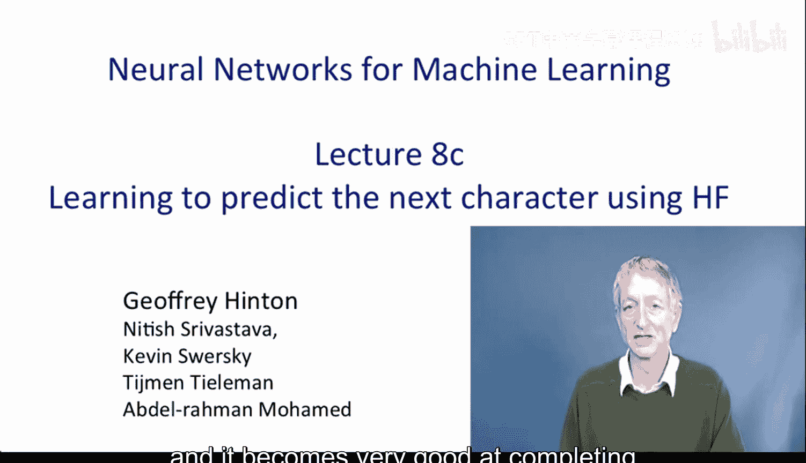
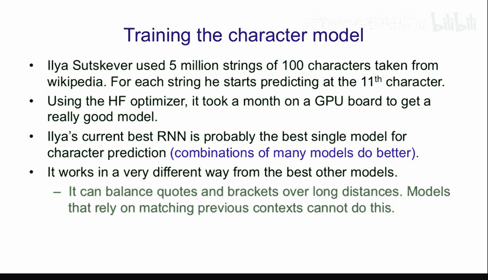
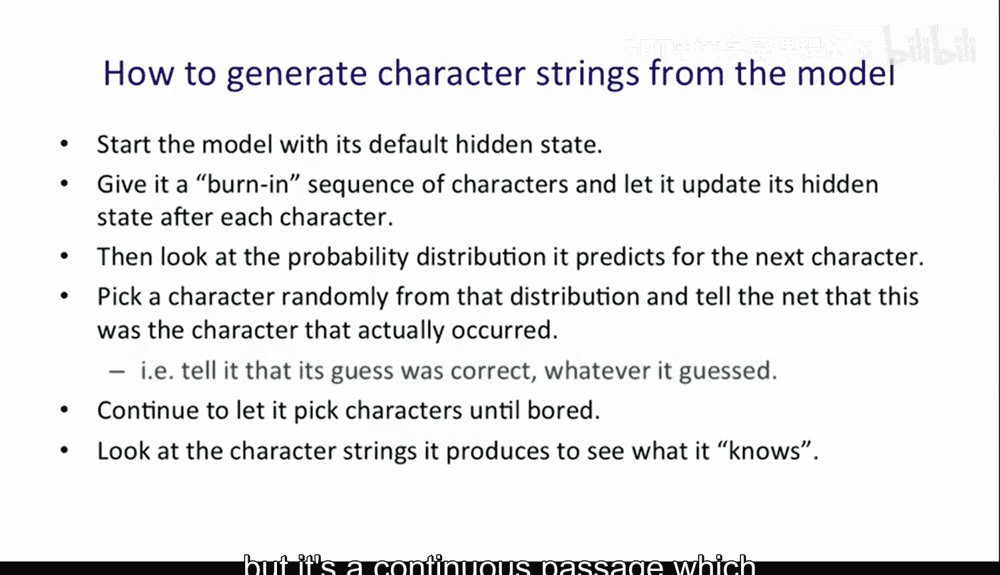
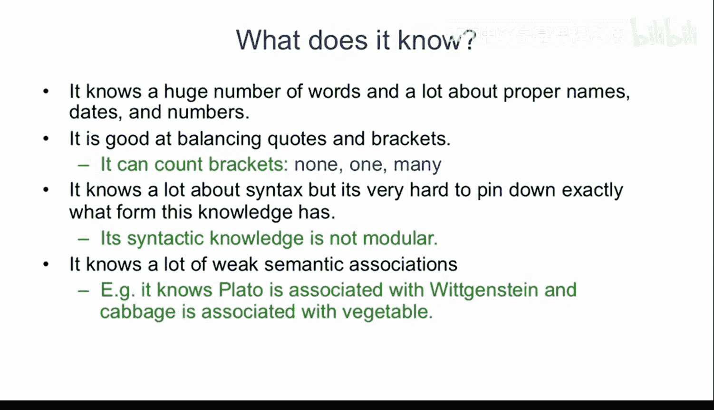
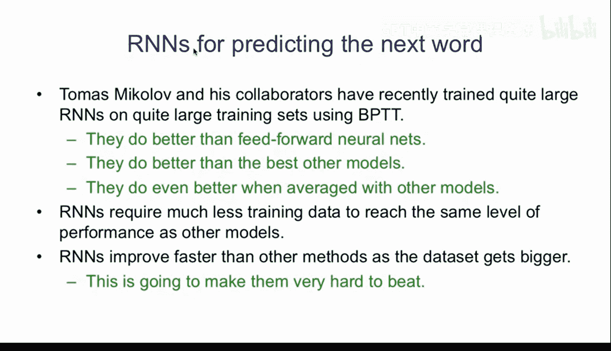

# Hinton@多伦多大学《机器学习的神经网络｜Neural Networks for Machine Learning 2016》claude-4s p37 -37-Lecture 8.3 — Predicting the next character using HF  -Neural Networks for M -BV1HtkUB2EZD_p37-

In this video， we're going to see what happens。When the hessum free Opr is used to optimize recurrent neural network containing multiplicative connections。

And the network is trained to predict the next character in Wikipedia。

The network is trained on millions of characters， and it works remarkably well。

It learns a lot about English， and it becomes very good at completing sentences in interesting ways。

Eveat Sva used 5 million strings of 100 characters each， taken from English Wikipedia。

For each string， he starts predicting after 11 characters。

 So the recurrent network starts off in a default state。It reads 11 characters。

 changing its hidden state each time， and then is ready to start predicting。

And he gets trained by back propagating the errors it makes in prediction。

He used the Hessem free Opr， and it took about a month on a very fast GPU board to get a really good model。

His current best recurrent neural network for character prediction。

Is probably the best single model there is for predicting characters。

You can do better than this model by combining many different models。

 using a neural network to decide which one to use。But for a single model， its is as good as it gets。

It works in a very different way， from the best other models。

So Ilia's model can balance quotes and brackets over long distances。

Any model that relies on matching a specific previous context can't do that。So， for example。

 if it has a bracket and it wants to close it，35 characters later。In order to do that properly。

 a model that relies on matching previous contexts would have to match all 35 intervening characters。

 And it's very unlikely that it has that whole string stored。

Once the model is learned， you can see what it knows by generating strings from the model。Of course。

 you have to be very careful not to over interprett what it says。

The way we generate strings is we start in the default hidden state。

We then give it a burn in sequence， so we feed it characters and let it update its hidden state after each character。

And then， we let it start predicting。We look at the probability distribution it predicts for the next character。

We pick a character randomly from that distribution。

 So if it predicts that the probability of a Q is one in 1000， we pick Q one time in 1000。

We then tell the net that whatever character we picked was the character that actually occurred。

And ask it to predict the next character。In other words。

 we're telling it that whatever it guesses is correct。

We let it continue to bit characters until we've got as many as we want。

And then we look at the strings it produces to see what it knows。

So here's an example of a string produced by Elilia's network after some burning。

This was selected from a much longer passage of text， but it's a continuous passage。

 which shows you that it works pretty well。

You'll notice that it has weird semantic associations。 So Opus Paul at Rome。

No person would ever say that， but we understand that Opus and Paul and Rome are all highly interconnected。

You'll notice it doesn't really have any long range thematic structure。It pretty much changes topic。

 after each full stop。One amazing thing is that it produces very few non words。

What that means is that even though it's predicting probabilities of characters。

As soon as you've got enough characters。 So there's only one way to complete it as an English word。

 it will predict the next character almost perfectly。If that wasn't the case。

 it would produce non words。Even when it does produce a non word， like the word in red。

 it's a very good non word。I'm not absolutely certain。

 or I wasn't when I first saw it that aemerable wasn't an English word。

You'll also notice it's produced a closing bracket without an opening one。

So it doesn't always balance brackets。 It just does it quite frequently。

You'll also notice at the end that it's produced an opening quote。

 and then a closing quote much later。That's consistent behaviour。 On its part。

 It really did produce that closing quote， because it had an open quote earlier on。

If you look at this text， you can see there's a lot of good local syntax。

 So little strings of three or four words look perfectly reasonable。

There's also lots of semantic knowledge。

So one thing we could do is we could test the model。

By giving it carefully designed strings to see what it knows。So I tried giving it a non word。

 The word Thre T， H， R， U， N， G， E is not an English word。But most English speakers。

 when they see that word， would expect it to be a verb because of its form。

So I gave it opening contexts in which that might be a verb to see what character was most likely to come next。

So if you give it Sheila Thre and ask for the next character， the most frequent one is an S。

 which suggests that it knows that Sheila is singular。Just from reading Wikipedia。

If you give it people Thre， the most frequent next character is a space， not an S。

 which suggests that it knows that people is plural。I then tried giving it a list of names。

So I used capitals for the names with a co in between。And I put a capital tea for Thrrone。

 So it looked like a name to see what it would do with that。So it actually completed it as a name。

And if you look at the name it made， it's not a bad name。

 It indicates that it knows an awful lot about names in many languages。

You can also give it the meaning of life is and see what comes next。If it produced 42。

 that wouldn't be very interesting because I'm fairly sure that'll be somewhere in Wikipedia。

It produces random things， but in its first 10 tries。

 it produced the meaning of life is literary recognition。

 which is syntactically and semantically sensible。We then trained the model some more。

And presented it with the meaning of life is again。We took the first 10 things it produced。

 and I'm going to show you the most interesting one。

The completion it produced for the meaning of life is suggests that by reading Wikipedia。

 it really is beginning to understand something about the meaning of life。

That's probably just wild over interpretationtertation， though。So here's its completion。

So what does the model know after it's read all these characters of Wikipedia？Well。

 it certainly knows about words。It produces almost always， English words。

It will produce strings of initials， typicallyy in capitals。

 It can produce numbers and dates and things like that。But it doesn't produce non words very often。

 It produces them extremely rarely。 And when it does produce them。

 they're typically very plausible non words。It also knows a lot about proper names。

 like Trangeullini deel Rey。It knows about dates and numbers。And the context in which they occur。

It's good at balancing quotes and brackets。And， in fact， it can actually count brackets。

If you give it no opening brackets， it's very unlikely to produce a closing bracket。

If you give it one opening bracket， it's quite likely to produce a closing bracket in the next 20 characters or so。

If you give it two opening brackets， it'll produce a closing bracket very quickly。

Giving it three doesn't seem to make it any faster。

It clearly knows a lot about syntax because it's able to produce these little strings of English words that are sensible。

But it's very hard to pin down exactly what form this knowledge has。It's not like trigram models。

 which have just learned little sequences of words。

 Or rather they have a table that contains little sequences of words。

It's actually synthesizing strings of words， and it's synthesizing them with sensible syntax。

It's very hard to say， though， what form that syntactic knowledge has。

 It's not a bunch of rules like a linguist has。It's much more like what's in the linguist's head when he speaks his native language。

It knows a lot of weak semantic associations。So， for example。

 it only ever produced the word Witgenstein once， and it produced that soon after producing the word Plato。

So it knows that Plato and Witgenstein are associated。 Well that's a pretty good assumption。

It clearly knows that cabbage is associated with vegetable。

He doesn't know much about the precise ways in which these things are associated。

People are like that， too， If you get them to respond very fast。 So I'm going to ask you a question。

 and I want you to shout out the answer。So you're sitting there watching this video。

And this experiment will work by far the best if you actually shout out the answer out loud。

And you have to shout it out really fast。You get rewarded for responding very quickly。

 It doesn't matter what you say。 You just have to respond fast。So the question is。

 what do cows drink。Most people， when given that question， shout out milk。Now。

 most cows don't drink milk most of the time。We say milk because it's associated with both drink and with cow。

 but it's not logical to say milk。

Recently， Thomas Mieloff and his collaborators。Have been training large recurrent neural networks to predict the next word in large dataset sets。

They use the same technique as the feed forward neural nets that first convert a word to a real valued feature vector。

And then use those feature vectors as input to the rest of the network。

And they do better than the feed forward neural nets。They also do better than the best other models。

 And when you average them with the best other models， they do better still。

So that's the best language models there are， currently。

One interesting property of the R And Ns is that they require less training data than the other methods to reach a given level of performance。

More importantly。As the data sets get bigger。The R Ns improve faster than the other methods。

So methods like trigrams， for example， do get better with bigger data sets。

 but it's a very slow process。 You need to double the size of the data set to get a small improvement。

With R ends， they can make much better use of the data。

This means it's going to be very hard to beat them as dataset sets get bigger。

I think it may be the same story as for object recognition with large， deep neural nets。

That once the neural onettes get ahead。They can make better use of faster computers and bigger data sets。

 And so it's going to be very hard for other methods to catch up。

