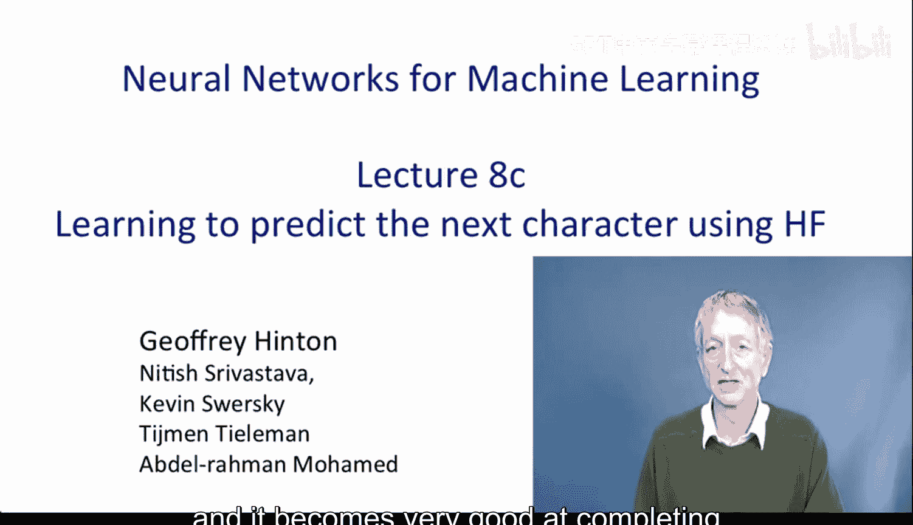
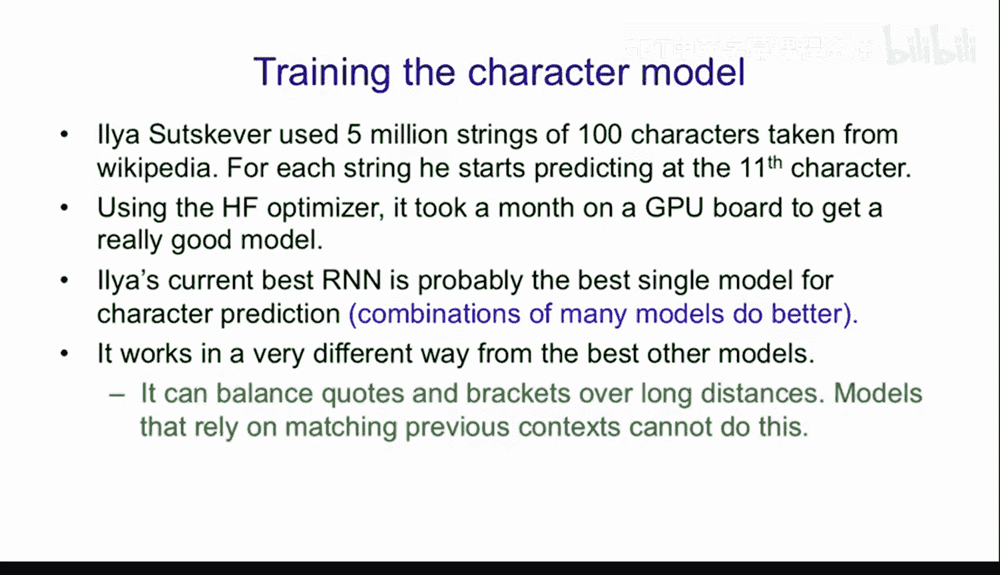
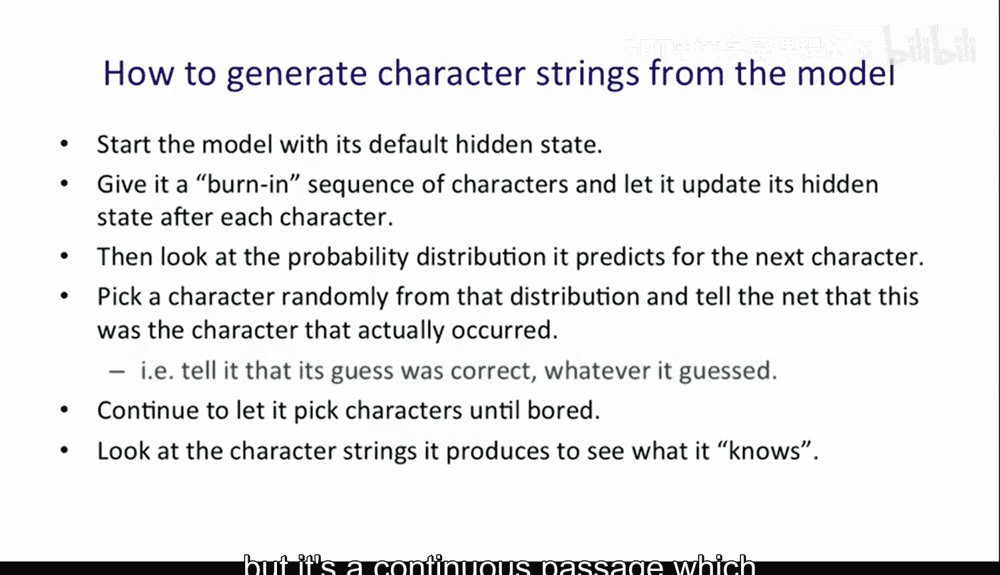
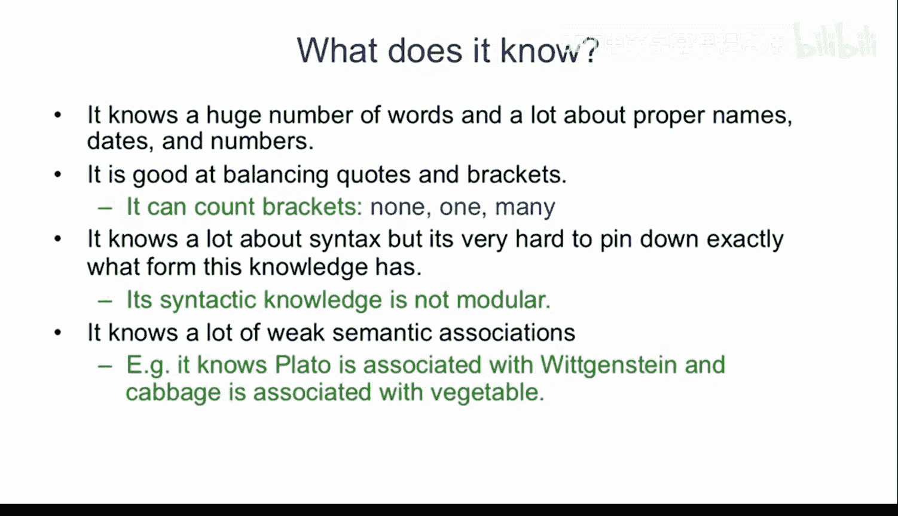
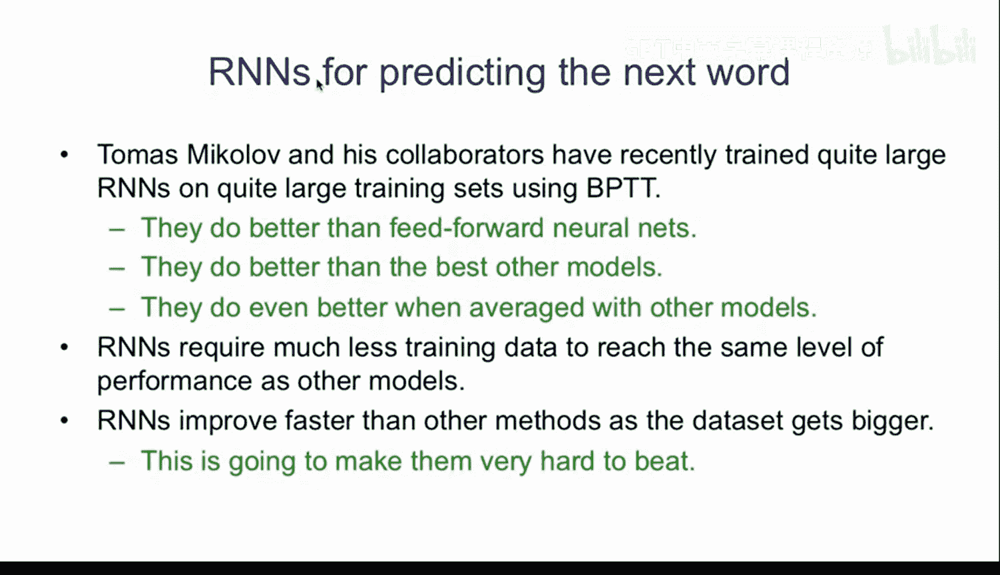

# 神经网络与机器学习：8.3：使用HF优化RNN预测维基百科下一个字符 📚

在本节课中，我们将探讨当使用Hessian-Free优化器来优化包含乘法连接（multiplicative connections）的循环神经网络时会发生什么。我们将看到一个被训练用于预测维基百科文本中下一个字符的网络实例，并分析其表现与学到的知识。

## 实验设置与训练过程

上一节我们介绍了循环神经网络的基本概念，本节中我们来看看一个具体的应用案例。Ilya Sutskever使用了一个包含乘法连接的循环神经网络，并利用Hessian-Free优化器对其进行训练，目标是预测维基百科文本中的下一个字符。

以下是实验的关键细节：
*   **数据**：使用了500万个字符串，每个字符串包含100个字符，均取自英文维基百科。
*   **初始化**：对于每个字符串，网络从默认的隐藏状态开始，先读取11个字符以更新其状态，然后才开始进行预测。
*   **训练**：通过反向传播其预测产生的误差来训练网络。
*   **耗时**：在一块高速GPU上，训练一个优质模型大约花费了一个月时间。

目前，这个用于字符预测的最佳循环神经网络模型，在单模型中是表现最好的。虽然可以通过组合多个模型并使用神经网络来决定使用哪一个来获得更好的效果，但就单一模型而言，它已经达到了顶尖水平。

## 模型的能力：长距离依赖与文本生成

该模型的工作方式与其他最佳模型截然不同。例如，Ilya的模型能够在长距离上平衡引号和括号。任何依赖匹配特定先前上下文的模型都无法做到这一点。因为要正确地在35个字符后闭合一个括号，依赖上下文匹配的模型必须精确匹配中间的全部35个字符，而这几乎不可能被完整存储。

一旦模型训练完成，我们可以通过从模型中生成字符串来观察它学到了什么。当然，我们需要谨慎，避免过度解读其生成的内容。

文本生成的过程如下：
1.  从默认的隐藏状态开始。
2.  提供一个“预热”序列，即输入一些字符，让网络在读取每个字符后更新其隐藏状态。
3.  开始预测。查看模型为下一个字符预测的概率分布。
4.  根据该分布随机选取一个字符（例如，如果它预测‘Q’的概率是1/1000，那么我们就有千分之一的几率选中‘Q’）。
5.  告诉网络我们选中的字符就是实际发生的字符，并让它预测下一个字符。换句话说，我们假设它的猜测总是正确的。
6.  重复此过程，直到生成足够多的字符。

以下是Ilya的网络在经过预热后生成的一个字符串示例（选自一段更长的连续文本）：
> “Opus Paul at Rome. No person would ever say that, but we understand that Opus and Paul and Rome are all highly interconnected.”

观察这个例子，我们可以发现：
*   **语义关联**：它产生了奇怪的语义关联（如Opus, Paul, Rome），但我们可以理解这些词是高度相关的。
*   **主题结构**：它缺乏长距离的主题结构，基本上在每个句号后就会改变话题。
*   **词汇准确性**：一个惊人的特点是它很少产生非单词。这意味着，一旦字符序列足以构成一个唯一的英语单词，它几乎能完美地预测下一个字符。即使偶尔产生非单词（如红色的“aemerable”），这些词看起来也非常像真词。
*   **符号平衡**：它并不总能平衡括号（本例中有一个多余的闭合括号），但它经常能做到。在本例末尾，它正确地在一个开引号之后，隔了很远才放置了闭合引号。

这段文本显示出良好的局部语法（短词串看起来很合理）和大量的语义知识。

## 测试模型的知识

我们可以通过输入精心设计的字符串来测试模型到底知道什么。以下是一些测试示例：

以下是针对一个非单词“Thrunged”的测试：
*   输入“Sheila thrunged”，最可能的下一个字符是‘s’。这表明模型知道“Sheila”是单数。
*   输入“people thrunged”，最可能的下一个字符是空格而非‘s’。这表明模型知道“people”是复数。

以下是针对名字列表的测试：
*   输入“Tom, Dick, Harry, Thrunged, …”，模型将其补全为一个名字（如“Thrungedullini deel Rey”），这表明它从维基百科中学到了大量关于多种语言名字的知识。

以下是关于“生命的意义”的趣味测试：
*   输入“The meaning of life is”，模型产生了多种补全。在最初的10次尝试中，有一次产生了“The meaning of life is literary recognition.”，这在语法和语义上都是合理的。经过更多训练后，它产生了更有趣的补全，但这可能只是过度解读。

## 模型学到了什么？

那么，在阅读了海量维基百科字符后，这个模型究竟知道了什么？
*   **词汇知识**：它几乎总是生成英语单词，极少产生非单词，即使产生也看起来非常合理。
*   **专有名词**：它了解许多专有名词（如Trangeullini deel Rey）。
*   **数字与日期**：它能生成数字、日期及其出现的上下文。
*   **符号计数**：它擅长平衡引号和括号，实际上能够“数”括号。如果没有开括号，它极不可能生成闭括号；如果有一个开括号，它很可能在大约20个字符内生成闭括号；如果有两个开括号，它会更快地生成闭括号。
*   **句法知识**：它显然掌握了许多句法知识，能够生成语法合理的小段英文词串。但这种知识的形式难以精确界定，它不像三元模型那样只是存储词序列，而是在合成具有合理句法的词串。这更像是一个语言学家在说母语时头脑中的知识，而非一套明确的规则。
*   **语义关联**：它知道许多弱的语义关联。例如，它只生成过一次“Wittgenstein”，而这次生成紧接在“Plato”之后，表明它知道这两者有关联。同样，它知道“cabbage”和“vegetable”相关联，尽管不一定清楚具体关联方式。

人类在快速反应时也类似。例如，快速问“奶牛喝什么？”，大多数人会喊出“牛奶”。虽然大多数奶牛并不常喝牛奶，但“牛奶”与“喝”和“奶牛”都高度关联，尽管从逻辑上讲这不完全正确。

## RNN语言模型的优势与前景

最近，Thomas Mikolov及其合作者一直在训练大型循环神经网络来预测大型数据集中的下一个词。他们使用了与先前前馈神经网络相同的技术（先将词转换为实值特征向量，再将这些向量作为网络其余部分的输入），并且效果优于前馈神经网络和其他最佳模型。当将它们与其他最佳模型结合时，效果更佳，这使其成为当前最好的语言模型。

循环神经网络有两个有趣的特性：
1.  **数据效率**：要达到给定的性能水平，RNN比其他方法需要更少的训练数据。
2.  **缩放优势**：随着数据集增大，RNN的性能提升速度比其他方法更快。例如，三元模型等会随数据集增大而改进，但过程非常缓慢，需要将数据集翻倍才能获得小幅提升。而RNN能更好地利用数据。

这意味着，随着数据集变得更大，其他方法将很难超越RNN。这与使用大型深度神经网络进行物体识别的故事可能类似：一旦神经网络取得领先，它们就能更好地利用更快的计算机和更大的数据集，因此其他方法将很难追上。

---

**本节课总结**：我们一起学习了使用Hessian-Free优化器训练循环神经网络来预测维基百科下一个字符的案例。我们探讨了该模型的训练过程、其通过文本生成展现出的能力（如长距离依赖、词汇和句法知识），以及如何通过设计输入来测试其学到的语义和语法关联。最后，我们了解了循环神经网络在语言建模任务上相对于其他模型的数据效率和缩放优势，预示着其在处理更大数据时的巨大潜力。