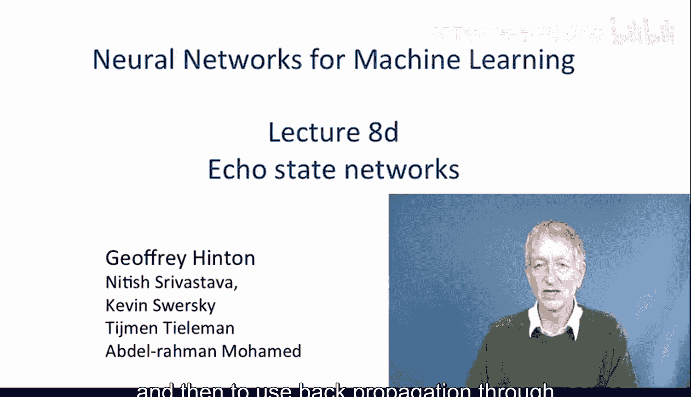
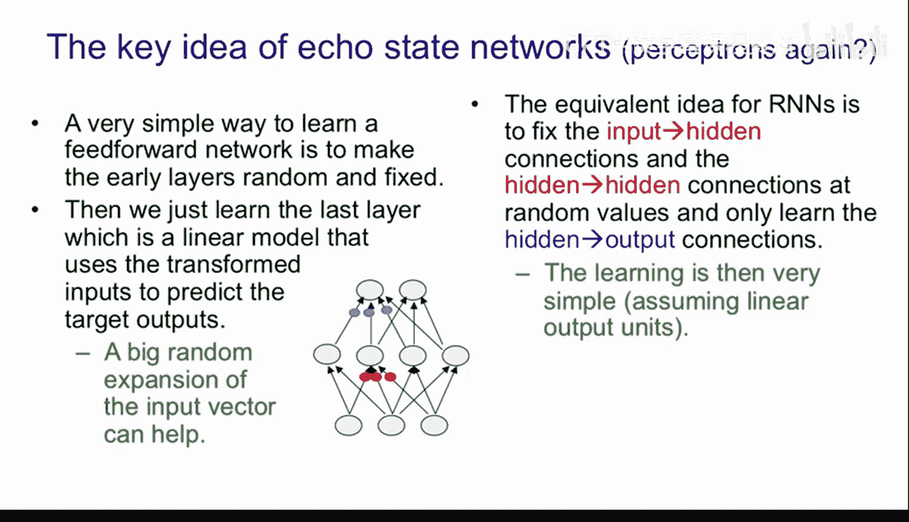
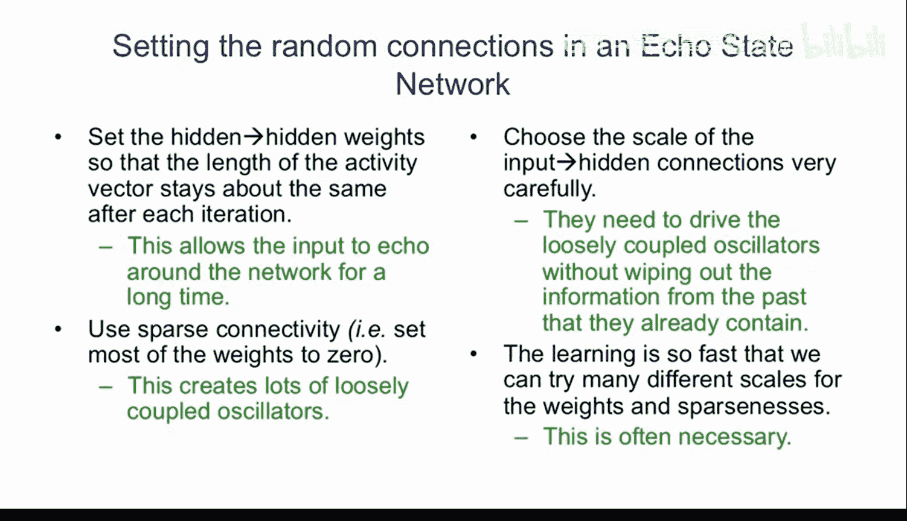
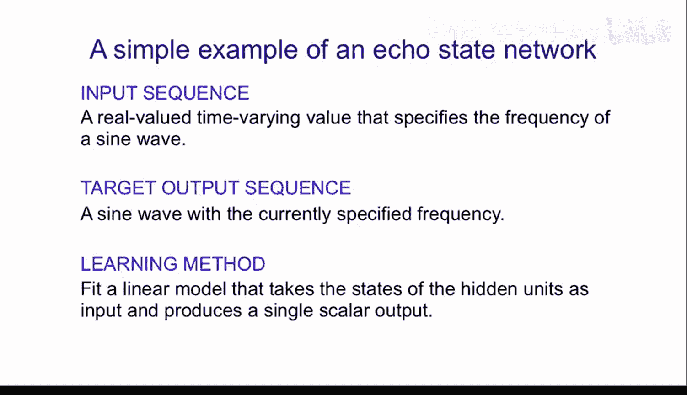
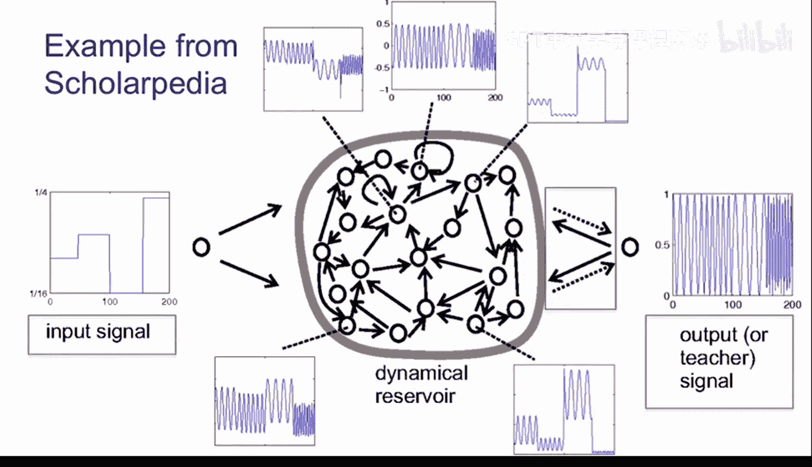
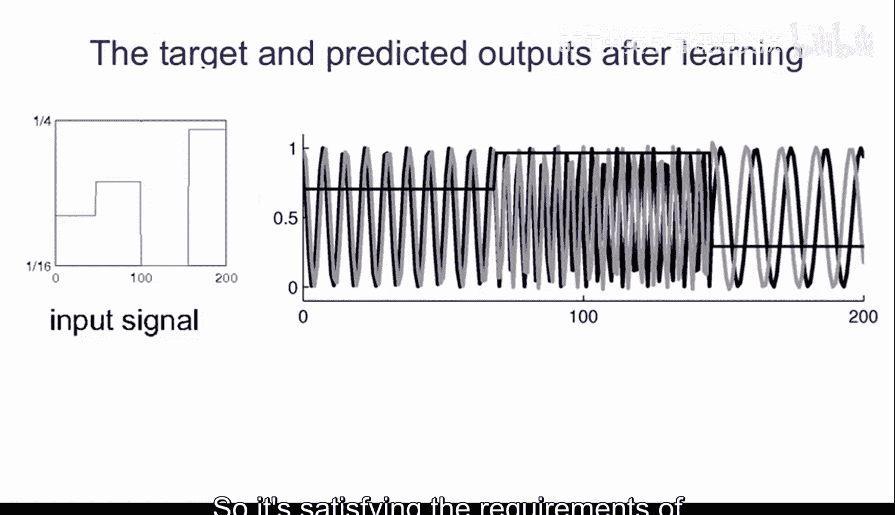
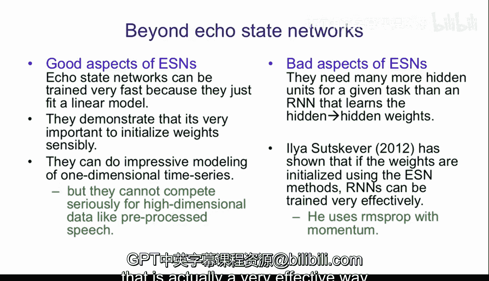

# Hinton@多伦多大学《机器学习的神经网络｜Neural Networks for Machine Learning 2016》claude-4s p38 -38-Lecture 8.4 — Echo State Networks  -Neural Networks for Machine Learning-.zh -BV1HtkUB2EZD_p38-

In this video， I'm going to describe Estate networks。

These use a clever trick to make it much easier to learn a recurrent neural network。

They initialize the connections in the recurrent neural network。

In such a way that it has a big reservoir of coupled oscillators。So if you provide input to it。

It converts that input。Into the states of these oscillators。

And then you can predict the output you want from the states of these oscillators。

 and the only thing you have to learn is how to couple the output to the oscillators。

This entirely gets rid of the problem of learning hidden to hidden connections or even input to hidden connections。

However。To get these networks to be good at complicated tasks， you need a very big hidden state。

As we'll see at the end of the video。There's no reason not to use the initialization。

That was carefully designed for Estate networks。And then to use back propagation through time with momentum to train the networks to be even better at the tasks that they're doing。

One interesting and quite recent idea。About training recurrent neural networks。

Is to not train the hidden to hidden connections at all。

But to just fix them randomly and hope that you can learn sequences by just training the way they affect the outputs。

This has strong similarities， with old ideas about perceptrons。

So a very simple way to train a feed forward neural network。

Is to make the early layers of feature detectors just be random。You put in sensible sized。

 random weights。And then all you learn is the last lair。

So that you're learning a linear model from the activities of the hidden units in the last layer to the outputs。

And， of course， it's much faster to learn a linear model。

This relies on the idea that a big random expansion of the input vector。

Can often make it easy for a linear model to fit the data when it couldn't fit the data well。

 just looking at the raw inputs。So in the little neural network here。

Those red weights will be fixed at random。 They would expand the imp vector。

And then using that expanded representation would tru a linear model。

This actually has some quite strong similarities with support vector machines。

Which are really just a really efficient way of doing this。So those same ideas many years later。

 were recycled for recurrent neural networks。The idea is to make the input to hidden connections and the hidden to hidden connections。

Have random values that are carefully chosen。And just learn the final layerir of hidden to output connections。

The learning is then very simple If you use linear output units， and it can be done extremely fast。

This approach is only ever going to work if you set the random connections very carefully so that the recurrent neural network。

Doesn't。Die out with no activity， and doesn't explode。

So the way they set the random connections in an echostate network is they set the hidden to hidden weights。

So that the length of the activity vector stays about the same after each iteration。

For those of you used to linear systems and matrices。

 you're setting it so the spectral radius is what。 That is the biggest eigenvalue。

Of the matrix of hidden to hidden weights is one， or it would be one if it was a linear system。

 and you want to achieve the same property in a nonlinear system。

If you set those weights to be of about the right magnitude。

 then an input can echo around in the recurrent state for a long time。

It's also important to use sparse connectivity。So instead of having lots of medium sized weights。

 we have a few quite large weights and nearly all the weights are zero in the hidden to hidden connections。

What this does is it makes a lot of loosely coupled oscillators。

So information can hang around in one part of the net without being propagated to other parts of the net too quickly。

It's also important to choose the scale of the input to hidden connections very carefully。

Those connections need to drive the states of the loosely coupled oscillators。

 but they mustn't wipe out information that those oscillators contain about the recent history。

Fortunately， the learning is very fast in echostate networks。

 so we can afford to experiment with the scales of the input to hidden connections。😊。

You could think of it as a little learning loop that's just learning the scales of those connections。

 And it's doing it by sort of feedback that involves the experimenter。

It also helps to learn the level of sparseness thus needed in the hidden to hidden connections。

And again， because the learning is so fast， you can afford to experiment with that。

That's important because it's often necessary to do those experiments。

 to get the system to work well。

So I'm now going to show you a simple example taken from the web of an echo state network。

It has an input sequence。Which is a real value that varies with time and specifies the frequency of a sine wave。

For the output of the Estate network。So you'd like this thing to generate sound waves。

 and the input is going to specify the frequency。The target output sequence is going to be a sine wave with the frequency specified by the input。

And it's going to be learned simply by fitting a linear model。

That takes the states of the hidden units。And from those tries to predict the correct scalar output value。

So here's a picture taken from Scchoopedia。Of an echostate network。Doing this problem。

The input signal。Is the desired frequency of the s wave。

 The output signal after it's learned or the teacher signal when it's learning。

Is a sine wave with the frequency specified by the input。And the stuff in the middle is a big。

 dynamical reservoir。So that the inputs coming from the input signal。

Drive those loosety couples oscillators。And cause complicated dynamics that goes on for a long time。

And those output weights are learning to map that complicated dynamics to the particular dynamics you want for the output。

All the other pictures are showing you the actual dynamics of individual units inside the dynamical reservoir。

One thing to notice is that there are also connections from the output back to the reservoir。

Those aren't always needed， but they help to tell the reservoir what out's been produced so far。

So here's an example。Of what the system actually produces after it's learned。

 And you can see that at the beginning， it's producing a sine wave。In phase。

 at the end is producing a sound wave of the right frequency。 but the phase is wrong。

And that's because we weren't telling you what phase the sine waveve should be in。

So it's satisfying the requirements of producing an appropriate frequency。

There are some very good aspects of echo state networks。

They can be trained very fast because they are just fitting a linear model。

They also demonstrate how important it is to initialize the hidden to hidden weight sensibly。

 and they can do quite impressive modelling of one dimensional time series。 That's where they excel。

They can look at a time series for a while and then predict it very well a long time into the future。

What they're not so good at is modeling high dimensional data。Like frames of acoustic coefficients。

Or frames of video。In order to model data like that。

They need many more hidden units than a recurrent neural network where you train the hidden to hidden connections。

Recently， Iliaas Sskeva tried something which is fairly obvious。

 which is to initialise a recurrent neural network。

Using all the tricks developed by the people doing echo state networks。 once you've done that。

 you know， you could learn quite well just by learning the hidden to output connections。

 But then presumably， you could learn even better if you also learn to make the hidden to hidden weights better。

So I you tried using the Echo state network initializations。

 but then training with back propagation through time。He used Im S prop， with momentum。

And he discovered that that is actually a very effective way to train recurrent neural networks。

