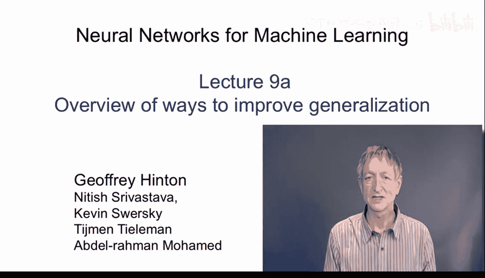
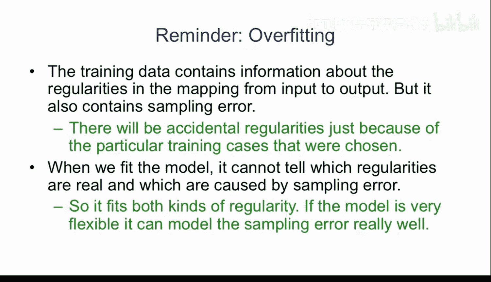
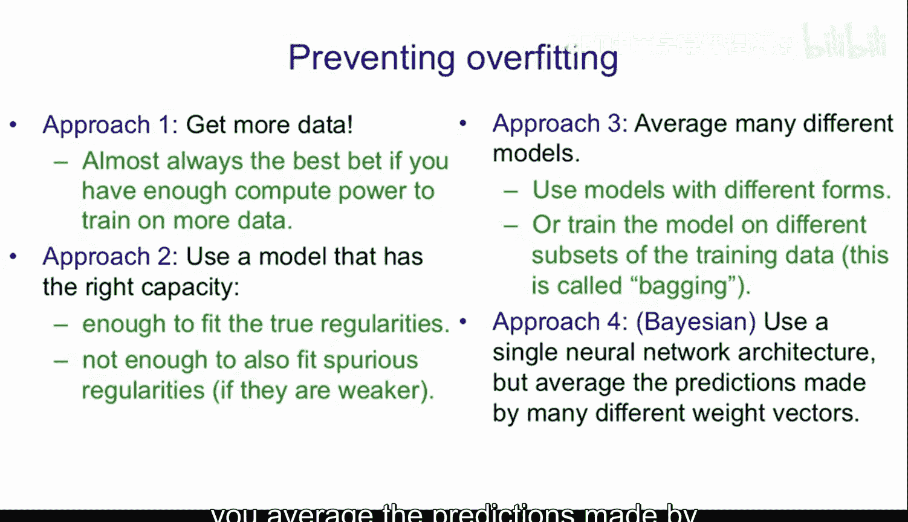
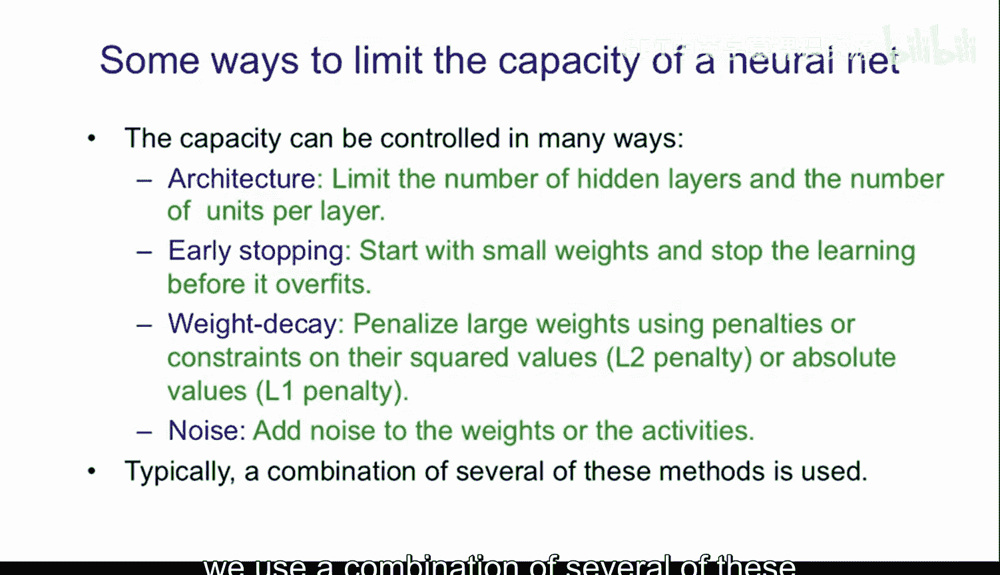
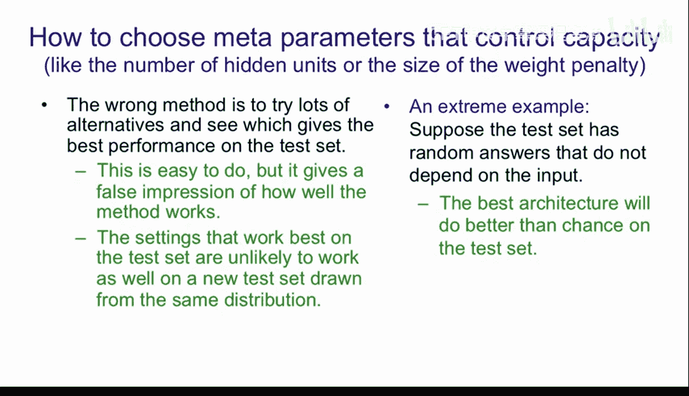
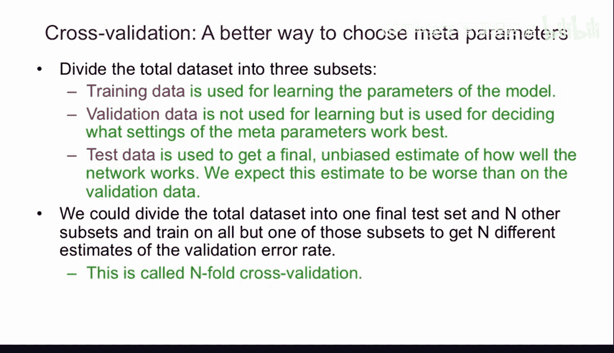
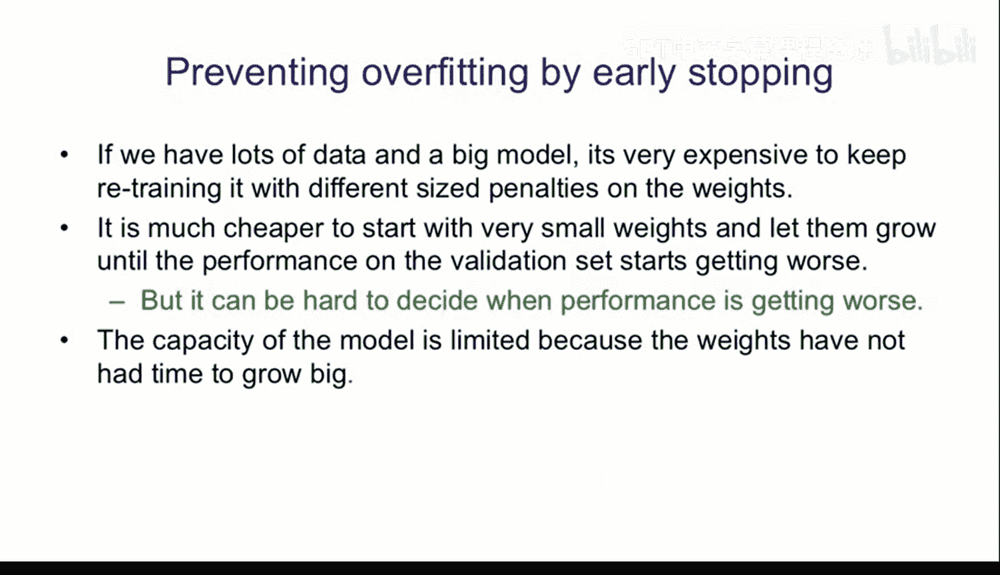
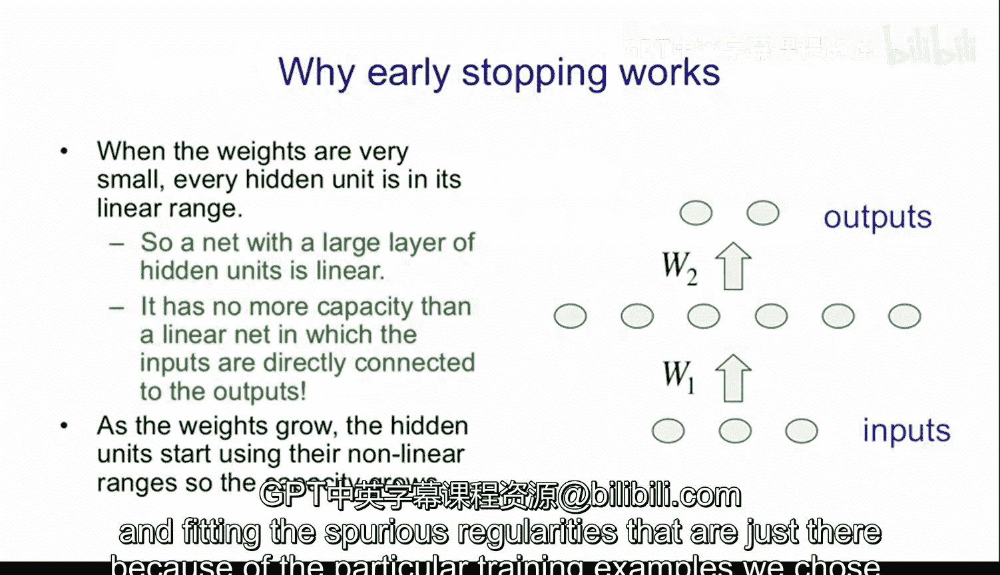

# Hinton@多伦多大学《机器学习的神经网络｜Neural Networks for Machine Learning 2016》claude-4s p39 -39-Lecture 9.1 — Overview of ways to improve generalization  -Neural Networks f -BV1HtkUB2EZD_p39-

In this video， I'm going to talk about improving generalization。

By reducing the overfitting that occurs when a network has too much capacity for the amount of data it's given during training。

I'll describe various ways of controlling the capacity of a network。

And I' also describe how we determine how to set the meta parametersa when we use a method for controlling capacity。

I'll then go on to give an example where we control capacity by stopping the learning early。

Just to remind you， the reason we get overfitting is because。

 as well as having information about the true regularities in the mapping from the input to output。

 any finite set of training data also contains sampling error。

There's accidental regularities in the training set just because of the particular training cases that were chosen。

So when we fit the model， it can't tell which of the regularities are real and would also exist if we sampled the training set again and which are caused by the sampling error。

So the model fits both kinds of regularity。And if the models too flexible。

 it'll fit the sampling error really well， and then it'll generalize badly。

So we need a way to prevent this overfitting。The first method I'll describe is by far the best。

 and it's simply to get more data。There's no point coming up with fancy schemes to prevent overfitting。

 if you can get yourself more data。Data has exactly the right characteristics to prevent overfitting。

 The more of it you have， the better， assuming your computer is fast enough to use it。

A second method。Is to try and judiciously limit the capacity of the model so that it's got enough capacity to fit the true regularities。

 but not enough capacity to fit the spurious regularities caused by the sampling error。This。

 of course， is very difficult to do， and I'll describe in the rest of this lecture various approaches to trying to regulate the capacity appropriately。

In the next lecture， I'll talk about averaging together many different models。

If we average models that have different forms and make different mistakes。

 the average will do better than the individual models。

We could make the models different just by training them on different subsets of the training data。

This is a technique， called bagging。There's also other ways to mess with the training data to make the models as different as possible。

And the fourth approach， which is the baesian approach。

Is to use a single neural network architecture， but to find many different sets of weights that do a good job of predicting the output。

And then on test data， you average the predictions made by all those different weight vector。

So there's many ways to control the capacity of a model。The most obvious is via the architecture。

 you limit the number of hidden layers and the number of units per layer。

 And this controls the number of connections in the network。 I。e。 the number of parameters。

A second method， which is often very convenient， is to start with small weights and then stop the learning before it has time to overfit again。

 on the assumption that it finds the true regularities before it finds the spurious regularities that are just to do with the particular training set we have。

I'll describe that method at the end of this video。

A very common way to control the capacity of a neural network is to give it a number of hidden layers or units per layer。

 There's a little too large， but then to penalise the weights using penalties or constraints on the squared values of the weights or the absolute values of the weights。

And finally， we can control the capacity of a model by adding noise to the weights or by adding noise to the activities。

😊，Typically， we use a combination of several of these different capacity control methods。

Now， for most of these methods， there's meta parameters that you have to set。

 like the number of hidden units or the number of layers or the size of the weight penalty。

An obvious way to transect those meta parameters is to try lots of different values of one of the meta parameters。

 Like， for example， the number of hidden units and see which gives the best performance on the test set。

But there's something deeply wrong with that。He gives a false impression of how well the method will work If you give it another test set。

So the settings that work best for one particular test set。

Are unlikely to work as well on a new test set that's drawn from the same distribution because they' have been tuned to that particular test set。

And that means you get a false impression of how well you would do a new test set。

Let me give you an extreme example of that。Suppose the test set really is random。

Quite a lot of financial data seems to be like that。

So the answers just don't depend on the inputs or can't be predicted from the inputs。

If you choose the model that does best on your test set。That will obviously do better than chance。

 because you selected it to do better than chance。But if you take that model and try it on new data that's also random。

 you can't expect it to do better than chance。

So by selecting a model， you get a false impression of how well a model will do on new data。

And the question is， is there a way around that？So here's a better way to choose the meta parameters。

You start by dividing the total data set into three subsets。You have the training data。

 which is what you're going to use to train your model。You hold back some validation data。

Which isn't going to be used for training， but is going to be used for deciding how to set the meta parameters。

In other words， you're going to look at how well the model does on the validation data to decide what's an appropriate number of hidden units or an appropriate size of weight penalty。

But then once you've done that and trained your model with what looks like the best number of hidden units and the best weight penalty。

You're then going to see how well it does on the final set of data that you've held back。

 which is the test data， and you must only use that once。

And that'll give you an unbiased estimate of how well the network works。And in general。

 that estimate will be a little worse than on the validation data。Nowadays， in competitions。

The people organizing the competitions have learned to hold back that true test data and get people to send in predictions。

So they can see whether they really can predict on true test data or whether they're just overfitting to the validation data by selecting meta parameters that do particularly well on the validation data。

 but won't generalize to new test sets。One way we can get a better estimate of our weight penalties or number of hidden units or anything else we're trying to fix using the validation data。

Is to rotate the validation set。So we hold back a final test set together our final unbiased estimate。

But then we divide the other data into n equal size subsets， and we train on all but one of those N。

And use the n as a validation set。Then we can rotate and hold back a different subset as of validation set。

 And so we can get many different estimates of what the best weight penalty is or the best number of hidden units is。

This is called Enfold cross validation。It's important to remember the indifferent estimates we get are not independent of one another。

If， for example， we were really unlucky and all the examples of one class fell into one of those subsets。

 wed expect to generalize very badly。And we'd expect to generalise very badly whether that subset was the validation set or whether it was in the training data。

So now I'm going to describe one particularly easy to use method for preventing overfitting。

It's good when you have a big model and a small computer and you don't have the time to train a model many different times with different numbers of hidden units or different size weight penalties。

What you do is you start with small weights。 and as the model trains， they grow。

And you watch the performance on the validation set。And as soon as it starts to get worse。

 you stop training。Now， the performance on the validation set may fluctuate。

 particularly if you're measuring an error rate rather than a squared error or a cross entropy error。

And so it's hard to decide when to stop。And so what you typically do is keep going into you're sure things are getting worse and then go back to the point at which things were best。

The reason this controls the capacity of the model。

Is because models with small weights generally don't have as much capacity。

 And the weights haven't had time to grow big。It's interesting to ask why small weights lower the capacity。

So consider a model with some input units， some hidden units， and some output units。

When the weights are very small， if the hidden units are logistic units。

Their total inputs will be close to 0， and they'll be in the middle of their linear range。That is。

 theyll behave very like linear units。What that means is when the weights are small。

The whole network。Is the same as a linear network that maps the input straight to the outputs。

So if you multiply that weight matrix W1 by the weight matrix W2。

 youll get a weight matrix that you can use to connect the inputs to the outputs。

And provided the weights are small。A net with a layer of logistic hidden units will behave pretty much the same as that linear net。

 provided we also divide the weights in the linear net by 4 to take into account the fact that when there's hidden units there in their linear region。

 they have a slope of a quarter。So it's got no more capacity than the linear net。

So even though in that network， I'm showing you， there's three times 6 plus 6 times2 weights。

It's really got no more capacity than a network with three times two weights。But as the weights grow。

 we start using the linear region of the Sig whites。

 and then we start making use of all those parameters。

So if the network has six weights at the beginning of learning。

And has 30 weights at the end of learning。Then we could think of the capacity as changing smoothly from 6 parameters to 30 parameters as the weights get bigger。

And what's happening in early stopping is we're stopping the learning when it has the right number of parameters to do as well as possible on the validation data。

That is when is optimized the trade off between fitting the true regularities in the data and fitting the spurious regularities that are just there because of the particular training examples we chose。

