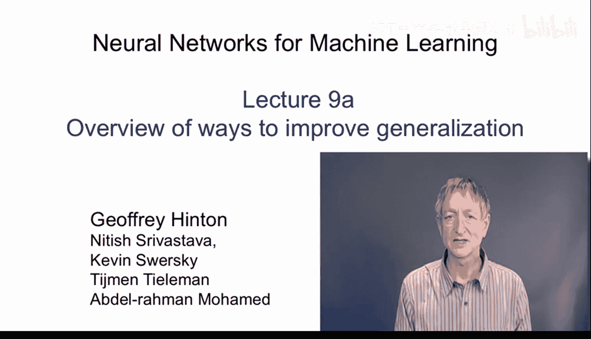
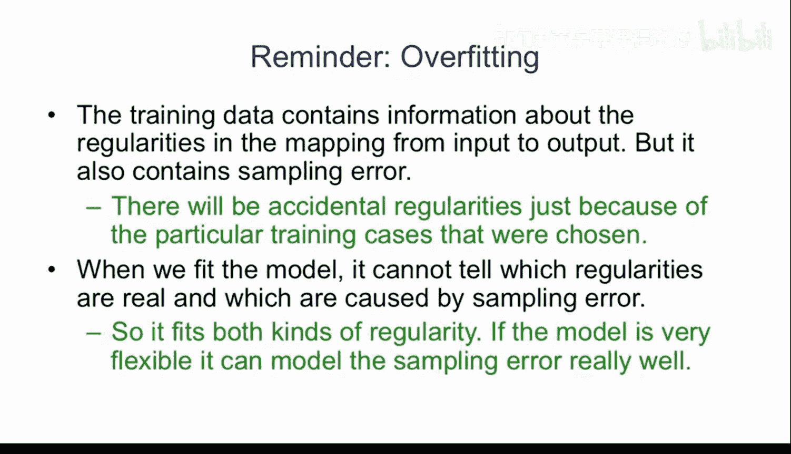
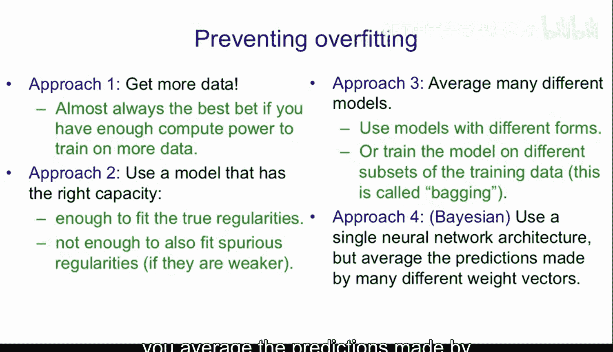
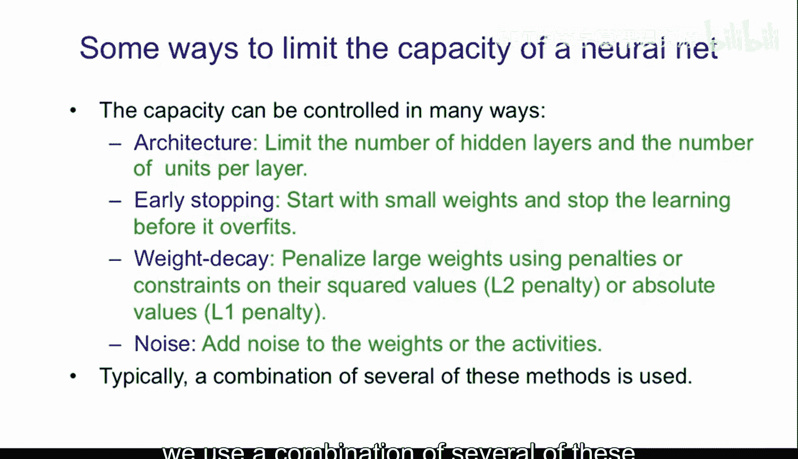
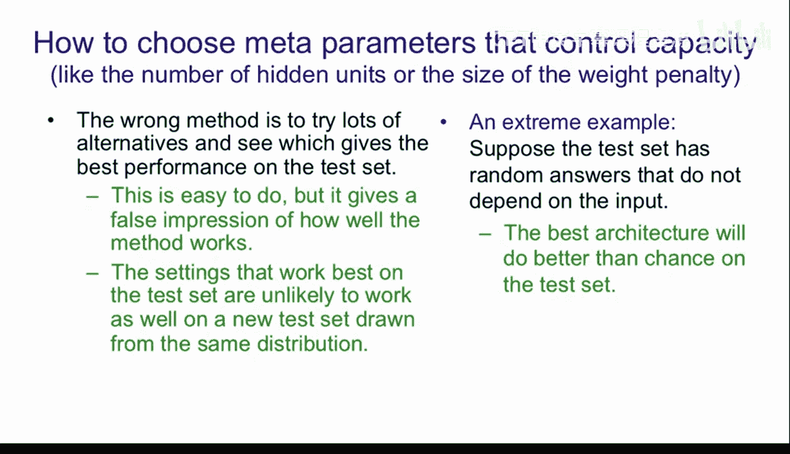
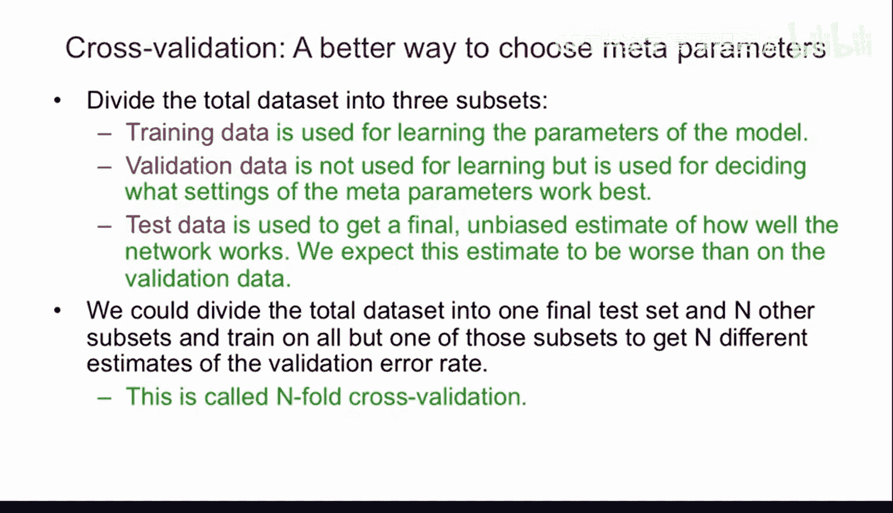
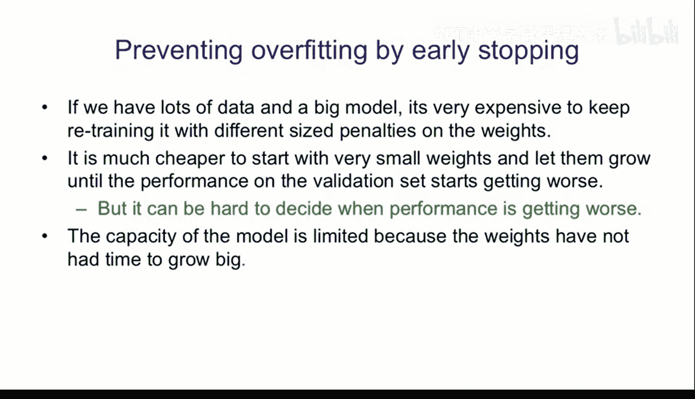
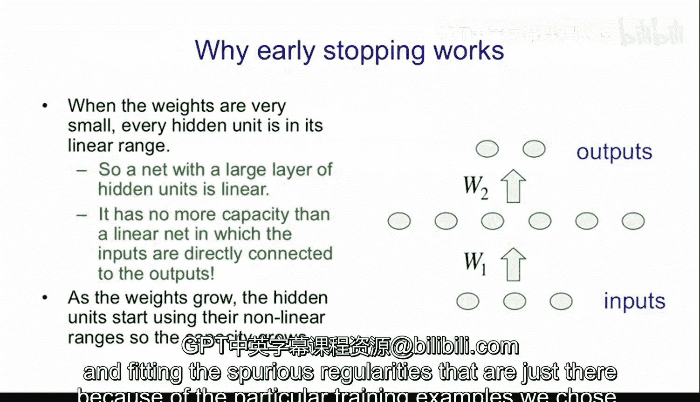

# 机器学习中的神经网络：第9.1讲：提升泛化能力的方法概述 🧠

在本节课中，我们将学习如何提升神经网络的泛化能力，即防止模型在训练数据上表现过好，而在未见过的测试数据上表现不佳的现象，这被称为过拟合。

## 过拟合的原因

上一节我们介绍了神经网络的基本概念，本节中我们来看看为什么会出现过拟合。任何有限的训练数据集，除了包含从输入到输出映射的真实规律信息外，还包含采样误差。这意味着训练集中存在一些偶然的规律，仅仅是因为我们选择了特定的训练样本。当模型进行拟合时，它无法区分哪些规律是真实的（即使重新采样训练集也会存在），哪些是由采样误差引起的。因此，模型会同时拟合这两种规律。如果模型过于灵活，它会非常完美地拟合采样误差，从而导致泛化能力变差。

## 防止过拟合的方法

为了应对过拟合，我们需要采取一些策略。以下是几种主要的方法：

1.  **获取更多数据**：这是迄今为止最好的方法。如果你能获得更多数据，就没有必要设计复杂的方案来防止过拟合。数据本身具有防止过拟合的正确特性。假设你的计算机足够快，数据越多越好。

2.  **限制模型容量**：这种方法试图明智地限制模型的容量，使其有足够的能力拟合真实规律，但又不足以拟合由采样误差引起的虚假规律。这当然非常困难，本讲剩余部分将描述各种尝试适当调节容量的方法。

3.  **模型平均**：在下一讲中，我们将讨论将许多不同模型进行平均的方法。如果我们对具有不同形式并犯不同错误的模型进行平均，那么平均模型的表现将优于单个模型。我们可以通过在不同的训练数据子集上训练模型来使它们不同，这种技术称为“装袋法”。还有其他方法可以干扰训练数据，以使模型尽可能不同。

4.  **贝叶斯方法**：这种方法使用单一的神经网络架构，但寻找许多不同的权重集合，这些权重都能很好地预测输出。然后在测试数据上，对所有不同权重向量做出的预测进行平均。

## 控制模型容量的具体方式

有多种方式可以控制模型的容量。以下是几种常见的方法：

*   **通过架构控制**：最明显的方式是通过架构，即限制隐藏层的数量和每层的单元数量。这控制了网络中的连接数量，也就是参数的数量。
*   **提前停止**：第二种方法通常非常方便，即从较小的权重开始，然后在模型有时间再次过拟合之前停止学习。其假设是模型会先找到真实规律，然后才会找到仅与我们拥有的特定训练集相关的虚假规律。本视频末尾将描述此方法。
*   **权重惩罚或约束**：控制神经网络容量的一种非常常见的方法是给它一个略大的隐藏层或每层单元数，然后通过对权重的平方值或绝对值施加惩罚或约束来惩罚权重。
*   **添加噪声**：我们可以通过向权重或激活值添加噪声来控制模型的容量。

通常，我们会结合使用上述几种不同的容量控制方法。

## 如何设置元参数

对于大多数这些方法，都有需要设置的元参数，例如隐藏单元的数量、层数或权重惩罚的大小。

一个显而易见的方法是尝试某个元参数（例如隐藏单元数量）的许多不同值，看看哪个在测试集上表现最好。但这种方法存在一个严重问题：它会对方法在另一个测试集上的表现给出错误的印象。因为在一个特定测试集上表现最好的设置，不太可能在从同一分布中抽取的新测试集上表现得同样好，因为它们已经被调整到适合那个特定的测试集。这意味着你会对在新测试集上的表现产生错误的印象。

让我给你一个极端的例子。假设测试集确实是随机的（很多金融数据似乎就是这样），即答案根本不依赖于输入或无法从输入预测。如果你选择在测试集上表现最好的模型，它显然会比随机猜测更好，因为你选择了它来超越随机猜测。但如果你将该模型应用于同样是随机的新数据，你不能期望它比随机猜测更好。

因此，通过选择模型，你会对模型在新数据上的表现产生错误的印象。问题是，有没有办法解决这个问题？

## 更好的元参数选择方法

以下是选择元参数的更好方法：

你首先将总数据集分成三个子集：
1.  **训练数据**：用于训练模型。
2.  **验证数据**：不用于训练，但用于决定如何设置元参数。换句话说，你将根据模型在验证数据上的表现来决定合适的隐藏单元数量或权重惩罚大小。
3.  **测试数据**：一旦你完成了上述步骤，并用看起来最好的隐藏单元数量和权重惩罚大小训练了模型，你将查看它在最后保留的数据集（即测试数据）上的表现。你只能使用测试数据一次，这将为你提供网络性能的无偏估计。通常，这个估计会比在验证数据上的表现稍差一些。

如今，在竞赛中，组织者已经学会保留真正的测试数据，并让参赛者提交预测结果，以便他们可以看到参赛者是否真的能预测真正的测试数据，或者他们是否只是通过选择在验证数据上表现特别好的元参数来过度拟合验证数据，而这些元参数无法泛化到新的测试集。

我们可以通过旋转验证集来获得对权重惩罚、隐藏单元数量或我们试图使用验证数据固定的任何其他参数的更好估计。我们保留一个最终的测试集用于最终的无偏估计，然后将其他数据分成N个大小相等的子集，我们在除其中一个子集外的所有子集上进行训练，并将该子集用作验证集。然后我们可以旋转并保留一个不同的子集作为验证集，从而获得关于最佳权重惩罚或最佳隐藏单元数量的许多不同估计。这被称为**N折交叉验证**。重要的是要记住，我们得到的不同估计并不是相互独立的。例如，如果我们真的不走运，某个类别的所有样本都落入其中一个子集，我们会期望泛化能力非常差。无论该子集是验证集还是在训练数据中，我们都会期望泛化能力非常差。

## 提前停止法

现在，我将描述一种特别易于使用的防止过拟合的方法。当你有一个大模型和一台小计算机，并且没有时间用不同的隐藏单元数量或不同的权重惩罚大小多次训练模型时，这种方法很有效。

具体做法是：你从小权重开始，随着模型训练，权重会增长。你观察模型在验证集上的表现。一旦表现开始变差，你就停止训练。验证集上的表现可能会波动，特别是如果你测量的是错误率而不是平方误差或交叉熵误差。因此，很难决定何时停止。所以，你通常的做法是继续训练，直到你确定情况正在恶化，然后回到情况最好的那个点。

这种方法之所以能控制模型的容量，是因为具有小权重的模型通常没有太大的容量，而且权重还没有时间增长到很大。一个有趣的问题是：为什么小权重会降低容量？

## 小权重如何降低容量

考虑一个具有一些输入单元、隐藏单元和输出单元的模型。当权重非常小时，如果隐藏单元是逻辑单元，它们的总输入将接近0，并且它们将处于其线性范围的中间。也就是说，它们的行为非常像线性单元。这意味着当权重很小时，整个网络等同于一个将输入直接映射到输出的线性网络。因此，如果你将权重矩阵 **W1** 乘以权重矩阵 **W2**，你将得到一个可用于连接输入和输出的权重矩阵。只要权重很小，具有一层逻辑隐藏单元的网络的行为将与那个线性网络大致相同，前提是我们还将线性网络中的权重除以4，以考虑到当隐藏单元处于其线性区域时，其斜率为四分之一。因此，它的容量并不比线性网络大。

所以，即使在我展示的那个网络中有 `3*6 + 6*2` 个权重，它的容量实际上并不比一个有 `3*2` 个权重的网络大。但随着权重增长，我们开始使用Sigmoid单元的线性区域，然后开始利用所有这些参数。

因此，如果网络在学习开始时具有6个有效参数，在学习结束时具有30个有效参数，那么我们可以认为容量随着权重的增大而从6个参数平滑地变化到30个参数。在提前停止中发生的情况是，当模型具有适当数量的参数以在验证数据上达到最佳可能表现时，我们停止学习。也就是说，当它在拟合数据中的真实规律和拟合仅由于我们选择的特定训练样本而存在的虚假规律之间达到最佳权衡时。

## 总结

本节课中我们一起学习了提升神经网络泛化能力的核心思想与方法。我们首先理解了过拟合的根本原因在于模型同时拟合了数据中的真实规律和采样误差带来的虚假规律。接着，我们探讨了四种主要的应对策略：获取更多数据、限制模型容量、模型平均以及贝叶斯方法。在控制模型容量的具体技术中，我们详细了解了通过架构设计、提前停止、权重惩罚和添加噪声等方法。我们还学习了正确设置元参数的重要性，并介绍了使用训练集、验证集和测试集的三分法以及N折交叉验证来获得无偏性能评估。最后，我们深入分析了提前停止法的工作原理，解释了小权重如何通过使网络在初期近似于线性模型来有效控制容量，从而在拟合真实规律与避免过拟合之间找到平衡点。