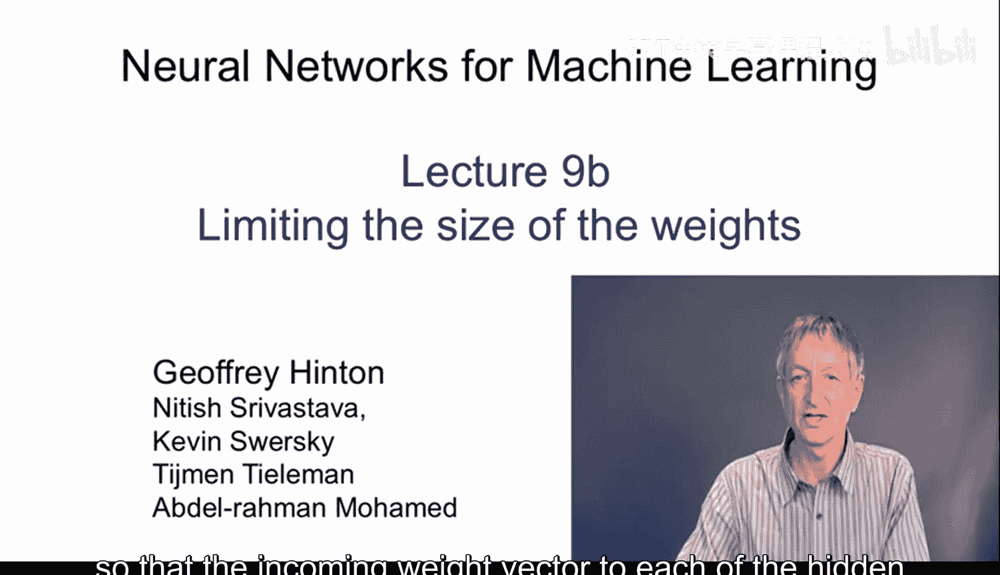
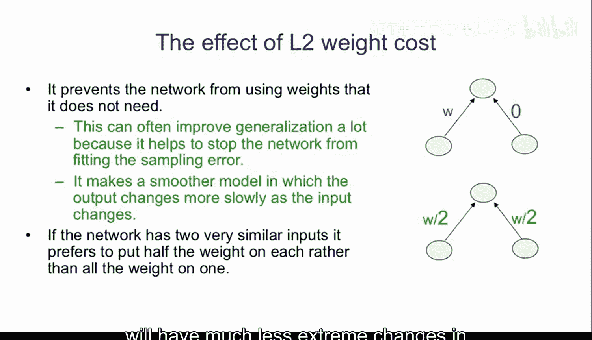
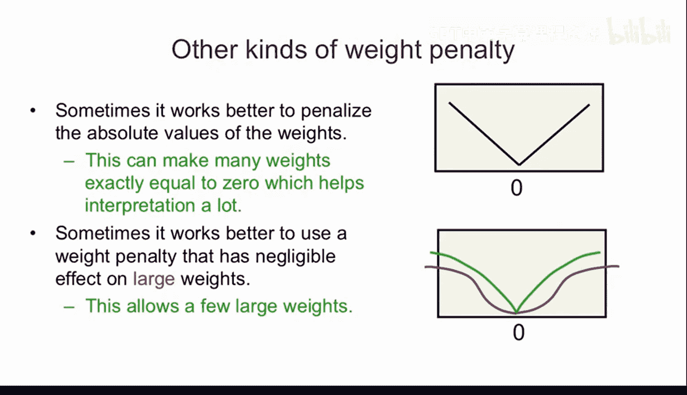
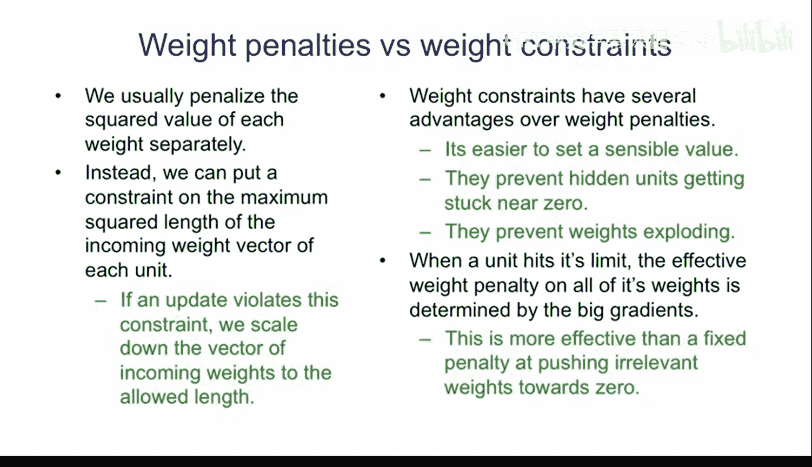

# Hinton@多伦多大学《机器学习的神经网络｜Neural Networks for Machine Learning 2016》claude-4s p40 -40-Lecture 9.2 — Limiting the size of the weights  -Neural Networks for Machine -BV1HtkUB2EZD_p40-

In this video， I'll talk about how we can control capacity by limiting the size of the weights。

The standard way to do this is to introduce a penalty that prevents the weights from getting too large。

 with the implicit assumption that a network with small weights is somehow simpler than a network with large weights。

There are several different penalty terms we can use。

And it's also possible to constrain the weights so that the incoming weight vector to each of the hidden units is not allowed to be longer than a certain length。

The standard way to limit the size of the weights is to use an L 2 weight penalty。

Which means that we penalize the square value of the weight。

This is sometimes called weight decay in the neural network literature。

Because the derivative of that penalty acts like a force pulling the weight towards 0。

This weight penalty keeps the weights small unless they have big error derivatives to counteract it。

So if you look at what the penalty term looks like as the weight moves away from 0。

You get this parabolic cost。If you look at the equation。

 the cost that you're optimizing is the normal error that you're trying to reduce。Plus。

 a term which is the sum of the squares of the weights with a coefficient in front Lada。

And we divide by two so that when we differentiate the twos cancel。

That coefficient in front of the sum squared weights is sometimes called the weight cost。

That determines how strong the penalty is。If you differentiate。

 you can see the derivative of this cost。Is just the derivative of the error。Plus。

 something that's to do with the size of the weight and the value of lambda。

That derivative will be 0。When the magnitude of the weight is one over lambda times the magnitude of the derivative。

So the only way you can have big weights when you're at a minimum of the cost function is if they also have big error derivatives。

And this makes the weights much easier to interpret。

You don't have a whole lot of weights that are large， but aren't doing anything。

The effect of an L2 penalty on the weights is to prevent the network from using weights that it doesn't need。

This often improves generalization a lot because it can use those weights that it doesn't really need to fit the sampling error。

It also makes a smoother model in which the output changes more slowly as the input changes。

So if the network has two very similar inputs， when you put in an L2 weight penalty。

 it prefers to put half the weight on each of those two similar inputs。

 rather than all of the weight on one， as shown on the right here。If the two inputs are very similar。

 those two networks will produce very similar outputs。

But the one with the halved weights will have much less extreme changes in its output when you change the inputs。

There are other kinds of weight penalty。 For example。

 an L1 penalty where the cost function is just this V shape。

So here what we're doing is we're penalizing the absolute values of the whites。

This has the nice effect that it drives many of the weights to be exactly 0。

And that helps a lot in interpretation。If there's only a few nonze weights left。

 it's much easier to understand what's going on。We can also use weight penalties that are more extreme than L1。

 where the gradient of the cost function actually gets smaller when the weight gets really big。

This allows the network to keep large weights without them being pulled towards 0。

 iss just the small weights that will get pulled towards 0。

So we then are even more likely to get nets with a few large weights。

Instead of putting penalties on the weights， we could actually use weight constraints。

What I mean by that is instead of penalizing the squared value of each weight separately。

We put a constraint on the maximum squared length of the incoming weight vector of each hidden unit or output unit。

When we update the weights， if the length of that incoming vector gets longer than allowed by the constraint。

 we simply scale the vector down by dividing all the weights by the same amount until its length fits the alive length。

Using weight constraints like this has a number of advantages over weight penalties。

 and I found they work noticeably better。It's much easier to select a sensible value for the squared length of the incoming weight factor than it is to select a weight penalty。

That's because logistic units have a natural scale to them。 So we know what a weight of one means。

Using weight constraints also prevents hidden units getting stuck near 0 with all their weights being tiny and not doing anything useful。

Because when all their weights are tiny， there's no constraint on the weight。

 so there's nothing preventing them growing。Weight constraints also prevent the weights from exploding。

One of the subtle thing that weight constraints do is that when a unit hits its constraint。

The effective penalty on all of its weights is determined by the big gradients。

So if some of the incoming weights have very big gradients。

 they'll be trying to push the length of the incoming weight factor up。

And that will push down on all the other weights。So in effect， if you think of it like a penalty。

 the penalty scales itself so as to be appropriate for the big weights and to suppress the small weights。

This is much more effective than a fixed penalty of pushing irrelevant weights towards 0。

For those of you who know about Lagrange multipliers。

 the penalties are then just the Lagrange multipliers required to keep the constraintstraint satisfied。

