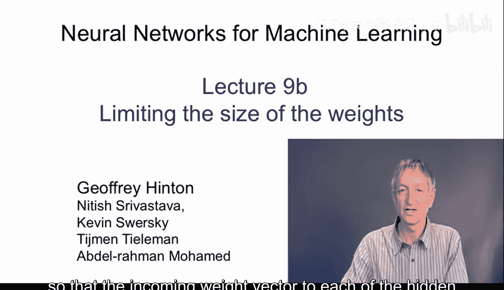
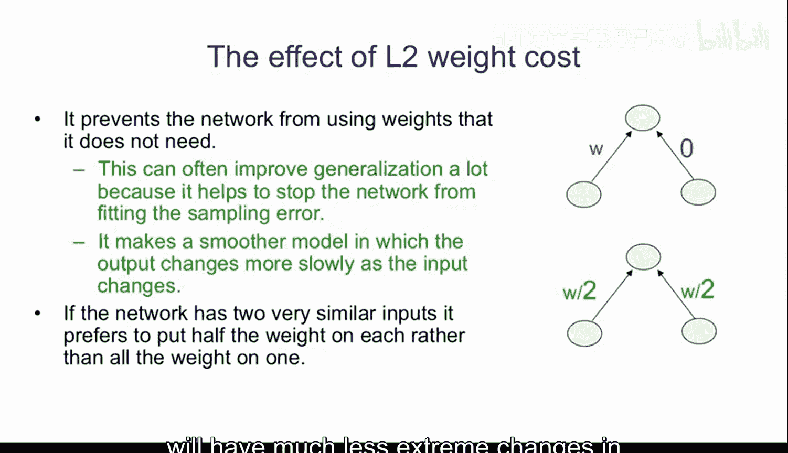
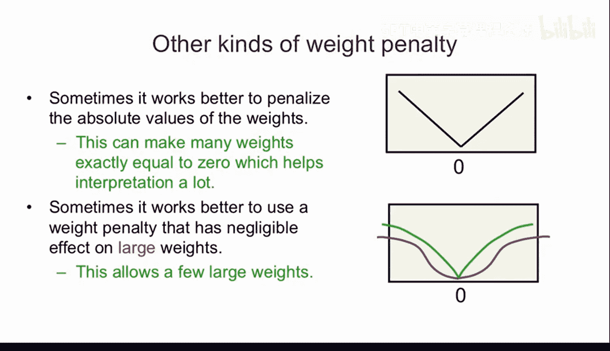
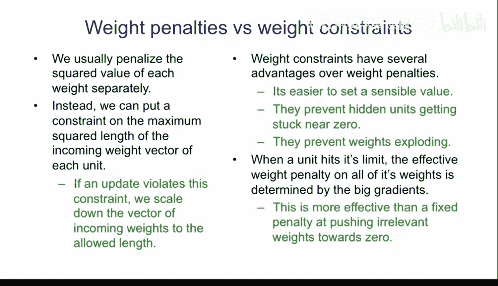

# 神经网络与机器学习：第9.2节：限制权重的大小 🧠

在本节课中，我们将学习如何通过限制神经网络中权重的大小来控制模型的容量。这是防止模型过拟合、提升其泛化能力的关键技术之一。

## 概述 📋

控制模型容量的一种标准方法是引入一个惩罚项，以防止权重变得过大。其背后的隐含假设是，具有较小权重的网络在某种意义上比具有较大权重的网络更简单。我们将探讨几种不同的惩罚项，以及如何通过约束权重向量长度来实现这一目标。

## 标准方法：L2权重惩罚

上一节我们介绍了控制容量的概念，本节中我们来看看最常用的方法：L2权重惩罚。

标准限制权重大小的方法是使用L2权重惩罚。这意味着我们对权重的平方值进行惩罚。在神经网络文献中，这有时被称为“权重衰减”，因为该惩罚项的导数会产生一个将权重拉向0的力。

这种权重惩罚会保持权重较小，除非它们有足够大的误差导数来抵消它。从公式上看，我们优化的总成本函数是：

**总成本 = 误差 + (λ/2) * Σ(权重²)**

其中，λ是决定惩罚强度的系数，有时被称为“权重成本”。除以2是为了在求导时与平方项的导数2相抵消。

当我们对总成本函数求导时，其导数等于误差的导数加上与权重大小和λ值相关的项。在成本函数的最小值点，导数为0。这意味着，只有当权重同时具有较大的误差导数时，才能在最小值点保持较大的权重值。

L2惩罚的效果是防止网络使用它不需要的权重。这通常能显著提升泛化能力，因为网络无法使用那些不必要的权重去拟合训练数据中的采样误差。同时，它还能产生一个更平滑的模型，使得输出随输入的变化更缓慢。

例如，当网络有两个非常相似的输入时，使用L2惩罚的网络倾向于将权重平分给这两个输入，而不是将所有权重放在其中一个上。这样，当输入变化时，输出的变化就不会那么极端。

## 其他类型的权重惩罚

除了L2惩罚，还有其他类型的惩罚项可供选择。

以下是几种常见的替代方案：

*   **L1惩罚**：其成本函数呈V字形，惩罚的是权重的绝对值。这种方法的一个优点是，它会将许多权重驱动到恰好为0，这极大地有助于模型的解释。如果只剩下少数非零权重，就更容易理解网络在做什么。
*   **更极端的惩罚**：我们还可以使用比L1更极端的惩罚函数，其成本函数的梯度在权重变得非常大时反而会减小。这允许网络保留较大的权重而不被拉向0，主要是将小权重拉向0。因此，我们更有可能得到具有少数大权重的网络。

## 权重约束：一种替代方案

除了对权重施加惩罚，我们还可以直接使用权重约束。

所谓权重约束，是指我们不对每个权重单独进行平方惩罚，而是对每个隐藏单元或输出单元的**输入权重向量**的最大平方长度施加一个约束。在更新权重时，如果某个单元的输入权重向量长度超过了约束允许的最大值，我们只需将所有权重除以同一个缩放因子，直到其长度符合约束。

与权重惩罚相比，使用权重约束有几个优势，并且实践表明其效果通常更佳。

以下是权重约束的主要优势：

*   **参数选择更直观**：为输入权重向量的平方长度选择一个合理的值，比为权重惩罚系数λ选值要容易得多。这是因为逻辑单元（如Sigmoid）本身具有自然的尺度，我们知道权重为1意味着什么。
*   **防止隐藏单元“卡死”**：权重约束可以防止隐藏单元的所有权重都变得极小，导致该单元失效。因为当所有权重都很小时，约束不会被触发，没有什么能阻止它们增长。
*   **防止权重爆炸**：约束能有效防止权重在训练过程中变得无限大。
*   **自适应的惩罚效果**：权重约束的一个微妙之处在于，当一个单元触及约束时，对其所有权重的有效惩罚是由最大的梯度决定的。如果某些输入权重有很大的梯度，它们会试图增加权重向量的长度，而这会压制所有其他权重。从效果上看，这就像一个自适应的惩罚，它会根据大权重的情况调整自身强度，并抑制小权重。这比固定的惩罚项在将无关权重推向0方面更有效。

对于那些了解拉格朗日乘数法的读者，这些惩罚项可以看作是保持约束满足所需的拉格朗日乘子。

## 总结 🎯

本节课中我们一起学习了控制神经网络容量的重要技术：限制权重大小。我们首先介绍了标准的L2权重惩罚（权重衰减）及其原理与效果，它能产生更平滑的模型并提升泛化能力。接着，我们探讨了L1惩罚等其他惩罚形式，它们能产生稀疏的权重，便于解释。最后，我们学习了权重约束这一强大的替代方案，它通过直接限制每个单元的输入权重向量长度来实现控制，具有参数选择直观、防止单元失效和权重爆炸等优点，在实践中往往表现更佳。理解并应用这些技术，对于构建稳健、高效的神经网络模型至关重要。