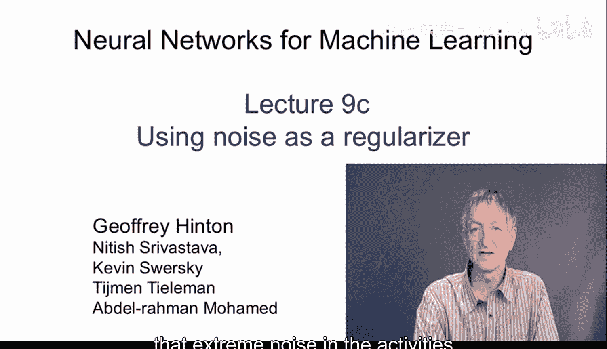
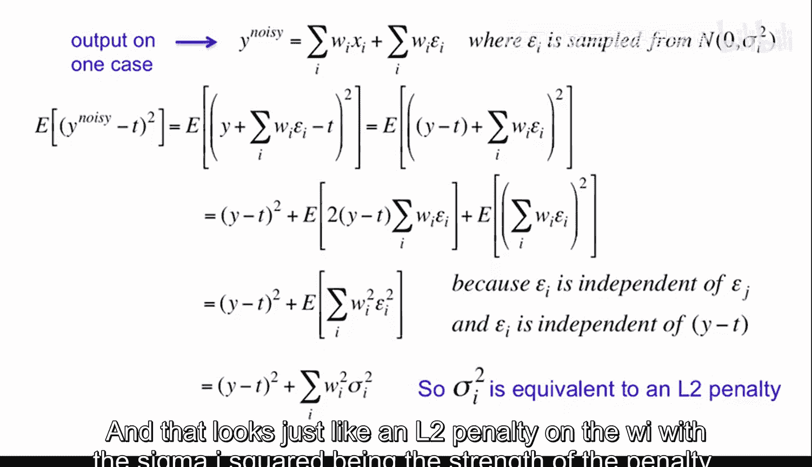
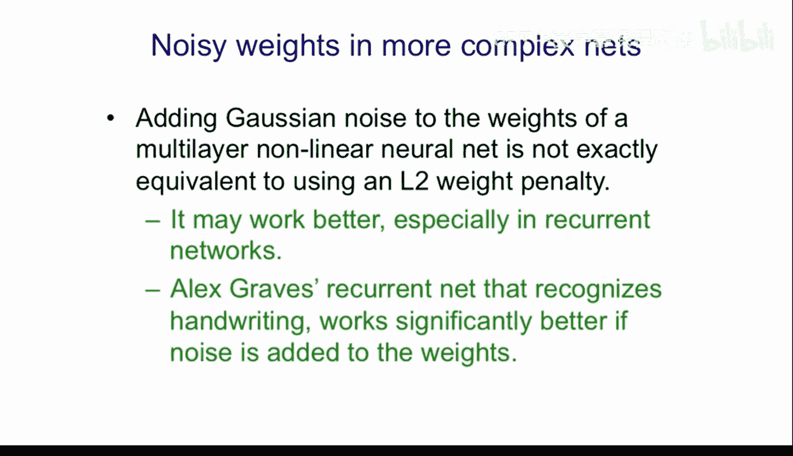
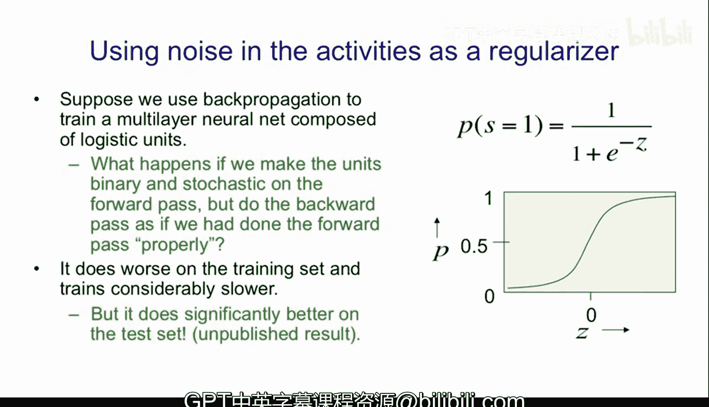

# Hinton@多伦多大学《机器学习的神经网络｜Neural Networks for Machine Learning 2016》claude-4s p41 -41-Lecture 9.3 — Using noise as a regularizer  -Neural Networks for Machine Lea -BV1HtkUB2EZD_p41-

In this video， I'll talk about another way of restricting the capacity of a neural network。

We can do that by adding noise either to the weights or to the activities。

I'll start by showing that if we add noise to the inputs in a simple linear network that's trying to minimize a squared error。

 that's exactly equivalent to imposing an L2 penalty on the weights of the network。

I'll then describe uses of noisy weights in more complicated networks。

And I'll finish by describing a recent discovery。That extreme noise in the activities can also be a very good regularisizer。

So let's look at what happens if we add Gaussian noise to the inputs to a simple neural network。

The variance of the noise gets amplified by the squared weights on the connections going into the next hidden layer。

If we have a very simple net with just a linear output unit that's directly connected to the inputs。

The amplified noise then gets added to the output。So if you look at the diagram。

We put in an input Xi with additional Gaussian noise that sampled from a Gaussian with0 mean and variant sigma I squared。

That additional noise has its variance multiplied by the squared weight。

It then goes through the linear output unit J。 And so what comes out of J is the Y J that would have come out before。

 plus Gaussian noise but has zero mean and has variance W I squared， sigma I squared。

This additional variance makes an adddjective contribution to the square error。

You can think of it like Pythagoras theorem that the square error is going to be the sum of the square error caused by Yj and this additional noise because the noise is independent of Yj。

So when we minimize the total squared error， we'll minimize the squared error that will come out if it was a noise free system。

And in addition， well be minimizing that second term。 That is。

 well be minimizing the expected square value of that second term。

And the expected squared value is just W I squared sigma I squared。

So that corresponds to an L2 penalty on W I。With a penalty strength of sigma I squared。

For those of you who like math， I'm going to derive that on this slide。 If you don't like math。

 you can just skip this slide。The output， why noisy。

 when we add noise to all of the inputs is just what the output would have been with a noise free system。

 The sum of all， the inputs of W I X I。Plus。W I times the noise that we added to each input。

 and those noises are sampled from a Gaussian with zeroeroine and varianceant sigma I squared。

So if we compute the expected squared difference between y noisy and the target value T。

That's the quantity that's shown on the left hand side of the equation。

And I'm using an E followed by square brackets to mean an expectation。 That's not the error。

 That's an expectation。And what we're computing the expectation of is the thing in the square brackets。

 So in this case， we're computing the expectation of the square error that we'll get with the noisy system。

So if we substitute the equation above for y noisy， we need the expectation of why。Plus。

 the sum over the eye of W I Epsilon I。So when we complete the square。

 the first time we get is y minus t squared。 And that's not inside an expectation bracket because it doesn't involve any noise。

The second term is the cross product of the two terms above。

And the third term is the square of the last term。Now， that equation simplifies a lot。In fact。

 it simplifies down to the normal squared error plus the expectation of W I squared Epsilon I squared summed overall I。

The reason it simplifies is because Epsilon I is independent of epsilon J。

 So if you look at the last term， when we multiply at that square。

 all of the cross terms have an expected value of 0 because we're multiplying together two independent things that are 0 mean。

If you look at the middle term， that also has an expectation of 0。

 because each of the epsilon eyes is independent of the residual error。

So we can rewrite the expectation of the sum overall I of W I squared epsilon I squared。

 as simply the sum overall I of W I squared sigma I squared。

Because the expectation of Epsilon I squared is just sigma I squared。

Because that's how we generated Epsil A。And so we see that the expected squared error we get is just the square error we get in the noise free system。

 plus this additional term。And that looks just like an L2 penalty on the W I with the sigma I squared being the strength of the penalty。

In more complex nets， we can restrict the capacity by adding Gasing noise to the weights。

This isn't exactly equivalent to an L2 penalty。But it seems actually to work better。

 especially in recurrent network。So Alex Graves recently took his recurrent net that recognises handwriting and tried it with noise added to the weights。

 and it actually works better。

We can also use noise in the activities as a regularizer。

So suppose we use back propagation to train a multi layer neural net with logistic hidden units。

What's going to happen if we make the units binary and stochastic on the forward pass。

 but then we do the backward pass as if we've done the normal deterministic forward pass using the real values？

So we're going to treat a logistic unit in the forward pass as if it's a stochastic binary neuron。

 That is， we compute the output of the logistic P， and then we treat that P as the probability of outputting a1。

 And in the forward pass， you make a random decision， whether to output a 1 or a 0。

 using that probability。But in the backward pass， you use the real value of P for back propagating derivatives through the hidden unit。

This isn't exactly correct， but it's close to being a correct thing to do for the stochastic system。

 If all of the units make small contributions to each unit in the layer above。When we do this。

 the performance on the training set is worse， and training is considerably slower。

 It may be several times slower。But it does significantly better on the test set。

This is currently an unpublished result。

