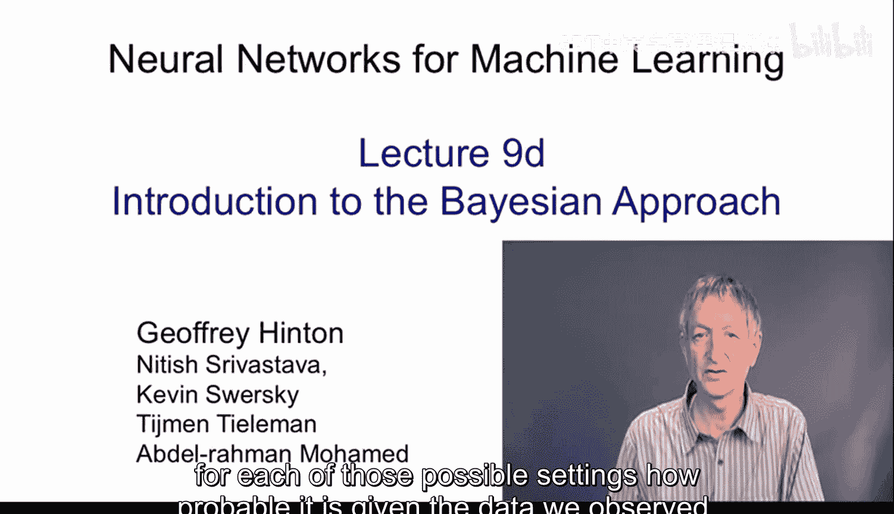
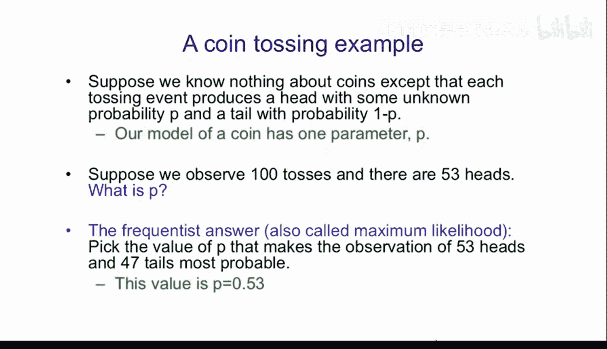
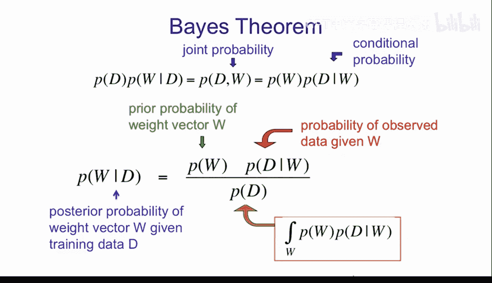

# Hinton@多伦多大学《机器学习的神经网络｜Neural Networks for Machine Learning 2016》claude-4s p42 -42-Lecture 9.4 — Introduction to the full Bayesian approach  -Neural Networks f -BV1HtkUB2EZD_p42-

In this video， I am going to describe the Bayesian approach to fitting models using a simple coin tossing example。

If you already know about the Bayesian approach， you can skip this video。

The main idea behind the baesing approach。Is that instead of looking for the most likely setting of the parameters of a model。

We should consider all possible settings of the parameters and try and figure out for each of those possible settings have probabilities。

 given the data we observed。 the Bayesian framework assumes that we always have a prior distribution for everything。

That is， for any event you might care to mention， I have to have some prior probability that that event might happen。

The prime might be very vague。So what's happening is our data gives us a likelihood term。

 We combine it with our prior， and then we get a posterior。

The likelihood term favors settings of our parameters that make the data more likely。

It can disagree with the prior。 And in the limit， if we get enough data。However。

 unlikely the prior is， the data can overwhelm it。 And in the end， with enough data。

 the truth will out。 That is， even if your prior is wrong， you'll end up with the right hypothesis。

But that may take an awful lot of data if you thought things were very unlikely under your prior。

So let's start with a coin tossing example。Suppose you don't know anything about coins except that they can be tossed。

 And when you toss a coin， you get either a head or a tail。And we're also going to assume。

 you know that each time you do that， it's an independent decision。

So our model of a coin is going to have one parameter P。

This parameter P determines the probability that the coin will produce ahead。

What happens now if we see 100 tosses and there are 53 heads。What is a good value for P。Well。

 obviously， you're tempted to say 053。But what's the justification for that。The frequentest answer。

Which is also called maximum likelihood， is to pick the value of P that makes the observations most probable。

And that value of P is 0。53。It's not obvious that's true。 Let's derive that。

So the probability of a particular sequence that contains 53 heads and 47 tails could be written out by writing down P every time you toss a head and one minus P every time you toss a tail。

And then if we collect all the p's together and all the one minus ps together。

 we get p to the 53 and 1 minus p to the 47。If we now ask。

 how does the probability of observing that data depend on P。We can differentiate， with respect to P。

And we get the expression shown here。And if we then set that derivative to 0。

We discover that the probability of the data is maximized by setting P to be 0。53。So。

 that's maximum likelihood。But there's some problems with using maximum likelihood to decide on the parameters of a model。

Suppose， for example， we only tossed the coin once， and we got one head。

It doesn't really make sense to say we think the probability of the coin coming down hence in future is one。

That would mean we'd be willing to bet at infinite odds that it can't come down tails。

 And that seems ridiculous。It's sort of intuitively obvious that a much better answer is nough 0。5。

 But how can we justify that。More importantly， we can ask， is it reasonable to give a single answer。

We don't know much。 We don't have much data。 And so we're unsure about what the value of P is。

So what we really ought to do is refuse to give a single answer and instead give a whole probability distribution across possible answers。

An answer like 05 is fairly likely。 An answer like  one is maybe still pretty unlikely if we have some prior belief that coins come down heads half the time。

So now I'm going to go through an example where we start with some prior distribution over parameter values。

 and we'll pick a prior distribution that's easy to work with。

 not one that necessarily fits what we really believe about coins。

And then we'll show how that prior distribution gets modified by data if we adopt the Bayesian approach。

So we're going to start with a prior distribution that says all the different values appear equally likely。

We believe that coins come bias to various extents， and any amount of bias is equally likely。

 so that some coins come down heads half the time。 Other coins come down heads all the time。

 and those two kinds of coins are equally likely。We now observe a coin coming down heads。

So what we do now is for each possible value of P。We take its prior probability。

And we multiply by the probability that we would have observed ahead。

 given that that value of P is the correct one。So， for example， if we take the value of P equal to1。

 which says coins come down heads every time then。The probability of observing ahead would be one。

There would be no alternative。And if we take the value of P to be 0。

 the probability of the observing head would be 0。And if we take it to be 0。5。

 the probability of a observing head will be 0。5。So we take that red line that's our prior。

 and we multiply each point on that by the probability of observing ahead。

 according to that hypothesis。 And now we get the sloping line。That's our unnormalized posterior。

 It's unnormalized because the area under that line doesn't add up to one。And， of course。

 for a probability distribution， the probabilities of all the alternative events have to add to one。

So the last thing we do is we renormalize it。 We scale everything up。

 So the area under the curve is one。And now， if we started with a uniform prior distribution of a P。

We end up。With this triangular posterior distribution of a P， having observed one head。Now。

 let's do it again。 And this time， let's suppose we get a tail。

So the prior distribution we start with now。Is the posterior distribution we had after observing our one head。

And now the green line shows the probability that we will get a tail。

 according to each of those hypotheses that correspond to a value of P。So， for example， if p is 1。

 the probability we would observe a tail is 0。So we have to multiply our prior by our likelihood term。

And now we get a curve like that。Then we have to renormalize to make the area be one。

And that's now our posterior distribution after having observed one head and one tail。

And notice it's a pretty sensible distribution。After observing one of each。

 we know that P can't be either 0 or one。And it also seems very sensible that the most likely thing is now in the middle。

If we do this again another 98 times and keep applying the same strategy of multiplying the posteri we had after the last toss by the likelihood of observing that event。

 given the various different settings of the parameter P。

And let's suppose we get 53 heads and 47 tails in all。

 Then we'll end up with a curve that looks like this。It'll have its mean at 0。

53 because we started with a uniform prior。And it'll be fairly sharply peaked about 。53。

But it will allow other values， like 0。49 is a perfectly reasonable value under this curve。

Not quite as likely as 0。53， but very reasonable， whereas the value like 0。

25 is extremely unlikely under this curve。So we can summarize all that with base theorem。

The term in the middle of this equation。Is the joint probability。Of a set of parameters。

 W and some data D。And for supervised learning， the data is going to consist of the target values。

So we assume that we're given the inputs and the data consists of the target values that are associated with those inputs。

 That's what we observe。That joint probability can be rewritten as the product of an individual probability and a conditional probability。

So on the right， we've written it as P of W times P of D given W。And on the left。

 I've written it as P of D times P of W given D。Now we can divide both sides by P of D。

And that gives us base there。 I mean， it's usual form。

Base theorem says that the posterior probability of a particular value of W， given the D to D。

Is just the prior probability of that particular value of W。Times the probability。

 given that particular value of W that you would have observed the data you observed。

And that has to be normalized by P of D， the probability of the data。

Which is simply the integral over all possible values of W of P of W， P of D given W。

The bottom line needs to be the sum of the top line over all possible values W in order for this to be a probability distribution that adds to one。

Because that P of D has integrated overall possible values of W。

 It's not affected by picking a particular value of W on the left hand side。

So when we're looking for the best value of W， for example。We can ignore P of D。

 It doesn't depend on W。

The other two terms on the right hand side， however， do depend on W。

