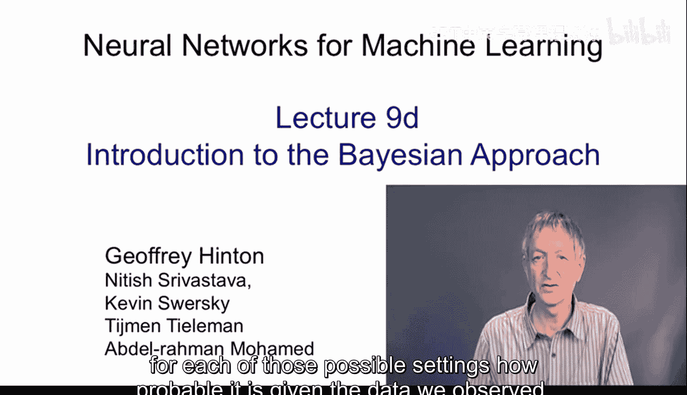
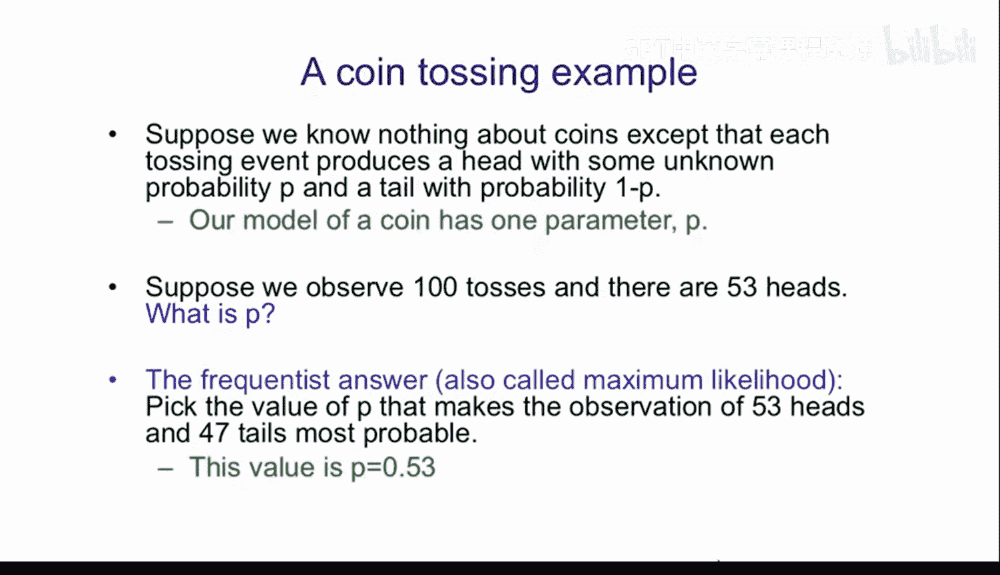
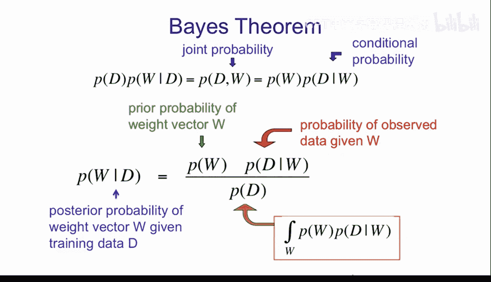

# 机器学习中的神经网络：第9.4讲：贝叶斯方法入门 🎲

在本节课中，我们将通过一个简单的抛硬币例子，学习贝叶斯方法如何用于拟合模型。我们将理解其核心思想，并与传统的最大似然估计方法进行比较。

## 概述

贝叶斯方法的核心思想是：我们不应只寻找模型参数最可能的单一取值，而应考虑参数所有可能的取值，并计算在观察到数据后，每个可能取值的概率。贝叶斯框架假设我们总是对一切事件拥有一个先验分布。

## 贝叶斯方法的核心流程

上一节我们介绍了贝叶斯方法的核心理念，本节中我们来看看它的具体流程。

贝叶斯推断的过程可以概括为：我们拥有关于参数的先验知识（先验分布），当观察到数据后，数据会提供一个似然项。我们将先验与似然结合，从而得到后验分布。

*   **先验分布**：在观察任何数据之前，我们对参数可能取值的信念。它可以是模糊的。
*   **似然项**：在给定特定参数值时，观察到当前数据的可能性。它倾向于使数据更有可能的参数值。
*   **后验分布**：结合先验和似然后，我们得到的关于参数在给定数据下的更新后的概率分布。

似然项可能与先验发生冲突。在极限情况下，如果我们获得足够多的数据，无论先验多么不可能，数据都能压倒它。最终，只要有足够的数据，真相就会显现。也就是说，即使你的先验是错误的，你最终也会得到正确的假设。但如果你的先验认为某些情况极不可能，那么这可能需要非常多的数据。

## 抛硬币示例：从最大似然到贝叶斯

为了具体理解，让我们从一个抛硬币的例子开始。假设你对硬币一无所知，只知道它可以被抛出，并且每次抛掷会得到正面或反面。我们还假设你知道每次抛掷是独立的决策。

我们的硬币模型有一个参数 **P**。这个参数 **P** 决定了硬币产生正面的概率。

### 最大似然估计法

现在，如果我们看到100次抛掷中有53次正面，**P** 的好值是多少？显然，你可能会说0.53。但这样做的理由是什么？

频率学派的答案，也称为**最大似然估计**，是选择使观测数据概率最大的 **P** 值。这个 **P** 值就是0.53。让我们推导一下。

包含53次正面和47次反面的特定序列的概率可以写成：每次抛到正面时写下一个 **P**，每次抛到反面时写下一个 **(1-P)**。然后，如果我们把所有 **P** 和所有 **(1-P)** 分别收集起来，我们得到 **P^53 * (1-P)^47**。

如果我们现在问，观测到该数据的概率如何依赖于 **P**？我们可以对 **P** 求导，并得到如下表达式：

`d/dP [P^53 * (1-P)^47] = 53*P^52*(1-P)^47 - 47*P^53*(1-P)^46`

然后令该导数为0，我们发现数据的概率在设置 **P = 0.53** 时最大化。这就是最大似然估计。

### 最大似然估计的局限性

但是，使用最大似然估计来决定模型参数存在一些问题。

例如，假设我们只抛了一次硬币，并且得到了一个正面。说我们认为硬币未来出现正面的概率是1，这并不合理。那意味着我们愿意以无限的赔率打赌它不会出现反面，这看起来很荒谬。直觉上，一个更好的答案是0.5左右，但我们如何证明这一点呢？

更重要的是，我们可以问：给出单一答案是否合理？我们知之甚少，数据也不多，因此我们对 **P** 的值并不确定。所以我们真正应该做的是拒绝给出单一答案，而是给出一个跨越所有可能答案的完整概率分布。

## 完整的贝叶斯推断过程

上一节我们指出了点估计的不足，本节中我们来看看贝叶斯方法如何给出完整的概率分布。

我将通过一个例子来说明，我们从参数值的某个先验分布开始（为了计算方便，我们选择一个不一定符合我们对硬币真实看法的简单先验），然后展示如果我们采用贝叶斯方法，这个先验分布如何被数据修改。

### 步骤一：设定均匀先验

我们从一个认为所有不同值都同等可能的先验分布开始。我们相信硬币有各种程度的偏差，并且任何偏差量都同等可能。因此，有些硬币一半时间出现正面，有些硬币总是出现正面，这两种硬币的可能性相同。这个先验分布是一条水平的红线。

### 步骤二：观察到一次正面

现在我们观察到一次硬币出现正面。我们对于 **P** 的每个可能值，取其先验概率，并乘以在该 **P** 值是正确的情况下我们会观察到一次正面的概率。

例如：
*   如果取 **P = 1**（硬币每次都是正面），那么观察到正面的概率是1。
*   如果取 **P = 0**，观察到正面的概率是0。
*   如果取 **P = 0.5**，观察到正面的概率是0.5。

我们取那条红色的先验线，将其每个点乘以根据该假设观察到一次正面的概率，现在我们得到一条倾斜的线。那是我们的**未归一化后验**。它是未归一化的，因为该线下的面积加起来不等于1。当然，对于一个概率分布，所有替代事件的概率之和必须为1。

### 步骤三：归一化后验

我们做的最后一件事是重新归一化它。我们按比例放大一切，使得曲线下的面积为1。现在，如果我们从一个均匀的 **P** 先验分布开始，在观察到一个正面后，我们最终得到这个三角形的 **P** 后验分布。

### 步骤四：继续观察更多数据

让我们再做一次。这次，假设我们得到一个反面。我们现在开始的先验分布是我们观察到一个正面后得到的后验分布。现在，绿线显示了根据每个对应于 **P** 值的假设，我们会得到一个反面的概率。

我们必须将我们的先验乘以似然项，现在我们得到一条那样的曲线。然后我们必须重新归一化以使面积为1。这就是我们在观察到一次正面和一次反面后的后验分布。

注意，这是一个非常合理的分布。在观察到一正一反后，我们知道 **P** 不可能是0或1。而且最可能的事情现在在中间，这似乎也非常合理。

如果我们再这样做98次，并继续应用相同的策略：将上次抛掷后的后验乘以在各种不同参数 **P** 设置下观察到该事件的似然。假设我们总共得到53次正面和47次反面，那么我们最终会得到一条看起来像这样的曲线。因为我们从均匀先验开始，它的均值在0.53。它会相当尖锐地在0.53处达到峰值。但它也允许其他值，比如0.49在这条曲线下是完全合理的值，虽然没有0.53那么可能，但非常合理；而像0.25这样的值在这条曲线下就极不可能了。

## 贝叶斯定理

我们可以用贝叶斯定理来总结以上所有内容。

以下等式中间的项是参数集 **W** 和一些数据 **D** 的联合概率。对于监督学习，数据将包含目标值。我们假设输入是给定的，数据由与这些输入相关联的目标值组成，这就是我们观察到的。

`P(W, D) = P(D) * P(W|D) = P(W) * P(D|W)`

这个联合概率可以重写为一个个体概率和一个条件概率的乘积。在右边，我们将其写为 **P(W)** 乘以 **P(D|W)**。在左边，我将其写为 **P(D)** 乘以 **P(W|D)**。

现在我们可以两边同时除以 **P(D)**，这就得到了贝叶斯定理的通常形式：

`P(W|D) = [P(W) * P(D|W)] / P(D)`

贝叶斯定理说：给定数据 **D**，参数 **W** 的某个特定值的后验概率，就等于该特定 **W** 值的先验概率，乘以在该特定 **W** 值下你会观察到你所观测数据的概率，然后除以数据 **D** 的概率 **P(D)** 进行归一化。

**P(D)** 是数据概率，它简单地是 **P(W) * P(D|W)** 在所有可能 **W** 值上的积分。为了使这是一个总和为1的概率分布，底行必须是顶行在所有可能 **W** 值上的总和。因为那个 **P(D)** 已经对所有可能的 **W** 值进行了积分，所以它不受在左侧选择特定 **W** 值的影响。

因此，例如，当我们寻找最佳的 **W** 值时，我们可以忽略 **P(D)**，因为它不依赖于 **W**。然而，右边的另外两项确实依赖于 **W**。

## 总结

本节课中我们一起学习了贝叶斯方法的基本原理。我们通过抛硬币的例子，对比了最大似然估计与贝叶斯推断的区别。贝叶斯方法的核心优势在于它不提供参数的单一“最佳”估计，而是提供一个完整的后验概率分布，这能更好地表达我们的不确定性。我们从先验信念出发，利用观测数据（似然）对其进行更新，最终得到后验信念。这个过程由贝叶斯定理精确描述，为我们在数据有限或需要纳入先验知识时提供了强大的建模框架。