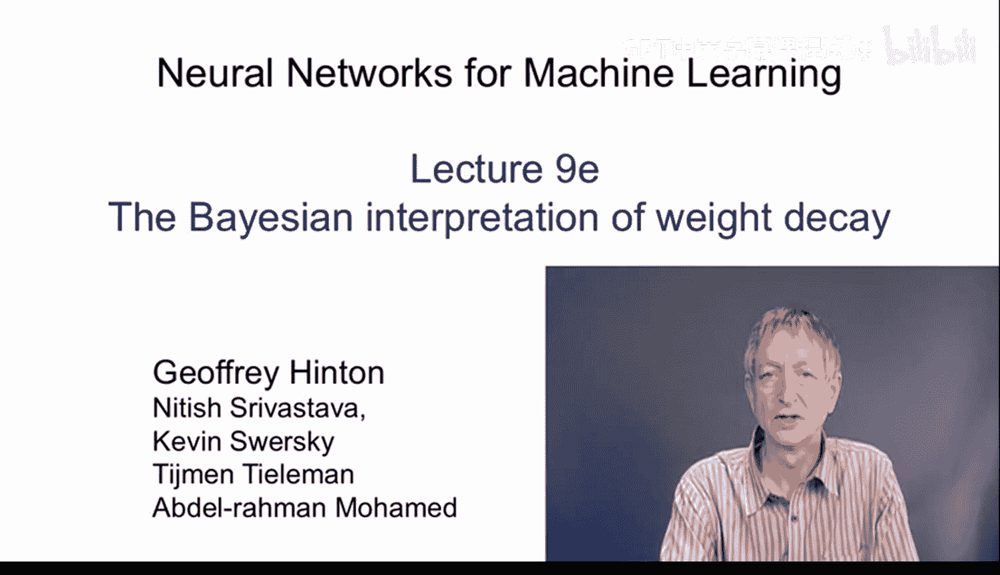
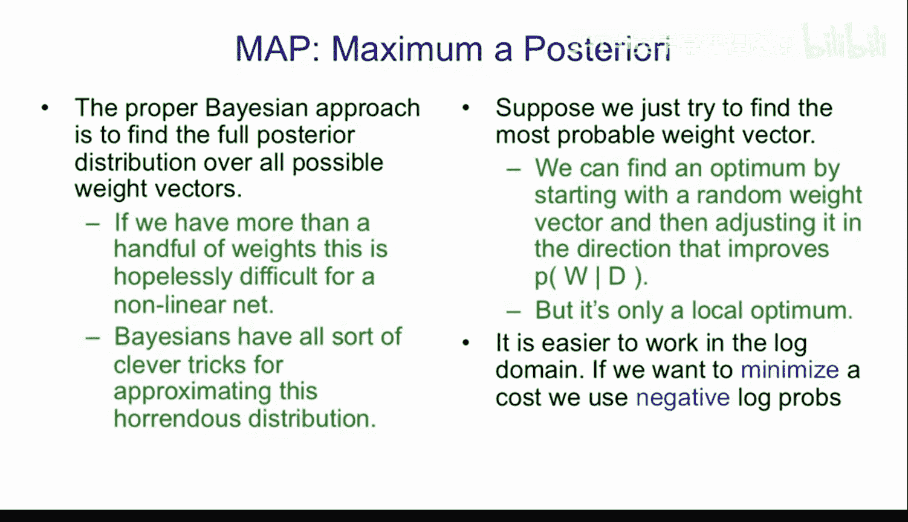
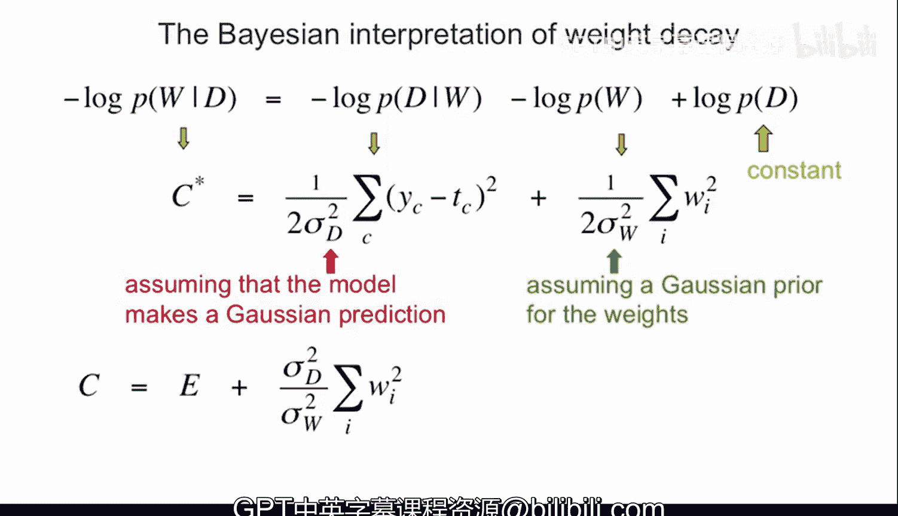

# Hinton@多伦多大学《机器学习的神经网络｜Neural Networks for Machine Learning 2016》claude-4s p43 -43-Lecture 9.5 — The Bayesian interpretation of weight decay  -Neural Networks -BV1HtkUB2EZD_p43-

In this video。I'm going to talk about the baesian interpretation of weight penalties。

In the full baesing approach， we try to compute the posterior probability of every possible setting of the parameters of a model。

But there's a much reduced form of the baesian approach。Where we simply say。

 I'm going to look for the single set of parameters。

That is the best compromise between fitting my prior beliefs about what the parameters should be like and fitting the data I've observed。

This is called maximum our posterioride learning。And it gives us a nice explanation of what's really going on when we use weight decay to control the capacity of a model。

I'm now going to talk a bit about what's really going on when we minimize a squared error during supervised maximum likelihood learning。

Finding the weight vector that minimizes the squared residuals。

 That is the differences between the target value and the value predicted by the net。

Is equivalent to finding weight vector that maximizes the log probability density of the correct answer。

In order to see this equivalence， we have to assume that the correct answer is produced by adding Gaussian noise to the output of the neural net。

So the idea is we make a prediction。By first running the neural net on the input to get the output and then adding some g in noise。

And then we ask， what's the probability that when we do that， we get the correct answer。

So the model's output is the center of a Gaussian。And what we're interested in is having the target value have high probability under that Gaussian。

Because the probability of producing the value T， given that the network gives an output of y。

Is just the probability density of T under a Gasian centreed at Y。So the math looks like this。

 Let's suppose that the output of the neural net on training case C is Y C。

And this output is produced by applying the weights W to the input C。

The probability that will get the correct target value when we add Gaussian noise to that output Y C。

Is given by Gaussian， centred on YC。So interested in the probability density of the target value under a Gaussian centred at the output of the neural net。

And on the right here， we have that Gaussian distribution with mean Y C。

We also have to assume some variance， and that variance will be important later。

If we now take logs and put in a minus sign。We see that the negative log probability density of the target value Tc。

Given that the network outputs wise see。Is a constant that comes from the normalizing term of the Gaussian。

Plus。The log of that exponential with a minus sign in。Which is just T C minus Y C squared。

 divided by twice the variance of the Gaussian。And so what you see is that if our cost function is the negative log probability of getting the right answer。

That turns into。Minimizing a squared distance。It's helpful to know that whenever you see a square error being minimized。

You can make a probabilistic interpretation of what's going on。

And in that probabilistic interpretation， you'll be maximizing the log probability under a Gaussian。

So the proper Bayesian approach is to find the full posterior distribution over all possible weight vectors。

If there's more than a handful of weights， that's hopelessly difficult when you have a nonlinear net。

Basins have a lot of ways of approximating this distribution， often using Monte Carlo methods。

But for the time being， let's try and do something simpler。

Let's just try to find the most probable weight factor。

 So the single setting of the weights that's most probable。

 given the prior knowledge we have and given the data。

So what we're going to try and do is find an optimal value of W by starting with some random weight vector。

And then adjusting it in the direction that improves the probability of that weight vector。

 given the data。It'll only be a local optimum。Now it's going to be easier to work in the log domain than in the probability domain。

So if we want to minimize a cost， wed better use negative log props。

Just an aside about why we maximize sums of log probabilities or minimize sums of negative log props。

What we really want to do is maximize the probability of the data。

Which is maximising the product of the probabilities of producing all the target values that we observed on all the different training cases。

If we assume that the output errors on different cases are independent。

We can write that down as the product over all the training cases of the probability of producing the target value T C。

 given the weights。That is the product of the probability of producing T C。

Given the output that we're going to get from our network， if we give it input C and it has weight W。

The log functions monotonic。And so it can't change where the maxima are。

So instead of maximizing a product of probabilities， we can max a sum of log probabilities。

 and that typically works much better on a computer， is much more stable。

So we maximize the log probability of the data given the weights。

Which is simply maximizing the sum over all the training cases of the log probability of the output for that training case。

 given the input and given the weights。In maximum a posterori learning。

We're trying to find the set of weights that optimizes the trade off between fitting up prior and fitting the data。

So that's Bayes theorem。If we take negative logs to get a cost。

 we get that the negative log of the probability of the weights given the data is the negative log of the prior term and the negative log of the data term。

At an extra term。So that last extra term is an integral over all possible weight vector。

 And so that doesn't affect W so we can ignore it when we're optimizing W。

The term that depends on the data is the negative log probability of the target values given W。

 And that's our normal error term。And then the term that only depends on W is the negative log probability of W under its prior。

Maximizing the log probability of a weight is related to minimizing a square distance in just the same way as maximizing the log probability of producing the correct target value is related to minimizing a square distance。

So minimizing the squared weights is equivalent to maximizing the log probability of the weights under a0 mean Gaussian prior。

So here's a go， sin。It's got a mean at 0。And we want to maximize the probability of the weights。

Or the log probability of the weights。And to do that， we obviously want W to be close to the mean 0。

The equation for the Gaussian is just like this。Where the mean is zero。

 so we don't have to put it in。And the log probability of W。

Is then the squared weights scaled by twice the variance。

 plus a constant that comes from the normalizing term of the Gaussian。

Isn't effective when we change W。So finally， we can get to the baesian interpretation of weight decay or weight penalties。

Were trying to minimize the negative log probability of the weights given the data。

And that involves minimizing a term that depends on both the data and the weights。

 namely how well we fit the targets。And a term that depends only on the weights。

Is derived from the log probability of the data， given the weights。

Which if we assume Gaussian noise is added to the output of the model to make the prediction。

 then that log probability is the square distance between the output of the net and the target value scaled by twice the variance of that Gaussian noise。

Similarly。If we assume we have a Gaussian por for the weights。

 the log probability of a weight under the p is the square value of that weight scaled by twice the variance of the Gaussian por。

So now let's take that equation and multiply through by2 sigma squared d。

So we get a new cost function。And the first term， when we multiply through turns into simply the sum over all the training cases of the square difference between the output of the net and the target。

 That's the square error that we typically mini in a neural net。

The second term now becomes the ratio of two variances times the sum of the squares of the weights。

And so what you see is the ratio of those two variances is exactly the weight penalty。

So we initially thought of weight penalties as just a number you make up to try and make things work better。

 where you fix the value of the weight penalty by using a validation set。

But now we see that if we make this Gaussian interpretation where we have a Gaussian prior and we have a Gaussian model of the relation of the output of the net to the target。

Then the weight penalty is determined by the variances of those Gaussians。

 Its just the ratio of those variances。 is not an arbitrary thing at all within this framework。

