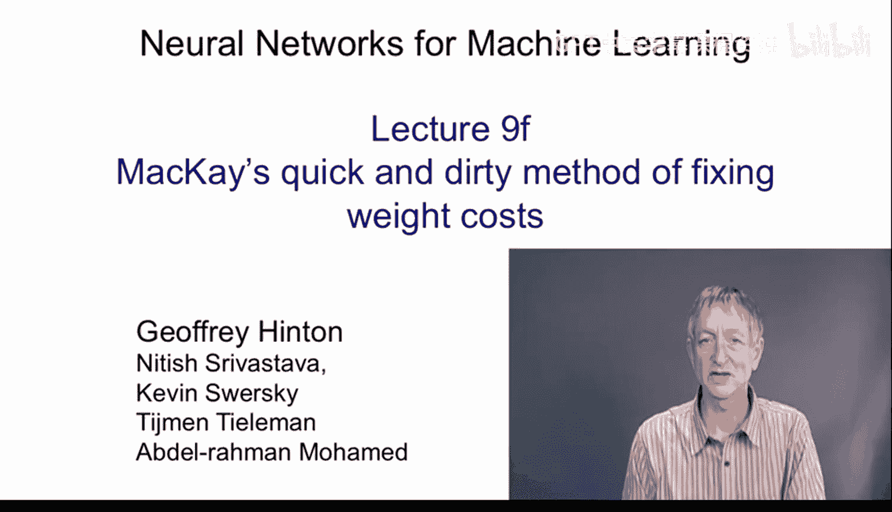
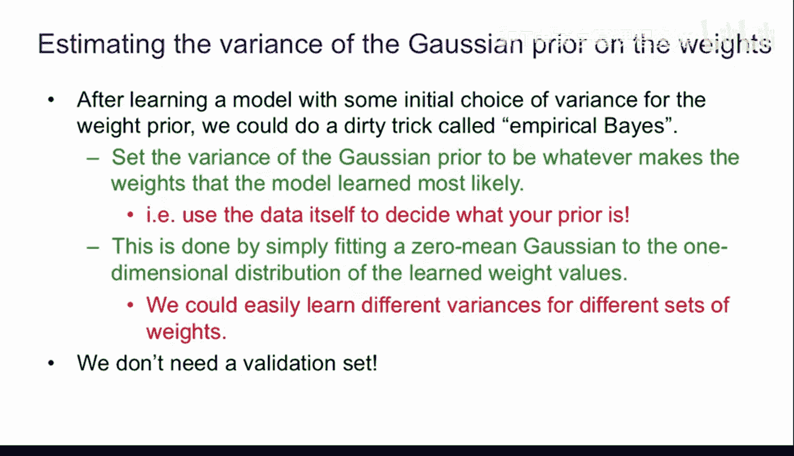
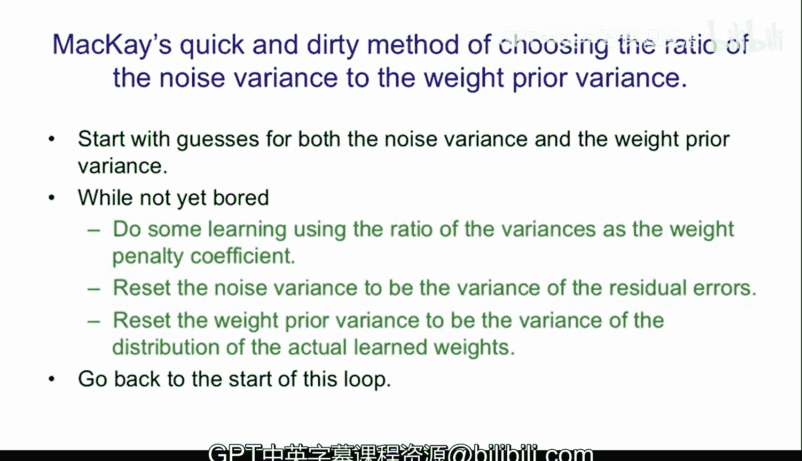

# Hinton@多伦多大学《机器学习的神经网络｜Neural Networks for Machine Learning 2016》claude-4s p44 -44-Lecture 9.6 — MacKay s quick and dirty method  -Neural Networks for Machine -BV1HtkUB2EZD_p44-

In this video。I am going to describe a method developed by David Mackaay， in the 1990s。

For determining the weight penalties to use in a neural network without using a validation set。

It's based on the idea that we can interpret weight penalties。As doing map estimation。

So that the magnitude of the weight penalty。Is related to the tightness of the prior distribution over the weights。

Mkaai showed that we can empirically fit both the weight penalties and the assumed noise in the output of the neural net。

To get a method for fitting weight penalties that does not require a validation set and therefore allows us to have different weight penalties for different subsets of the connections in a network。

Something that would be very expensive to do using validation sets。Mkaai went on to win competitions。

 using this kind of method。

I'm now going to describe a simple and practical method developed by David Mackaay for making use of the fact that we can interpret weight penalties as the ratio of two variances。

After we've learned a model to minimize square error。

 we can find the best value for the output variance。

 and the best value is found by simply using the variance of the residual errors。

We can also estimate the variance in the Gaussian， prior for the weights。

We have to start with some guess about what this variant should be。Then we do some learning。

And then we use a very dirty trick called empirical bays。

We set the variance of our prior to be the variance of the weights that the model learned。

 because that's the variances that will make those weights most likely。

This really violates a lot of the presuppositions of the Bayesian approach。

We're using the data to decide what our prior beliefs are。So once we've learned the weights。

 we fit a0 mean Gaussian to the one dimensional distribution of the learned weights。

 And then we take the variance of that Gaussian， and we use that for our prior。Now。

 one nice thing about that is if there are different subsets of weights， like in different layers。

 for example。We could learn different variances for the different layers。

We don't need a validation set， so we can use all of the non test data for training。

And because we don't need validation sets to determine the weight penalties in different layers。

We can actually have many different weight penalties。

This would be very hard to do with validation sets。

So here's Mackai's method。You start by guessing the noise variance and the weight prior variance。

Actually， all you have to really do is guess that ratio。Then you do some gradient descent learning。

Trying to improve the weights。Then you reset the noise variance to be the variance of the residual errors。

And you reset the weight prior variance to be the variance of the distribution of the actual learned weights。

And then you go back round this loop again。So this actually works quite well in practice。

 and Mackaay won several competitions this way。

