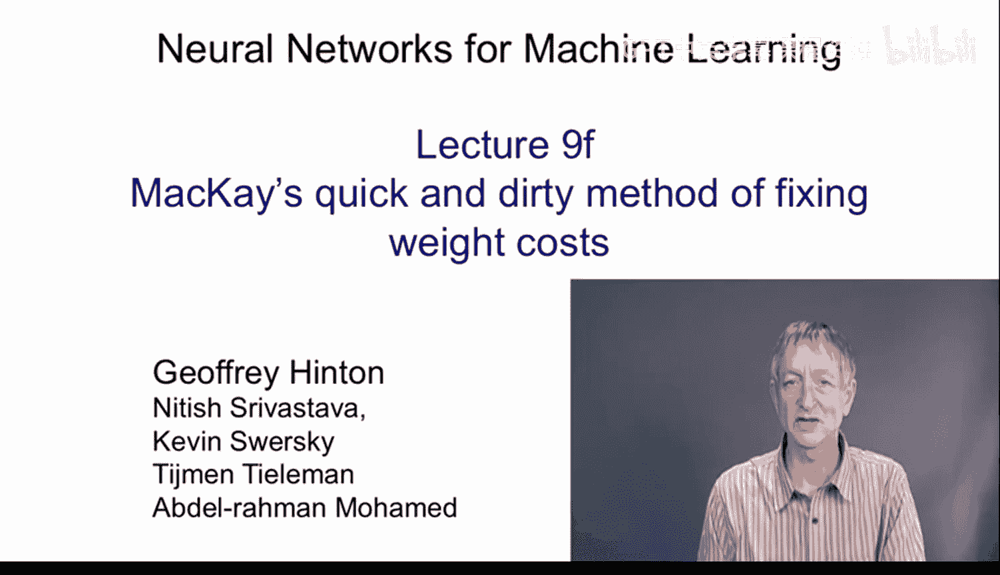
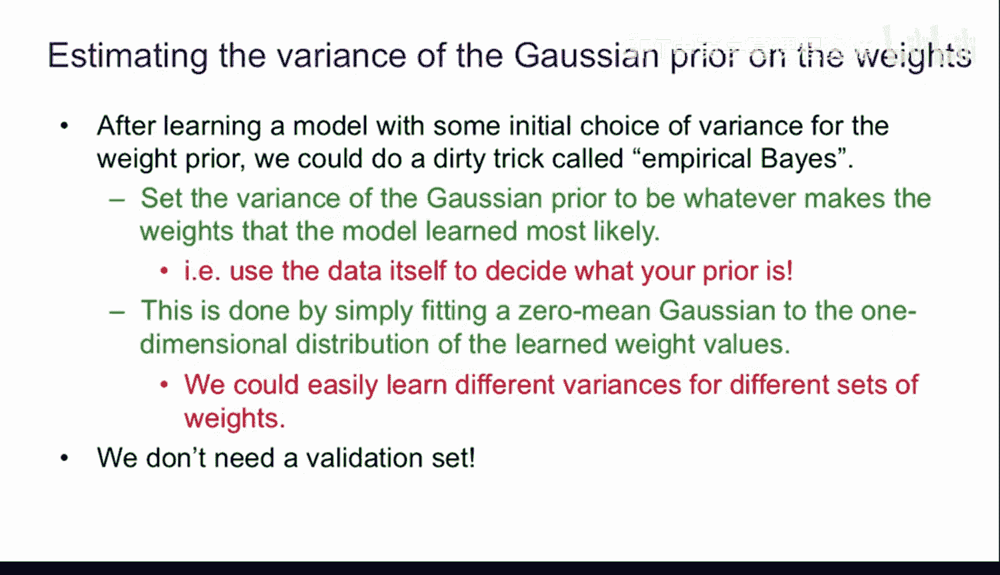
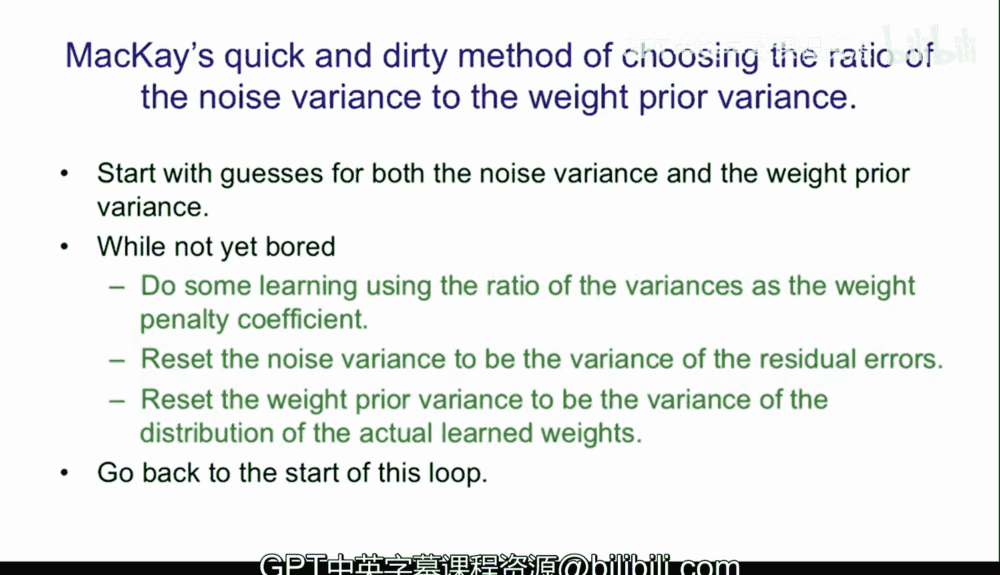

# 机器学习的神经网络：9.6：MacKay的快速近似方法 🧠

在本节课中，我们将学习一种由David MacKay在20世纪90年代开发的方法。该方法用于确定神经网络中应使用的权重惩罚项，而无需借助验证集。我们将看到，这种方法基于将权重惩罚解释为最大后验概率估计，并通过经验性地拟合权重惩罚和输出噪声，来实现对不同连接子集使用不同惩罚系数的目标。

---

## 概述

上一节我们介绍了权重惩罚与贝叶斯先验之间的关系。本节中，我们来看看David MacKay提出的一种实用方法，它允许我们在没有验证集的情况下，自动确定合适的权重惩罚强度，甚至可以为网络中的不同层或连接组设置不同的惩罚系数。

## 方法原理

该方法的核心思想是，我们可以将权重惩罚项解释为两个方差的比值。具体来说，在最小化平方误差学习到一个模型后，我们可以找到输出噪声方差的最佳值，这个最佳值就是残差误差的方差。

我们也可以估计权重高斯先验的方差。这需要从一个初始猜测开始，然后进行学习，最后使用一个被称为“经验贝叶斯”的技巧：我们将先验方差设置为模型学习到的权重的方差，因为该方差会使这些权重出现的可能性最大。

这种方法虽然违反了贝叶斯方法中“先验应独立于数据”的前提假设，但在实践中非常有效。它的一个优点是，如果存在不同的权重子集（例如在不同层中），我们可以为不同层学习不同的方差。由于不需要验证集，我们可以将所有非测试数据都用于训练。

## 实施步骤

以下是MacKay方法的具体步骤：

1.  **初始化**：猜测噪声方差和权重先验方差。实际上，只需要猜测它们的比值。
2.  **学习**：进行梯度下降学习，以改进权重。
3.  **更新方差**：
    *   将噪声方差重置为当前模型残差误差的方差。
    *   将权重先验方差重置为已学习权重的实际分布的方差。
4.  **迭代**：返回步骤2，重复此循环。

这个方法在实践中效果很好，MacKay曾凭借此类方法赢得了多次竞赛。

---

## 总结

本节课中，我们一起学习了David MacKay的快速近似方法。该方法通过经验贝叶斯框架，在训练过程中同时更新输出噪声的估计和权重先验方差的估计，从而自动确定合适的权重衰减强度。它最大的优势在于无需使用验证集来调优惩罚系数，使得为网络中不同部分设置不同的正则化强度变得可行且高效。