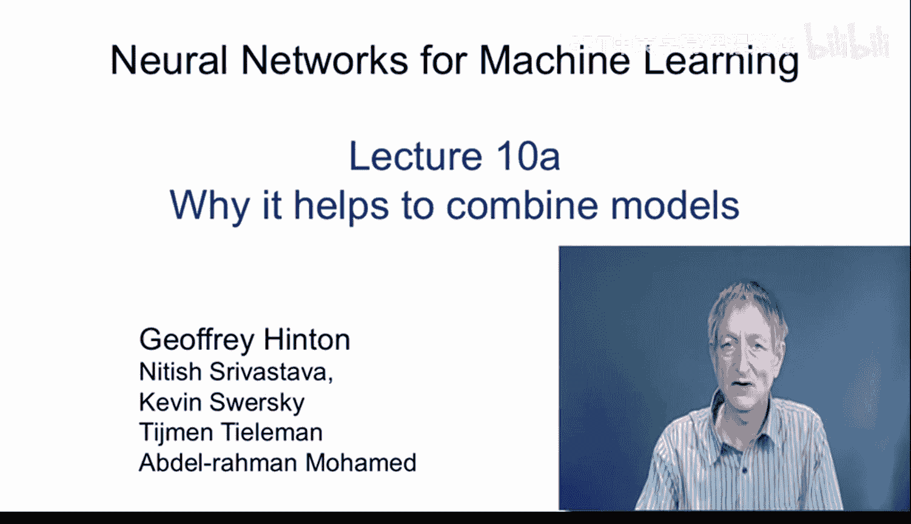
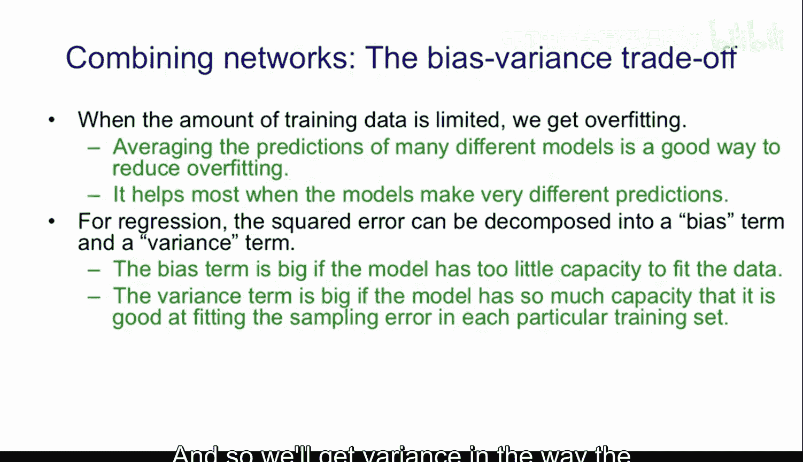
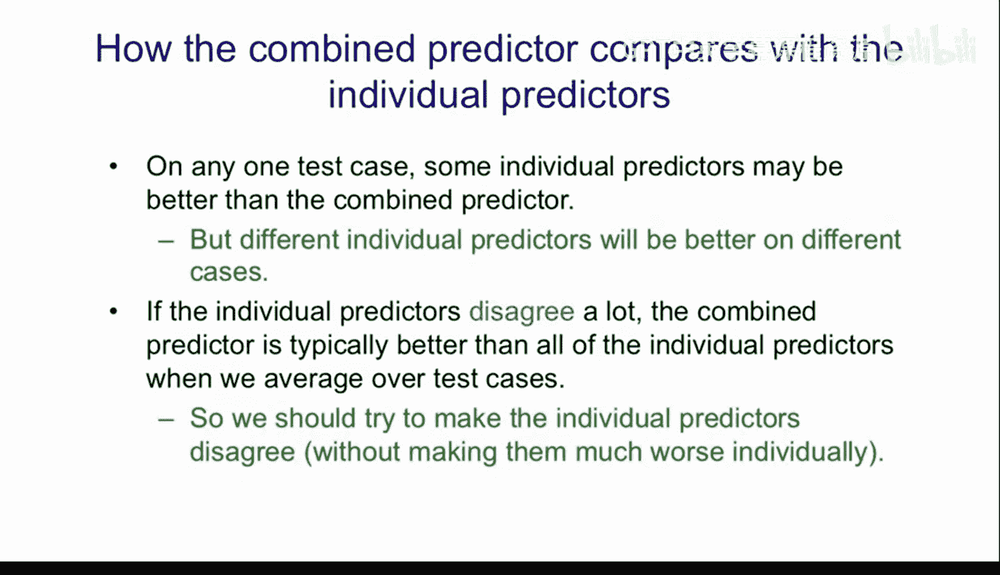
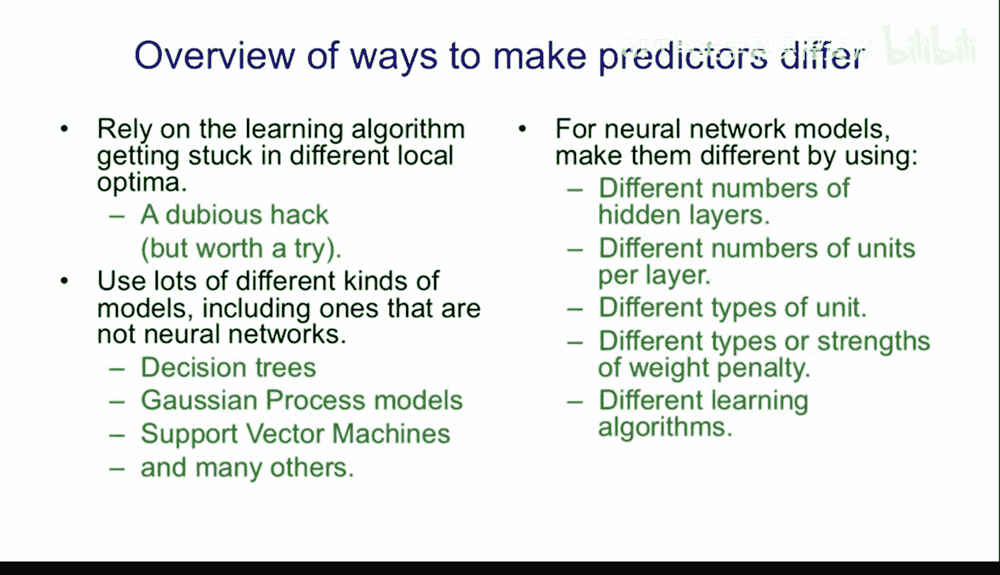
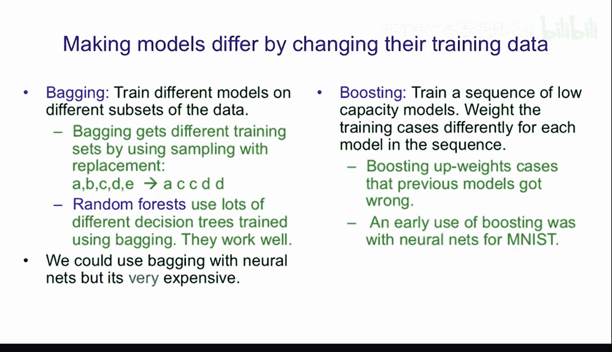

# Hinton@多伦多大学《机器学习的神经网络｜Neural Networks for Machine Learning 2016》claude-4s p45 -45-10.1 — Why it helps to combine models  -Neural Networks for Machine Learning -BV1HtkUB2EZD_p45-

In this video， Im going to talk about the reason why we want to combine many models when we're making predictions。

 If we have a single model， we have to choose some capacity for it。If we choose too little capacity。

 it won't be able to fit the regularities in the training data。And if we choose too much capacity。

You will be able to fit the sampling error in the particular training set we have by using many models。

 we can actually get a better trade off。Between fitting the true regularities and overfitting the sampling error in the data。

At the start of the video。I'll show you that when you average models together。

You can expect to do better than any single model。This effect is largest when the models make very different predictions from each other。

And at the end of this video， I'll discuss various ways in which we can encourage the different models to make very different predictions。

As we've seen before， when we have a limited amount of training data。We tend to get overfitting。

If we average the predictions of many different models， we can typically reduce that overfitting。

This helps most when the models make very different predictions from one another。For aggression。

 the squared error can be decomposed into a bias term and a variance term。

And that allows us to analyze what's going on。The bias term is big if the model has too little capacity to fit the data。

It measures how poorly the model approximates the true function。The variance term is big。

 If the model has so much capacity that it's good at modelling the sampling error in our particular training set。

So it's called variance because if we were go and get another training set of the same size from the same distribution。

 our model will fit differently to that training set because it has different sampling error。

 and so we'll get variants in the way the models fit to different training sets。

If we average models together， what we're doing is we're averaging away the variance。

 and that allows us to use individual models that have high capacity and therefore high variance。

These high capacity models typically have low bias。

 so we can get the low bias without incurring the high variance by using averaging to get rid of the variance。

So now let's try and analyze how an individual model compares with an average of models。

On any one test case， some individual predictors may be better than the combined predictor。

But different individual predictors will be better on different cases。

And if the individual predictors disagree a lot， the combined predictor is typically better than all of the individual predictors when we average over test cases。

So we should aim to make the individual predictors disagree without making them be poor predictors。

 The art is to have individual predictors that make very different errors from one another。

 but reach fairly accurate。

So now let's look at the math of what happens when we combine networks。

We're going to compare two expected squared errors。

The first expected squared error is the one we get if we pick one of the predictors at random and use that for making our predictions。

 and then what we do is we average overall predictors the error we'd expect to get if we followed that policy。

So y bar is the average of what all the predictors say。

And why I is what an individual predictor says。So y bar is just the expectation over all the individual predictor's eye of Y I。

And I'm using those angle brackets to represent an expectation。

Where the thing that comes after the angle bracket tells you what it's an expectation over。

We can write the same thing as one over N times the sum over the n of the white eye。Now。

 if we look at the expected squared error we' get， if we chose a predictor at random。

 what we'd have to do is compare that predictor with the target， take the square difference。

 and then average that over all the predictors。That's what's on the left hand side there。

If I simply add a y bar and subtract a Y bar， I don't change the value and now it's going to be easier to do some manipulations。

I can now multiply out that square。 and inside these expectation brackets。

 I have T minus y bar squared。Y I minus y bar squared and t minus y bar into y I minus y bar。

 which as we willll see， will disappear。So the first term t minus y bar squared doesn't have an I in it anymore。

 And so we can forget about the expectation brackets for that。 That really is t minus y bar squared。

And that's the squared error you'd get if you compared the average of the models with the target。

And our aim is to show the thing on the left hand side is bigger than that。 I。e。

 by using that average， we've reduced the expected square error。

So the extra term we have on the right hand side is the expectation of yi minus y bar squared。

 and that's just the variance of the Y I is the expected square difference between Y I and Y bar。

And then， the last term disappears。It disappears because the difference of Y I from Y bar。

 we expect to be uncorrelated with the difference between the error that the average of the networks makes and the target。

And so we're multiplying together two things that are zero mean and uncorrelated。

 and we expect to get0 on average。So the result is that the expected squared error we get by picking a model at random is greater than the squared error we get by averaging the models。

By the variance of the outputs of the models。That's how much we win by when we take an average。

So I want to show you that in a picture。So along the horizontal line。

 we have the possible values of the output， and in this case。

 all of the different models predict a value that's too high。

The predictors that are further than average from T make bigger than average squared errors。

 like that bad guy in red。And the predictors that are less than the average distance from T make smaller than average squared errors。

And the first effect dominates because we're using squared error。So if you look at the math。

 let's suppose that the good guy and the bad guy were equally far from the mean。

So the average squared error they make。Is y bar minus epsilon squared plus y bar plus epsilon squared。

And when we work that out， we get the squared error that the mean of the predictors makes plus an epsilon squared。

So we win by averaging predictors before we compare them with the target。That's not always true；

 it depends very much on using a squared error。If， for example， you have a whole bunch of clocks。

And you try and make them more accurate by averaging them all， That'll be a disaster。

And it'll be a disaster because the noise you expect in clocks isn't Gaussian noise。

What you expect is that many of them will be very slightly wrong。

 and a few of them will have stopped or will be wildly wrong。 And if you average。

 you make sure they're all significantly wrong， which is not what you want。

The same thing applies to the discrete distributions we have over class label probabilities。

So suppose that we have two models。And one gives the correct label a probability of PI。

And the other gives the correct label a probability of PJ。

Is it better to pick one model at random or is it better to average those two probabilities and predict the average of PIM PJ？

Well， if our error measure is the log probability of getting the right answer。

Then the log of the average of PI and PJ is going to be a better bet than the log of PI plus the log of PJ averaged。

That's most easily seen in a diagram because of the shape of the log function。

So that black curve is the log。On the horizontal axis， I've drawn P I and PJ。

And the gold colored line joins log P I to log PJ。You can see that if we first average PI and PJ together。

To get that average value where the blue arrow is。And then we compute the log， we get that blue dot。

Whereas if we first take the log of PI。And separately take the log at PJ。

And then we average those two logs。We get the midpoint of that gold line。

 which is below the blue dot。So to make this averaging be a big win。

 we want our predictors to differ by a lot。And there's many different ways to make them differ。

You could just rely on a learning algorithm that doesn't work too well and gets stuck in different local optima each time。

It's not a very intelligent thing to do， but it's worth a try。

You could use lots of different kinds of models， including ones that are not neural networks。

So it makes sense to try decision trees。As in process models。Support vector machines。

I'm not explaining any of those in this course in Andrew Iing's machine learning course on Courerra。

 you can learn about all those things。Or you could try many other different kinds of model。

If you really want to use a bunch of different neural network models。

 you can make them different by using a different number of hidden layers。

Or a different number of units per layer。Or different types of unit。Like in some nets。

 you could use rectified linear units and in other nets， you could use logistic units。

You could use different types or strengths of weight penalty。

 so you might use early stopping for some nets and an L2 weight penalty for others and an L1 weight penalty for others。

You could use different learning algorithms， so for example。

 you could use full batch for some and mini batch for others if your data set is small enough to allow that。

You can also make the models differ by training the models on different training data。

So there's a method introduced by Leo Bman calledBing。

Where you train different models on different subsets of the data。

And you get these subsets by sampling the training set with replacement。

So we sampled a training set that had examples， A， B， C， D， and E， and we got five examples。

 but well have some missing and some duplicated， and we train one of our models on that particular training set。

This is done in a method called random forests that uses baggging with decision trees。

 which Leobriman was also involved in inventing。And when you train decision trees with bagging and then average them together。

They work much better than single decision trees by themselves。In fact。

 the connect box uses random forests to convert information about depth into information about where your body parts are。

We could use bagging with neural nets， but it's very expensive。If you wanted to train。

 say 20 different neural nets this way， you'd have to get your 20 different training sets and then it would take 20 times as long as training one net。

That doesn't matter with decision trees because they're so fast to train。Also at test time。

 you'd have to run these 20 different nets。Again， with decision trees。

 that doesn't matter because they're so fast to use at test time。

Another method for making the training data different is to train each model on the whole training set。

 but to weight the cases differently。So in boosting。

 we typically use a sequence of fairly low capacity models。

And we weight the training cases for each model differently。

What we do is we up the cases that previous models got wrong and we down weight the cases that previous models got right。

So the next model in the sequence doesn't waste its time trying to model cases that are already correct。

It uses its resources to try and deal with the cases the other models are getting wrong。

An early use of boosting was with neural nets for amnt。And there， when computers were much slower。

 one of the big advantages was that it focused the computational resources on modelling the tricky cases and didn't waste a lot of time going over easy cases again and again。

