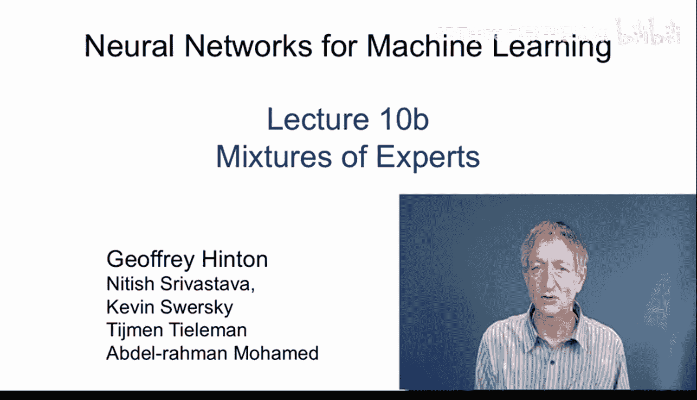
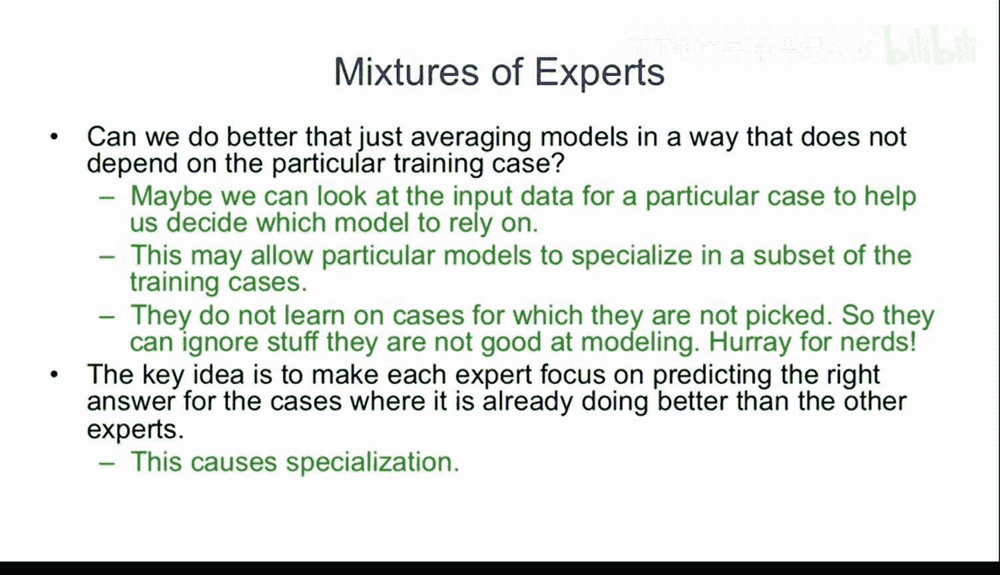
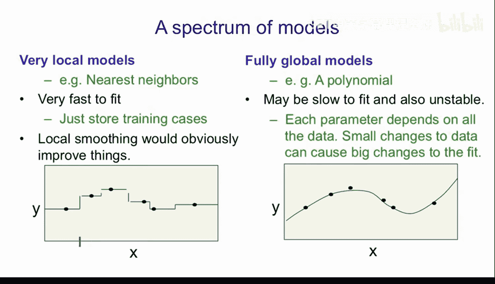
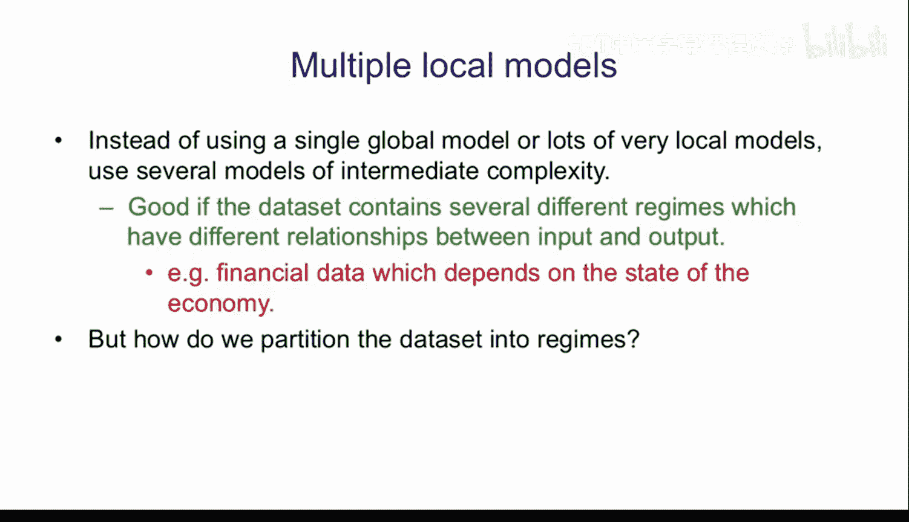
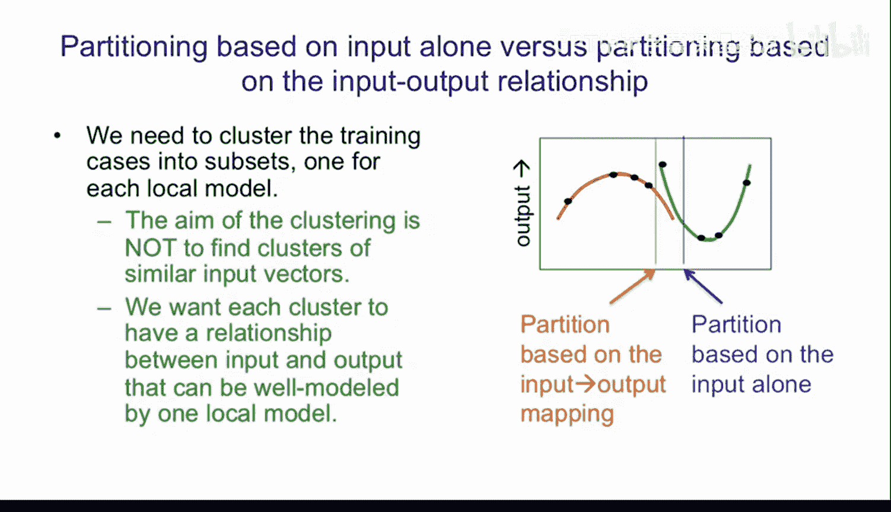
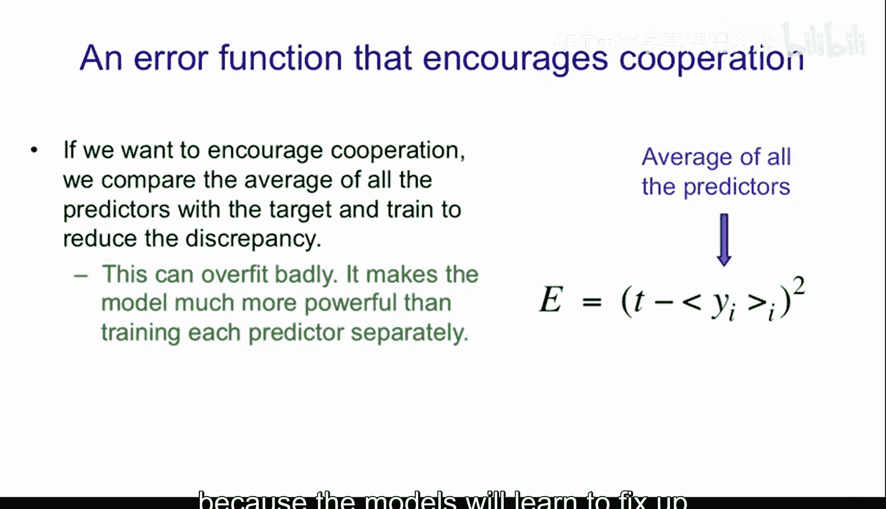
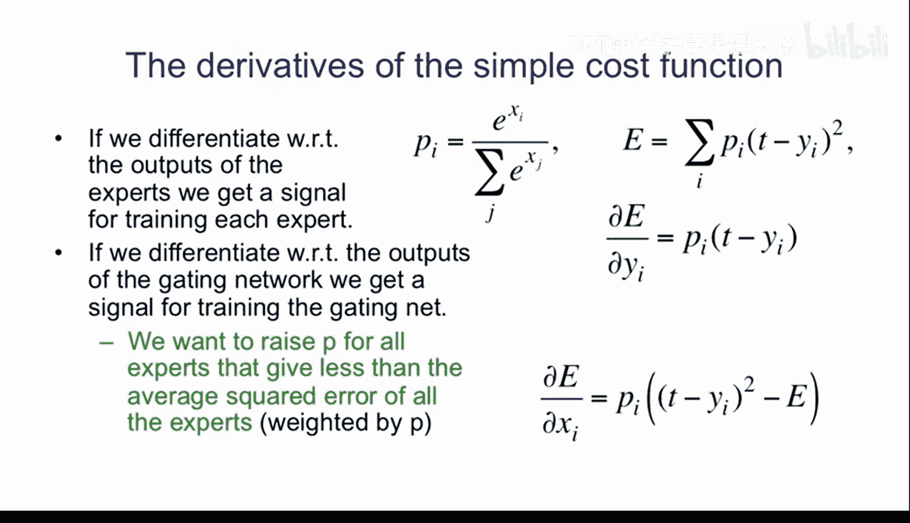
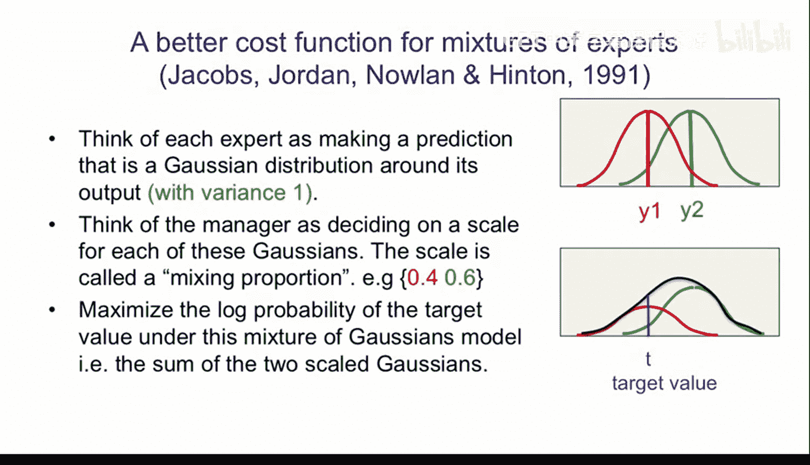
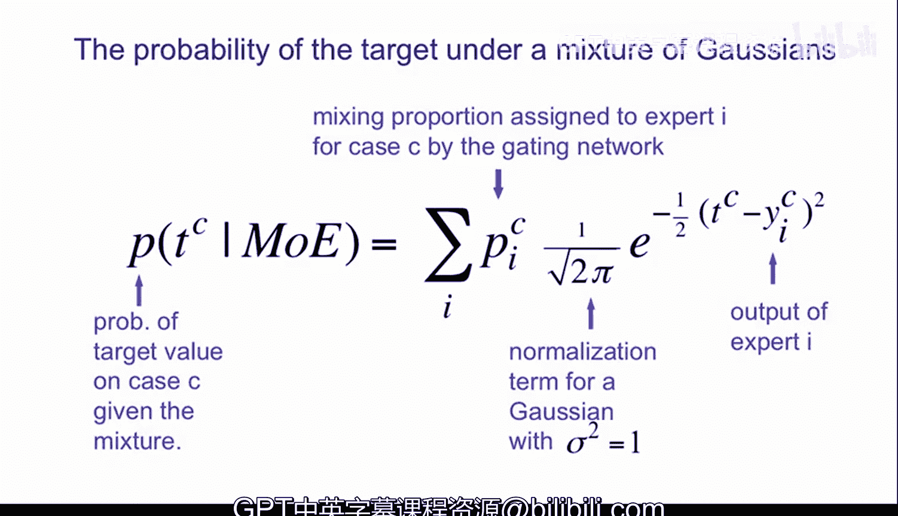

# Hinton@多伦多大学《机器学习的神经网络｜Neural Networks for Machine Learning 2016》claude-4s p46 -46-Lecture 10.2 — Mixtures of Experts  -Neural Networks for Machine Learning-.z -BV1HtkUB2EZD_p46-

In this video， I'm going to talk about the mixture of experts model that was developed in the early 1990s。

The idea of this model is to train a number of neural nets。

 each of which specialises in a different part of the data。That is， we assume we have a data set。

 which comes from a number of different regimes。And we train a system in which one neural net will specialise in each regime and a manager neural net will look at the input data and decide which specialists to give it to。

This kind of system doesn't make very efficient use of data because the data is fractionated over all these different experts。

And so with small data sets， it can't be expected to do very well。But as data sets get bigger。

This kind of system may well into its own because it can make very good use of extremely large data sets。

In boosting， the weights on the models are not all equal， but after we finish training。

 each model has the same weight for every test case。

We don't make the weights on the individual models depend on which particular case we're dealing with。

In mixtures of experts， we do。So the idea is that we can look at the input data for a particular case。

During both training and testing to help us decide which model we can rely on。During training。

 this will allow models to specialise on a subset of the cases。

They then will not learn on cases for which they're not picked。So they can ignore stuff。

 they're not good at modeling。This will lead to individual models that are very good at some things and very bad at other things。

The key idea is to make each model or expert， as we call it。

 focus on predicting the right answer for cases where it's already doing better than the other experts。

That will cause specialization。

So there's a spectrum of models from very local models to very global models。Nearest neighbours。

 for example， is a very local model。To fit it， you just store the training cases。

 So that's really simple。And then if you have to predict y from X。

 you simply find the stored value of x that's closest to the test value of x。

 and you predict the value of y that's the same as for the stored value。

The result of that is that the curve relating the input to the output consists of lots of horizontal lines connected by cliffs。

It would clearly make more sense to smooth things out a bit。At the other extreme。

 we have fully global models like fitting one polynomial to all the data。

They're much harder to fit to data， and they may also be unstable。That is。

 small changes in the data may cause big changes in the model you fit。

That's because each parameter depends on all the data。

In between these two ends of the spectrum， we have multiple local models that are of intermediate complexity。

This is good if the dataset set contains several different regimes。

And those different regimes have different input output relationships。In financial data， for example。

 the state of the economy has a big effect on determining the mappings between inputs and outputs。

 and you might want to have different models for different states of the economy。

But you might not know in advance how to decide what constitutes different states of the economy。

You're going to have to learn that， too。So we have this problem if we're going to use different models for different regimes。

Of how do we partition the data into these different regimes。

In order to fit different models to different regimes。

We need to cluster the training data into subsets。One for each of these regimes。

But we don't want to cluster the data based on the similarity of input factors。

 What we're interested in is the similarity of input output mappings。

So if you look at the case on the right。There's four data points that are nicely fitted by the red parabola。

And another four data points that are nicely fitted by the green parabola。

If you partition the data based on the input output mapping。

That is based on the idea that a parabola will fit the data nicely。

Then you partition the data where that brown line is。If however。

 you partition the data by just clustering the inputs。We partition it where the blue line is。

And then if you look to the left of that blue line。

 you'd be stuck with a subset of data that can't be modeled nicely by a simple model。

So I'm going to explain an error function that encourages models to cooperate。

And then I'm going to explain an error function that encourages models to specialize。

And I'm going to try to give you a good intuition for why these two different functions have these very different effects。

So if you want to encourage cooperation， what you should do is compare the average of all the predictors with the target and train all the predictors together to reduce the difference between the target and their average。

So using angle brackets for expectations again。The error would be the difference between the target and the average over all the predictors of what they predict。

That will overfit badly。It will make the model much more powerful than training each predictor separately。

 because the models will learn to fix up the errors that other models make。

So if you're averaging models during training and training so that the average works nicely。

 you have to consider cases like this。On the right。

 we have the average of all the models except for Model R。

So that's what everybody else is saying when their votes are averaged together。On the left。

 we have the output of model I。Now， if we'd like the overall average to be closer to the target。

What do we have to do to the output of the ice model。we have to move it away from the target。

That will take the overall average towards the target。

You can see that what's happening is Model I is learning to compensate for the errors made by all the other models。

But do we really want to move model I in the wrong direction。Intuitively。

 it seems better to move Model I towards the target。

So here's an error function that encourages specialization。And it's not very different。

To encourage specialization。We compare the output of each model with the target， separately。

We also need to use a manager to determine the weight we put on each of these models。

Which we can think of as the probability of picking each model if we had to pick one。

So now our error is the expectation over all the different models。

Of the square  error made by that model。Times the probability of picking that model。

We the manager or gating net。Is determining that probability by looking at the input for this particular case。

What will happen if you try and minimize this error。

Is that most of the experts will end up ignoring most of the targets。

Each expert will only deal with a small subset of the training cases and it will learn to do very well on that small subset。

So here's a picture of the mixture of experts architecture。

Our cost function is the square difference between the output of each checked button and the target。

Averaged over all the experts。 But with the weights in that average determined by the manager。

There's actually a better cost function we'll come to later based on a mixture model。

But this was the cost function I first thought of。And I think it's easier to explain the intuition with this cost function。

So， we have an input。A different experts all look at that input。They all make their predictions。

 based on that input。In addition。We have a manager。The manager might have multiple layers。

And the last layer of the manager is a Somaxma。So the manager outputs as many probabilities as there are experts。

And using the outputs of the manager and the outputs of the experts。

 we can then compute the value of that error function。

If we look at the derivatives of that error function。

The outputs of the manager are determined by the inputs X I。

To the softnax group in the final layer of the manager。And then， the error。

Is determined by the outputs of the experts。And also， the probabilities output by the manager。

If we differentiate that error with respect to the outputs of an expert。

We get a signal for training that expert。And that gradient that we get。

With respect to the output of an expert。Is just the probability of picking that expert times the difference between what that expert says in the target。

So if the manager decides that there's a very low probability of picking that expert for that particular training case。

The expert will get a very small gradient， and the parameters inside that expert won't get disturbed by that training case。

It'll be able to save its parameters for modeling the training cases where the manager gives it a big probability。

We can also differentiate with respect to the outputs of the gating network。And actually。

 what we're going to do is differentiate with respect to the quantity that goes into the softm。

 that's called the logit。 that's Xi。And if we take the derivative with respect to X I。

We get the probability that that expert was picked。

Times the difference between the squarearrow made by that expert。And the average overall experts。

When you use the weighting provided by the manager of the squared error。

So what that means is if expert I makes a lower squared error than the average of the other experts。

Then we'll try to raise the probability of exp I。But if expert I makes a higher squared error than the other experts will try and lower his probability。

That's what causes the specialization。

Now there's actually a better cost function。It's just more complicated。It depends on mixture models。

 which I haven't explained in this course。 Again， those will be well explained in Andrew Eing's course。

I did explain， however， the interpretation of maximum likelihood when you're doing regression as the idea that the network is actually making a Gaussian prediction。

That is the network outputs a particular value， say y1。

 and we think of it as making bets about what the target value might be that are a Gaussian distribution around y1 with unit variance。

So the red expert makes a Gaussian distribution of predictions around y1。

 and the green expert makes a Gaussian prediction around y2。

The manager then decides probabilities for the two experts。

 and those probabilities are used to scale down the Gaussians。Those probabilities have to add to one。

 and they're called mixing proportions。And so once we've scaled down the Gaussians。

 we get a distribution that's no longer a Gaussian。

 It's the sum of the scaled down red Gaussian and the scaled down green Gaussian。

And that's the predictive distribution for our mixture of experts。

What we want to do now is maximize the log probability of the target value under that black curve。

And remember， the black curve is just the sum of the red curve and the green curve。

So that leads to the following model for the probability of a target， given a mixture of experts。

The probability is on the left。And it's the sum over all the experts of the mixing proportion assigned to that expert by the manager or Gating network。

Times e to the minus， the square difference between the target and the output of that expert。

Scaled by the normalization term for a Gaussian with a variance of what。

And so our cost function is simply going to be the negative log of that probability on the left。

We're going to try and minimize the negative log of that probability。

