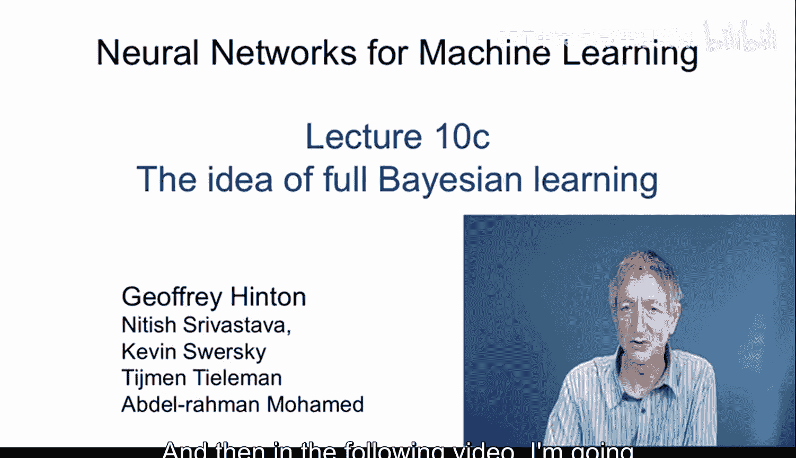
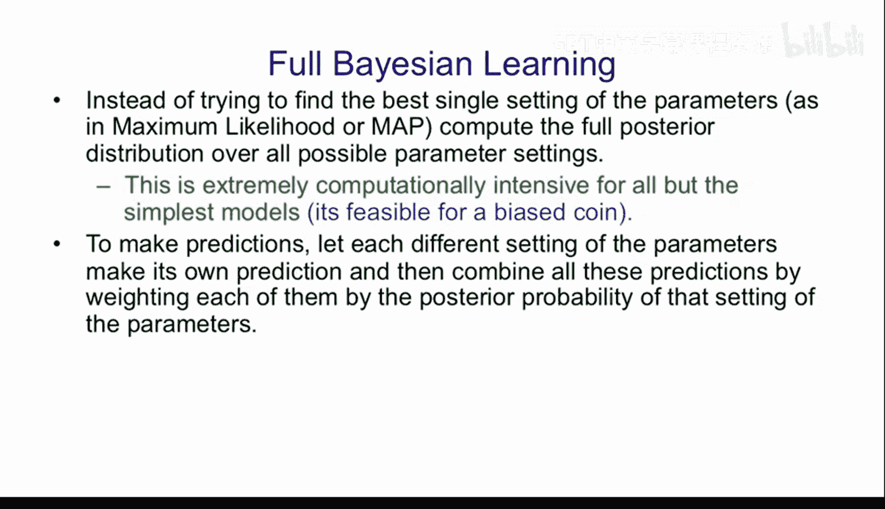
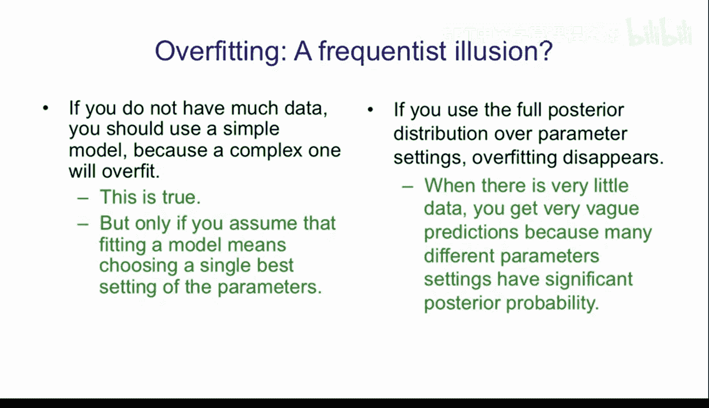
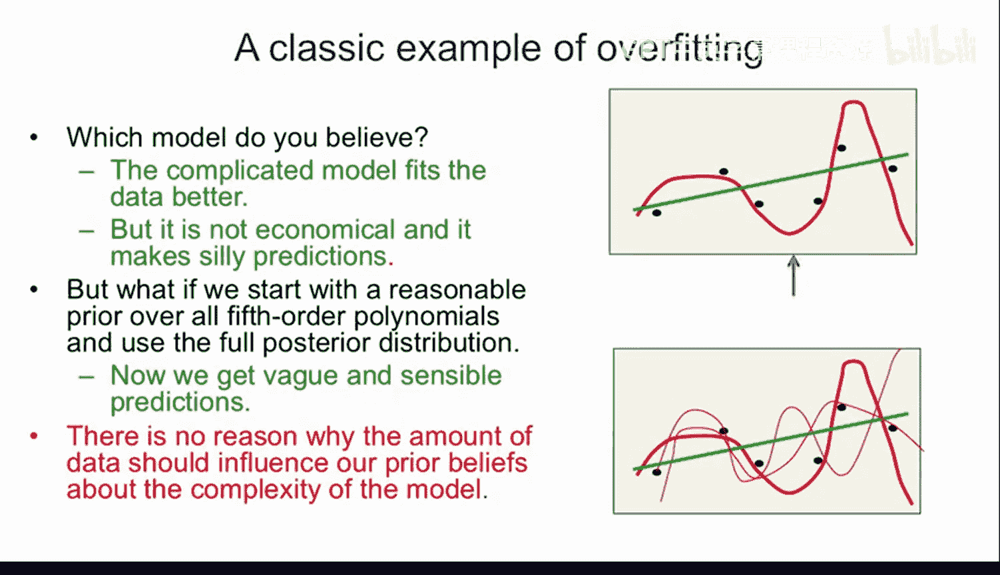
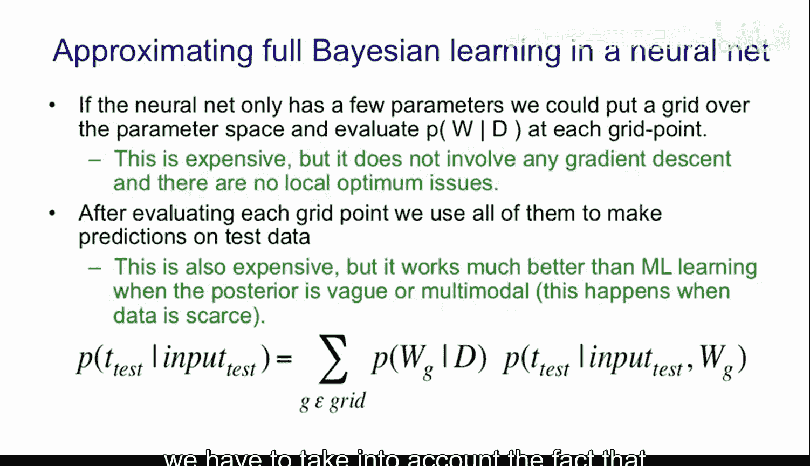
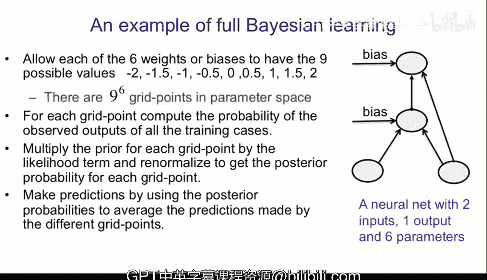

# Hinton@多伦多大学《机器学习的神经网络｜Neural Networks for Machine Learning 2016》claude-4s p47 -47-Lecture 10.3 — The idea of full Bayesian learning  -Neural Networks for Mach -BV1HtkUB2EZD_p47-

In this video， I'm going to return to the idea of full Bayesian learning。

And explain a little bit more about how it works。And then in the following video。

 I'm going to show how it can be made practical。

In full Bayesian learning， we don't try and find a single best setting of the parameters。Instead。

 we try and find the full posterior distribution over all possible settings。

That is for every possible setting， we want a posterior probability density。And all those densities。

 we want to add up to one。It's extremely computationally intensive to compute this for all but the simplest models。

So in the example earlier， we did it for a biased coin， which just has one parameter。

 which is how biased it is。But in general， for a neural net， it's impossible。

After we've computed the posterior distribution across all possible settings of the parameters。

 we can then make predictions。By letting each different setting the parameters make its own prediction and then averaging all those predictions together。

 waiting by their posterior probability。

This is also very computationally intensive。The advantage of doing this。

Is that if we use the full baesing approach， we can use complicated models。

 even when we don't have much data。So there's a very interesting philosophical point here。

We're now used to the idea of overfitting when you fit a complicated model to a small amount of data。

But that's basically。Just a result of not bothering to get the full posterior distribution over the parameters。

So a frequentist would say， if you don't have much data， you should use a simple model。

And that's true。But it's only true if you assume that fitting a model means finding the single best setting of the parameters。

If you find the full posterior distribution。That gets rid of overfitting。If there's very little data。

The full posterior distribution will typically give you very vague predictions because many different settings of the parameters that make very different predictions will have significant posterior probability。

As you get more data， the posterior probability will get more and more focused on a few settings of the parameters。

And the posterior predictions will get much sharper。

So here's a classic example of overfitting。We've got six data points。

 and we've fitted a fifth order polynomial。And so it should go exactly through the data。

 which it more or less does。We also fitted a straight line which only has two degrees of freedom。

And so which model do you believe， the model that has six coefficients and fits the data almost perfectly。

Or the model that only has two coefficients。And doesn't fit the data all that well。

It's obvious that the complicated model fits better。But you don't believe it。It's not economical。

And it also makes silly predictions。So if you look at the blue arrow。

If that's the input value and you're trying to predict the output value。

The red curve will predict a value that's lower than any of the observed data points。

Which seems crazy。Whereas the green lime would predict a sensible value。But， everything changes。

If instead of fitting one fifth order polynomial。We start with the reasonable prior of the fifth or polynomials。

 For example， that their coefficient shouldn't be too big。

And then we compute the full posterior distribution over fifth0 polynomials。

I have shown you some samples from this distribution in the picture。

Where a thicker line means higher probability in the posterior。

So you'll see some of those thin curves miss a few of the data points by quite a lot。

But nevertheless， they're quite close to most of the data points。Now we get much vagueagr。

 but much more sensible predictions。So where the blue arrow is。

You'll see the different models predict very different things， and on average。

 they make a prediction quite close to the prediction made by the green9。From a Bayesian perspective。

 there's no reason why the amount of data you collect should influence your prior beliefs in the complexity of the model。

A true Bayesian would say you have prior beliefs about how complicated things might be。

And just because you haven't collected any data yet。

 it doesn't mean you think things are much simpler。

So we can approximate full Bayesian learning in a neural net if the neural net has very few parameters。

The idea is we put a grid over the parameter space。

So each parameter is only allowed a few alternative values。And then we take the cross product。

Of all those values for all the parameters。And now we get a number of grid points in the parameter space。

 And at each of those points， we can see how well our model predicts the data。That is。

 if we're doing supervised learning， how well our model predicts the target outputs。

And we can say that the posterior probability of that grid point。Is。The product。

Of how well it predicts the data。How likely it is under the prior。

And with the whole thing normalized so that the posterior probabilitybilities add to one。

This is still very expensive。But notice it has some attractive features。

 There's no gradient descent involved， and there's no local optimum issues。

We're not following a path in this space。 We're just evaluating a set of points in the space。

Once we've decided on the posterior probability to assign to each group point。

We then use them all to make predictions on the test data。That's also expensive。

But when there isn't much data， it will work much better than maximum likelihood or maximum my posterii。

So the way we predict the test output， given the test input is we say the probability of a test output。

Given a test input。Is the sum overall the grid points。

Of the probability that that grid point is a good model is the sum of all grid points of the probability of that grid point given the data and given our prior。

Times the probability that we will get that test output。Given the input and given the grip point。

 In other words， we have to take into account the fact that we might add noise to the output of the net。

Before producing the test answer。So here's a picture of F Bayesian learning。

We have a little neck here that has four weights and two biases。

If we allowed9 possible values for each of those weights and biases。

There'd be 9 to the6 grid points in the parameter space。It's a big number， but we can cope with it。

For each of those group points， we compute the probability of the observed outputs on all the training cases。

We would multiply by the prior for the grid point， which might depend on the values of the weights。

 for example。And then we'd renormalize to get the posterior probability over all the grid points。

Then， we make predictions。Using those grid points， but weighting each of their predictions by its posterior probability。

