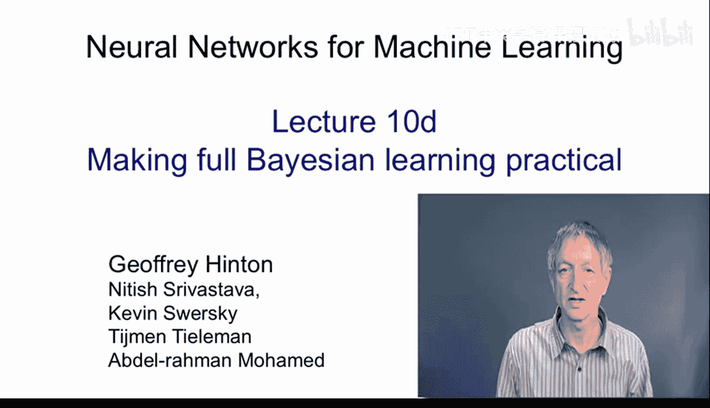
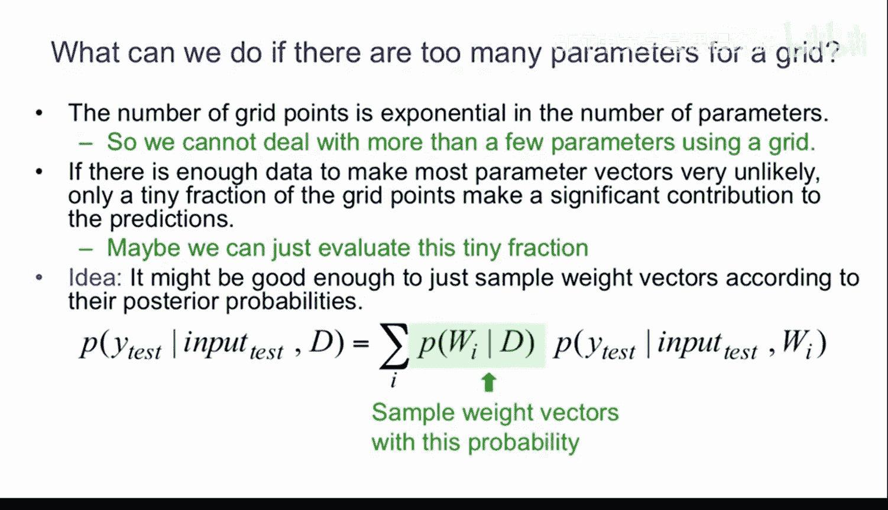
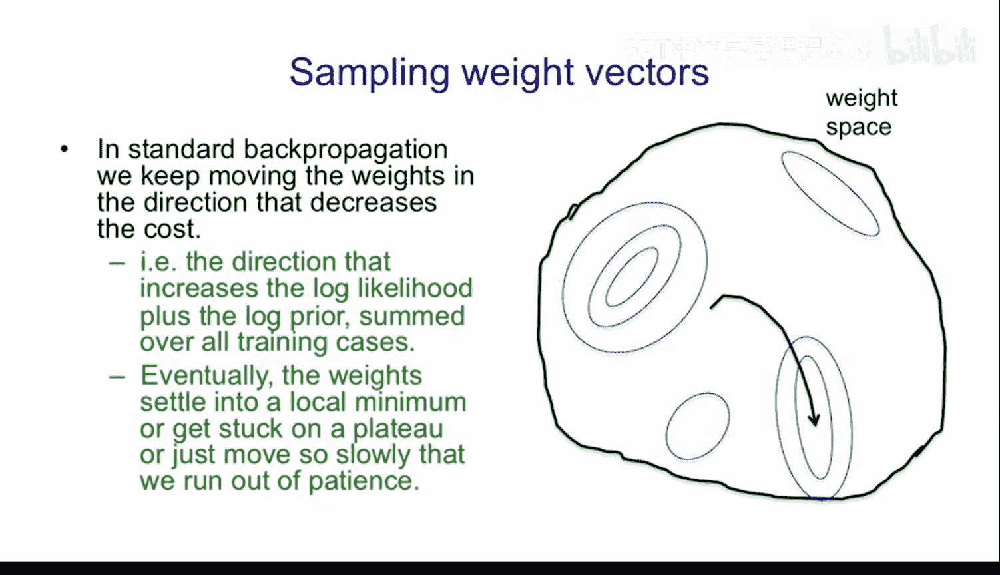
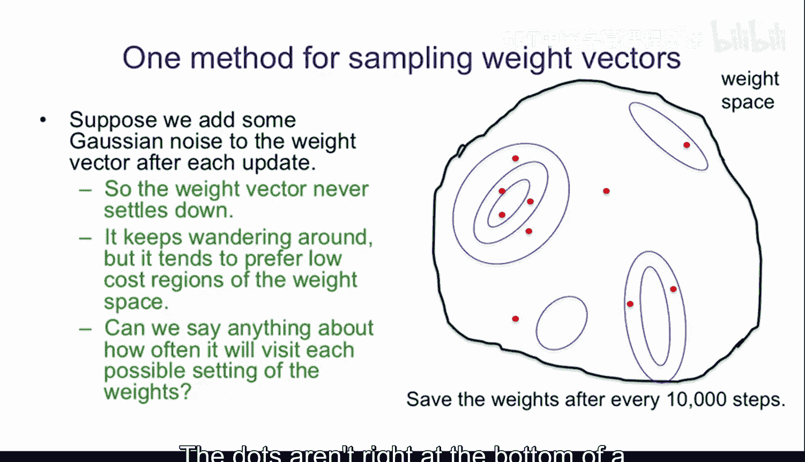
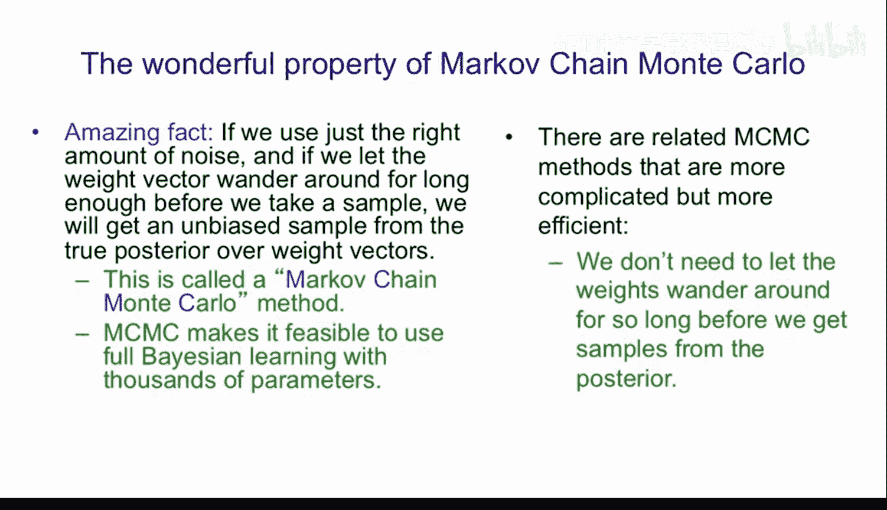
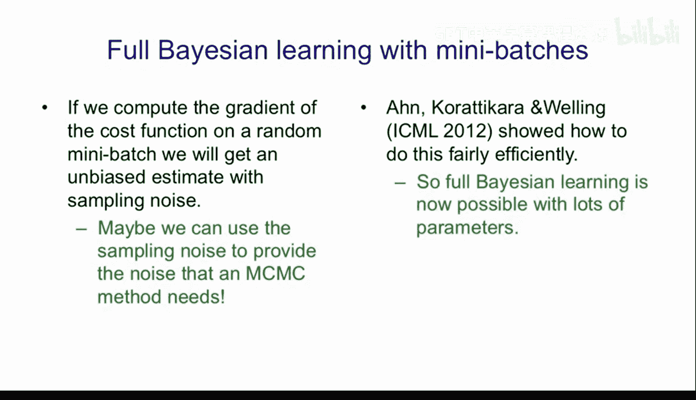

# Hinton@多伦多大学《机器学习的神经网络｜Neural Networks for Machine Learning 2016》claude-4s p48 -48-Lecture 10.4 — Making full Bayesian learning practical  -Neural Networks for -BV1HtkUB2EZD_p48-

In this video。I'm going to describe how to make full Bayesian learning practical for neural networks that have thousands and perhaps even millions of weights。

The technique that's used is a Monte Carlo method， which seems very odd the first time you hear about it。

 we use a random number generator。To move around the space of weight vectors。In a random way。

But with a bias towards going downhill in our cost function。If we do this right。

 we get a beautiful property， which is that we sample weight vectors in proportion to their probability in the posterior distribution。

And that means by sampling a lot of weight vectors。We can get a good approximation。

To the full Bayesian method。

The number of grid points is exponential in the number of parameters。

 So we can't make a grid for more than a few parameters。

If there's enough data so that most of the parameter vectorctors are very unlikely。

Only a tiny fraction of the group points will make a significant contribution to the predictions。

So maybe we can just focus on evaluating this tiny fraction if we can find it。

An idea that makes Bayesian learning feasible is that it might be good enough just to sample weight vectors according to their posterior probabilities。

So if you look at this equation。The probability that we assign to a test output。

 given the input for the test case and the training data。

Is the sum of all points in weight space of the posterior probability of that point in weight space。

 given the training data。Times the probability distribution for the test values that we predict。

 given that point in weight space W I and given them the test input。Now。

 instead of adding up all the terms in that sum。We could just sample terms from that sun。

What we do is we sample the weight vectors in proportion to that probability。

So either we sample them or we don't。 so they'll get a weight of  one or0。

But the probability of getting a one， that is the probability of being sampled。

Will be their posterior probability。So that will give us the correct expected value for the right hand side。

It'll have noise due to the sampling， but it'll have the correct expected value。

So here's a picture of what happens in standard back propagation。On the right。

 I' have drawn the weight space， which， of course， is very high dimensional and unbounded。

 And this is a very bad picture of it。 but it's the best I can do。In this weight space。

 I haveve drawn some contours， which are meant to be contours of equal values of our cost function。

And the way back propagation is normally used is we start with some small value of the weights。

 and then we follow the gradient。 We move downhill in our cost function。

In the direction that increases the log likelihood plus the log prior， some overall training cases。

Eventually。Will either end up in a local minimum。Or will get stuck on a plateau。

All will just move so slowly that we run out of patience。

 But the main point of this picture is that we follow a path from an initial point to some final single point。

Now， if we're using a sampling method。What we could do is start at the same place as we did before。

But each time we update the weights。We add a bit of ghost in noise。So we're jittering around。

The weight vector will never settle down。 Then It'll keep on moving around。

It'll wander over the space， but always preferring low cost regions。

 that as it'll tend to go downhill， if it can。An important question is whether we can say anything about how often the waits will visit each point in that space。

So the red dots are meant to be samples we took of the weights as we wandered around the space。

And the idea is we might save the weights after every 10000 steps。And if you look at those red dots。

 a few of them are in high cost regions。Because those regions are quite big。

The deepest minimum has the most red dots。And other minima also have red dots。

The dots aren't right at the bottom of a minimum， because they're noisy samples。

If we had that g in noise in just the right way， there's a wonderful property of Markov chainin Monte Carlo。

It's an amazing fact。The weight vectors。If we've wandered around for long enough。

Will be unbied samples from the true posterior distribution over weight vectors。That is。

 those red dots we saw on the previous slide will be samples from the posterior。

 where weight vectors that are highly probable under the posterior are much more likely to be represented by a red dot than weight vectors that are highly improbable。

This is called Markov chainin， Monte Carlo。And it makes it feasible to use Bayesian learning with thousands of parameters。

The method I suggested of adding some gautian noise is called the logeran method。

 and it not the most efficient method。There's more sophisticated methods that are more efficient。

And what I mean by more efficient is they don't need to wander around the weight space for so long before you can start taking those red samples。

Full Bayesian learning can actually be done with mini batches。

When we compute the gradient of the cost function on a random mini batch。

 we're going to get an unbiased estimate， but with sampling noise。

And the idea is to use that sampling noise to provide the noise that a Markov chain Monticcoli method needs。

It's a very clever idea。Recently， Welling and his collaborators made it work nicely so that they could fairly efficiently get samples from the posterior distribution over weights using mini batch methods。

This should make it possible to use full Bayesian learning for much larger networks。

 where you have to train them with mini batch to have any hope of ever finishing training them。

