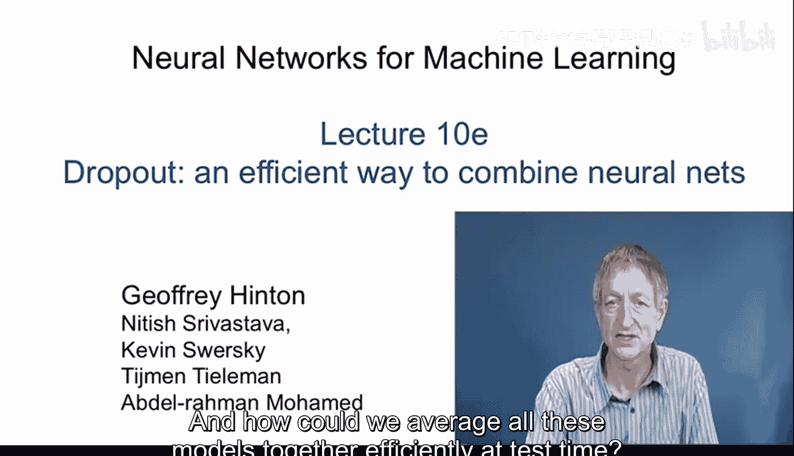
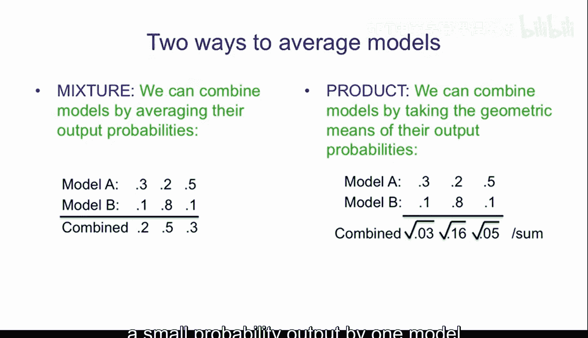
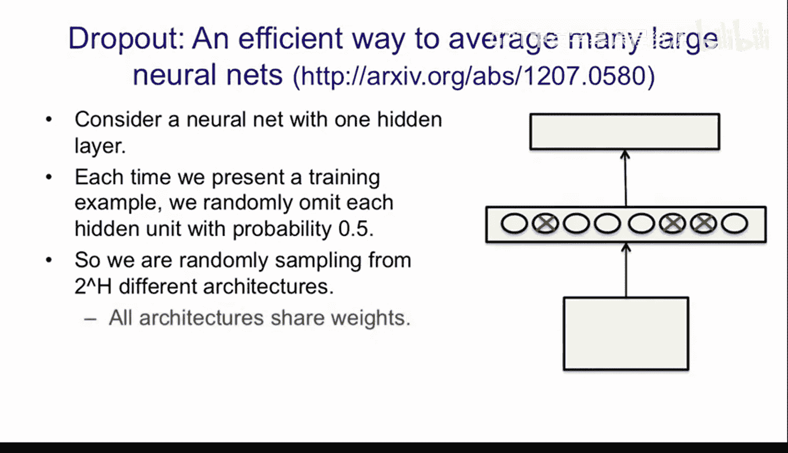
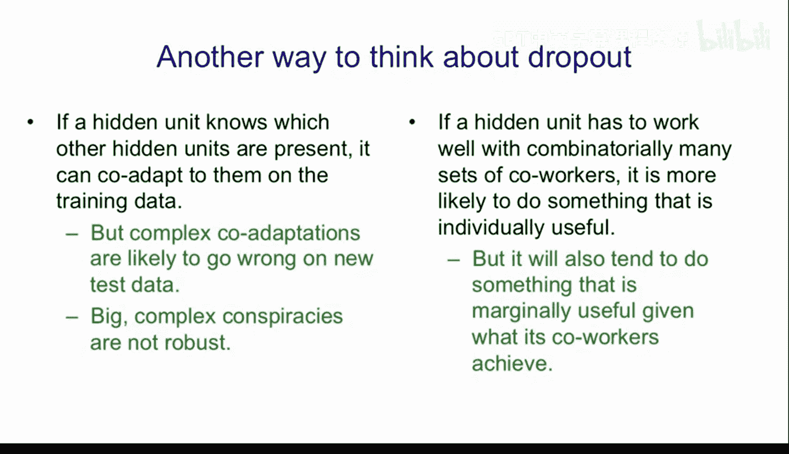

# Hinton@多伦多大学《机器学习的神经网络｜Neural Networks for Machine Learning 2016》claude-4s p49 -49-Lecture 10.5 — Dropout  -Neural Networks for Machine Learning-.zh_en -BV1HtkUB2EZD_p49-

In this video。Im going to describe a new way of combining a very large number of neural network models without having to separately train a very large number of models。

 This is a method called drop out that's recently been very successful in winning competitions。😊。

For each training case， we randomly emit some of the hidden units。

 so we end up with a different architecture for each training case。

We can think of this as having a different model for every training case。And then the question is。

 how could we possibly train a model on only one training case？

And how could we average all these models together efficiently at test time？

The answer is that we use a great deal of weight sharing。

I want to start by describing two different ways of combining the outputs of multiple models。

In a mixture， we combine models by averaging their output probabilities。

So if Model A assigns probabilities of 0。3。2 and 0。5 to 3 different answers。

And Model B assigns probabilities of 0。1。8 and 。1。The combined model simply assigns the averages of those probabilities。

 A different way of combining models is to use a product of the probabilities。

Here we take a geometric mean of the same probabilities。

So Model A and Model B again assign the same probabilities as they did before。

But now what we do is we multiply each pair of probabilities together。And then， take the square root。

That's the geometric mean。And the geometric means。Will generally add up to less than one。

So we have to divide by the sum of the geometric means to normalize the distribution so that it adds up to one again。

You'll notice that in a product。A small probability output by one model。

Has veto power over the other models。Now， I want to describe an efficient way to average a large number of neural nets that gives us an alternative to doing the correct Bayesian thing。

The alternative probably doesn't work quite as well as doing the correct Bayesian thing。

 but it's much more practical。So consider the neural net with one hidden layer shown on the right。

Each time we present a training example to it。What we're gonna do is randomly emit each hidden unit with a probability of not 05。

So we crossed out three of the hidden units here。And we run the example through the net with those hidden units。

Absent。What this means is， we're randomly sampling。From2 to the H architectures。

 where H is the number of hidden units。It's a huge number of architectures。Of course。

 all of these architectures share weights。That is， whenever we use a hidden unit。

 it's got the same weights as it has in other architectures。

So we can think of dropout as a form of model averaging。We sample from these two to the H models。

Most of the models， in fact， will never be sampled。

And a model that is sampled only gets one training example。That's a very extreme form of bagging。

 The training sets are very different for the different models， but they're also very small。

The sharing of the weights between all the models。Means that each model is very strongly regularized by the others。

And this is a much better regularizer than things like L 2 or L 1 penalties。

 Those penalties pull the weights towards 0。By sharing weights with other models。

A model gets regularized by something that's going to tend to pull the weight towards the correct value。

The question still remains what we do at test time。So we could sample many of the architectures。

Maybe 100 and take the geometric mean of their output distributions。But that will be a lot of work。

 There's something much simpler we can do。We use all of the hidden units。

But we halve their outgoing weights。So they have the same expected effect as they did when we were sampling。

It turns out。That using all of the hidden units with half their outgoing weights。

Exactly computes the geometric mean of the predictions that all two to the H models would have used。

Provided we using a softm output group。If we have more than one hidden layer。

 we can simply use dropout of 0。5 in every layer。At test time。

 we halved the outgoing weights of all the hidden units。And that gives us what I call the mean net。

So we use a net that has all of the units。But， the weights are halved。

When we have multiple hidden layers， this is not exactly the same as averaging lots of separate drop out models。

But it's a good approximation， and it's fast。We could run lots of stochastic models with dropout。

And then average across those stochastic models。And that would have one advantage over the mean net。

He would give us an idea of the uncertainty in the answer。What about the input layer， Well。

 we can use the same trick there， too。We use drop out on the inputs。

But we use a higher probability of keeping an input。This trick's already in use。

In a system called denoising autoens， developed by Pascal Von。

Hugar La Rachelle and Yosio Benjo at the University of Montreal。And he works very well。

So how well does Dropout work？While the record breaking object recognition net developed by Alex Khesevsky would have broken the record even without dropout。

 but he broke it by a lot more using dropout。In general， if you have a deep neural net。

And it's overfitting。Dropout will typically reduce the number of hours， by quite a lot。

I think any net that requires early stopping in order to prevent it overfitting would do better by using drop out。

It would， of course， take longer to train。And it might need more hidden units。

If you've got a deep neural net and it's not overfitting。

 you should probably be using a bigger one and using Drop Act。

 That's assuming you have enough computational power。There's another way to think about drop out。

 which is how I originally arrived at the idea。And you'll see it's a bit related to mixtures of experts。

And what's going wrong when all the experts cooperate。What's preventing specialization。

So if a hidden unit knows which other hidden units are present。

It can coad to the other hidden units on the training data。What that means is。

The real signal that's training a hidden unit is try to fix up the error that's left over when all the other hidden units have had their say。

That's what's being back propagated to train the weights of each hidden unit。

Now that's going to cause complex co adaptations between the hidden units。

And these are likely to go wrong。When there's a change in the data。 So a new test data。

If you rely on a complex co adaptation to get things right on the training data。

 it's quite likely to not work nearly so well on new test data。It's like the idea that a big。

 complex conspiracy involving lots of people。He's almost my sudden to go wrong。

Because there's always things you didn't think of。And if there's a large number of people involved。

 one of them will behave in an unexpected way， and then the others will be doing the wrong thing。

It's much better if you want conspiracies to have lots of little conspiracies。

 than when unexpected things happen， many of the little conspiracies will fail。

 but some of them will still succeed。 So by using drop out。

We force a hidden unit to work with combinatorialily many other sets of hidden units。

And that makes it much more likely to do something that's individually useful。

 rather than only useful because of the way particular other hidden units are collaborating with it。

But is also going to tend to do something that's individually useful and is different from what other hidden units do。

It needs to do something that's marginally useful。Given what its cos tend to achieve。

And I think this is what's giving nets with dropout their very good performance。

