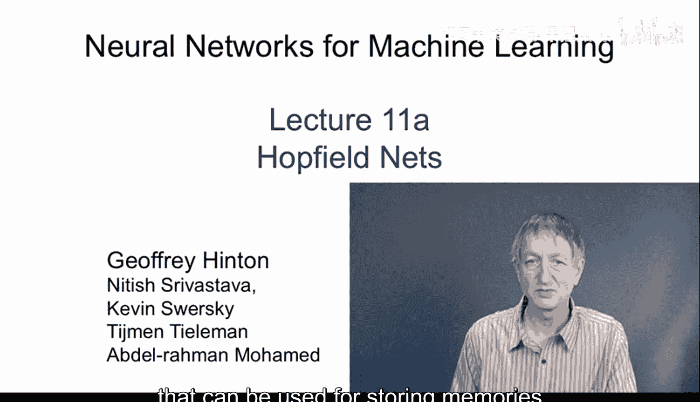
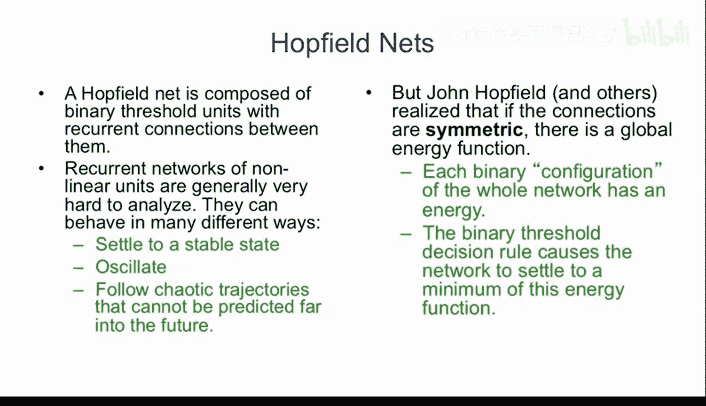
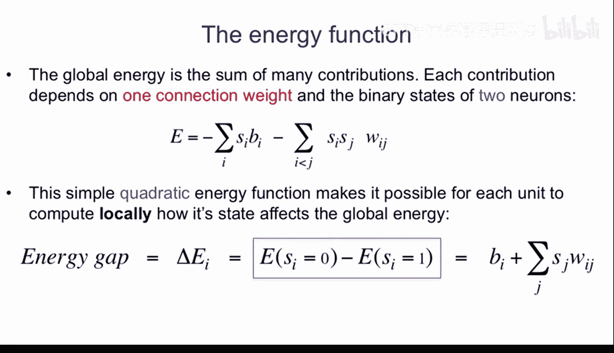
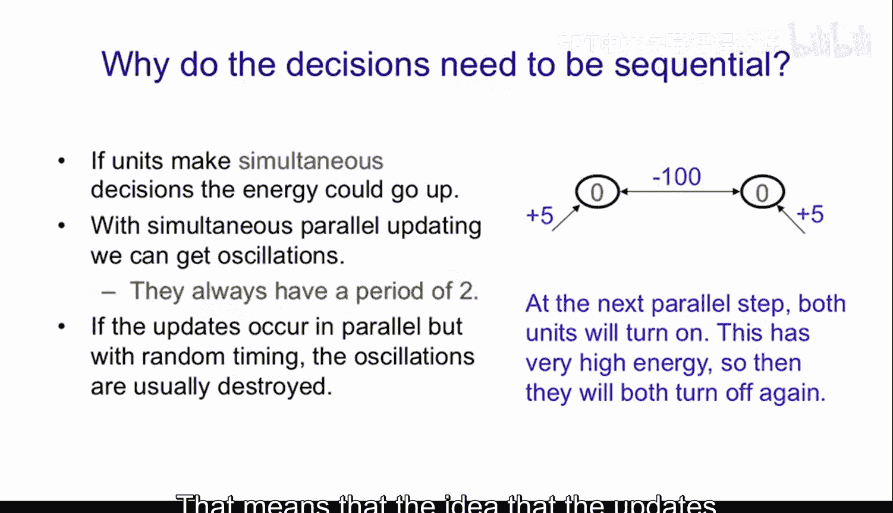
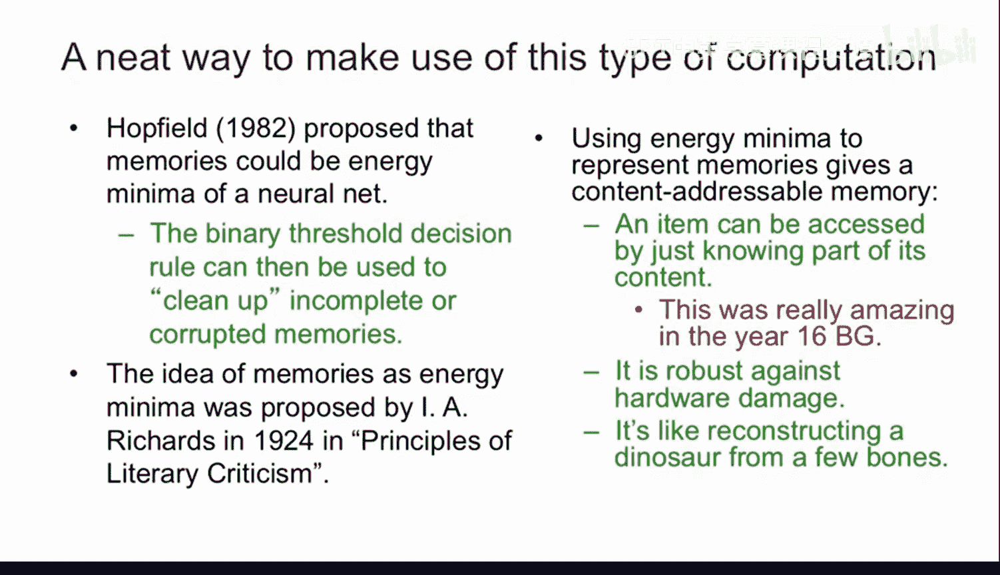
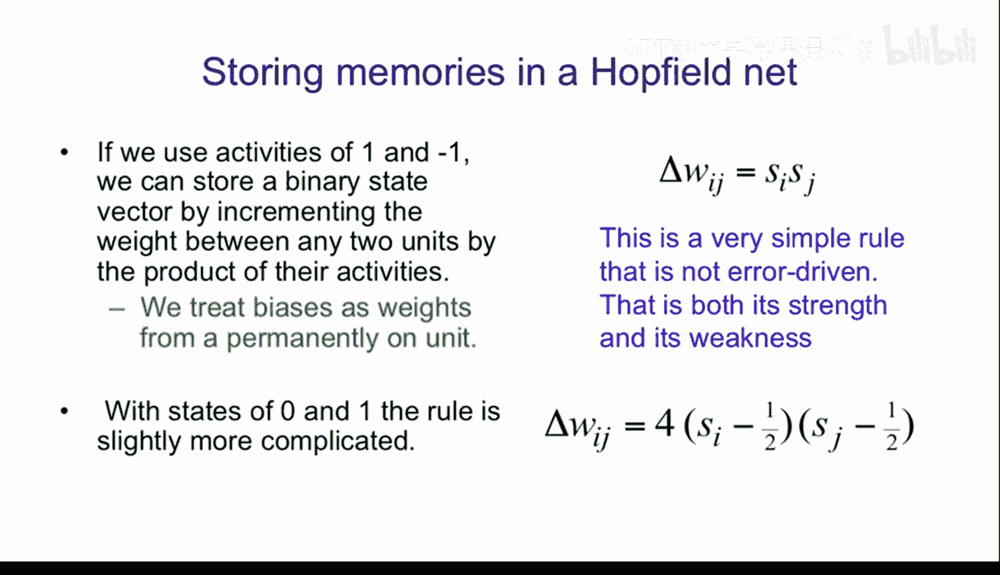

# Hinton@多伦多大学《机器学习的神经网络｜Neural Networks for Machine Learning 2016》claude-4s p50 -50-Lecture 11.1 — Hopfield Nets  -Neural Networks for Machine Learning-.zh_en -BV1HtkUB2EZD_p50-

In this video。I'm going to introduce hububfield nets。Together with back propagation。

These were one of the main reasons for the resurgence of interest in neural networks in the 1980s。

Hoopfield networks are beautifully simple devices that can be used for storing memories as distributed patterns of activity。

We're now going to learn about a very different kind of model from a feed forward neural net。

These are sometimes called energy based models because their properties derive from a global energy function。

So hopopfield met。Is one of the simplest kinds of energy based model。

It's composed of binary threshold units， with recurrent connections between them。In general。

 if you have networks of nonlinear units with recurrent connections， they're very hard to analyze。

They can behave in many different ways。 They can settle to a stable state。They can oscillate。

They can even be chaotic， which means that unless you know theyre starting state with infinite precision。

 you can't predict the state they'll be in very far into the future。Fortunately。

 John Hoopfield and various other groups like Stephen Grosberg's group。

Realized that if the connections are symmetric， there's a global energy function。

Each binary configuration of the whole network has an energy。

 And so what I mean by binary configuration is an assignment of binary values to each neuron in the network。

So every neuron has a particular binary value in her configuration。

The thing that Hotfield realized is that if you set up the right energy function。

 the binary threshold decision rule。Is actually causing the network to go downhill in energy。

And if you keep applying that rule， it'll end up in an energy minimum。

So everything is controlled by the energy function。

The global energy of a configuration is the sum of a number of local contributions。

 and the main contributions have the form of the product of one connection weight with the binary states of two neurons。

So the energy function looks like this。Energy is bad， so low energy is good。

 And that's what those minus signs are doing in there。If you look at the main term here。

 it has a weight， which is the symmetric connection strength between two neurons。

And it has the activities of the two connected neurons。

So S I is a binary variable that has values of  one or 0， or in another kind of hot real net。

 it has values of 1 or -1。In addition to that quadratic term that involves the states of two units。

 there's also a bias term that only involves the state of individual units。

The quadratic energy function makes it possible for each unit to compute locally how changing its state will change the global energy。

So we first need to define the energy gap。The energy gap for a unit I is the difference in the global energy of the whole configuration。

 depending on whether or not I is on。So the energy gap we're going to actually define as the difference。

Between the energy， when I is off。And the energy when I is armed。

And that difference is just what's being computed by the binary threshold decision rule。

So if you look at the equation for the energy and you differentiate it with respect to the state of the I unit。

It's a funny thing to do， because it's a binary variable。But if you differentiate it。

 you'll see you get the binary threshold decision rule。 But without the minus sign。

 because that's for going downhill in energy。

So by following the binary threshold decision rule。

 a hopfield net will go downhill in its global energy。

One way to find an energy minimum in a hot field net is to start from a random state and then update the units one at a time in random order。

So we're doing a sequential update。 And for each unit that you pick。

 you compute whichever of its two states gives the lowest global energy。

 and you put it in that state， independent of what state it was previously in。

That's equivalent to saying you just use the binary threshold decision rule。

So let's look at a little example for the net on the right。We'll start with a random global state。

This was a carefully selected， random state。And that has an energy of -3， or a goodness of 3。

It's easier to think about negative advantages， which arell called goodnesses。

There aren't any biases here。 So to compute the goodness。

 you just look at all pairs of units that are on and add in the weight between them。

And in this configuration， there's only one pair of units as active。And that has a weight of three。

 So we get a goodness of three。Now let's start probing the units。 Let's pick a unit at random。

Like that one。And ask， what state should that be in， given the current states of all the other units。

So if we look at the total input to that， it gets an input of  one times -4。

Plus 0 times 3 plus another0 times 3。 So guess a total input of -4。That's below 0。 So we turn it off。

I。 stays in the offstate。Now， let's probe another unit。If we look at this unit。Again。

 it gets a total input of one times 3。Plus，-1 times 0。 So it gets a total input of 3。

 So the binary threshold decision rule will make it turn on。Let's pro one more unit。

This unit' is more interesting。It's getting an input of one times 2 plus 1 times -1 plus 0 times 3 plus 0 times -1。

So that's a total input of one。 So it will now turn on。Previous， it was off。And so when it turns on。

 the global energy changes。We now have a global energy of -4， or goodness of 4。

And that's a local energy minimum。If you now try probing any of the units。

You'll see that they don't want to change their current state。The net is settled to a minimum。

However， the minimum it' settled to is not the deepest energy minimum。

It's just one of two minima that this net has。The deepest energy minimum。Is shown on the right here。

And it's when the other triangle of units that support each other is on。

That has a goodness of 3 plus 3 plus -1 is 5。 So that's a slightly better energy minimum1。

If you look at that net， you can see the nets composed of these two triangles in which the units mostly support each other。

 although there's a bit of disagreement at the bottom。

And each of those triangles mostly hates the other triangle via that connection at the top。

The triangle on the left differs from one on the right by having a weight of 2。

 where the other one has a weight of 3。So the triangle on the right will give you the deepest minimum。

So if you ask， why do the decisions need to be sequential in the hotfield net？

The problem is that if units make simultaneous decisions。

 they could each think they were reducing the energy， but actually， the energy could go up。

With simultaneous parallel updating， we can get oscillations， which always have a period of two。

So here's a little network where the units have biases of plus 5 and a weight between them of100。

So when both units are off。The next parallel step， if we update them both at the same time。

Will turn both units on because they each think they can improve things via the bias term。

But as soon as you do that， you get this  minus-100。 And so you've actually made things much worse。

So then at the next parallel step， both units will turn off again。If we do the updates in parallel。

 but with random timing。In other words， we don't wait for one update to communicate the state to everybody before we consider another update。

 but we do wait for random lengths of time between doing updates of a given unit。

Then those random timings will often destroy these biphasic oscillations。

That means that the idea that the updates have to be sequential isn't quite as bad as it seems from a biological perspective。

Now， what Hofield suggested was that we could make use of this kind of energy based model that settles to a minimum of its energy for storing memories。

So he had a very influential paper in 1982 that proposed that memories could be energy minima of a neural net with symmetric weights。

The binary threshold decision rule。Can then take partial memories and clean them up into full memories。

So the memory could be corrupted by part of it being wrong。

 or part of it could just be undecided and we can use the net to fill out the memory。

The idea of memories as energy Minma goes back a long way。

 The first example I know of is in a book called Principles of literary Criism by I A Richards。

 where he proposes that memories are like a large crystal that can sit on different faces。

Using energy minima to represent memories gives a contra addressable memory， as Hotfield realized。

So that you can access an item just by knowing part of its content。

I can tell you a few properties of something。That'll set the states of some of the neurons in the net。

 And if you' put the other neurons in random states and now go round applying the binary threshold rule。

With a bit of luck， you'll fill out that memory to be some stored item that you know about。

When Hofield nets were proposed in 1982， that was a very interesting property。

1982 was 16 years before Google。Now that we have Google， we regard this as perfectly obvious。

Another property of hopfield nets that's biologically interesting is theyre robust against hardware damage。

 You can remove a few of the units in the net。 And unlike the central processor of your computer。

 everything will still work fine。Psychologists have a nice analogy for this kind of memory。

It's like reconstructing a dinosaur from just a few of its bones because you know something about how the bones are meant to fit together。

So the weights in the network give you information about how states of neurons fit together。And now。

 given the states of a few neurons， I can fill out the whole state to recover a whole memory。

The storage rule for memories in Hotfield net is very simple。

The idea is if we use activities of 1 and minus one。

That we can store a binary state vector by just incrementing the weights between any two units by the product of their activities。

So it's a very simple rule shown on the right。One nice thing about this rule。

Is that you just go through the data once and you're done。So it really is a genuine online rule。

That's because it's not error driven。You're not comparing what you would have predicted with what the right answer is。

 and then making small adjustments。The fact that it's not an error correction rule is both its strength and its weakness。

 It means it can be on line， but as we'll see later。

 it also means it's not a very efficient way to store things。We can also have biases， and， as usual。

 we treat the biases as weights from a permanently on unit。

If you want to use states of 0 and one for units。Which is what we'll use later。

The update rule is only slightly more complicated。

