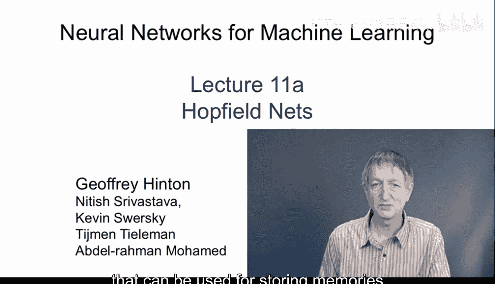
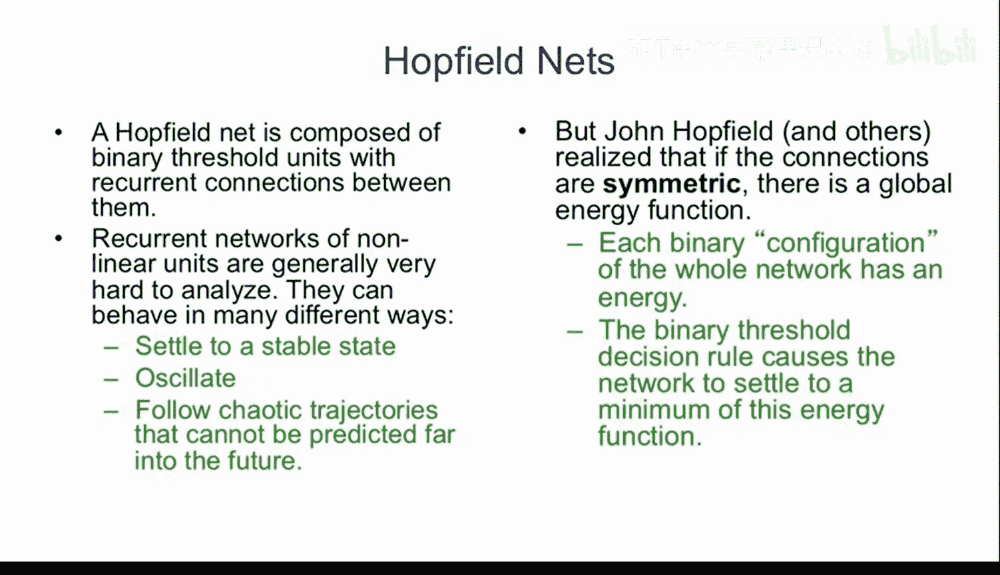
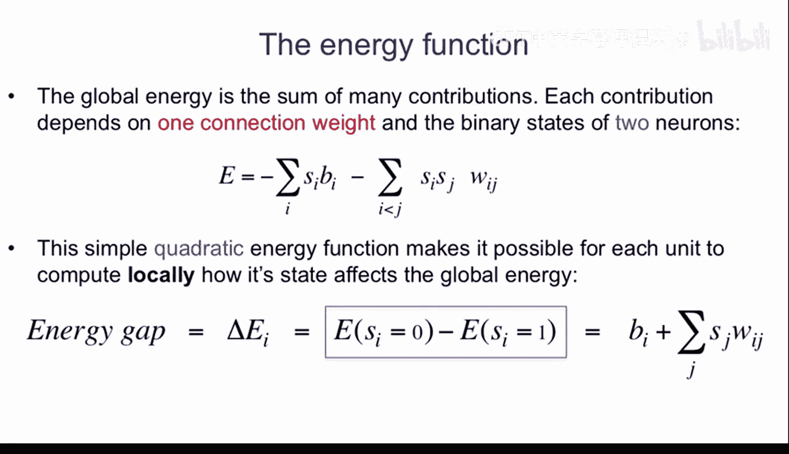
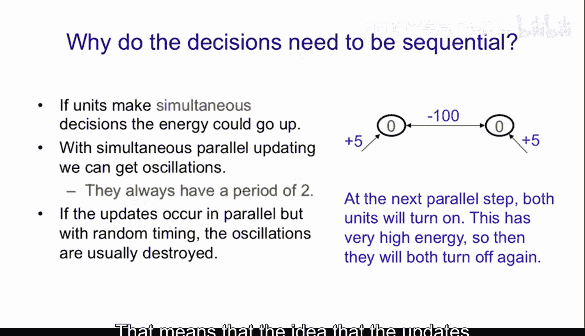
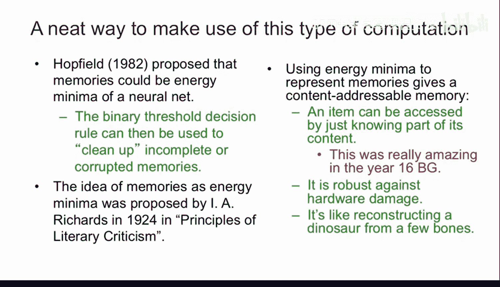
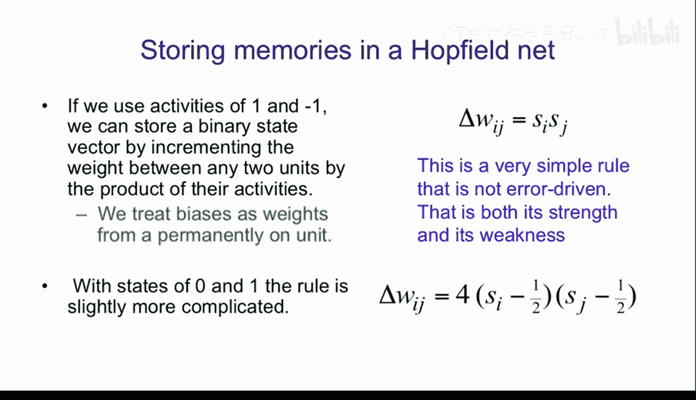

# 神经网络与机器学习：11.1：霍普菲尔德网络 🧠

在本节课中，我们将要学习一种与之前介绍的前馈神经网络截然不同的模型——霍普菲尔德网络。这种网络是20世纪80年代神经网络研究复兴的主要原因之一。它是一种结构简单、可用于以分布式活动模式存储记忆的模型。

## 能量基础模型

上一节我们介绍了前馈网络，本节中我们来看看一种基于全局能量函数的模型，有时被称为“能量基础模型”。霍普菲尔德网络是最简单的能量基础模型之一。

它由二元阈值单元组成，单元之间存在循环连接。通常，具有循环连接的非线性单元网络非常难以分析，它们的行为方式多样：可以稳定在某个状态、可以振荡，甚至可能出现混沌行为。混沌意味着除非你以无限精度知道其初始状态，否则无法预测其未来的状态。

幸运的是，约翰·霍普菲尔德以及斯蒂芬·格罗斯伯格等研究小组发现，如果网络中的连接是对称的，那么整个网络就存在一个全局能量函数。网络的每一种二元配置（即网络中每个神经元都被赋予一个二元值）都对应一个能量值。

## 能量函数与状态更新

霍普菲尔德意识到，如果设置了正确的能量函数，二元阈值决策规则实际上会使网络朝着能量降低的方向演化。持续应用该规则，网络最终会到达一个能量最小值。

全局配置的能量由许多局部贡献的总和构成，其主要贡献形式是连接权重与两个神经元二元状态的乘积。能量函数如下所示：

**能量公式：**
`E = - Σ_i Σ_j w_ij * s_i * s_j - Σ_i b_i * s_i`

其中，能量越低越好，公式中的负号即为此意。`w_ij` 是两个神经元之间的对称连接强度，`s_i` 和 `s_j` 是神经元的二元活动状态（取值为1或0，或另一种形式中的1或-1）。除了涉及两个单元状态的二次项，还有一个仅涉及单个单元状态的偏置项 `b_i`。

这种二次能量函数使得每个单元能够局部地计算其状态改变将如何影响全局能量。为此，我们首先需要定义“能量差”。

## 能量差与决策规则

单元 `i` 的能量差是指，根据单元 `i` 处于“开启”或“关闭”状态，整个网络全局能量的差值。我们将其定义为单元 `i` 关闭时的能量减去其开启时的能量。这个差值正是二元阈值决策规则所计算的内容。

如果对能量公式关于单元 `i` 的状态进行微分（尽管状态是二元变量，但这样做在数学上可行），你会发现得到的结果正是二元阈值决策规则（只是少了负号，因为该规则是为了使能量下降）。

因此，遵循二元阈值决策规则，霍普菲尔德网络会使其全局能量不断下降。

## 寻找能量最小值

在霍普菲尔德网络中寻找能量最小值的一种方法是：从一个随机状态开始，然后以随机顺序逐个更新单元。我们进行顺序更新。对于选中的每个单元，计算其两种状态中哪一种能带来更低的全局能量，并将其置于该状态，而不管它之前处于什么状态。这等同于直接应用二元阈值决策规则。

以下是更新过程的一个小例子：

假设我们从一个精心挑选的随机状态开始，其能量为 -3（或者说“优度”为 3，优度是负能量的相反数，便于思考）。在这个配置中，只有一个活跃的单元对，其权重为 3，因此优度为 3。

1.  **随机选择一个单元**：例如选择某个单元。计算其总输入：`1 * (-4) + 0 * 3 + 0 * 3 = -4`。该值低于 0，因此我们将其关闭（它原本就是关闭的，状态不变）。
2.  **选择另一个单元**：计算其总输入：`1 * 3 + (-1) * 0 = 3`。二元阈值决策规则会使其开启。
3.  **再选择一个单元**：计算其总输入：`1 * 2 + 1 * (-1) + 0 * 3 + 0 * (-1) = 1`。因此它将开启（之前是关闭的）。此时，全局能量变为 -4（优度为 4）。

现在网络达到了一个局部能量最小值。如果尝试探测任何单元，你会发现它们都不希望改变当前状态。网络已经稳定在一个最小值上。

然而，这个最小值并非网络中最深的能量最小值。这个网络存在两个最小值，更深的最小值出现在另一个相互支持的三角形单元组全部开启时，其优度为 `3 + 3 + (-1) = 5`，是稍好一些的能量最小值。

## 顺序更新的必要性

你可能会问，为什么霍普菲尔德网络中的决策必须是顺序的？问题在于，如果单元同时做出决策，每个单元可能都认为自己正在降低能量，但实际上总能量可能上升。

使用同步并行更新时，我们可能会得到振荡，且振荡周期总是为 2。例如，在一个两个单元偏置均为 +5、相互间权重为 -100 的小网络中：
*   当两个单元都关闭时，下一步并行更新会使两者都开启（因为它们都认为可以通过偏置项改善状况）。
*   但一旦都开启，就会引入 -100 的权重项，实际上使情况变得更糟。
*   于是在下一个并行步骤中，两个单元又会都关闭，如此循环振荡。

但是，如果我们采用并行更新，但更新时机是随机的（即，在考虑更新另一个单元之前，我们不等一个单元的更新状态传播给所有单元，而是每个单元的更新间隔时间是随机的），那么这种随机时序通常会破坏这种双相振荡。

这意味着，从生物学角度看，“更新必须是顺序的”这一要求并不像看起来那么严格。

## 作为记忆存储的能量最小值

霍普菲尔德提出，我们可以利用这种能稳定在能量最小值的基于能量的模型来存储记忆。他在1982年发表了一篇非常有影响力的论文，提出记忆可以是对称权重神经网络的能量最小值。

二元阈值决策规则可以将部分记忆“清理”成完整记忆。也就是说，记忆可能因部分内容错误而被破坏，或者部分内容尚未确定，我们可以利用网络来补全记忆。

将记忆视为能量最小值的想法由来已久。霍普菲尔德意识到，使用能量最小值来表示记忆，可以提供一种“内容可寻址”存储器。这意味着，你只需知道记忆内容的一部分，就可以访问整个记忆项。

你可以告诉我某个事物的几个属性，这将设置网络中一些神经元的状态。如果你将其他神经元置于随机状态，然后开始循环应用二元阈值规则，运气好的话，你就能补全该记忆，得到某个已知的存储项。

在1982年霍普菲尔德网络被提出时，这是一个非常有趣的特性（那时距离谷歌诞生还有16年）。如今有了谷歌，我们觉得这理所当然。

霍普菲尔德网络的另一个具有生物学意义的特性是，它们对硬件损伤具有鲁棒性。你可以移除网络中的一些单元，与计算机的中央处理器不同，一切仍能正常工作。心理学家对此类记忆有一个很好的类比：就像仅凭几块骨头重建恐龙，因为你了解骨头应该如何组合在一起。

网络中的权重提供了关于神经元状态如何组合的信息。现在，给定少数神经元的状态，我可以补全整个状态以恢复完整的记忆。

## 记忆存储规则

霍普菲尔德网络中的记忆存储规则非常简单。

如果我们使用取值为 1 和 -1 的活动状态，那么存储一个二元状态向量的方法是：简单地按照两个单元活动值的乘积来增加它们之间的权重。

**存储规则（状态为 ±1）：**
`Δw_ij = s_i * s_j`

这个规则的一个优点是，你只需遍历数据一次就完成了存储。因此，它确实是一种真正的在线学习规则。这是因为它不是基于误差驱动的：你不是在比较预测结果与正确答案，然后进行微调。

它不是一个误差校正规则，这既是其优点也是其弱点。优点在于它可以实现在线学习，但正如我们稍后将看到的，弱点在于这不是一种非常高效的存储方式。

我们也可以设置偏置，通常将偏置视为来自一个永久开启单元的权重。

如果你想使用 0 和 1 作为单元的状态（这是我们后面会用的形式），更新规则只是稍微复杂一点。

**存储规则（状态为 0/1）：**
`Δw_ij = (2*s_i - 1) * (2*s_j - 1)`
（或者等效地，先将状态转换为 ±1 形式，再应用 ±1 规则）

---

本节课中我们一起学习了霍普菲尔德网络的基本原理。我们了解到它是一种基于能量函数的循环神经网络，能够通过简单的局部规则收敛到能量最小值，并利用这些最小值来实现内容可寻址的记忆存储。我们还探讨了其顺序更新的必要性、作为记忆模型的优势（如鲁棒性、内容寻址）以及其简单但非误差驱动的学习规则。