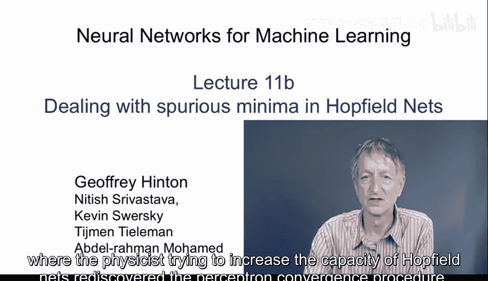
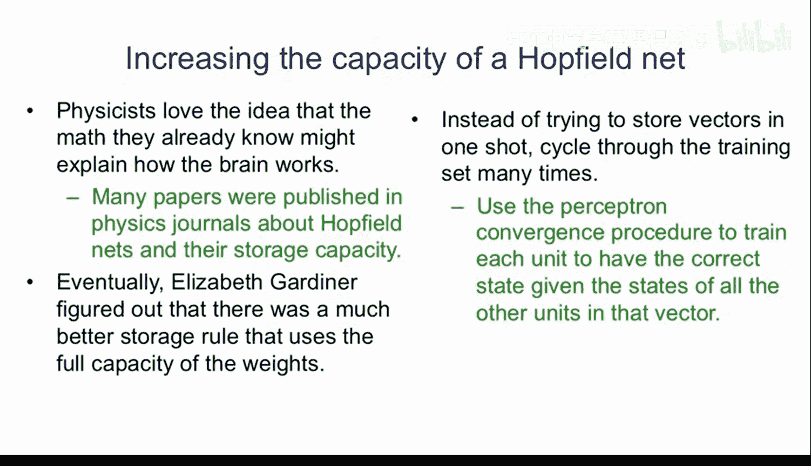

# Hinton@多伦多大学《机器学习的神经网络｜Neural Networks for Machine Learning 2016》claude-4s p51 -51-Lecture 11.2 — Dealing with spurious minima  -Neural Networks for Machine Le -BV1HtkUB2EZD_p51-

In this video， I'm going to talk about the storage capacity of hot field nets。

Their ability to store a lot of memories is limited by what are called spurious memories。😔。

These occur when two nearby energy minima combine to make a new minimum in the wrong place。

Attempts to remove these spurious minima。Eventually led to a very interesting way of doing learning。

In things considerably more complicated than a basic hop field net。At the end of the video。

I'll also talk about a curious historical rediscovery where the physicists trying to increase the capacity of hotfield nets。

Weiscovered the piceptron convergence procedure。After Hoopfield invented Hoopfield nets as memory storage devices。

The field became obsessed by the storage capacity of a hot field net。

Using Hoopfield storage rule for a totally connected net， the capacity is about 0。15 N memories。

That is， if you have N binary threshold units， the number of memories you can store is about 0 。

15 n before memories start getting confused with one another。

So that's the number you can store and still hope to retrieve them sensibly。

Each memory is a random configuration of the N unit， so it has n bits of information in it。

 And so the total information being stored in a Hfield net is about nugh 。15 n squared bits。

This doesn't make efficient use of the bits that are required to store the weights。In other words。

 if you look at how many bits the computer is using to store the weights， it's using well over 0。

15 n squared bits to store the weights。 And therefore。

 this kind of distributed memory in local energy minima is not making efficient use of the bits in the computer。

We can analyze how many bits we should be able to store if we were making efficient use of the bits in the computer。

There's n squared weights and vicees in the net。And after storing M memories。

 each connection weight has an integer value in the range minus M to M。

That's because we increase it by one or decrease it by one each time we store a memory。

 assuming that we use states of -1 and 1。Now， of course。

 not all values will be equi probable so we could compress that information。

 but ignoring that the number of bits it would take us to store a connection weight in the naive way is log 2 M plus 1。

 because that's the number of alternative connection weights。 And that's a log to the base 2。

And so the total number of bits of computer memory that we use。

Is of the order of n squared log 2 m plus 1。So notice that that scales logarithmically with M。

Whereas if you store things in the way Hefield suggests， you get this constant notugh 。

15 instead of something that scales logarithmically。

So we're not so worried about the fact that the constant is a lot less than2。

 What we were worried about is this logarithmic scaling。

That shows we ought to be able to do something better。

If we ask what limits the capacity of a hotfield net， what is it that causes it to break down。Then。

 its merging of energy minima。So each time we memorize a binary configuration。

We hope that we'll create a new energy minimum。So we might have our state space for all the states of the net being depicted horizontally here and the energy being depicted vertically。

 And we might have one energy minimum for the blue pattern and another for the green pattern。

But if those two patterns are near by， what will happen is we won't get two separate minimumma。

 They'll merge to create one minimum at an intermediate location。

And that means we can't distinguish those two separate memories。 and indeed。

 we'll recall something that's a blend of them rather than the individual memories。

That's what limits the capacity of a hotfield net。 that kind of merging of nearby by Minma。

One thing I should mention is this picture is a big misrepresentation。

 The states of a hot field net are really the corners of a hypercue。

 and it's not very good to show the corners of a hypercue as if they were a continuous one dimensional horizontal space。

One very interesting idea that came out of thinking about how to improve the craft of a hotfield mat is the idea of unlearning。

This was first suggested by Hopepeville Feinstein and Palmer。Who suggested the following strategy。

You let the net settle from a random initial state， and then you do unlearning。

 That is whatever binary state it settles to。You apply the opposite of the storage rule。

I think you can see that with the previous example， that red merged minimum。

 If you let the net settle there and did some unlearning on that merge minimum。

 you'd get back the two separate minimum because you'd pull up that red point。

So by getting rid of deep， spurious minima， we can actually increase the memory capacity。

Hoopford Feinstein and Palmer showed that this actually worked。

But they didn't have a good analysis of what was really going on。Francis Crick。

 one of the discoverers of the structure of DNA and Gham Mison。

 proposed that unlearning might be what's going on during Rem sleep。That is rapid eye movement sleep。

So the idea was that during the day， you store lots of things and you'll get spurious minimum。

And at night， you put the network in a random state。You settle to a minimum。

 and you unlearn what you settled to。And that actually explains a big puzzle。

This is a puzzle that doesn't seem to puzzle most people to study sleep， but it ought to。Each night。

 you go to sleep and you dream for several hours。When you wake up in the morning。

 those dreams are all gone。Well， they're not quite all gone。

The dream you had just before you woke up， you can get into short term memory。

 and you'll remember it for a while。 And if you think about it。

 you might remember it for a long time。But we know perfectly well that if we were woken you up at other times in the night。

 you'd have been having other dreams。 And in the morning， they're just not there。

So it looks like you're simply not storing what you're dreaming about。And the question is， why。

In fact， why do you bother to dream at all。Dreamy is paradoxical in that the state of your brain looks extremely like the state of your brain when you are awake。

 Except that it's not being driven by real input。 It's being driven by a relay station just after the real input called the thalamus。

So the cricket Miitchson theory， at least explains functionally what the point of dreams is is to get rid of their spurious minimumma。

But there's another problem with unlearning， which is a more mathematical problem。

Which is how much unlearning should we do。Now， give them what you've seen in this course so far。

A real solution to that problem would be to show that unlearning。

Is part of the process of fitting a model to data。And if you do maximum likelihood fitting of that model。

Then unlearning will automatically come out of fitting the model。 And what's more。

 you'll know exactly how much unlearning to do。So what we're going to try and do is derive unle as the right way to minimize a cost function where the cost function is how well your neural net models the data that you saw during the day。

Before we get to that。I want to talk a little bit about ways that physicists discovered for increasing the capacity of a hotfield net。

As I said， this was a big obsession with the field。

 I think it's because physicists really love the idea that math they already know might explain how the brain works。

 That means postdoctoral fellows in physics who can't get a job in physics might be able to get a job in neuroscience。

So there were a very large number of papers published in physics journals about hotfield nets and their storage capacity。

Eventually， a very smart student called Elizabeth Gardner figured out that there was actually a much better storage rule。

 if you were concerned about capacity。And that it would use the full capacity of the weights。

And I think this storage rule will be familiar to you。Instead of trying to store vectors in one go。

 what we're going to do is we're going to cycle through the training set many times。

So we lose our nice online property that you only have to go through the data once。But in return。

 we can gain more efficient storage。What we're going to do is we're going to use the perceptron convergence procedure to train each unit to have the correct state。

 given the states of all the other units in that global vector that we want to store。So。

 you take your net。You put it into the memory state you want to store。

And then you take each unit separately， and say。Would this unit adopt the state I want for it。

 given the states of all the other units。If it would， you leave its incoming waits alone。

If it wouldn't， you change its incoming weights in the way specified by the perceptproron convergence procedure。

And notice those will be integer changes to the weights。You may have to do this several times。 And。

 of course， if you give it too many memories， this won't converge。

You only get convergence with the perceptron convergence procedure If there is a set of weights that will solve the problem。

But assuming there is， this is a much more efficient way to store memories in a hotfield net。

This technique has also been developed in another field， statistics。

 and statisticians call the technique pseudo likelihood。The idea is to get one thing right。

 given all the other things。 And so with high dimensional data， if you want to build a model of it。

The idea is， you build a model that tries to get the value on one dimension， right。

 given the values on all the other dimensions。The main difference between the perceptron convergence procedure。

 as it is normally used and pseudo likelihoodhood， is that in the hop field net。

 the weights are symmetric。 So we have to get two sets of gradients for each weight and average them。

But apart from that， the way to use the full capacity of a hottfield net is to use the perceptron convergence procedure and to go through the data several times。

