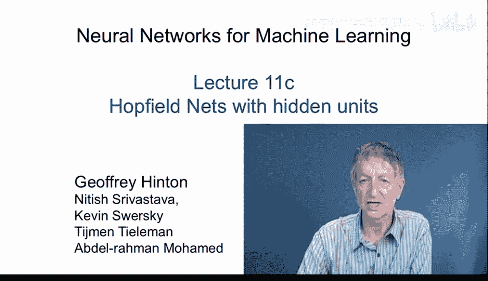
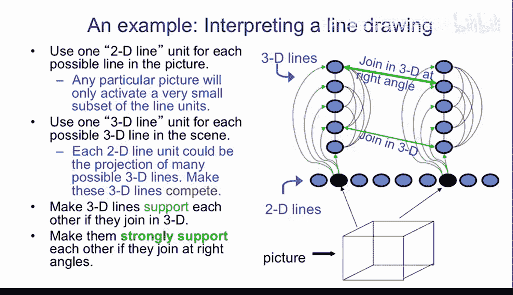
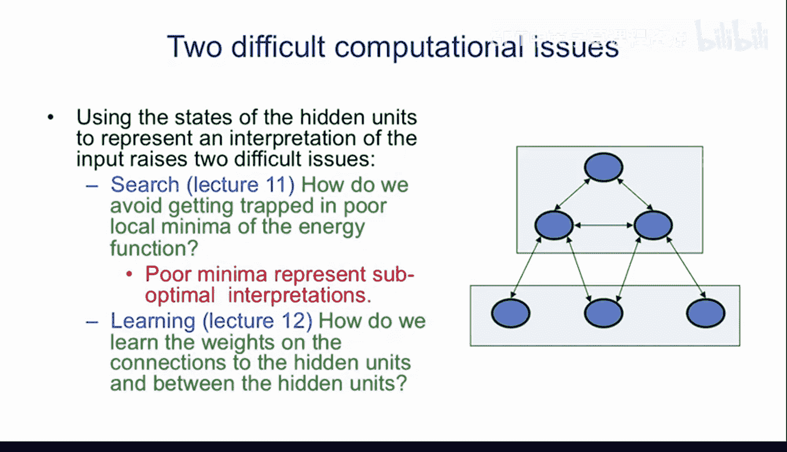

# Hinton@多伦多大学《机器学习的神经网络｜Neural Networks for Machine Learning 2016》claude-4s p52 -52-Lecture 11.3 — Hopfield nets with hidden units  -Neural Networks for Machine -BV1HtkUB2EZD_p52-

In this video。I'm going to explain a very different way of using Hofield's energy function。

 We add some hidden units to the network。And what we try and do is make the states of those hidden units represent an interpretation of the perceptual input that's shown on the visible units。

So the idea is that the weights between units represent constraints on good interpretations。

And by finding a low energy state， we find a good interpretation of the input data。

Hgfield Nes combine two ideas。The idea that you can find a local energy minimum by using a network of symmetrically connected binary threshold units。

And the idea that these local energy minima might correspond to memories。

There's a different way of using the ability to find local minima。

Instead of using the net to store memories， we can use it to construct interpretations of the sensory input。

So the idea is that we have the input represented by some visible units。

And we construct an interpretation of that input in the set of hidden units。

So the interpretation or explanation of the input is going to be a binary configuration over the hidden units。

The energy of the whole system。Will represent the badness of that interpretation。

So to get good interpretations， according to our current model of the world。

 which is in the energy function。We need to find low energy states of the hidden units。

 Given the input represented by the visible units。I want to give an example of this。

 to make the idea clearer。In order to give the example。

 I need to go into a little bit of detail about what you can infer when you see a2 D line in an image。

 What does that tell you about the three dimensional world。

So a 2D line in an image could have been caused by many different three dimensional edges in the world。

If this blue dot is your eyeball and the red lines are two lines of sight coming from the centre of your eyeball。

Then the black line is a possible 3D edge that would lead to a two dimensional line on your ratiotina。

Here's another 3D edge that would lead to exactly the same thing on your retina。

And here's another one。 And here's another one。All of these different 3D edges have exactly the same appearance in the image。

That's because we've lost the information about how far away the ends of the line are along that line of sight。

We know the end is somewhere along line of sight， but we don't know the depth。So， if we assume。

That a straight，3D edge in the world is the cause of a straight 2D line in the image。

Then we've lost 2 degrees of freedom of that 3D edge。 Its depth at each end。

So there's a whole family of 3D edges that all correspond to the same 2 D line。

You can only see one of these 3D edges at a time because they all get in the way of each other。

So now we're in a position to see a little example of what you might be able to do if you can use the fact that you can find low energy states of a network of binary units。

To help you find interpretations of sensory input。So， here's the example。

We imagine we see a line drawing， and we want to interpret it as a three dimensional thing。

So the data we have， let's suppose。Is a bunch of 2 D lines like the lines shown in the picture。

And for each possible line， we will have set aside a neuron。

Don't worry for now about the fact that that would require too many neurons。

So for every possible 2G line we have a neuro。In any one picture。

Only a few of the possible lines will be present。And so we'll activate just a few of those neurons。

So I've shown two edges in that picture， activating two of the neurons。

And those are neurons that represent 2 D lines。Pd data。Now。

What we're going to do is have a whole bunch of 3D line units。

 one for each possible 3D line or 3D edge。So each of the two D line units。

Could be the projection of many different possible 3D lines。

We therefore need to make the 2 D line unit excite those 3D lines。

 but we also need to make them all compete with one another because you can only see one of them at a time。

So here's an example where I have a stack of 3D line units。

The green connections are excitatory connections coming from the 2 D line unit。

All of them with equal weight。Saying if this line is present， I'm to try and turn on all of those。

But in addition， we need competition between those so that only one of them will turn on。

 And that's what the red lines represent。And we do that for each 2 D line unit。

So I'm just showing it you for the 2D line units that happen to be active at present。And again。

 don't worry about the fact that this would need far too many units。Now。

 the story is not quite complete。 We've now wired into the neural network。

 The information about projection that I showed on the previous slide。 I。e。

 the neural network in those green and red connections。

 understands that each 2 D line can correspond to many different 3D edges。

 but only one of them should be present at a time。But now we know a lot about how 3D edges connect。

For example， when we see 22 D lines connect in the image。

 we think it almost certain they correspond to edges that have the same depth at the point where the lines connect。

So let's suppose that the 2 3D edges I've joined there correspond to having the same depth at the point where the 2。

2D lines join。That means they should support each other。It doesn't have to be like that。

 You could have a very funny viewpoint where one line ends at a different depth from the other。

 And you just happen to be at the viewpoint from which they coincide on your retina。

 But that's very unlikely。So we're going to need to use the fact that we expect 2 D lines that coincide in the image to correspond to 3D edges that agree on the depth at that point。

So we'll put in a lot of connections like that。But there's an even stronger effect we can use。

 which is that in our manufactured world， we expect that quite often。

3D edges will join in a right angle。And so for two particular 3D edges that happen to agree in depth and join at a right angle will put in a particularly strong connection。

And I've indicated that by a thicker green line。So by putting in lots of connections like that。

 we can indicate how we expect 3D edges to go together to form a coherent 3D object。

And now we have a network that contains information about how edges go together in the world and about how edges project to cause lines in the image。

 And so if we give that network an image。It should be able to come up with an interpretation of the image。

 And for the image I am showing you， there's two quite different interpretations。

 It's called a neckcker cube。 And if you look at it long enough， it will flip in depth on you。

And this network would have two pretty much equally deep energy minima that correspond to those two interpretations of the Necu。

Remember。This is all just an analogy。 So you understand the idea of using low energy states as interpretations of perceptual data。

To actually build a proper model of what happens when the neck cube flips would be a lot more complicated than this。

So if we decide we're going to use low energy states to represent good perceptual interpretations。

 then we have two issues。The first is to do with search。

 And I'm going to deal with that in the next video。The search question is。

 how do we avoid the hidden units getting trapped in poor local minima of the energy function。

The poor minima represent interpretations that are suboptimal。

 given our current model in the weights of the network。

Can we do anything better than simply going downhill in energy from some random starting state。

The second issue， which seems even more difficult， is how do we learn the weights on the connections between hidden units and between visible units and hidden units。

Is the some simple learning algorithm for adjusting all those weights so that we get sensible perceptual interpretations。

And notice here， we haven't got a supervisor anywhere。 We're just showing it input。

 and we'd like it to construct patterns of activity in the hidden units that represent sensible interpretations。

This seems like a rather tall order。