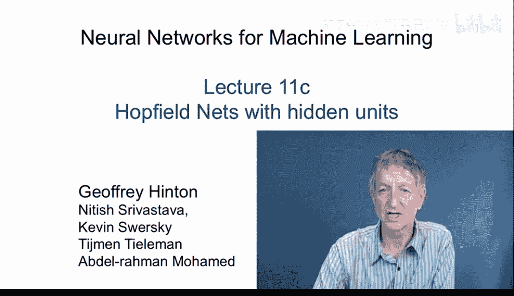
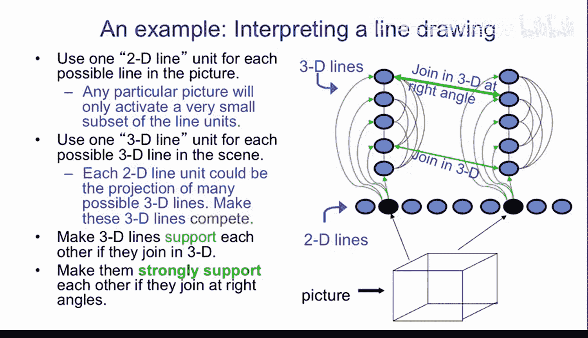
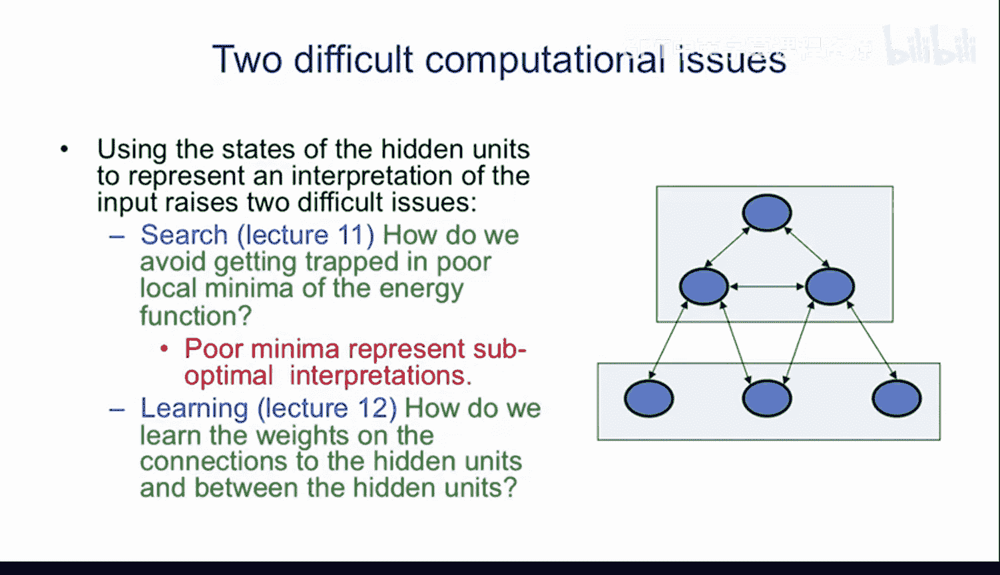

# 神经网络与机器学习：第11讲第3节：带隐藏单元的霍普菲尔德网络 🧠

在本节课中，我们将学习一种使用霍普菲尔德能量函数的全新方法。我们将为网络添加隐藏单元，并尝试让这些隐藏单元的状态表示对可见单元上感知输入的一种解释。核心思想是，单元之间的权重代表了良好解释所必须满足的约束。通过找到一个低能量状态，我们就能找到对输入数据的一种良好解释。

---

## 霍普菲尔德网络的两个核心思想

上一节我们介绍了霍普菲尔德网络的基本概念。霍普菲尔德网络结合了两个核心思想：
1.  你可以通过使用一个对称连接的二元阈值单元网络来找到局部能量最小值。
2.  这些局部能量最小值可能对应着记忆。

然而，利用寻找局部最小值的能力，还有另一种不同的方式。

我们不是用网络来存储记忆，而是用它来构建对感知输入的解释。其思想是，输入由一些可见单元表示，而我们在隐藏单元集合中构建对该输入的解释。因此，对输入的解释或说明将是隐藏单元上的一个二元配置。

整个系统的能量将代表该解释的“糟糕程度”。因此，为了根据我们当前对世界的模型（该模型体现在能量函数中）获得良好的解释，我们需要在给定由可见单元表示的输入的情况下，找到隐藏单元的低能量状态。

---

## 一个具体的感知解释示例 👁️

为了让这个想法更清晰，我想举一个例子。为了说明这个例子，我需要稍微详细地解释一下，当你在图像中看到一条二维线段时，你能推断出关于三维世界的什么信息。

图像中的一条二维线段，可能由世界中许多不同的三维边缘所导致。如果我们假设世界中的一条笔直三维边缘是图像中一条笔直二维线段的原因，那么我们就丢失了该三维边缘的两个自由度，即其两端的深度。因此，存在一整个三维边缘家族，它们都对应于同一条二维线段。你一次只能看到这些三维边缘中的一个，因为它们会互相遮挡。

现在，我们可以通过一个小例子来看看，如果你能利用找到二元单元网络低能量状态的能力来帮助寻找感知输入的解释，你可能会做什么。

---

## 构建解释网络：从2D到3D

以下是构建解释网络的步骤：

我们想象看到一幅线条画，并希望将其解释为一个三维物体。我们拥有的数据，假设是一束二维线段，就像图中显示的线条那样。对于每一条可能的线段，我们都预留了一个神经元（暂时不必担心这需要太多神经元的问题）。在任何一幅图片中，只有少数可能的线段会出现，因此我们只会激活那些神经元中的少数几个。图中我展示了激活两个神经元的两条边缘，这些神经元代表二维线段，即感知数据。

接下来，我们将拥有一大堆三维线段单元，每一个对应一条可能的三维线段或三维边缘。每一个二维线段单元，可能是许多不同可能的三维线段的投影。因此，我们需要让二维线段单元去**兴奋**那些三维线段单元，但同时我们也需要让它们彼此**竞争**，因为你一次只能看到其中一个。

这里有一个例子，我有一组三维线段单元。绿色的连接是来自二维线段单元的兴奋性连接，它们都具有相同的权重，表示“如果这条线段存在，我将尝试激活所有这些三维单元”。但此外，我们需要在这些单元之间建立竞争，以便只有一个会被激活，这就是红线所代表的。我们对每个二维线段单元都这样做（图中只展示了当前活跃的二维线段单元的情况，同样，暂时不必担心这需要太多单元的问题）。

---

## 整合三维世界的约束

现在，故事还不完整。我们已经将关于投影的信息（即上一张幻灯片展示的：每条二维线段可以对应许多不同的三维边缘，但一次只能出现一个）通过绿色和红色的连接“连接”到了神经网络中。但是，我们还知道很多关于三维边缘如何连接的知识。

例如，当我们看到图像中两条二维线段相连时，我们几乎可以肯定它们对应的边缘在连线点处具有相同的深度。因此，我们期望在图像中重合的二维线段，对应于在该点深度一致的三维边缘。我们会加入许多这样的连接。

我们还可以利用一个更强的效应：在我们制造的世界中，我们期望三维边缘经常以直角连接。因此，对于恰好深度一致并以直角连接的两条特定三维边缘，我们会加入一个特别强的连接（图中用更粗的绿线表示）。

通过加入许多这样的连接，我们可以表明我们期望三维边缘如何组合在一起，形成一个连贯的三维物体。

---

## 网络的解释能力与内克尔立方体

现在，我们有了一个网络，它包含了关于边缘在世界上如何组合以及边缘如何投影以在图像中产生线段的信息。因此，如果我们给这个网络一幅图像，它应该能够提出对该图像的一种解释。

对于我展示给你的这幅图像，存在两种相当不同的解释。它被称为**内克尔立方体**。如果你盯着它看足够久，它在深度上会对你产生翻转。而这个网络将会有两个能量深度几乎相等的极小值，分别对应内克尔立方体的那两种解释。

请记住，这一切只是一个类比，旨在帮助你理解使用低能量状态作为感知数据解释这一理念。要实际构建一个描述内克尔立方体翻转时发生什么的恰当模型，会比这复杂得多。

---

## 使用低能量状态的两个关键问题 ❓

如果我们决定使用低能量状态来表示良好的感知解释，那么我们面临两个问题。

第一个问题与**搜索**有关，我将在下一个视频中讨论。搜索问题是：我们如何避免隐藏单元陷入能量函数的**不良局部极小值**？这些不良极小值代表了根据我们网络中权重的当前模型来看是次优的解释。我们能否做得比从某个随机初始状态简单地沿着能量下坡更好？

第二个问题，看起来甚至更困难，是我们如何学习隐藏单元之间以及可见单元与隐藏单元之间连接的**权重**？是否存在一种简单的学习算法来调整所有这些权重，以便我们得到合理的感知解释？请注意，这里我们没有任何监督者，我们只是向它展示输入，我们希望它在隐藏单元中构建出代表合理解释的活动模式。

这似乎是一个相当高的要求。

---

## 本节课总结 📝

本节课中，我们一起学习了霍普菲尔德网络的一种新颖应用：利用其能量函数和隐藏单元来为感知输入构建解释。我们通过从2D线段推断3D边缘的具体例子，阐述了如何将关于世界（如投影几何、边缘连接约束）的知识编码到网络的连接权重中，从而使网络的低能量状态对应于对输入数据的合理解释。最后，我们指出了实现这一目标所面临的两个核心挑战：如何有效搜索以避免不良局部极小值，以及如何在没有监督的情况下学习到合适的连接权重。这为后续讨论更强大的模型（如玻尔兹曼机）奠定了基础。