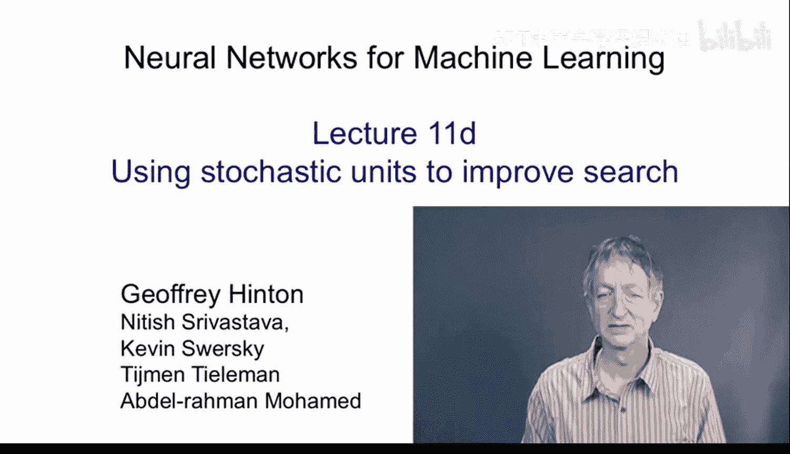
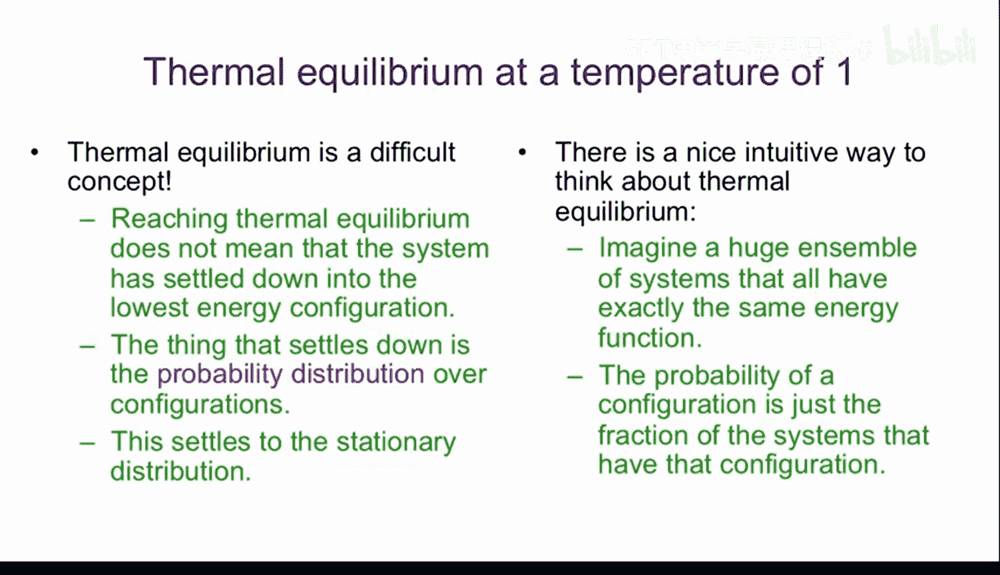
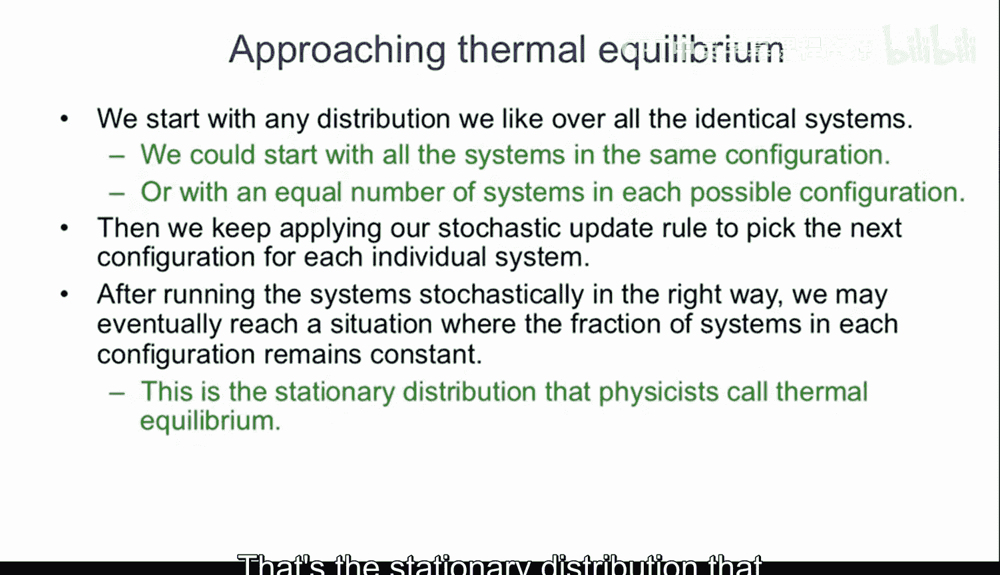
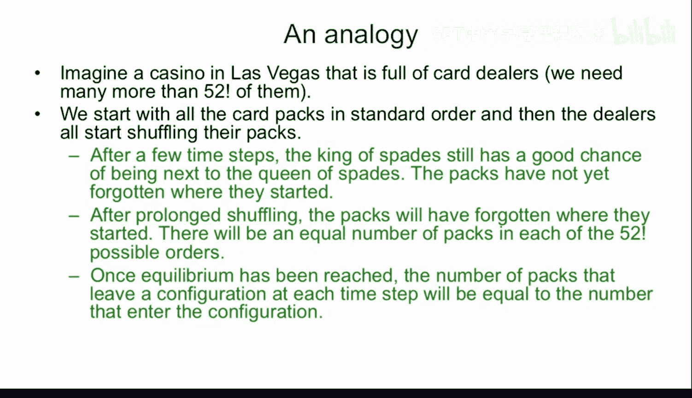

# Hinton@多伦多大学《机器学习的神经网络｜Neural Networks for Machine Learning 2016》claude-4s p53 -53-Lecture 11.4 — Using stochastic units to improve search  -Neural Networks fo -BV1HtkUB2EZD_p53-

In this video。I'm going to explain how adding noise can help systems escape from local minima。

And I'm going to show what you have to do to the units in a Hofield net。

To add noise in the appropriate way。

I'm now going to introduce the idea that we can find better Minma。By using noise。So a hopfield net。

Always makes decisions that reduce the energy。Or if it doesn't change the state of a unit。

 the energy stays the same。This makes it impossible to climb out of a local minimum。

So if you look at the landscape here。If we get into the local minimum a。

There's no way we're going to get over the energy barrier to get to the better minimum B。

Because we can't go uphill in energy。If we had random noise。We can escape from poor minima。

 especially minima that is shallow。 that is ones that don't have big energy barriers around them。

It turns out， rather than using a fixed noise level。

 the most effective strategy is to start with a lot of noise。

 which allows you to explore the space on a coar scale and find the generally good regions of the space。

 and then to decrease the noise level。With a lot of noise。

 you can cross big barriers as you decrease the noise level。

 you start concentrating on the best nearby minima。

If you slowly reduce the noise so that the system ends up in a deep minimum。

That's called simulated andneling。And this idea was propagated by Corkpat at around the same time as hopfield nets were proposed。

So the reason forimd an kneealling。Is because the temperature in a physical system。

Or in a simulated system with an energy function。Affects the transition probabilities。

So in a high temperature system， the probability of going uphill from B to A。

Is lower than the probability of going downhill from A to B。But， it's not much lower。In effect。

 the temperature flattens the energy landscape。And so the little black dots are meant to be particles。

And what we're imagining is particles moving about， according to the transition probabilities。

That you get with an energy function and a temperature。

And this might be a typical distribution if you run the system at high temperature。

Where it's easy to cross barriers， but it's also hard to stay in a deep minimum once you've got there。

If you run the system at much lower temperature。Then your probability of crossing barriers gets much smaller。

But your ratio gets much better。So the ratio of the probability of going from。

A to B versus the probability of going from B to A is much better in the low temperature system。

And so if we run it long enough。We would expect all the particles to end up in B。

But if we just run it for a long time at low temperature。

 it will take a very long time for particles to escape from May。

And it turns out a good compromise is to start at a high temperature and gradually reduce the temperature。

The way we get noise into a hotfield net。Is to replace the binary threshold units by binary stochastic units。

That make by random decisions。And the amount of noise is controlled by something called temperature。

Which you'll see in a minute in the equation。Raising the noise level is equivalent to decreasing all the energy gaps between configurations。

So this is our normal logistic equation。But with the energy gap scaled。Bair temperature。

If the temperature is very high。That exponent will be roughly 0。

So the right hand side will be one over  one plus one。

And so the probability of the unit turning on will be about a half。It'll be in his on and off states。

 more or less equally often。As we lower the temperature。Depending on the sign of Delta E。

The unit will either become more and more firmly on or more and more firmly off。At 0 temperature。

 which is what we're using in a hop field net。Then， the sine of Delta E。

Determines whether the right hand side goes to 0。Or goes to one。But with t 0。

 it either be 0 or 1 on the right hand side。And so the unit will behave deterministically。

 And that's a binary threshold unit that will always adopt whatever of the two states is the lowest energy。

So the energy gap we saw in a previous slide， and it's just the difference in the energy of the whole system。

 depending on whether unit I is off or whether the unit I is on。

Although simulated a kneeling is a very powerful method for improving searches that get stuck in local optima。

And although it was influential in leading Terrysovskyite， the ideas behind Balsmore machines。

It's actually a big distraction from understanding boltolsman machines。

So I'm not going to talk about it any more in this course， even though it's a very interesting idea。

And from now on， I am going to use binary stochastic units that have a temperature of one。That is。

 is the standard logistic function in the energy gap。

So one concept that you need to understand in order to understand the learning procedure for boltsman machines。

Is the concept of thermal equilibrium。And because we're setting the temperature to one。

 it's the concept of thermal equilibrium at a fixed temperature。It's a difficult concept。

Most people think that it means the system is settled down and isn't changing any more。

 That's normally what equilibrium means。But it's not the states of the individual units that are settled down。

The individual units。Are still rattling around at thermal equilibrium。Unless the temperature is 0。

The thing that settles down is the probability distribution over configurations。

That's a difficult concept the first time you meet it。 And so I'm going to give you an example。

The probability distribution settles to a particular distribution called the stationary distribution。

This stationaryistribution is determined by the energy function of the system。And， in fact。

 in the stationaryist， the probability of any configuration is proportional to E to the minus its energy。

A nice， intuitive way to think about thermal equilibrium。

Is to imagine a huge ensemble of identical systems that all have exactly the same energy function。

So imagine a very large number of stochastic hopfield nets。All with the same weight。Now。

 in that huge ensemble。We can define the probability of a configuration as the fraction of the systems that are in that configuration。

So now we can understand what's happening as we approach thermal equilibrium。

We can start with any distribution we like over all these identical systems。

 We could make them all be in the same configuration。

So that's a distribution with a probability of one on one configuration and 0 and everything else。

Or we could start them off with an equal number of systems in each possible configuration。

 So that's a uniform distribution。And then we're going to keep applying atochastic update rule。Which。

 in the case of a stochastic Hufield net would mean you pick a unit。And。You look at its energy gap。

And you make a random decision based on that energy gap about whether to turn it on or turn it off。

Then you go and pick another unit and so on。We keep applying that stochastic rule。

And after we'd run the system stochically in this way。

We may eventually reach a situation where the fraction of the systems in each configuration remains constant。

In fact， that's what will happen if we have symmetric connections。That's the stationary distribution。

 the physic called thermal equilibrium。

Any given system keeps changing its configuration。 We apply the update rule。

 and the states of its units will keep flipping between 0 and 1。

But the fraction of systems in any particular configuration， doesn't change。

And that's because we have many， many more systems than we have configurations。So here's an analogy。

Just to help with the concept。Imagine a very large casino in Las Vegas with lots of card dealers。

In fact， we have many more than 52 factorial card dealers。

We start with all the card packs in the standard order that they come from the manufacturer。

Let's suppose that has the aess spades then the king of spades and the Queen of spades。

And then the dealers all start shuffling。And they do random shuffles。

 They don't do fancy shuffles that bring them back to the same order again。After a few shuffles。

 there's still a good chance that the king of spades will be next to the queen of spades in any given pack。

 So the packs have not yet forgotten where they started。

Their initial order is still influencing their current order。If we keep shuffling。

 eventually the initial order will be irrelevant。The packs will have forgotten where they started。

And in fact， in this example， there will be an equal number of packs in each of the 52 factorial possible orders。

 Once this has happened， if we carry on shuffling。There still be an equal number of packs in each of the 52 factorial orders。

That's why it's called equilibrium。 It's because the fraction in any one configuration doesn't change。

Even though the individual systems are still changing。

The thing that's wrong with this analogy is that once we've reached equilibrium here。

 all configurations have equal energy。 And so they all have the same probability。In general。

 were interested in reaching equilibrium for systems where some configurations have lower energy than others。

