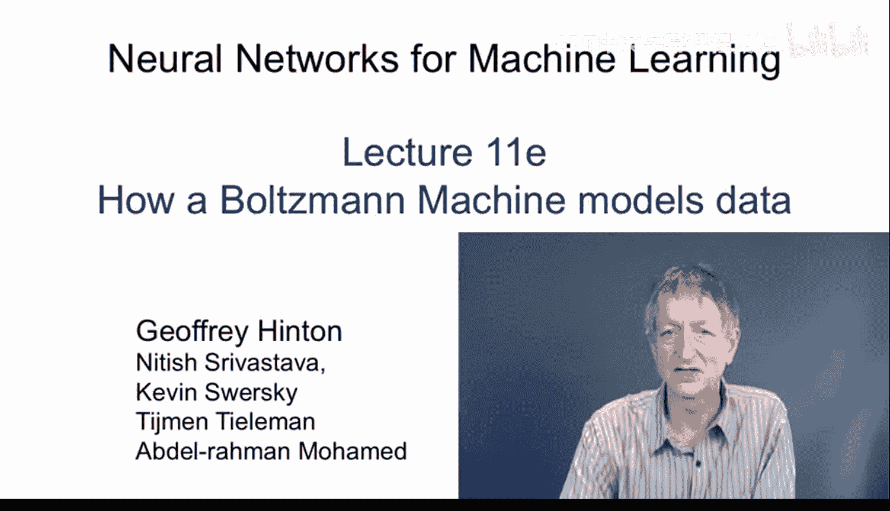
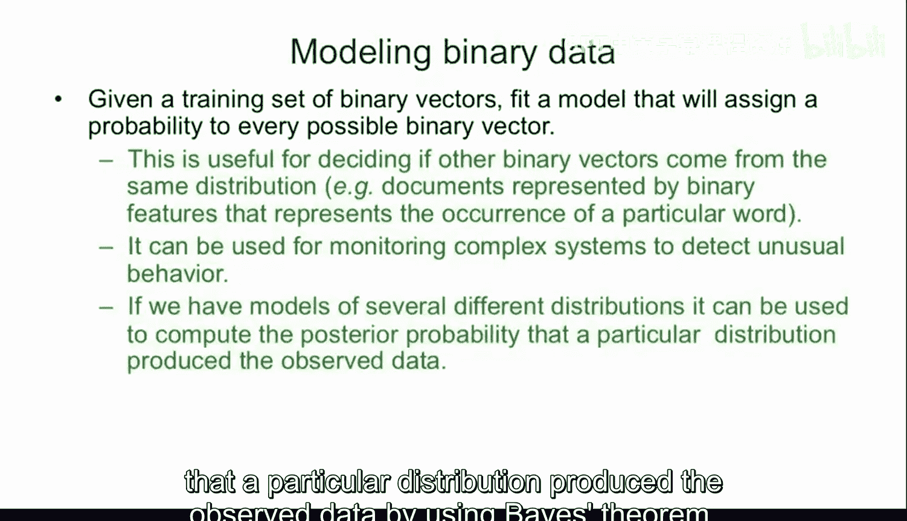
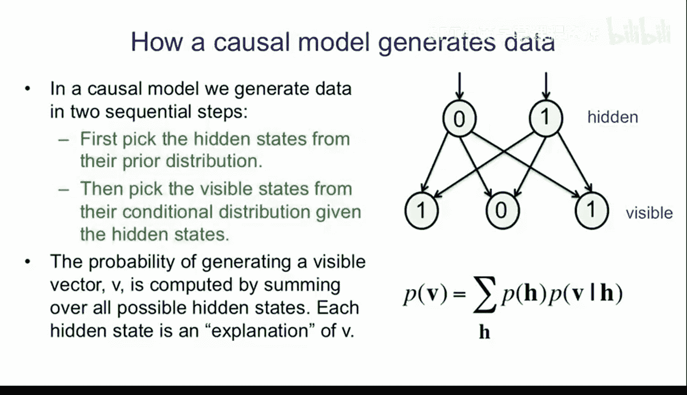
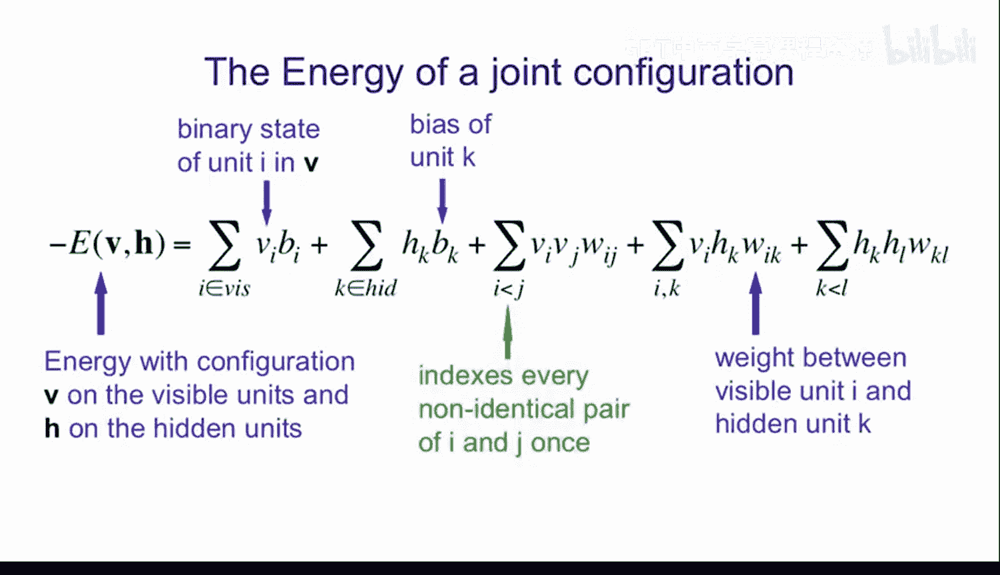
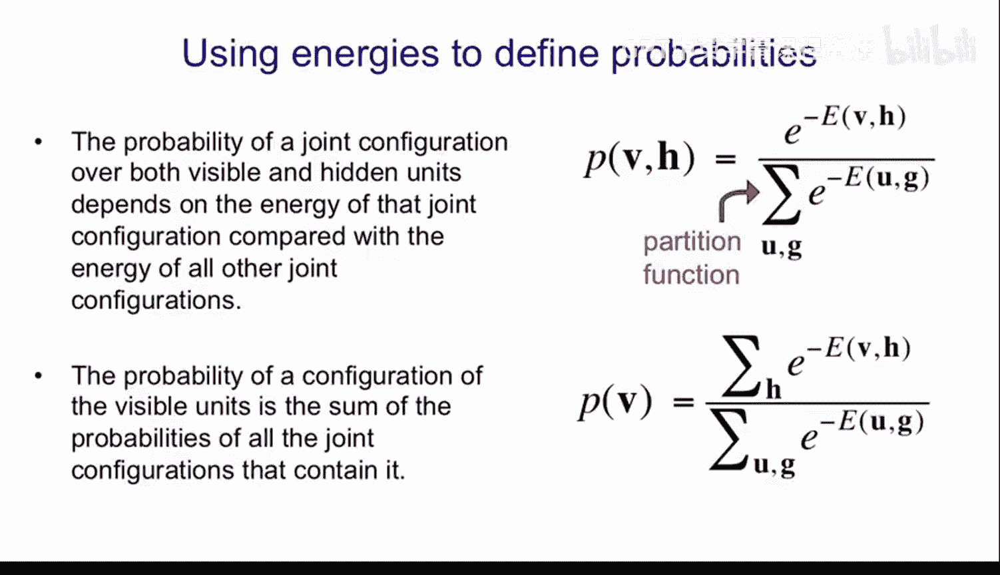
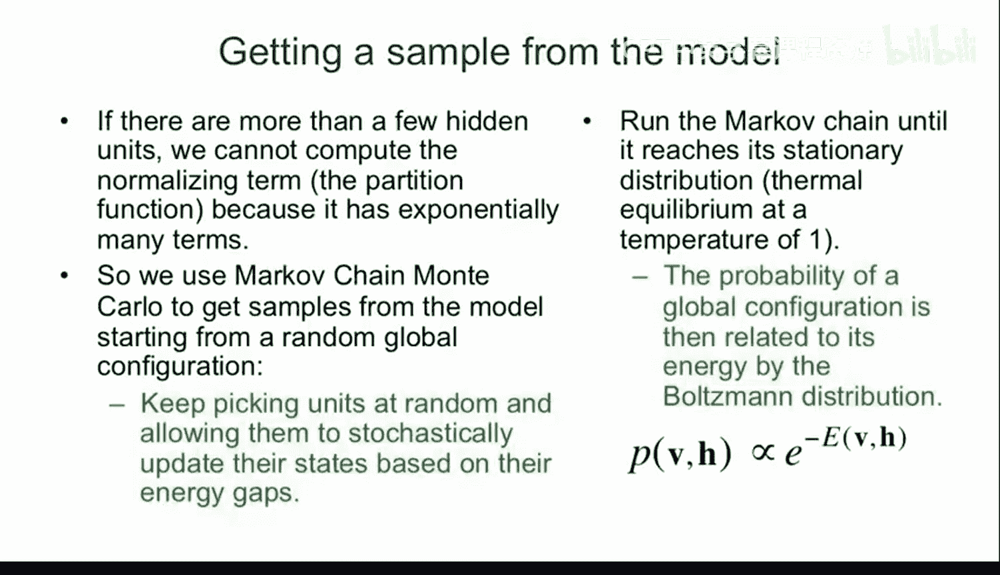
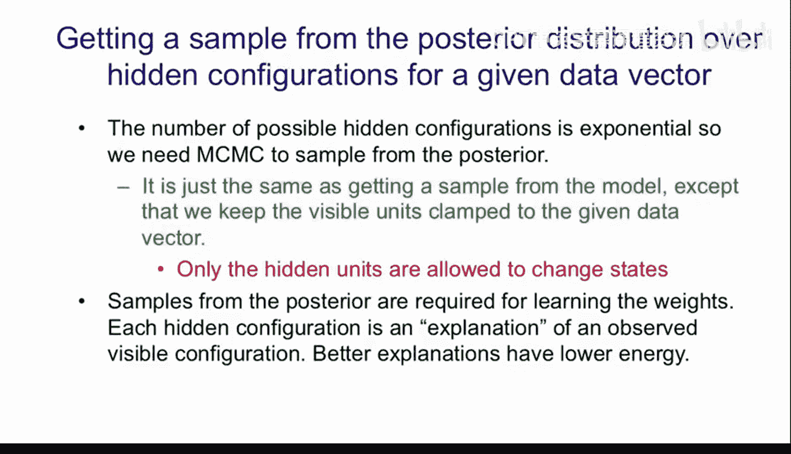

# Hinton@多伦多大学《机器学习的神经网络｜Neural Networks for Machine Learning 2016》claude-4s p54 -54-Lecture 11.5 — How a Boltzmann machine models data  -Neural Networks for Mac -BV1HtkUB2EZD_p54-

In this video。I'm going to explain how a Balsmore machine models a set of binary data vectors。

I'm going to start by explaining why we might want to model a set of binary data vectors。

And what we could do with such a model if we had it。

And then I'm going to show how the probabilities assigned to binary data vectors are determined by the weights in a B spin machine。

Sttochastic hopbfield nets with hidden units。Which we also call Baltiman machines。

Are good at modeling binary data。So given a set of binary training vectors。

They can use the hidden units。To fit a model that assigns a probability to every possible binary vector。

There are several reasons why you might like to be able to do that。If， for example。

 you had several different distributions of binary vectors。

You might like to look at a new binary vector and decide which distribution it came from。

So you might have different kinds of documents。And you might represent a document。By。

A number of binary features， each of which says whether there's more than zero occurrences of a particular word in that document。

For different kinds of documents。You'd expect different counts for the different word。

 maybe also different correlations between words。And so you could use a set of hidden units。

To model the distribution for each document。And then you could pick the most likely document。By Xing。

And then you could assign a test document to the appropriate class by seeing which class of documents is most likely to have produced that binary vector。

 You could also use Balsman machines for monitoring complex systems to detect unusual behaviour。

Suppose， for example， that you had a nuclear power station。And all of the dials were binary。

So you get a whole bunch of binary numbers。That tell you something about the state of the power station。

What you'd like to do is notice that it's in an unusual state。

 a state that's not like states you've seen before。

And you don't want to use supervised learning for that。Because really。

 you don't want to have any examples of that cause it to blow up。

You'd rather be able to detect that it's going into such a state without ever having seen such a state before。

And you could do that by building a model of what the normal states look like and then noticing that this state is different from the normal states。

If you have models of several different distributions。You can compute the posterior probability。

That a particular distribution produce the observed data。By using base there。

So given the observed data， the probability it came from Model I。

Under the assumption that it came from one of your models。

Is the probability that Model I would produce that data。Divided by the same quantity for all models。

Now I want to talk about two ways of producing models。Of data。In particular， binary vectors。

The most natural way to think about generating a binary vector。

Is to first generate the states of some latent variables。

And then use the latent variables to generate the binary vector。So the causal model。

We used two sequential steps。These are the latent variables or hidden units。

 And we first picked the states of the latent variables from their prior distributions。

Often in a causal model， these will be independent in the prior。

So their probability of turning on if they were binary latent variables would just depend on some bias that each one of them has。

Then once we' picked a state for those。We would use those to generate the states of the visible units。

By using weighted connections in this model。So this is a kind of neural network。

 causal generative model。Is using logistic units。And it uses biases for the hidden units and weights on the connection between hidden invisible visible units。

To assign a probability to every possible visible vector。

The probability of generating a particular vector of V is just the sum over all the possible hidden states。

Of the probability of generating that hidden state。Times the probability of generating V。

 given that you've already generated that hidden state。So that's a causal model。Factor analysis。

 for example， is a causal model that uses continuous variables。

And it's probably the most natural way to think about generating data。In fact， some people。

 when they say generative model mean a causal model like this。

But there's a completely different kind of model。

A Bswa machine is an energy based model。And in this kind of model。You don't generate data causally。

It's not a causal generative model。Instead， everything's defined in terms of the energies of joint configurations of visible and hidden units。

There's two ways of relating the energy of a joint configuration to its probability。

You can simply define the probability to be。The probability of a joint configuration of the visible and hidden variables is proportional to each to the negative energy of that joint configuration。

Or you can define it procedurally by saying。We're going to define the probability as the probability of finding the network in that state after we've updated all the stochastic binary units。

For enough times so that we reach thermal equilibrium。

The good news is that those two definitions agree。The energy of a joint configuration of the visible and hidden units。

Has five terms in it。So I've put the negative energy to save if having to put lots of minor signs。

And so the negative energy of the joint configuration V H。

That's with vector V and on the visible units and H on the hidden units。Has bias terms。

Where V I is the binary state of the I unit in vector V。And B， K。Is the bias。Of the Caith unit。

 in this case， a hidden unit。So that's the first two terms。Then there's the visible。

 visible interactions。And to avoid counting each of those interactions twice。

We can just say we're going to count with indices I and J and make sure that I is always less than J。

 That'll avoid counting the interaction of something with itself and also avoid counting pairs twice。

 And so we don't have to put a half in front。Then there's the visible， hidden interactions。

Where W I K is await on a visible hidden interaction。

And then there's the hidden to hidden interactions。

So the way we use the energies to define probabilities is that the probability of a joint configuration over V and H is proportional to E to the minus V H to make that anequ。

 we need to normalize the right hand side。By all possible configurations over the visible and hidden units。

And that's what the divisor there is。That's often called the partition function。

 That's what physicists call it。And notice that it has exponentially many terms。

To get the probability of a configuration of the visible units alone。

We have to sum over all possible configurations of the hidden units。

So P V is the sum of all possible ages。Of E to the minus the energy you get with that H normalized by the partition function。

I want to give you an example。Of how we compute the probabilities of the different visible vectors。

Because that'll give you a good feel for what's involved。It's all very well to see the equations。

 but I find I understand it much better when I've worked through the computation。

So let's take a network with two hidden units and two visible units。And we'll ignore biases。

 So we just got three weights here。To keep things simple。

 I'm not going to connect the visible units to each other。 So the first thing we do。

Is right down all possible。States of the visible units。I'm going to put them in different colors。

 and I'm going write each state four times。Because for each state of the visible units。

There's four possible states of the hidden units that could go with it。

So that gives us 16 possible joint configurations。Now， for each of those joint configurations。

We're going to compute its negative energy， minus E。So if you look at the first line。

When all of the units are on。The negative energy will be plus 2-1 plus 1 is plus 2。

And we do this for all 16 possible joint configurations。We then take the negative energies。

 and we exponentiate them。And that will give us unnormalized probabilities。

So these are the unnormalized probabilities of the configurations。

Their probabilities are proportional to this。If we add all those up to get 39。7。

And then we divide everything by 39。7。We get the probabilities of joint configurations。爹仔我啦。Now。

 if we want the probability of a particular visible configuration。

We have to sum over all the hidden configurations that could go with it。

And so we add up the numbers in each block。And now we've computed the probability of each possible visible vector。

In a bolts from machine that has these three weights in it。Now。

 let's ask how we get a sample from the model when the network's bigger than that。Obviously。

 in the network we just computed， we can figure out the probability of everything because it's small。

But when the networks big， we can't do these exponentially large computations。

So if there's more than few hidden units， we can't actually compute that partition function。

 There's too many terms in it。But we can use Markov chainin Monte Carlo to get samples from the model by starting from a random global configuration。

And then picking units at random and updating them stochically。Based on their energy gaps。

Those energy gaps being determined by the states of all the other units in the network。

If we keep doing that until the markov chain reaches its stationary distribution。

Then we'll have a sample from the model。And the probability of that sample is related to its energy by the Boltzman distribution。

 That is the probability。Of the sample is proportional to each of the minus the energy。

What about getting a sample from the posterior distribution over hidden configurations when given a data vector。

It turns out we're going to need that for learning。

So the number of possible hidden configurations is， again， exponential。So again。

 we use Mark chain Monte Carlo。And it's just the same as getting a sample from the model。

Except that we keep the visible units clamped to the data vector we're interested in。

So we only update the hidden units。The reason we need to get samples from the posterior distribution。

 given a data vector is we might want to know a good explanation for the observed data。

And we might want to base our actions on that good explanation。

But we also need to know that for learning。