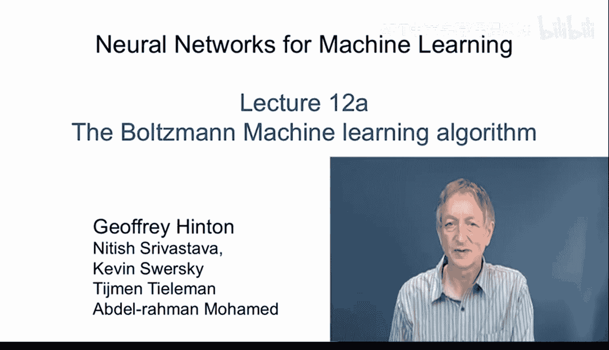
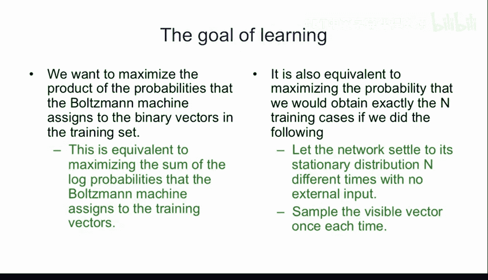
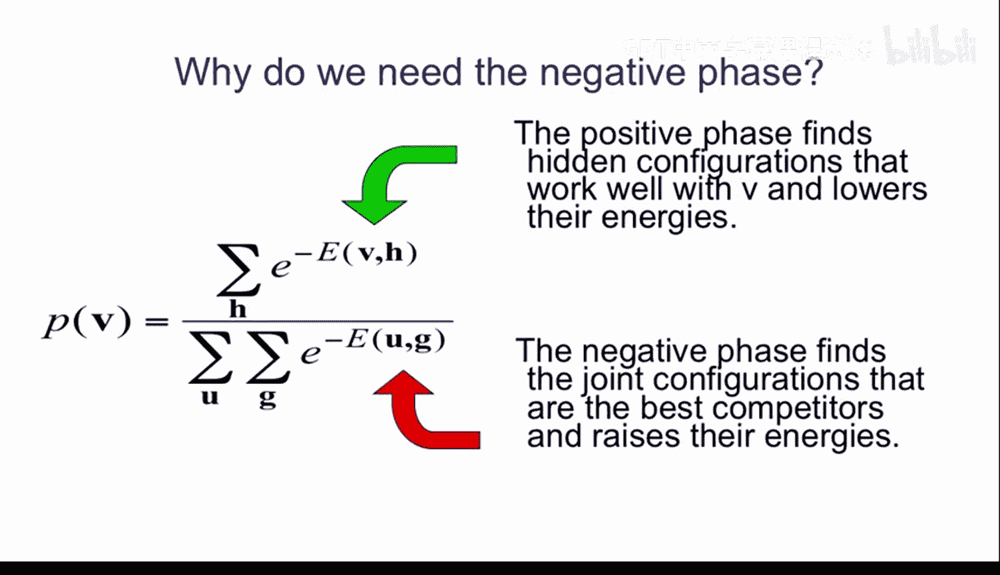
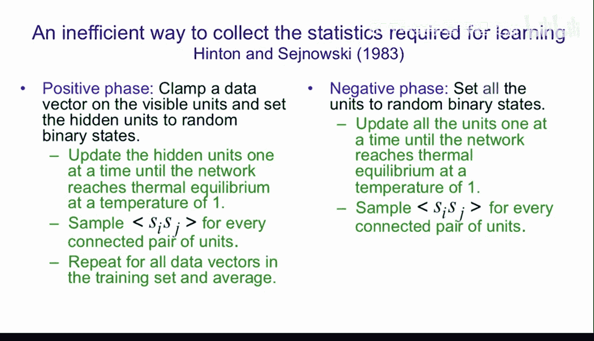

# Hinton@多伦多大学《机器学习的神经网络｜Neural Networks for Machine Learning 2016》claude-4s p55 -55-Lecture 12.1 — Boltzmann machine learning  -Neural Networks for Machine Lear -BV1HtkUB2EZD_p55-

In the previous video。I showed how a boltolsman machine can be used as a probabilistic model of a set of binary data vectors。

In this video， we're finally going to get round to the Balsman machine learning algorithm。

This is a very simple learning room。Which has an elegant theoretical justification。

But it turned out in practice， it was extremely slow and noisy and just wasn't practical。

 And for many years， people thought that Bolsen machines would never be practical devices。

Then we found several different ways of greatly speeding up the Lanni algorithm。

 And now the algorithm is much more practical。And has， in fact。

 been used as part of the winning entry for a million dollar machine learning competition。

 which I'll talk about in a later video。

The Boltimore machine learning algorithm is an unsupervised learning algorithm。

Unlike the typical use of back propagation， where we have an input vector and we provide it with a desired output。

In Baltimore machine learning， we just give it the input vector。There are no labels。

What the algorithm is trying to do is build a model of a set of input vector。

Though it might be better to think of them as output vectors。

What we want to do is maximize the product of the probabilities that the Bolsam machine assigns to a set of binary vectors。

 the ones in the training set。This is equivalent to maximising the sum of the log probabilities that the Bolsman machine assigns to the training vectors。

It's also equivalent to maximising the probability that we'd obtain exactly the end training cases if we ran the Bsman machine in the following way。

First， we let it settle to its stationary distribution in different times with no external input。

Then we sample the visible vector once。Then we let it settle again and sample the visible vector again and so on。

Now， there are many reasons why the learning could be difficult。

This is probably the most important reason。If you consider a chain of units。

A chain of hidden units here。With visible units attached to the two ends。

And if we use a training set that consists of 1，0 and 01。In other words。

 we want the two visible units to be in opposite states。

Then the way to achieve that is by making sure that the product of all those weights is negative。So。

 for example， if all the weights are positive。Turning on W1 will tend to turn on the first hidden unit。

 and that'll tend to turn on the second hidden unit and so on。

 And the fourth hidden unit will tend to turn on the other visible unit。

If one of those weights is negative。Then we'll get an anti correlationlation between the two visible units。

What this means is that if we're thinking about learning weight W1。We need to know other weights。

 So there's W1 to know how to change that weight。We need to know， W3。

But we need to have information about W 3。Because if W3 is negative。

 what we want to do with W1 is the opposite of what we want to do with W1 if W3 is positive。

So given that one weight needs to know about other weights in order to be able to change。

 even in the right direction。It's very surprising that there's a very simple learning algorithm and that the learning algorithm only requires local information。

So it turns out that everything that one weight needs to know about all the other weights and about the data。

Is contained in the difference of two correlations。Another way of saying that。

Is that if you take the log probability。That the Bolsman machine assigns to a visible vector V。

And ask about the derivative of that log probability with respect to await W。 I J。

It's the difference。Of。The expected value of the products of the states of I And J。

When the network settled to thermal equilibrium， with V clamped on the visible units。

That is how often an I And J on together when v is clamped in the visible units。

And the network is a thermal equilibrium。Minus。The same quantity。

But when V is not clamped on the visible units。So because the derivative of the log probability of a visible vector。

Is this simple difference of correlations。We can make the change in the weight， be proportional to。

The expected product of the activities averaged overall all visible vectors in the training set。

That's what we call data。Minus the product of the same two activities when you're not clamping anything and the network has reached thermal equilibrium with no external interference。

So this is a very interesting learning room。The first term in the learning rule says。

 raise the weights in proportion to the product of the activities that units have when youre presenting data。

That's the simplest form of what's known as a heavy and learning rule。Donald Habb。

 a long time ago in the 1940s or 1950s， suggested that synapses in the brain might use a rule like that。

But if you just use that rule， the synap strengths will keep getting stronger。

 The weights will all become very positive， and the whole system will blow up。

You have to somehow keep things under control。And this learning algorithm is keeping things under control by using that second term。

 It's reducing the weights in proportion to how often those two units are on together when you're sampling from the model's distribution。

You can also think of this as the first term is like the storage term for a hopfield net。

And the second term is like the term for getting rid of spurious minima。And， in fact。

 this is the correct way to think about that。 This rule tells you exactly how much on learning to do。

One obvious question is， why is the derivative so simple。Well。

 the probability of a global configuration at thermal equilibrium。

 that is once you've let it settle down。Is an exponential function of its energy。

The probability is related to E to the minus energy。So when we settle to equilibrium。

 we achieve a linear relationship between the log probability and the energy function。Now。

 the energy function。Is linear in the weights。So we have a linear relationship between the weights and the log probability。

And since we're trying to manipulate log probabilities by manipulating weights。

 that's a good thing to have。It's a log linear model。In fact， the relationship is very simple。

It's that the derivative of the energy with respect to a particular weight， W。 I J。

Is just the product of the two activities that that weight connects。

So what's happening here is the process of settling to thermal equilibrium is propagating information about weights。

We don't need an explicit back propagation stage。We do need two stages。

 We need to settle with the data， and we need to settle with no data。

But notice that the networks behaving in pretty much the same way in those two phases。

The unit deep within the network is doing the same thing， just with different boundary conditions。

With back prop， the forward pass and the backward pass are really rather different。

Another question you could ask is， what's that negative phase for。

I've already said it's like the unlearning we do in a hop field net to get rid of spurious minima。

But let's look at it in more detail。The equation for the probability of a visible vector。

Is that it's the sum of all hidden vectors of E to the minus the energy of that visible and hidden vector together。

Normalized by the same quantity， summed overall visible vectors。So if you look at the top term。

What the first term in the learning rule is doing is decreasing the energy of terms in that sum that are already large。

And it finds those terms by settling to thermal equilibrium with the vector V clamp。

 so that it can find an H that goes nicely with V。 That is， gives a nice， low energy with V。

Having sampled those vectors H， it then changes the weights to make that energy even lower。

The second phase in the learning， the negative phase。Is doing the same thing。

But for the partition function， that is the normalizing term on the bottom line。

Its finding global configurations， combinations of visible and hidden states。That give low energy。

And therefore， are large contributors to the partition function。

And having found those global configurations， it tries to raise their energy so that they contribute less。

So the first term is making the top line big， and the second term is making the bottom line small。

Now， in order to run this learning rule。You need to collect those statistics。

You need to collect what we call the positive statistics。

 Those are the ones when you have data clamped on the visible units and also the negative statistics。

 Those are the ones when you don't have data clamped and that you're going to use for unlearning。

An inefficient way to collect these statistics was suggested by me and Terrysonovski in 1983。

And the idea is。In the positive phase， you clamp a data vector on the visible units。

You set the hidden units to random binary states。And then you keep updating the hidden units in the network one unit at a time until the network reaches thermal equilibrium at a temperature of one。

We actually did that by starting at a high temperature， and reducing it。

But that's not the main point here。And then once you reach thermal equilibrium。

You sample how often two units are on together。 So you're measuring the correlation of I and J with that visible vector clamped。

You then repeat that over all the visible vectors so that that correlation。

 your sampling is averaged over all the data。Then， in the negative phase。You don't clamp anything。

 The network is free from external interference。So you set all of the units。

 both visible and hidden to random binary states。And then you update the units one at a time until the network reaches thermal equilibrium equilibrium at a temperature of one。

Just like you did in the positive face。And again， you sample the correlation of every pair of units。

 I J。

And you repeat that many times。 Now， it's very difficult to know how many times you need to repeat it。

 But certainly in the negative phase， you expect the energy landscape to have many different minima that are fairly separated and have about the same energy。

The reason you expect that is we're going to be using bolts from machines to do things like model a set of images。

And you expect there to be reasonable images， all of which have about the same energy。

And then very unreasonable images， which have much higher energy。

And so you expect a small fraction of the space to be these low energy states and a very large fraction of the space to be these bad。

 high energy states。If you have multiple modes。It's very unclear how many times you need to repeat this process to be able to sample those modes。

