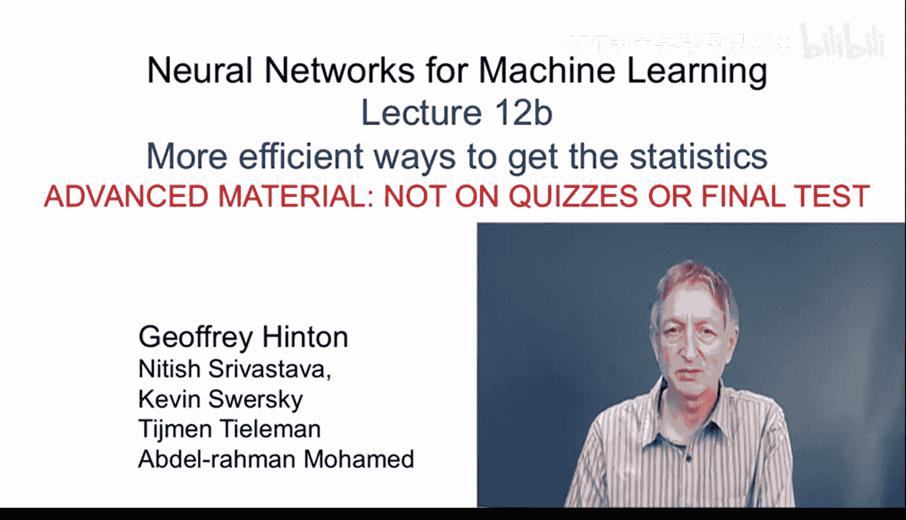
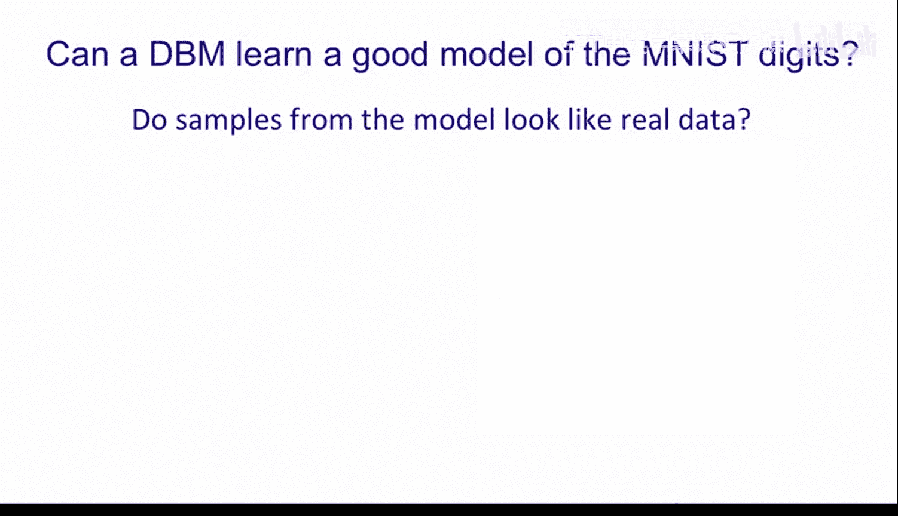
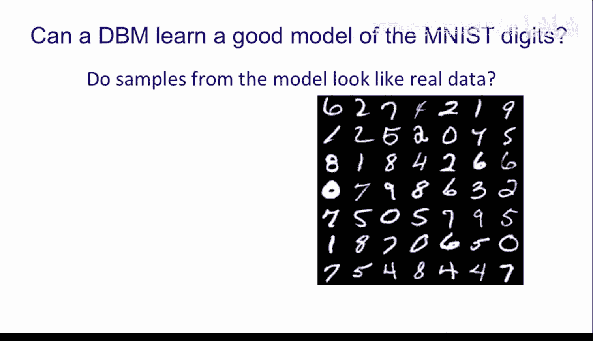
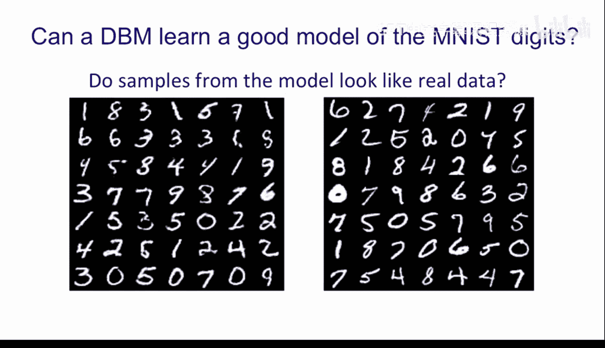
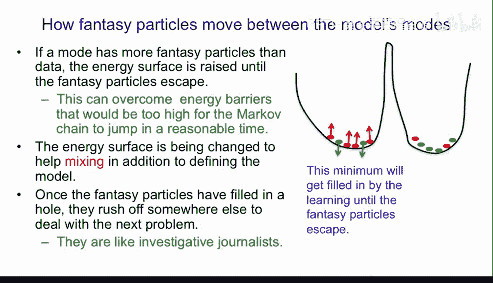

# Hinton@多伦多大学《机器学习的神经网络｜Neural Networks for Machine Learning 2016》claude-4s p56 -56-Lecture 12.2 — More efficient ways to get the statistics  -Neural Networks f -BV1HtkUB2EZD_p56-

In this video。I go into more detail。About how we can speed up the Balom machine learning algorithm。

By using clever ways of keeping markov chains near the equilibrium distribution。

Or by using what are called mean field methods。The material is quite advanced。

 And so it's not really part of the course。 There won't be any quizzes on it。

 and it's not on the final test。 You can safely skip this video。

It's included for people who are really interested in how to get deep Bsmore machines to work well。

There are better ways of collecting the statistics than the method that Teresovsky and I originally came up with。

If we start from a random state， it may take a long time to reach thermal equilibrium。Also。

 there's no easy tests for whether you've reached thermally equilibrium。

 So we don't know how long we need to run for。So the idea is。

 why not start from whatever state you ended up in Last time you saw that particular data vector。

So we remember the interpretation of the data vector in the hidden units， and we start from there。

This stored state， the interpretation of the data vector。Is called a particle。

Using particles that persist gives us a warm start， and it has a big advantage。

If we were at equilibrium before and we only updated the weights a little bit。

It'll only take a few updates of the units in a particle to bring it back to equilibrium。

We can use particles for both the positive phase when we have a clamp data vector and for the negative phase when nothing is clamped。

So here's the method for collecting statistics introduced by Raford Neal in 1992。

In the positive phase， you have a set of data specific particles。One or a few per training case。

And each particle has a current value That's the configuration of the hidden units。

 plus which date of vector goes with。You sequentially update all the hidden units a few times in each particle with the relevant data of vector clamped。

And then for every connected pair of units， you average the probability of the two units being on over all these particles。

In the negative phase， you keep a set of fantasy particles。But is， these are global configurations。

And again， after each weight update， you sequentially update all the units in each fantasy particle a few times。

Now， you' are updating the visible units as well。And for every connected pair of units。

 your average S I S J over all the fantasy particles。

The learning rule is then the change in the weights is proportional to。The average you got with data。

Averaged overall training data。And the average you got with the fantasy particles when nothing was clamped。

This works better。Than the learning rule that Terry andovskin and I introduced。

At least for full batch learning。However， it's difficult to apply this approach to mini batches。

And the reason is。That by the time we get back to the same data vector if we're using mini batch learning。

The weights will have been updated many times。So the stored data specific particle for that data vector。

Won't be anywhere near thermal equilibrium anymore。

The hidden units won't be in thermal equilibrium with the visible units of the particle。

 given the new weights。And again， we don't know how long we're going to have to run for before we get close to equilibrium again。

So we can overcome this by making a strong assumption about how we understand the world。

It's a kind of epistemological assumption。We're going to assume that when a data vector is clamped。

 the set of good explanations， that is states of the hidden units that act as interpretations of that data vector is unimmodal。

That means we're saying that for a given data vector。

 there aren't two very different explanations for that data vector。We assume that for sensory input。

 there's one correct explanation。 And if we have a good model of this data。

 our model will give us one energy minimum for that data point。

This is a restriction on the kinds of models we're willing to learn。

We're going to use a learning algorithm that is incapable of learning models in which a data vector has many very different interpretations。

Provid you we willing to make this assumption。We can use a very efficient method for approaching thermal equilibrium or an approximation thermal equilibrium with the data。

It's called a mean field approximation。So if we want to get the statistics right。

We need to update the units， stochically and sequentially。

And the update rule is the probability of turning on unit I is the logistic function of the total input it receives from the other units and its bias。

Wei。S。 J， the state of another unit。Is a stochastic binary thing。Now instead of using that rule。

We could say we're not going to keep binary states for unit I。

We're going to keep a real value between 0 and 1， which we call a probability。And that probability。

 at time， T plus1。Is going to be the output of the logistic function。

And what you put in is the bias and the sum of all the other probabilities at time T times the weights。

So we're replacing this stochastic binary thing。By a real value probability。

And that's not quite right。Because this stochastic binary thing is inside a nonlinear function。

If it was a linear function， things would be fine。But because the logistics No nonlinear。

We don't get the right answer when we put probabilities instead of fluctuating binary things inside。

However。He works pretty well。It can go wrong by giving us biphasic oscillations。

 because now we're going to be updating everything in parallel。

And we can normally deal with those by using what's called damped meanfield。

 where we compute that P I of T plus one。But we don't go all the way there。

We go to a point in between where we are now and where this update wants us to go。So。

 in damp mefield。We'll go to Lambda。 times the place we are now。Plus，1 minus lambda。

Times the place the update rule tells us to go to。And that will kill oscillations。Now。

 we can get an efficient mini batchche learning procedure for Bolsman machines。

And this was what Rus Salakudov realized。In the positive phase。

 we can initialise all the probabilities at 0。5。We can clampor data vector on the visible units。

And we can update all the hidden units in parallel， using mean field until convergence。

And for mean fields， you can recognise convergence is when the probabilities stop changing。

And once we converged， we record P I PJ for every connected pair of units。In the negative phase。

 we do what we were doing before。 We keep a out of fantasy particles。

 each of which has a value that's a global configuration。And after each weight update。

 we sequentially update all the units in each fantasy particle a few times。

And then for every connected pair of units， we average S I S J， these stochastic binary things。

 over all fantasy particles。And the difference in those averages is the learning rule。 That is。

 we change the weights by amount proportional to that difference。

If we want to make the updates for the fantasy particles more parallel。

We can change the architecture of the Bolsman machine。

So we're going to have a special architecture that allows alternating parallel updates for the fantasy particles。

We have no connections within a lair。And we have no skipped their connections。

But we allow ourselves lots of hidden layers。So， the architecture looks like this。

We call it a deep boltman machine。And it's really a general Bolsman machine with lots of missing connections。

 All skip their connections。 If they were present， we wouldn't really have layers at all。

 It would just be a general Baltzman machine。But in this special architecture。

 there's something nice we can do。We can update the states of， for example。

 the first hidden layer and the third hidden layer。

 given the current states of the visible units and the second hidden layer。

And then we can update the states of the visible units in the second hidden layer。

And then we can go back and update the other states， and we can go back as a fool like this。

 And so we can update half the states of all the units in parallel。And that'll be a correct update。

So one question is， if we have a deep bolt from machine like that。

Trained by using mean field for the positive phase and updating fantasy particles by alternating between even layers and odd layers for the negative phase。

Can we learn good models of things like the enes digits or indeed， of more complicated things。

So one way to tell whether you've learned a good model is after learning。You remove all the input。

And you just generate samples from your model。So you run the Markov chain for a long time until it's burned in。

 And then you look at the samples you get。Sir Russalakudoff used a deep Bsum machine to model Mnines digits using meanfield for the positive phase and alternating updates of the layers of the particles for the negative phase。

And the real data。Looks like this。And the data that he got from his model。

Looks like this。You can see they're actually fairly similar。

 The model is producing things very like the Mist digits。 So it's learned a pretty good model。

So here's a puzzle。When he was learning that， he was using mini batches with 100 data examples。

And also， he was using 100 fantasy particles。The same hundred fantasy particles for every mini batch。

And the puzzleise。How can we estimate the negative statistics， Well。

 with only 100 negative examples to characterize the whole space。For all interesting problems。

 the global configuration space is going to be highly multimodal。

And how do we manage to find and represent all the modes with only 100 particles。

There's an interesting answer to this。The learning interacts with the Markov chain that's being used to gather the negative statistics。

Are the one that's used to update the fantasy particles。

And it interacts with it to make it have a much higher effective mixing rate。

That means we cannot analyze the learning by thinking of the being an outer loop that updates the weights and an inner loop that gathers statistics with a fixed set of weights。

The learning is affecting how effective that inner a loop is。

The reason for this is that whenever the fantasy particles outnumber the positive data。

 the energy surface is raised。And this has an effect on the mixing rate of the Markov chain。

It makes the fantasies rush around hyperactiveively。

And they move around much faster than the mixing rate of the Markov chain。

 defined by the current static weights。So here's a picture that shows you what's going on。

If there's a mode in the energy surface that has more fantasy particles than data。

The energy surface will be raised until the fantasy particles escape from that mode。So。

 the mode on the left。Has four fantasy particles， and only two data points。

So the effect of the learning is going to be to raise the energy there。

And that energy barrier might be much too high for our Markov chain to be able to cross。

 So the mixing rate would be very slow。But the learning will actually spill those red particles out of that energy minimum by raising the minimum。

It'll get filled up， and the panty particles will escape and go off somewhere else to some other deep minimum。

So we can get out of minima that the Markov chain would not be able to get out of。

At least not in a reasonable time。So what's going on here is the energy surface is really being used for two different purposes。

The energy surface represents our model。But it's also being manipulated by the learning algorithm to make the Markov chain mix faster。

Or rather， to have the effect of a faster mixing markov chain。

Once the fantasy particles have filled up one hole。

 they'll rush off to somewhere else and deal with the next problem。

An analogy for them is that theyre like investigative journalists who rush in to investigate some nasty problem as soon as the publicity has caused that problem to be fixed instead of saying。

 O， everything's O， now。

They rush off to find the next nasty problem。