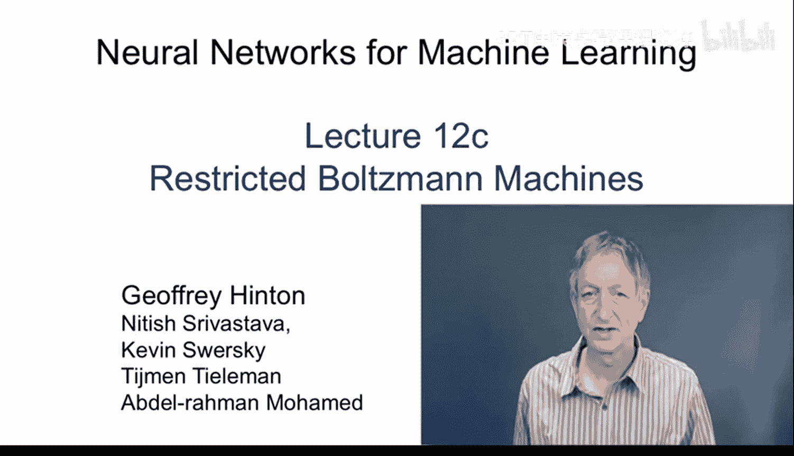
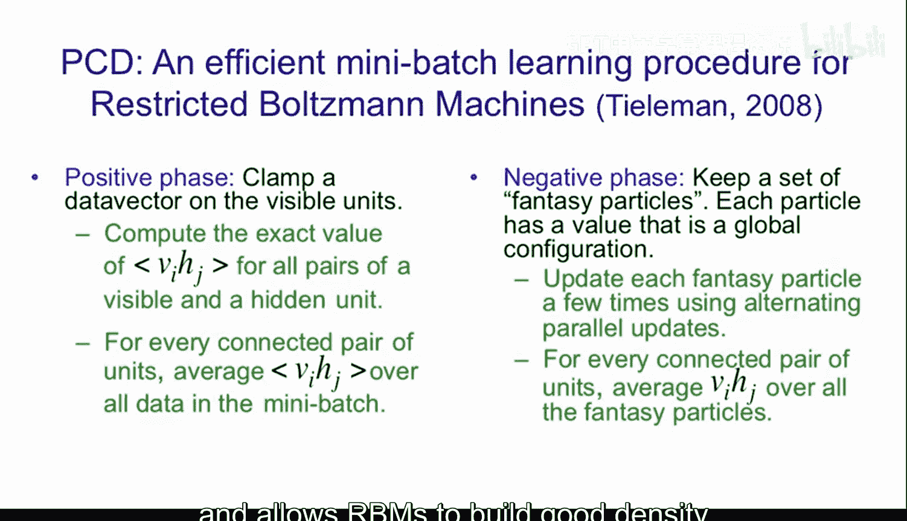
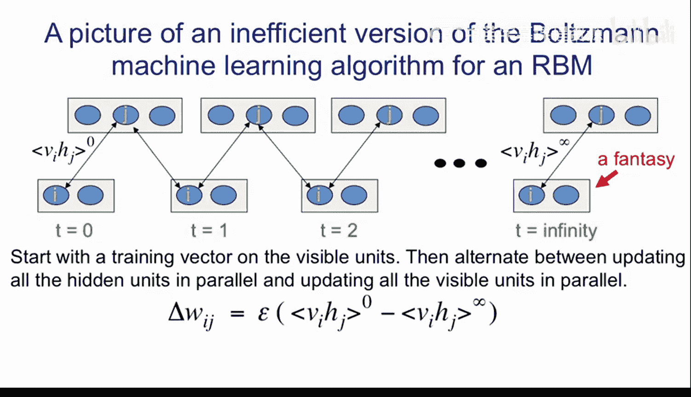
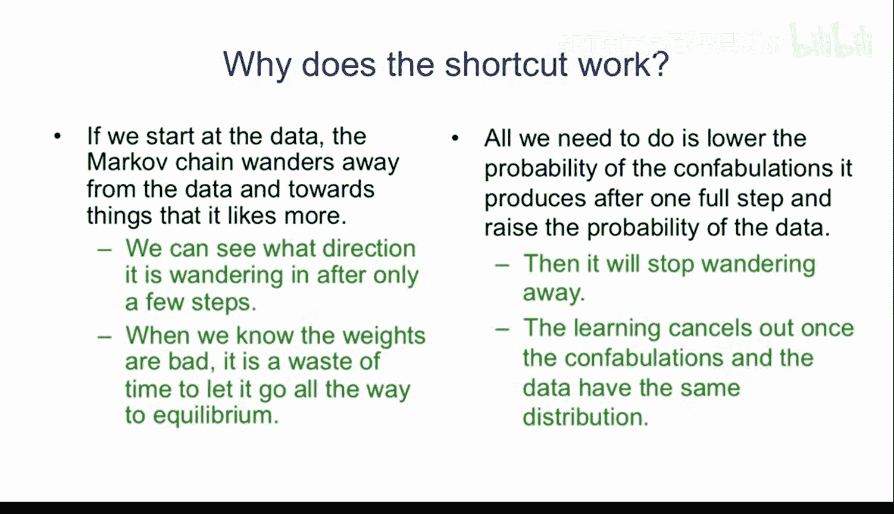
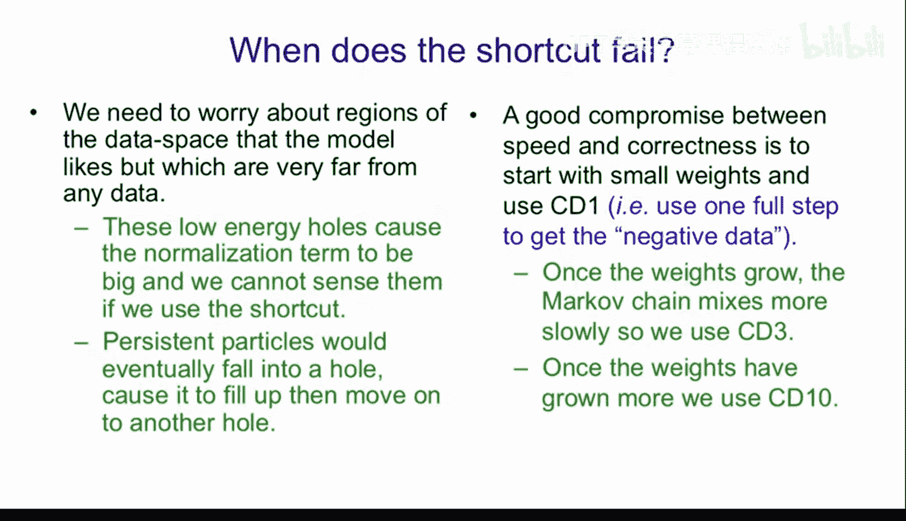

# Hinton@多伦多大学《机器学习的神经网络｜Neural Networks for Machine Learning 2016》claude-4s p57 -57-Lecture 12.3 — Restricted Boltzmann Machines  -Neural Networks for Machine L -BV1HtkUB2EZD_p57-

In this video。I'll introduce restricted Baltimore machines。These have a much simplified architecture。

In which there are no connections between hidden units。

This makes it very easy to get the equilibrium distribution of the hidden units if the visible units are given。

That is， once you've clamped a data vector on the visible units。

 the equilibrium distribution of the hidden units can be computed exactly in one step because they're all independent of one another。

 given the states of the visible units。The proper Bolsman machine learning algorithm is still slow for a restricted Balsman machine。

But in 1998， I discovered a very surprising shortcut that leads to the first efficient learning algorithm for Bsman machines。

Even though this algorithm has theoretical problems， it works quite well in practice。

And it led to a revival of interest in Balsman machine learning。

In a restricted Bolsman machine， we restrict the connectivity of the network in order to make both inference and learning easier。

So it only has one layer of hidden units。And there's no connections between the hidden units。

There's also no connections between the visible units。So， the architecture looks like that。

It's what computer scientists call a bipartite graph。There's two pieces。 and within each piece。

 there's no connections。The good thing about an RBM。

Is that if you clamp a data vector on the visible units。

You can reach thermal equilibrium in one step。That means with the data vector clamped。

 we can quickly compute the expected value of V I H J。

Because we can compute the exact probability with which J will turn on。

And that is independent of all the other units in the hidden layer。

The probability that J will turn on is just the logistic function of the input that he gets from the visible units。

And quite independent of what other hidden units are doing。

So we can compute their probabilities all in parallel。And that's a tremendous win。

If you want to make a good model。Of a set of binary vectors。

Then the right algorithm to use for a restricted boltolsman machine is one introduced by Tierman in 2008。

Is based on earlier work by Neil。In the positive phase。You clamp a data vector on the visible units。

You then compute the exact value of the expectation V I H J for all pairs of a visible in the hidden unit。

And you can do that because VI is fixed and you can Pj exactly。

And then for every connected pair of units， you average the expected value of V I H J。Overall。

 the data of vectors in the mini batch。For the negative phase， you keep a set of fantasy particles。

That is， global configurations。And then you update each fantasy particle a few times。

By using alternating parallel updates。So， after each wait update。

You update the fantasy particles a little bit。And that should bring them back to close to equilibrium。

And then for every connected pair of units， you average V I H J over all the fantasy particles。

And that gives you your negative statistics。This algorithm actually works very well。

And allows RBMs to build good density models of sets of binary vectors。

Now， I'm going to go on to a learning algorithm that's not as good at building density models。

 but is much faster。So I'm going to start with a picture of an inefficient learning algorithm for a restricted Balsman machine。

We're going start by clamping a data vector。On the visible units。

And we're going to call that time t 0。 So we're going to use times now not to denote weight updates。

 but to denote steps in a markov chain。Given that visible vector。We now update the hidden units。

So we choose binary states for the hidden units。And we measure the expected value of V I H J for all pairs of visible and binary units that are connected。

And I'll call that V I H J 0 to indicate that it's measured at time 0。

With the hidden units being determined by the visible units， and， of course。

 we can update all the hidden units in parallel。We then use the hidden vector to update all the visible units in parallel。

And again， we update all the hidden units in parallel。So the visible vector t equals1。

We'll call a reconstruction or a one step reconstruction。

And we can keep going with the alternating chain that way。

Updating visible units and then hidden units， each set being updated in parallel。

And after we've gone for a long time。We'll get to some state of the visible units that I'll call T infinity to indicate it needs to be a long time。

And the system will be at thermal equilibrium。And now we can measure the correlation of V I and H J。

After the chains run for a long time。And I'll call that V I H J infinity。

And the visible state we have after a long time， I'll call a fantasy。So now the learning rule。

Is simply we change W I J by the learning rate times the difference between V I H J at time 0 and V I H J a time affinity。

And， of course， the problem with this algorithm is that we have to run this chain for a long time before it reaches thermal equilibrium。

And if we don't run it for long enough， the learning may go wrong。In fact。

 that last statement is very misleading。 It turns out that even if we only run the chain for a short time。

 the learning still works。

So here's the very surprising shortcut。You just run the chain。Up down and up again。

So from the data you generate a hidden state， from that， you generate a reconstruction。

 and from that， you generate another hidden state。And you measure the statistics once you've done that。

So instead of using the statistics measured at equilibrium。

We're using the statistics measured after doing one full update of the Markov chain。

The learning rule is then the same as before。Except is much quicker to compute。

And this clearly is not doing maximum likelihood learning。

Ca the term we're using for the negative statistics is wrong。But the learning， nevertheless。

 works quite well。Next week， we'll understand a bit more about why it works well。 but for now。

 we'll just see that it does。So the obvious question is， why does that shortcut work at all。

And here's the reasoning。If we start the chain at the data。

 the markov chain will wander away from the data and towards its equilibrium distribution。

That is towards things that is initial weights， like more than the data。

We can see what direction it's wandering in after only a few steps。

And if we know the initial weights aren't very good。

 it's a waste of time to go all the way to equilibrium。

We know how to change them to stop it wandering away from the data without going all the way to equilibrium。

All we need to do is lower the probability of the reconstructions or confabulations。

 as a psychologist would call them。It produces， after one full step。

And then raise the probability of the data。That will stop it wandering away from the data。

Once the data and the places it goes to after one full step have the same distribution。

Then the learning will stop。

So here's a picture of what's going on。Here's the energy surface in the space of global configurations。

Here's a data point on the energy surface。And by data point。

 I mean both the visible vector and the particular hidden vector that we got by stochically updatingating the hidden units。

So that hidden vector is a function of what the data point is。So starting at that data point。

 we run the markov chain for one full step to get a new visible vector and the hidden vector that goes with it。

So a reconstruction of the data point， plus the hidden vector that goes with that reconstruction。

We then change the weights to pull the energy down at the data point。

And to pull the energy up of the reconstruction。And the effect of that will be to make the surface look like this。

And you'll notice we're beginning to construct an energy minimum at the data。

You'll also notice that far away from the data， things have stayedd pretty much as they were before。

So this shortcut of only doing one full step to get the reconstruction。

Fails for places that are far away from the data。We need to worry about regions of the data space that the model likes。

 but which are very far from any data point。These low energy holes cause the normalization term to be big。

 and we can't sense them if we use the shortcut。If we used persistent particles where we remembered their states。

 and after each update， we updated them a few more times。

 Then they would eventually find these holes。They'd move into the holes。

 and the learning would cause the holes to fill up。

A good compromise between speed and correctness is to start with small weights and to use C D1 that is contrasted divergence with one full step to get the negative data。

Once the weights have grown a bit。The microov chain is mixing more slowly， and now we can use C D3。

And once the weights have grown more， we can use C D 5 or 9 or 10。

So by increasing the number of steps as the weights grown。

We can keep the learning working reasonably well。

Even though the mixing rate of the Markov chain is going down。

