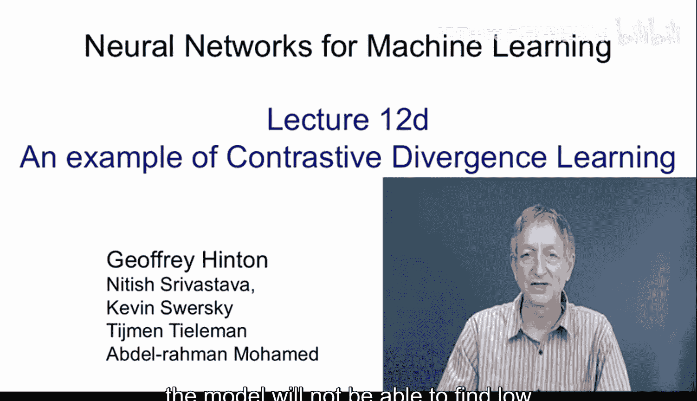
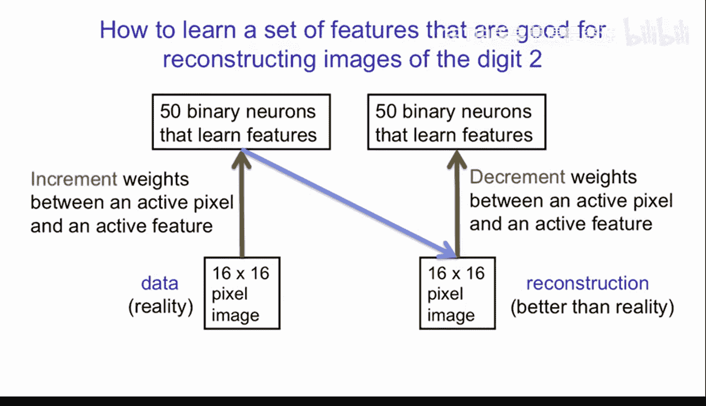
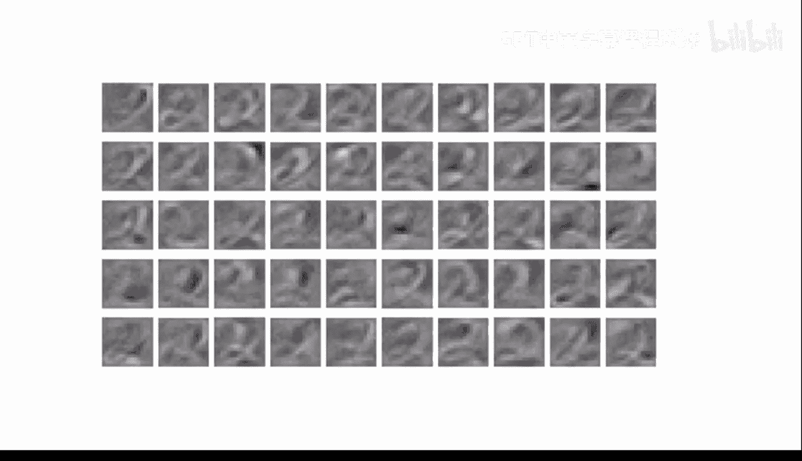
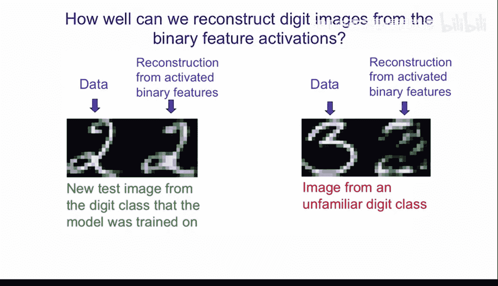

# Hinton@多伦多大学《机器学习的神经网络｜Neural Networks for Machine Learning 2016》claude-4s p58 -58-Lecture 12.4 — An example of RBM learning  -Neural Networks for Machine Lear -BV1HtkUB2EZD_p58-

In this video， I'm going to show a simple example。Of a restricted Bs machine learning a model of images of handwritten toolss。

After it's learned the model。We'll look at how good it is at reconstructing twos and we'll look at what happens if we give it a different kind of digit and ask it to reconstruct that。

We'll also look at the weights we get if we train a restricted boltsman machine that's considerably larger。

On all of the digit classes。It learns a wide variety of features。

 which between them are very good at reconstructing all the different classes of digits and also are quite a good model of those digit classes。

 That is， if you take a binary vector that's an image of 100 and digit。

 the model will be able to find low energy states， compatible with that image。

 And if you give it an image that's a long way away from being an image of 100 and digit。

 the model will not be able to find low energy states compatible with that image。

I'm now going to show how a relatively simple RBM。Can learn to build a model of images of the digit。

 too。The images of 16 pixels by 16 pixels。And it has 50 binary hidden units that are going to learn to become interesting feature detectors。

 So when it's presented with a data case， the first thing that it does is use the weights on the connections from pixels to feature detectors。

To activate the feature detectors。That is for each of the binary neurons。

 He makes a stochastic decision about whether it should adopt a state of 1 or 0。

He then uses these binary patterns of activation。To reconstruct the data。That is， each each pixel。

 It makes a binary decision about whether it should be a one or a0。It then。

Reactivates the binary feature detectors， using the reconstruction to activate them rather than the data。

The weights are changed。By incrementing。The weights between an active pixel and an active feature detector。

 when the network is looking at data。And that will lower the energy。

Of the global configuration of the data and whatever hidden pattern went with it。

And it decrements the weights between an active pixel and an active feature detector when it' looking into reconstruction。

 and that will raise the energy of the reconstruction。Near the beginning of learning。

 when the weights are random， the reconstruction will almost certainly have lower energy than the data。

Because the reconstruction is what the network likes to reproduce on their visible units。

 given the hidden pattern of activity。And obviously。

 it likes to reproduce patterns that have low energy， according to its energy function。

And you can think of what learning does。As changing the weights so that the data is low energy and the reconstructions of the data are generally higher energy。

So let's start with some random weights for the 50 feature detectors。 We'll use small。

 random weights。And each of these squares shows you the weights to the pixel cellss coming from a particular feature detector。

The small， random weights are used to break symmetry。Though because the update rule is stochastic。

 we don't really need that。After seeing a few hundred examples of digits and adjusting the weights a few times。

 the weights are beginning to form patterns。If we do it again。

 you can see that many of the feature detectors。Are detecting the pattern of a hole， too。

They're fairly global feature detectors， and those feature detectors are getting stronger。

And stronger。And now some of them begin to localise。

 and they're getting more local and even more local and even more local。

And these are the final weights。 And you can see that each neuron has become a different feature detector。

And most of the feature detectors are fairly local。

If you look at the feature detector in the red box， for example。It's detecting the top of a two。

And it's happy when the top of a two is where its white pixels are and where there's nothing where the black pixels are。

 So it's representing where the top of the two is。 once we've learned the model。

We can look at how well it reconstructs digits。And we'll give it some test digits that it hasn't seen before。

So we'll start by giving it a test example of a two。

And its reconstruction is pretty faithful to the test example。Is slightly blurry。

The test example has a hook at the top， and that's been blurred out in the reconstruction。

But it's a pretty good reconstruction。A more interesting thing we can do。

Is give it a test example from a different digit class。

So if you give it an example of a three to reconstruct。

What it reconstructs actually looks more like a two than like a three。

All of the feature detectors it's learned are good for representing twos。

But it doesn't have feature detectors for things like representing that cusp in the middle of the three。

So it ends up reconstructing something that debates the regularities of a two better than the debates the regularities of a three。

In fact， the network tries to see everything as a two。So here's some feature detectors。

That were learned in the first hidden layerir。Of a model that uses 500 hidden units to model all 10 digit classes。

 And this model has been trained for a long time， with contrasted divergence。

It has a big variety of feature detectors。 If you look at the one in the blue box。

That's obviously gonna be useful for detecting things like As。If you look at the one in the red box。

 it's a curious kind of feature。 It's not what you expect to see。

It likes to see pixels on very near the bottom there。

And it really doesn't like to see pixels on in a row that's 21 pixels above the bottom。

 What's going on here is that the data was normalized。And so， the digits。

Can't have a height of greater than 20 pixels。And that means if you know that there's a pixel on where those big positive weights are。

 there can't possibly be a pixel on where those negative weights are。

So this is picking up on a long range regularity。That was introduced by the way we normalized the data。

Here's another one that's doing the same thing for the fact that the data can't be wider than 20 pixels。

The feature detector in the green box。Is very interesting。

It's for detecting where the bottom of a vertical stroke comes。

 and it will detect it in a number of different positions and then refuse to detect it in the intermediate positions。

So it's very like one of the least significant digits in a binary number that as you increase the magnitude of the number goes on again and off again and on again and off again。

 And it shows that this is developing quite complex ways of representing where things are。

