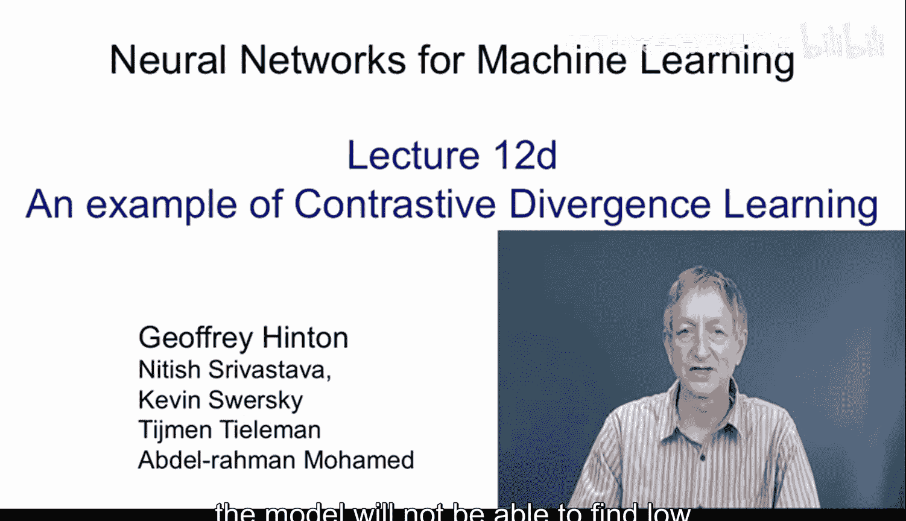
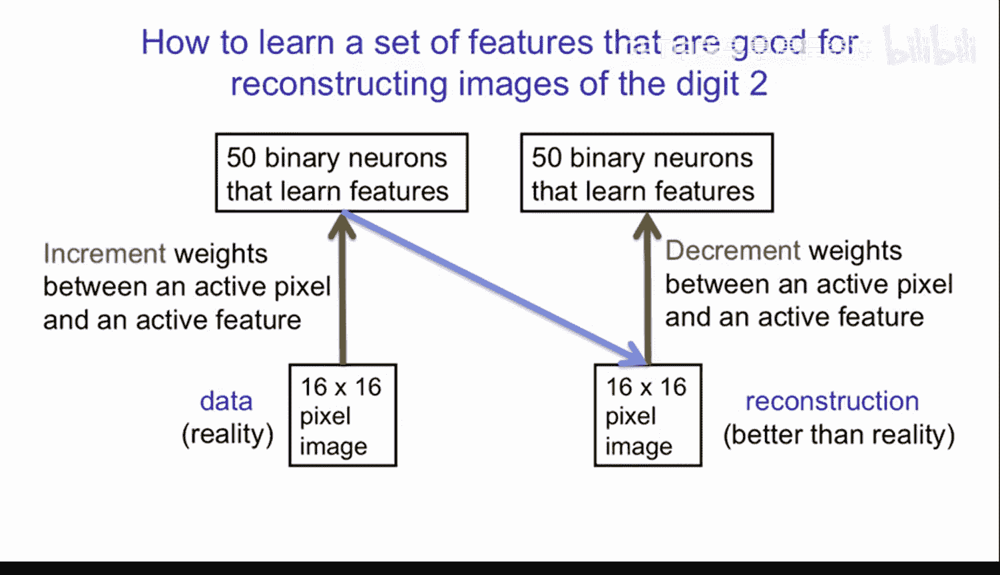
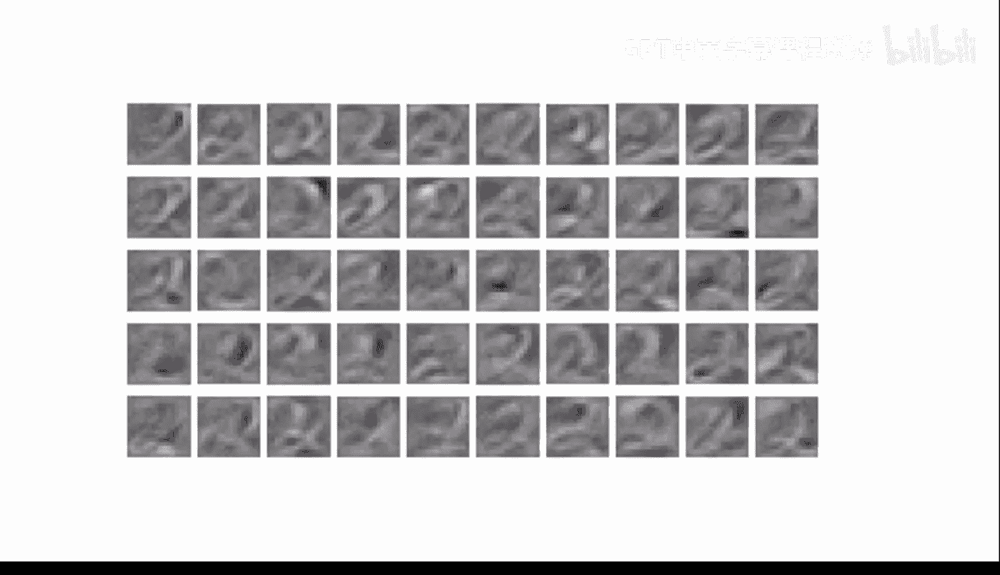
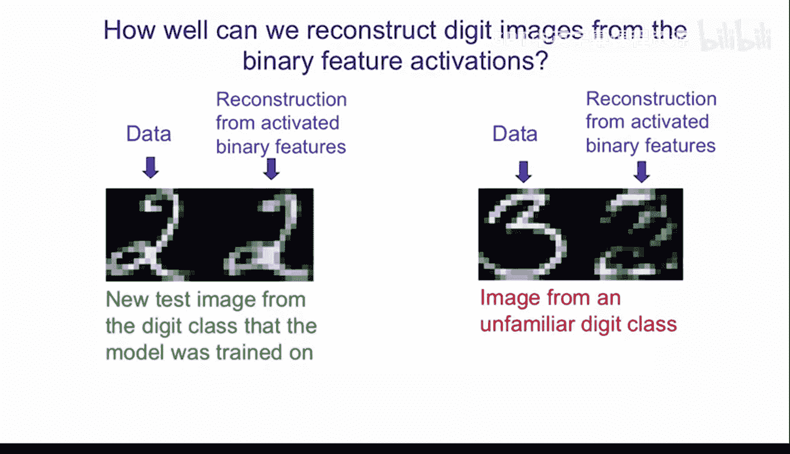

# 神经网络用于机器学习：第12.4讲：受限玻尔兹曼机学习示例 🧠

在本节课中，我们将学习一个受限玻尔兹曼机学习手写数字“2”图像模型的简单示例。我们将观察模型学习后如何重建数字“2”，以及当输入其他数字时会发生什么。此外，我们还将探讨一个更大的RBM模型在所有数字类别上训练后所学习到的权重特征。

## 模型结构与学习过程

上一节我们介绍了RBM的基本概念，本节中我们来看看一个具体的学习示例。该RBM模型相对简单，旨在学习手写数字“2”的图像模型。图像尺寸为16x16像素，模型包含50个二值隐藏单元，这些单元将学习成为有趣的特征检测器。

当模型接收到一个数据样本时，首先会利用从像素到特征检测器的连接权重来激活这些特征检测器。具体来说，对于每个二值神经元，模型会随机决定其状态应为1还是0。

随后，模型利用这些激活的二值模式来重建数据。即，每个像素会做出一个二值决策，决定其应为1还是0。

接着，模型使用重建结果（而非原始数据）来重新激活二值特征检测器。

权重的更新规则如下：
*   当网络观察数据时，增加活跃像素与活跃特征检测器之间的权重。这将降低数据及其对应隐藏模式这一全局配置的能量。
*   当网络观察重建结果时，减少活跃像素与活跃特征检测器之间的权重。这将提高重建结果的能量。

在学习初期，权重是随机的，重建结果几乎总是比原始数据具有更低的能量。这是因为重建结果是网络根据其隐藏活动模式，在其可见单元上喜欢重现的模式。显然，根据其能量函数，网络倾向于重现低能量的模式。

学习过程可以理解为改变权重，使得数据的能量变低，而数据的重建结果通常能量更高。

## 权重学习与特征演化

以下是权重学习过程的直观展示。我们首先为50个特征检测器设置小的随机初始权重，以打破对称性（尽管由于更新规则是随机的，这并非必需）。

在观察了几百个数字样本并多次调整权重后，权重开始形成模式。随着训练继续，许多特征检测器开始学习检测数字“2”的轮廓。这些特征检测器起初较为全局化，随后逐渐变得更加局部化。

最终，每个神经元都成为了不同的特征检测器。大多数特征检测器是相当局部的。例如，红色框中的特征检测器专门检测数字“2”的顶部。当“2”的顶部出现在其白色像素位置，且黑色像素位置没有内容时，该检测器会被激活。

## 模型测试与重建

一旦模型学习完成，我们可以观察它重建数字的效果。我们将给它一些之前未见过的测试数字。

首先，我们输入一个数字“2”的测试样本。其重建结果相当忠实于原测试样本，尽管略显模糊。例如，测试样本顶部有一个钩状结构，在重建中被模糊化了，但整体重建效果良好。

更有趣的是，当我们输入一个来自不同数字类别（例如数字“3”）的测试样本时，模型重建出的结果看起来更像数字“2”而非“3”。这是因为模型学习到的所有特征检测器都擅长表示“2”，但它没有专门用于表示“3”中间那个尖角的特征检测器。因此，它最终重建出的东西更符合“2”的规律，而非“3”的规律。

实际上，这个网络倾向于将所有输入都视为“2”。

## 扩展模型：多类别特征学习

接下来，我们看看一个更大的模型所学习到的特征。这是一个使用500个隐藏单元来建模所有10个数字类别的模型的第一层隐藏单元特征检测器。该模型已通过对比散度法训练了很长时间。

它学习了多种多样的特征检测器。以下是几个例子：
*   **蓝色框中的检测器**：显然对检测类似“4”的数字有用。
*   **红色框中的检测器**：这是一种奇特的特征。它喜欢看到靠近底部的像素，但非常不喜欢看到在底部上方第21行的像素。这是因为数据经过了归一化处理，数字高度不能超过20像素。因此，如果你知道在那些具有大正权重的像素位置有像素激活，那么在那些负权重的位置就不可能再有像素激活。这个检测器捕捉到了由数据归一化方式引入的长程规律性。
*   **绿色框中的检测器**：非常有趣。它用于检测垂直笔画的底部位置。它会在多个不同位置检测到它，但拒绝在中间位置检测。这非常像一个二进制数中的最低有效位，随着数值增大，它会反复开启和关闭。这表明网络正在发展出相当复杂的方式来表示事物的位置。

## 总结

本节课中，我们一起学习了受限玻尔兹曼机学习手写数字模型的具体示例。我们看到了一个简单RBM如何学习检测特定数字（如“2”）的特征，并理解了其重建和泛化行为。通过扩展模型，我们还观察到RBM能够学习到多样化的、有时甚至是复杂的特征，这些特征共同构成了对多类别数据（如所有手写数字）的有效模型。