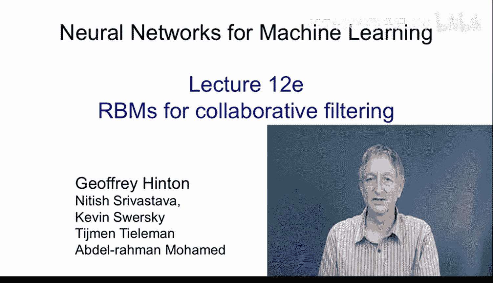
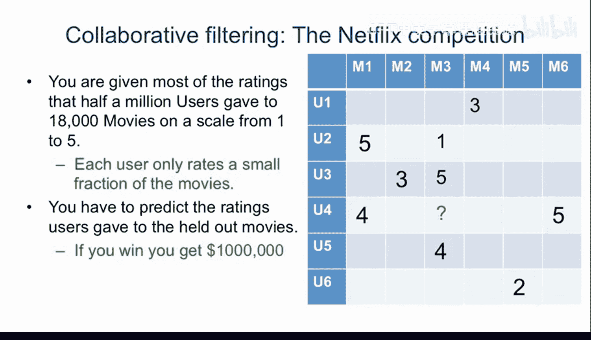
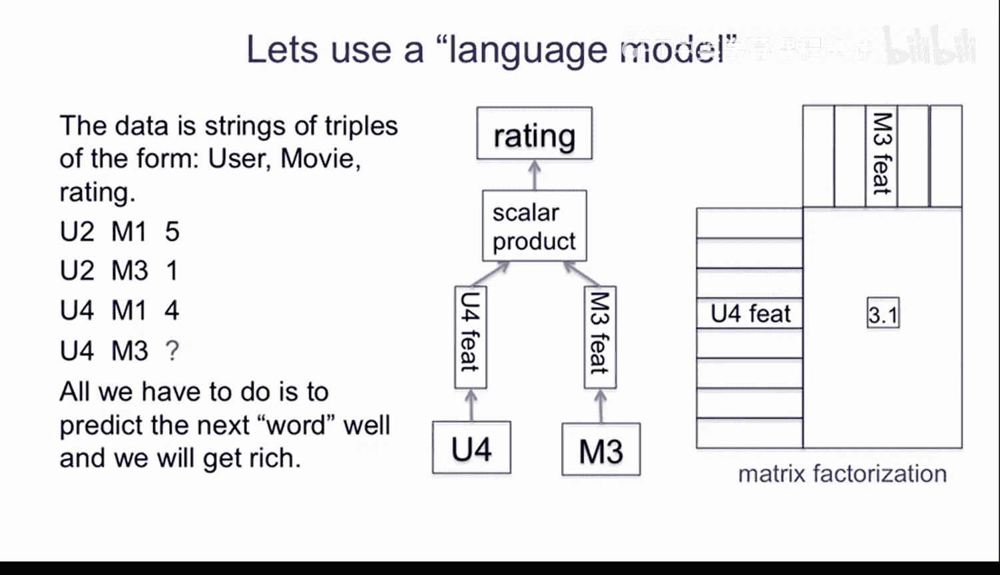
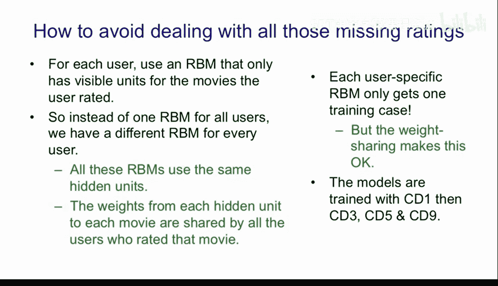
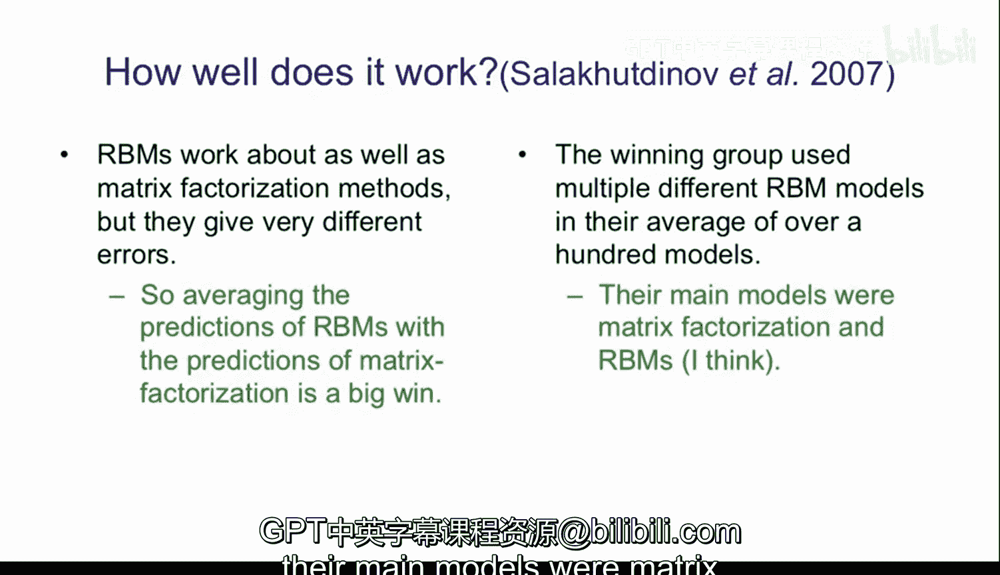

# Hinton@多伦多大学《机器学习的神经网络｜Neural Networks for Machine Learning 2016》claude-4s p59 -59-Lecture 12.5 — RBMs for collaborative filtering  -Neural Networks for Machin -BV1HtkUB2EZD_p59-

In this video， I'm going to talk about applying restricted Bs machines to collaborative filtering。

 Collabor filtering means trying to figure out how much a user would like one product based on how much that user liked other products。

And how much many other users like products。 The particular case we'll look at is the Netflix competition in which a machine learning algorithm has to predict how much a particular user will like a particular movie。

The training data for this competition consists of 100 million ratings。

Of 18000 movies by half a million users。So it's quite a big data set。

It's not the kind of thing anybody at the time imagined a Balsman machine could deal with。

 As we'll see， there's an important trick to being able to get a restricted Bum machine to cope with the fact that nearly all the ratings of nearly all the movies are missing。

But when we use this trick， we're able to train models that are very useful in practice and were。

 in fact， used in the winning entry。 So now I'm going to explain how restricted bolts from machines were used for collaborative filtering in the Netflix competition。

😊。

In that competition。You're given most of the ratings that half a million users gave to 18000 movies。

And each movie gets rated on a scale from 1 to 5。Each user， of course。

 only writes a small fraction of the movies。But even so， there's about 100 million ratings。

 So it's quite a big data set。You have to predict the ratings that the users gave to held out movies。

And if you can do that well， you get a big price。You actually win a million dollars if you're the best person at doing that。

So you can draw the ratings in a big matrix like this。

 where we have movies across the top and users down the side。And so， for example。

 user 2 gave a rating of 5 to Mo 1， and a rating of 1 to Mo 3。Use a for over rating a4 to movie 1。

And the question is， what rating did he give to Movie 3。

You might decide he's quite like user 2 because he rated Mo 1 the same way。 So maybe light user 2。

 he hated Movie 3。On the other hand， user4 liked Mo 6。 So maybe he likes all the movies。

By the time you've done that much reasoning， you realize youd better use some statistics。

Let's start by trying to use a language model。It sounds bizarre， but as you'll see。

 it's equivalent to a standard method。So we can write the data as a string of triples。

 much like family trees。Each triple has a form， user， movie and rating。

So here's some of the data from that table on the previous slide。

And we just have to predict the third term of a triple。So if we built a language model。

 what we would do。Is we'd convert each user。Into a vector of features for that user。

That is a vector that we learned。And we converted each movie into a vector features for that movie。

 a vector that we learned。 And from those two feature vectors， we try and predict the rating。Now。

 the obvious way to do this is to put in a big hidden layer。

And make the feature vectors feed into the hidden and then have the hidden eye predict the rating。

We tried that， and we couldn't get that to work any better than a very simple method。

Which is simply to take the scalar product。Of the feature vector for the user and the feature vector for the movie。

You just multiply them together Point wise。 Add it up。And output that as your rating。

So it's not even a soft max。 You actually output whatever real number you get from the scalar product。

Now， that's exactly equivalent to doing something else。

 which is normally called a matrix factorization model。If we arrange the user features。

 down the rows and the movie features above the columns。

 we can see that if we multiply that matrix of user times features。

By the matrix of features timed movies。Then we'll get predictions for the ratings。

 and it will be exactly equivalent to the language model that's beside it。So。

 the matrix factorization model。Is the most commonly used model for collaborative filtering like this。

And it works pretty well。Now let's consider an alternative model using a restricted bolt from machine。

It's not obvious how you would apply a restricted bolts machine to this problem。

And so we had to do some thinking。In the end， we decided that we'd treat each user as a training case。

 And so a user is really a vector of movie ratings。And for each movie。

 we would have a visible unit that had five alternative values。 So the visible units。

 instead of being binary。A five way soft max。And so the network or the restricted Bom machine looks like this。

Each of its visible units is a five way softm。With one visible unit per movie。

You might start worrying about the being 18000 visible units here。

And then we had about 100 binary hidden units。And each hidden unit is connected to all five values of the softm。

It also has a bias。And so you can see the number of parameters we'll have。Is large。

The C D learning rule for a softmax incidentally is exactly the same as for a binary unit。

And like I said， we've got about 100 hidden0 units。And what we're going to do is learn a model。

And then try and fill in one of the missing values using the model。Now。

 the problem with this approach。Is we don't want to have an RBM with 18000 visible units。

 only a few of which have known values。That's a huge number of missing values to be dealing with。

And there's a neat way round that。For each user， we use an RBM that only has as many visible units as the movies that the user rated。

So it's possible that every user will correspond to a different RBM with a different subset of the visible units。

No。All of these RBMs are going to share the same weights。That is， we know which move is which。And so。

 if two users。Saw the same movie and rated the same movie。The weights from that movie。

To the hidden units will be the same for those two users。

 So we're doing an awful lot of weight sharing here。And that's lucky。Because for each user。

We only get one training case。 We make this specific RBM for each user with the right architecture。

 That is the right number of visible units for the movies that the user rated。

And now there's only one training case。Which is that rating vector。

But all of these half a million training cases share weights to hidden units。And so。

 the learning works fine。The models are trained with Cd1。And then after a while， with C D 3。That is。

 you go up and down three times before you collect the statistics for the negative phase。

And then with C D 5， and then with C D 9。

And how well does it work。Well， the RBMs work about as well as the matrix factorization methods。

 but they give very different errors。What that means is that if you average the predictions of the RBMs with the predictions of the matrix factorization methods。

 you get a big win。And the winning group actually used multiple different RBM models in their average and multiple different matrix factorization models。

And I think， probably other models， as well。As far as I know。

 their main models were matrix factorization models and RBM models。

