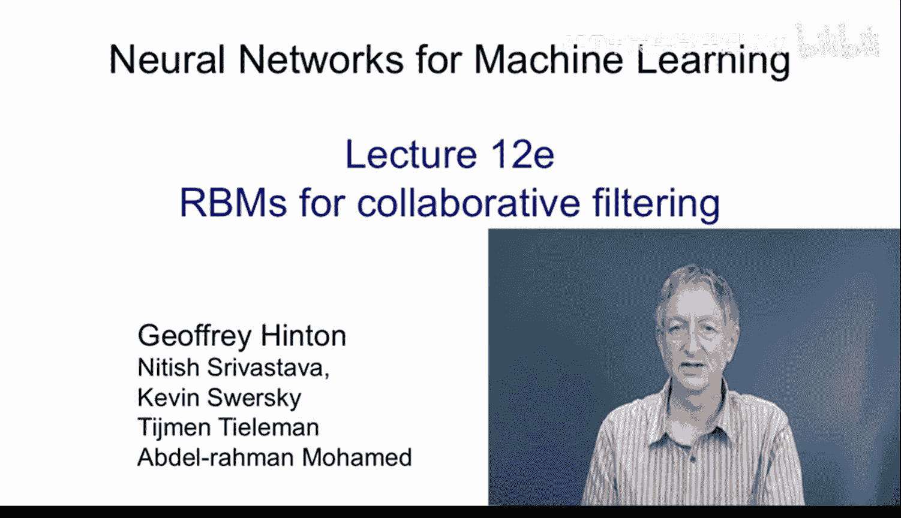
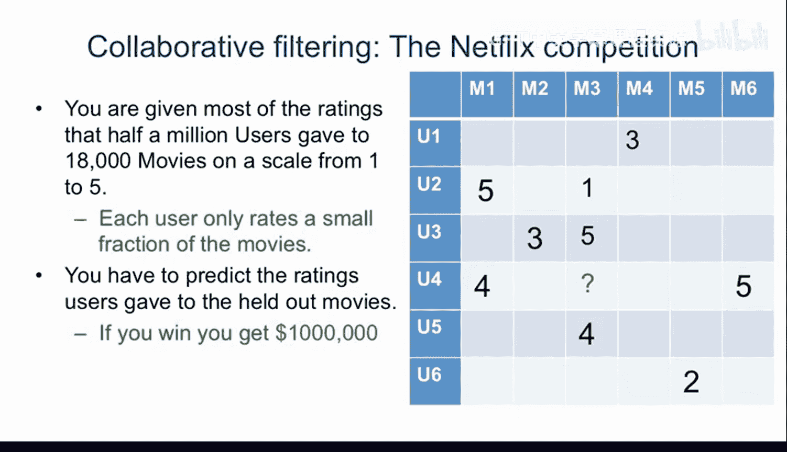
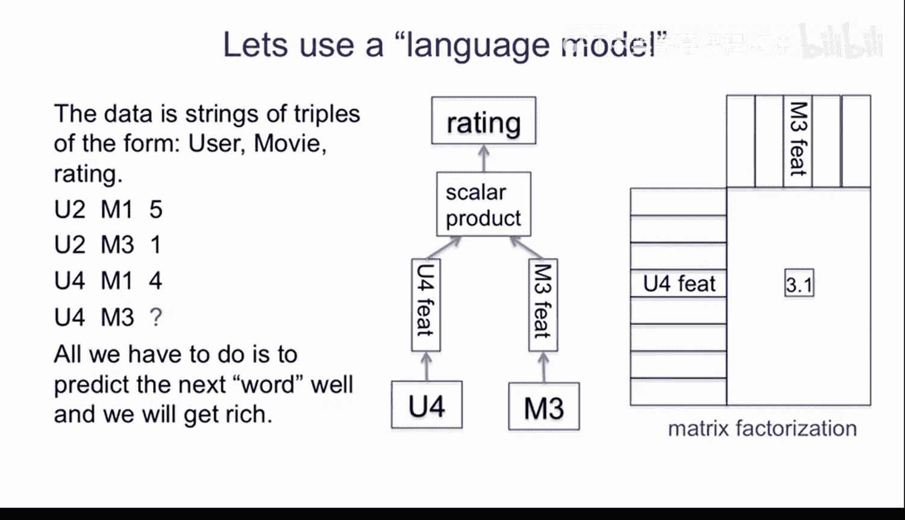
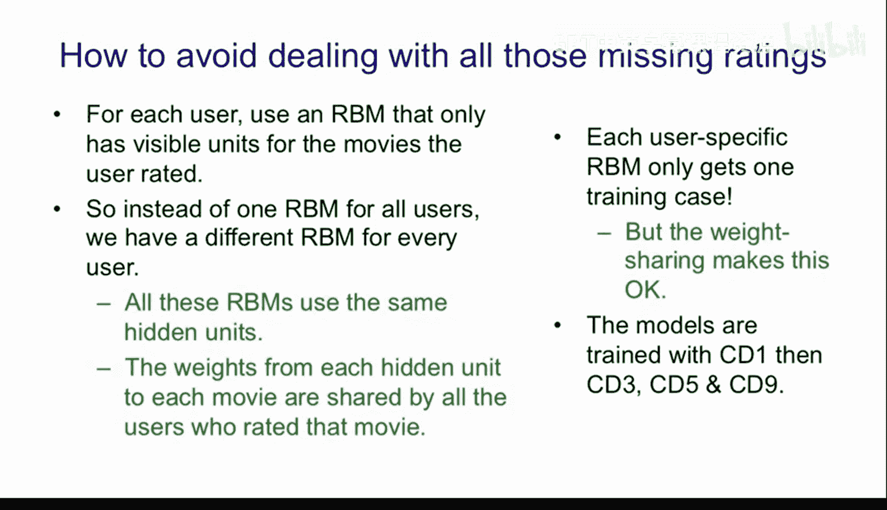
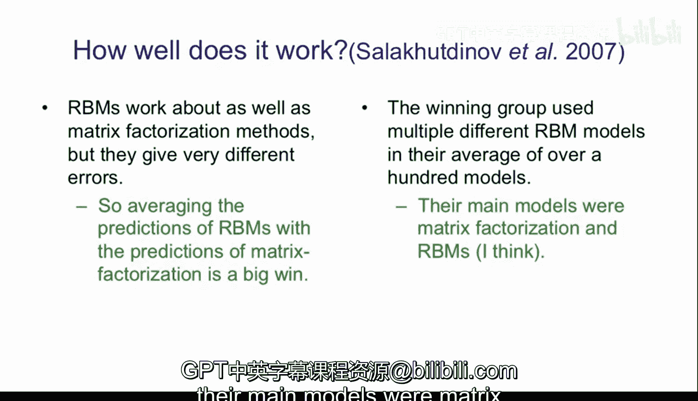

# 神经网络用于机器学习：12.5：受限玻尔兹曼机在协同过滤中的应用 🎬

在本节课中，我们将学习如何将受限玻尔兹曼机应用于协同过滤问题。协同过滤是指根据用户对其他产品的喜好程度，以及其他用户对产品的喜好程度，来推测某个用户对某个产品的喜好程度。我们将以Netflix竞赛为例，探讨机器学习算法如何预测特定用户对特定电影的评分。

## 理解协同过滤与Netflix竞赛 🎯

协同过滤的目标是预测用户对产品的喜好。我们重点关注的案例是Netflix竞赛，该竞赛要求机器学习算法预测特定用户对特定电影的评分。

竞赛的训练数据包含1亿条评分，涉及50万用户对1.8万部电影的评分。这是一个相当大的数据集。在当时，人们很难想象玻尔兹曼机能够处理这样的数据。然而，我们将看到，通过一个重要的技巧，受限玻尔兹曼机能够应对几乎所有电影的评分都缺失的情况。使用这个技巧后，我们能够训练出在实践中非常有用的模型，并且这些模型实际上被用于获胜方案中。

接下来，我将解释在Netflix竞赛中，受限玻尔兹曼机是如何用于协同过滤的。

## 数据表示与挑战 📊

在竞赛中，我们获得了50万用户对1.8万部电影的大部分评分。每部电影的评分范围是1到5分。当然，每个用户只对一小部分电影进行了评分。即便如此，仍有大约1亿条评分，因此数据集相当庞大。

我们的任务是预测用户对预留电影的评分。如果预测准确，将获得大奖。实际上，最佳预测者将赢得一百万美元。

我们可以将评分绘制成一个大矩阵，其中顶部是电影，侧面是用户。例如，用户2给电影1评了5分，给电影3评了1分。用户4给电影1评了4分。问题是，他给电影3评了多少分？你可能会认为他类似于用户2，因为他们对电影1的评分相同。因此，也许像用户2一样，他不喜欢电影3。另一方面，用户4喜欢电影6，所以他可能喜欢所有电影。当你进行这样的推理时，你会意识到最好使用一些统计方法。

## 从语言模型到矩阵分解 🔄

首先，我们尝试使用语言模型。这听起来可能有些奇怪，但正如你将看到的，它等同于一种标准方法。我们可以将数据写成一个三元组字符串，类似于家谱。每个三元组的形式是：用户、电影、评分。

以下是从上一张幻灯片的表格中提取的一些数据。我们只需要预测三元组的第三项。如果我们构建一个语言模型，我们会将每个用户转换为该用户的特征向量，这是一个我们学习的向量。同样，我们将每部电影转换为该电影的特征向量，这也是一个我们学习的向量。然后，我们尝试从这两个特征向量预测评分。

显然的方法是添加一个大的隐藏层，让特征向量输入到隐藏层，然后让隐藏层预测评分。我们尝试了这种方法，但发现它并不比一个非常简单的方法更好。这个方法就是简单地取用户特征向量和电影特征向量的标量积。你只需将它们逐点相乘，然后求和，并将结果作为评分输出。因此，它甚至不是一个softmax函数，你实际上输出的是从标量积得到的任何实数。

现在，这完全等同于另一种通常称为矩阵分解模型的方法。如果我们按行排列用户特征，按列排列电影特征，我们可以看到，如果我们将用户特征矩阵乘以特征时间电影矩阵，那么我们将得到评分的预测，并且它将完全等同于旁边的语言模型。因此，矩阵分解模型是用于此类协同过滤的最常用模型。

## 引入受限玻尔兹曼机 🧠

矩阵分解模型效果相当不错。现在，让我们考虑使用受限玻尔兹曼机的替代模型。如何将受限玻尔兹曼机应用于这个问题并不明显。因此，我们进行了一些思考。最终，我们决定将每个用户视为一个训练案例。因此，一个用户实际上是一个电影评分向量。对于每部电影，我们将有一个具有五个替代值的可见单元。因此，可见单元不是二元的，而是一个五路softmax。因此，网络或受限玻尔兹曼机看起来像这样。

它的每个可见单元都是一个五路softmax，每部电影对应一个可见单元。你可能会开始担心这里有18000个可见单元。然后，我们大约有100个二元隐藏单元。每个隐藏单元都连接到softmax的所有五个值。它还有一个偏置。因此，你可以看到我们将拥有的参数数量是巨大的。顺便说一下，softmax的CD学习规则与二元单元完全相同。

如前所述，我们大约有100个隐藏单元。我们将学习一个模型，然后尝试使用该模型填充一个缺失值。现在，这种方法的问题是，我们不希望有一个具有18000个可见单元的RBM，其中只有少数几个具有已知值。这是一个需要处理的大量缺失值。

## 巧妙的解决方案：权重共享 💡

有一个巧妙的方法可以解决这个问题。对于每个用户，我们使用一个RBM，该RBM只具有用户评分的电影数量的可见单元。因此，每个用户可能对应一个不同的RBM，具有不同的可见单元子集。不，所有这些RBM将共享相同的权重。也就是说，我们知道哪部电影是哪部电影。因此，如果两个用户观看了同一部电影并对同一部电影进行了评分，那么从该电影到隐藏单元的权重对于这两个用户将是相同的。

因此，我们在这里进行了大量的权重共享。这是幸运的。因为对于每个用户，我们只得到一个训练案例。我们为每个用户创建这个特定的RBM，具有正确的架构，即用户评分的电影的正确数量的可见单元。现在只有一个训练案例，即评分向量。但是，所有这些50万个训练案例共享到隐藏单元的权重。因此，学习效果很好。

模型使用CD1进行训练，然后一段时间后使用CD3，即在上上下下三次之后收集负相的统计信息，然后使用CD5，最后使用CD9。

## 模型性能与集成优势 🏆

那么，它的效果如何呢？RBM的效果与矩阵分解方法大致相当，但它们产生的误差非常不同。这意味着，如果你将RBM的预测与矩阵分解方法的预测进行平均，你会获得很大的优势。获胜团队实际上在他们的平均中使用了多个不同的RBM模型和多个不同的矩阵分解模型。据我所知，他们的主要模型是矩阵分解模型和RBM模型。

## 总结 📝

本节课中，我们一起学习了如何将受限玻尔兹曼机应用于协同过滤问题，特别是Netflix竞赛中的电影评分预测。我们首先理解了协同过滤的基本概念和Netflix竞赛的数据规模与挑战。接着，我们探讨了从语言模型到矩阵分解的标准方法。然后，我们引入了受限玻尔兹曼机模型，并详细解释了如何通过为每个用户构建仅包含其已评分电影的可见单元的特定RBM，并共享权重，来巧妙地处理海量缺失值问题。最后，我们看到RBM模型与矩阵分解模型性能相当但误差不同，通过集成平均可以获得更好的预测效果，这也是实际获胜方案的关键。