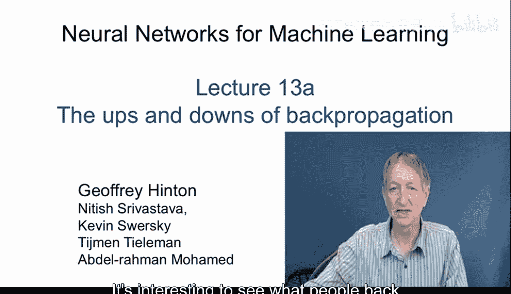
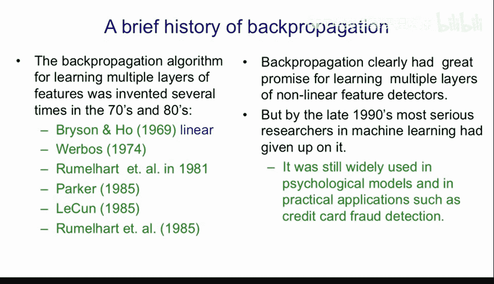
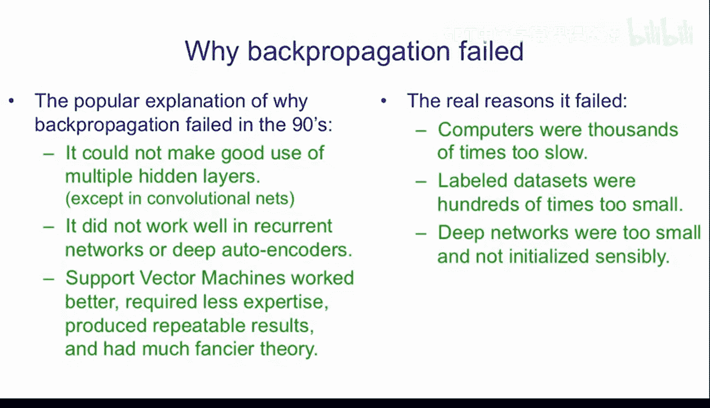
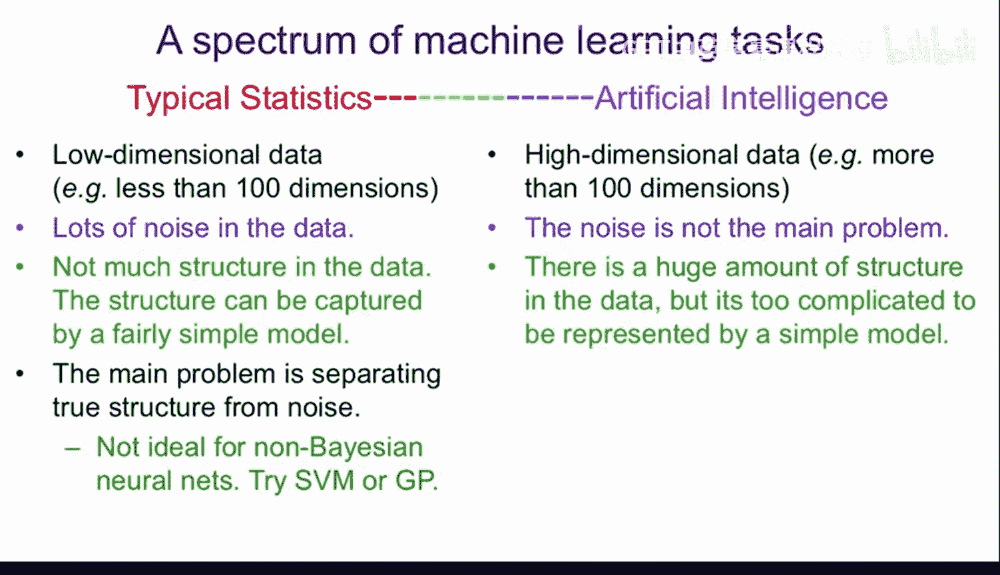
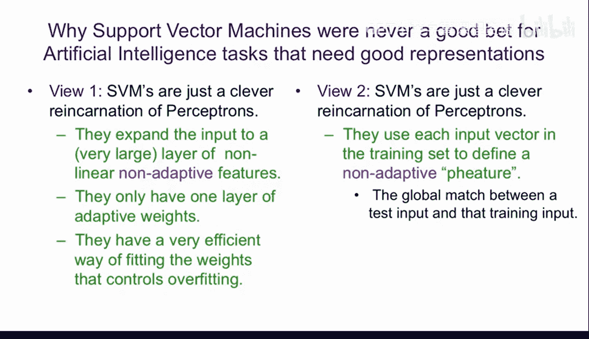

# Hinton@多伦多大学《机器学习的神经网络｜Neural Networks for Machine Learning 2016》claude-4s p60 -60-Lecture 13.1 — The ups and downs of backpropagation  -Neural Networks for Ma -BV1HtkUB2EZD_p60-

In this video， I'm going to talk about the history of back propagation。

I'll start with where it came from in the 70s and 80s。

And then I'll talk a bit about why it failed in the '90s。

That is why serious machine learning research has abandoned it。

There was a popular view of why this happened。And we can now see that that popular view was largely wrong。

The real reasons it was abandoned。We because computers were too slow and data sets were too small。

I'll conclude by showing you a historical document。

There was a bet made between two machine learning researchers in 1995。

It's interesting to see what people back then believed and how wrong they were。

Back propagation was invented independently several times in the 70s and 80s。

It started in the late 60s with control theorists called Bryson and Hoe。

 who invented a linear version of back propagation。

Paul Wils went to their lectures and realized it could be made nonlinear。 And in his thesis in 1974。

 he published what's probably the first proper version of back propagation。

Roald Har and Williams and I invented in 1981 without knowing about Paul Wes's work。

But we tried it out， and it didn't work very well for the first thing we tried it for。

 And so we abandoned it。David Parker invented it in 1985， and so did Jan Laar。Also in 1985。

 I went back and tried again the thing that Romelhart Williams N abandoned and discovered it worked pretty well。

In 1986， we produced a paper。With a really convincing example of what it could do。

It was clear that back propagation had a lot of promise for learning multiple layers of non nonlinear fi detectors。

But it didn't really live up to its promise。 And by the late 1990s。

 most of the serious researches in machine learning had given up on back propagation。For example。

 in David Mackaay's textbook， there's very little mention of it。

It was still widely used by psychologists for making psychological models。

 and it was also quite widely used in practical applications such as credit card fraud detection。

But in machine learning， people thought it had been supplanted by support vector machines。

The popular explanation of what happened to back propagation in the late 90s was that it couldn't make use of multiple layers and nonlinear features。

This wasn't true in convolutional nets， which were the exception。But in general。

 people couldn't get feed forward neural networks trained with back propagation。

To do impressive things if they had multiple hidden layers， except for some toy examples。

It also did not work well in recurrent networks or in deep auto encoders。

 which we cover in a later lecture。And recurrent networks were perhaps the place where it was most exciting。

 And so。It was there that it was most disappointing that people couldn't make it work well。

Support vector machines， by contrast。Worked well。 They didn't require as much expertise to make them work。

They produced repeatable results。And they had a much better theory。And they had much fancier theory。

So that was the popular explanation of what went wrong with back propagation。

With a more historical perspective。We can see why it really failed。

The computers were thousands of times， too slow。And the labeled dataset sets were hundreds of times too small for the regime in which back propagation would really shine。

Also， the deep networks。As well as being too small， were not sensibly initialized。

And so back propagating through deep networks didn't work well。Because the gradients tended to die。

 because the initial weights were typically too small。

These issues prevented back propagation from being successful。For tasks， like vision and speech。

Where it would eventually be a big win。So， we need to distinguish。

Between different kinds of machine learning task。There's ones that are more typical of the kinds of things people study in statistics and ones that are more typical of the kinds of things people study in artificial intelligence。

So the statistics end of the spectrum。You typically have low dimensional data。

 A statistician thinks of 100 dimensions， as high dimensional data。

At the artificial intelligence end of the spectrum。Things like images。

Or coefficients representing speech typically have many more than 100 dimensions。

 at the statistics end of the spectrum。There's usually a lot of noise in the data。

Whereas in the AI end of the spectrum， noise isn't the real problem。For statistics。

There's often not that much structure in the data。And what structure there is can be captured by a fairly simple model。

At the AI end of the spectrum， there's typically a huge amount of structure in the data。

So if you take a set of images， it's highly structured data。

 but the structure is too complicated to be captured by a simple model。So in statistics。

 the main problem is separating true structure from noise。

Not thinking that noise is really structure。This can be done by a Bayesing neural net， pretty well。

But for typical nonbaesian neural nets， it's not the kind of problem they're good at。

And so for problems like that， it makes sense to try a support vector machine。

Or a method called a Gaussian process， if you're doing regressionggression。

Which I'll talk about briefly later。At the artificial intelligence end of the spectrum。

The main problem is to find a way of representing all this complicated structure so that it can be learned。

The obvious thing to do is to try to hand design appropriate representations， but actually。

 it's easier to let back propagation figure out what representations to use by giving it multiple layers。

And using a lot of computation power to let it decide what the representation should be。

I now want to talk very briefly about support vector machines。I'm not going to explain how they work。

But I am going to say what I think their limitations are。

So theres several ways in which you can view a support vector machine。

And I'm going to give you two different views of them。According to the first view。

Support vector machines are just a reincarnation of perceptrons with a clever trick called the kernelel trick。

So the idea is that you take the inputs。You expand the raw input into a very large layer of nonlinear。

 but also non adaptive features。So that's just like perceptrons where you have this big layer of features it doesn't learn。

And then you only have to learn one layer of adaptive weights。

The weights from the features to the decision unit。

And support vector machines have a very clever way of avoiding overfitting when they learn those weights。

They look for what's called a maximum margin hyperplane in a high dimensional space。

And they can do that much more efficiently than you might have thought possible。

And that's why they work well。The second view also views support vector machines as a clever reincarnation of perceptrons。

But it has a completely different notion of what kinds of features they're using。So。

 according to the second view。Each input vector in the training set is used to define one feature。

I'll spell it differently to indicate its completely different kind of feature from the first kind。

Each of these features gives a scale of value。Which involves doing a global match between a test input and that particular training input。

So roughly speaking is how similar the test input is to a particular training case。

Then there's a clever way of simultaneously finding how to weight those features so as to make the right decision。

And also doing feature selection。 that is deciding which of those features not to use。

 So although these views sound extremely different from one another。

 they're just two alternative ways of looking at the same thing， a support vector machine。

And in both cases， it's using non adaptive features。 and then one layer of adaptive weights。

And there's limits to what you can do that way。You can't learn multiple layers of representation with a support vector machine。

This is a historical document from 1995。 It was given to me by Yalaca。

And it's a bet between Larry Jackll， who headed the Adapive Systems research group at Bell Labs。

And Vladimir Vpnik。Who。Is the leading proponent to support vector machines。

Larry Jackkyll bet that by 2000， people would understand why big neural nets trained with back propagation。

Worked well on large dataset sets。 That is， they would understand it theoretically in terms of conditions and bankss。

Vabni bet that they wouldn't， but he made aside side bet that if he was the one to figure it out。

 he would win anyway。That Nick， in turn。Be that by 2005。

 nobody will be using big neural nets like that trend with back propagation。

 It turns out that they were both wrong。The limitation to using big neural nets with back propagation was not that we didn't have a good theory and not that they were essentially hopeless。

 but that we didn't have big enough computers or big enough data sets。It was a practical limitation。

 not a theoretical。