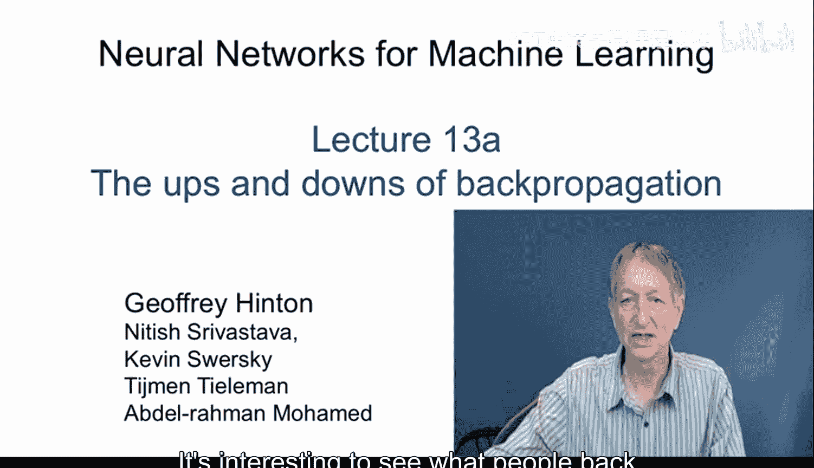
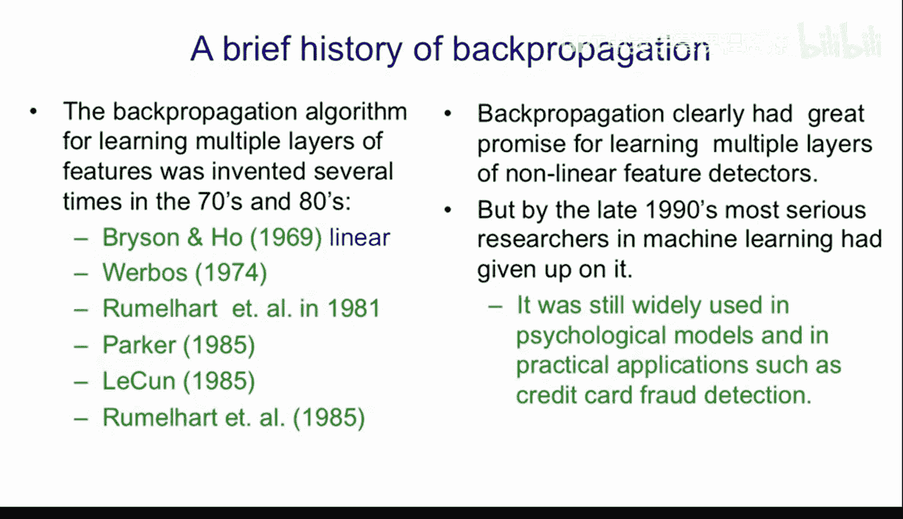
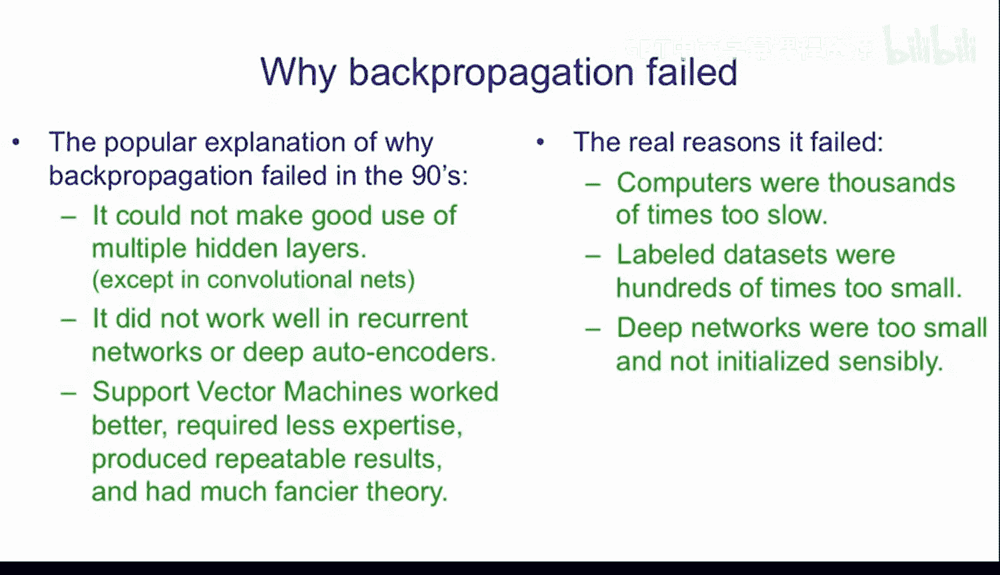
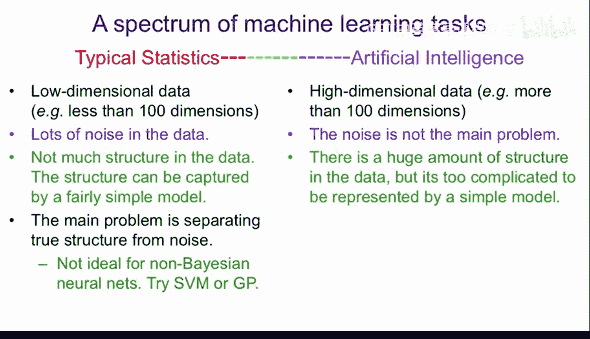
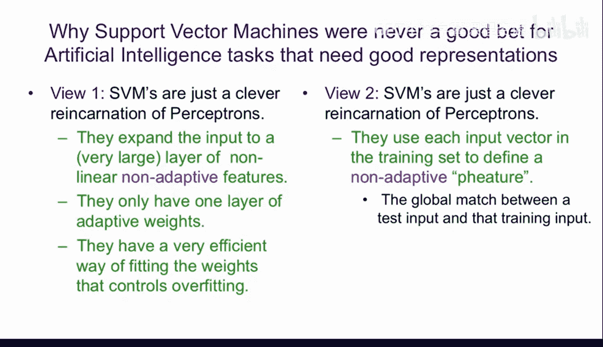

# 神经网络与机器学习：13.1：反向传播的兴衰史 📈📉

在本节课中，我们将回顾反向传播算法的历史发展脉络。我们将从其在上世纪70-80年代的起源开始，探讨它在90年代为何遭遇冷落，并分析其后来重新崛起的原因。最后，我们将通过一份历史文件，了解当时研究者们的观点与预判。

## 反向传播的起源与早期发展

上一节我们概述了本节课的内容，本节中我们来看看反向传播算法最初的诞生过程。

反向传播在70年代和80年代被独立发明了数次。
它始于60年代末，控制理论家Bryson和Ho发明了反向传播的线性版本。
Paul Werbos听了他们的讲座，意识到它可以被非线性化。在他的1974年博士论文中，他发表了可能是第一个正确的反向传播版本。
Rumelhart、Hinton和Williams在1981年发明了它，但并不知道Paul Werbos的工作。
我们尝试了它，但对我们尝试的第一件事效果并不好，因此我们放弃了它。
David Parker在1985年发明了它，Jan LeCun也在1985年发明了它。
同样在1985年，我回去再次尝试了Rumelhart、Williams和我放弃的事情，并发现它效果相当好。
1986年，我们发表了一篇论文，其中包含了一个关于它能做什么的非常令人信服的例子。

很明显，反向传播在学习多层非线性特征检测器方面大有可为。
但它并未真正兑现其承诺。到了90年代末，机器学习领域大多数严肃的研究者已经放弃了反向传播。
例如，在David MacKay的教科书中，几乎没有提到它。
它仍然被心理学家广泛用于构建心理模型，并且在信用卡欺诈检测等实际应用中也相当广泛地使用。
但在机器学习领域，人们认为它已经被支持向量机所取代。

## 90年代的反向传播：流行观点与真实原因

上一节我们介绍了反向传播的早期发展，本节中我们来看看它在90年代遭遇困境时，流行的解释是什么，以及我们如今如何看待其真实原因。

关于90年代末反向传播遭遇了什么，流行的解释是它无法有效利用多层和非线性特征。
这在卷积神经网络中并不成立，卷积网络是个例外。但总的来说，人们无法让使用反向传播训练的前馈神经网络在拥有多个隐藏层时做出令人印象深刻的事情，除了一些玩具示例。
它在循环网络或深度自编码器（我们将在后面的课程中介绍）中效果也不好。
循环网络或许是它最令人兴奋的应用领域。因此，正是在那里，人们无法让它良好工作最令人失望。
相比之下，支持向量机效果很好。它们不需要太多专业知识就能使其工作。
它们产生了可重复的结果。并且它们有更好的理论，更花哨的理论。
这就是关于反向传播出了什么问题的流行解释。

以更历史的视角来看，我们可以看到它真正失败的原因。
计算机的速度慢了数千倍。并且对于反向传播真正能大放异彩的领域，带标签的数据集小了数百倍。
此外，深度网络不仅规模太小，而且初始化方式也不合理。
因此，通过深度网络进行反向传播效果不佳。因为梯度往往会消失，因为初始权重通常太小。

这些问题阻碍了反向传播在视觉和语音等任务上取得成功，而这些任务最终将是它大获全胜的领域。

## 机器学习任务谱系：统计学与人工智能

上一节我们分析了反向传播失败的技术原因，本节中我们需要区分不同类型的机器学习任务，以理解不同方法的适用场景。

我们需要区分不同类型的机器学习任务。
一类更偏向于统计学中人们研究的事物，另一类更偏向于人工智能中人们研究的事物。
在统计学这一端，你通常拥有低维数据。统计学家认为100维就是高维数据。
在人工智能这一端，像图像或表示语音的系数通常有远多于100个维度。
在统计学这一端，数据中通常有很多噪声。
而在人工智能这一端，噪声不是真正的问题。
对于统计学，数据中通常没有那么多结构。存在的结构可以由一个相当简单的模型捕捉。
在人工智能这一端，数据中通常有大量的结构。
所以，如果你取一组图像，它是高度结构化的数据，但结构过于复杂，无法用简单模型捕捉。
因此，在统计学中，主要问题是将真实结构与噪声分离，不把噪声误认为是结构。
贝叶斯神经网络可以很好地做到这一点。但对于典型的非贝叶斯神经网络来说，这不是它们擅长处理的问题。
因此，对于这类问题，尝试支持向量机或一种称为高斯过程的方法（如果你在做回归，我稍后会简要提及）是有意义的。
在人工智能这一端，主要问题是找到一种表示所有这些复杂结构的方法，以便能够学习它。
显而易见的做法是尝试手动设计合适的表示，但实际上，让反向传播通过赋予它多层并使用大量计算能力来决定表示应该是什么，要更容易。

## 支持向量机的局限

上一节我们对比了不同任务的特点，本节中我们将简要讨论一下支持向量机，并阐述其局限性。

我现在想非常简要地谈谈支持向量机。我不会解释它们如何工作，但我会说明我认为它们的局限性是什么。

有几种方式可以看待支持向量机。我将给你两种不同的观点。
根据第一种观点，支持向量机只是感知机的重生，带有一个称为核技巧的巧妙技巧。
其思想是，你获取输入，将原始输入扩展到一个非常大的非线性但也是非自适应的特征层。这就像感知机，你有一个大的、不学习的特征层。
然后你只需要学习一层自适应权重，即从特征到决策单元的权重。
支持向量机有一种非常聪明的方法来避免在学习这些权重时过拟合。
它们在高维空间中寻找所谓的最大间隔超平面。它们能做到这一点的效率比你想象的可能要高得多，这就是它们效果好的原因。
第二种观点也将支持向量机视为感知机的巧妙重生，但它对它们使用的特征类型有完全不同的概念。
根据第二种观点，训练集中的每个输入向量都被用来定义一个特征。
我将用不同的拼写来表明它是与第一种完全不同的特征。
这些特征中的每一个都给出一个标量值，这涉及到在测试输入和那个特定的训练输入之间进行全局匹配。
粗略地说，就是测试输入与特定训练案例的相似程度。
然后有一种巧妙的方法可以同时找到如何加权这些特征以做出正确决策，并进行特征选择，即决定不使用哪些特征。
所以，尽管这些观点听起来彼此截然不同，但它们只是看待同一事物（支持向量机）的两种替代方式。
在这两种情况下，它都使用非自适应特征，然后是一层自适应权重。
这种方式有其局限性。你无法用支持向量机学习多层的表示。

## 一份历史赌约与反思

上一节我们探讨了支持向量机的特点，本节中我们通过一份历史文件，来回顾当时研究者们的预判，并总结本节课的核心内容。

这是一份来自1995年的历史文件。是Yann LeCun给我的。
这是Larry Jackel（贝尔实验室自适应系统研究组的负责人）和Vladimir Vapnik（支持向量机的主要倡导者）之间的一个赌约。
Larry Jackel打赌，到2000年，人们将理解为什么用反向训练的大型神经网络在大数据集上效果良好。也就是说，他们将从理论和条件上理解它。
Vapnik打赌他们不会，但他附带了一个侧赌，即如果他是那个弄清楚原因的人，他无论如何都会赢。
Vapnik反过来打赌，到2005年，将没有人再使用像那样用反向传播训练的大型神经网络。
事实证明，他们都错了。
使用反向传播的大型神经网络的限制，不在于我们没有好的理论，也不在于它们本质上没有希望，而在于我们没有足够大的计算机或足够大的数据集。这是一个实践上的限制，而非理论上的。

## 总结

本节课中我们一起学习了反向传播算法的历史轨迹。我们回顾了其多次独立发明的起源，分析了它在90年代被主流机器学习界放弃的流行解释（无法有效利用深度）和真实原因（算力与数据不足）。我们对比了统计学与人工智能两类任务的特点，指出了反向传播在后者处理复杂结构数据时的潜力。我们还简要讨论了支持向量机的两种视角及其无法学习多层表示的局限性。最后，通过一份历史赌约，我们认识到技术发展的限制往往来自实践条件，而非理论本身。这段历史提醒我们，在评估技术潜力时，需要考虑计算资源和数据规模的长期发展趋势。