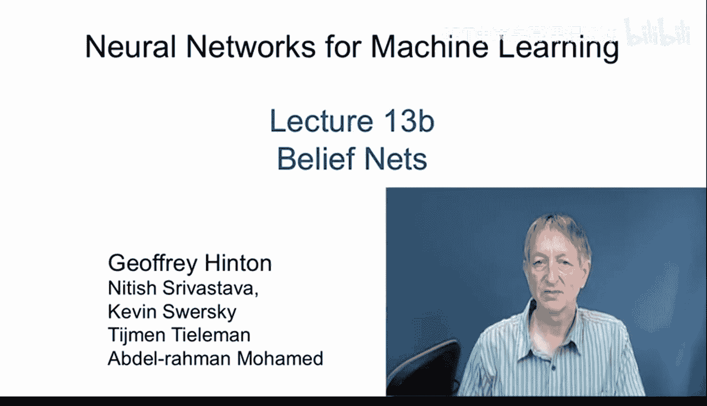
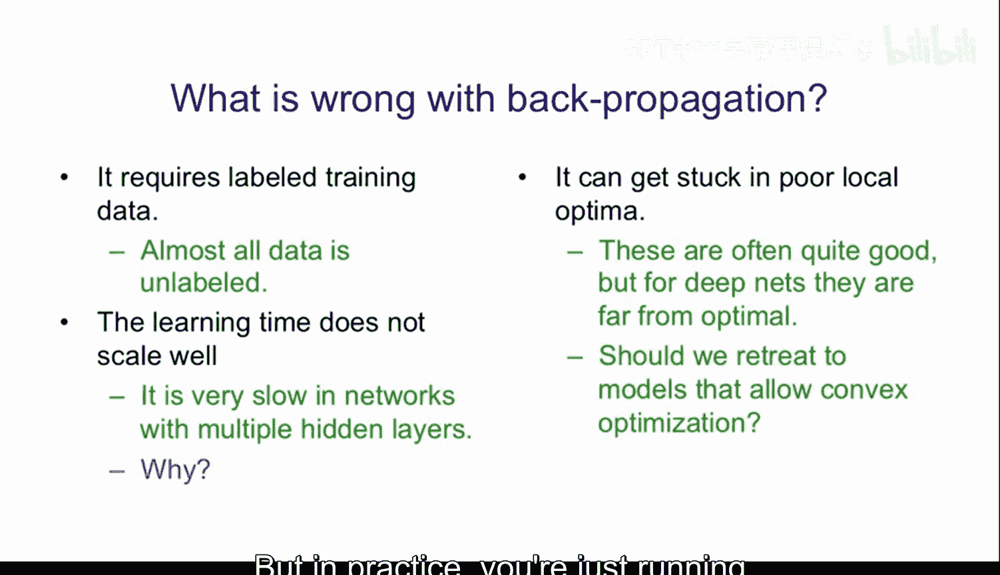
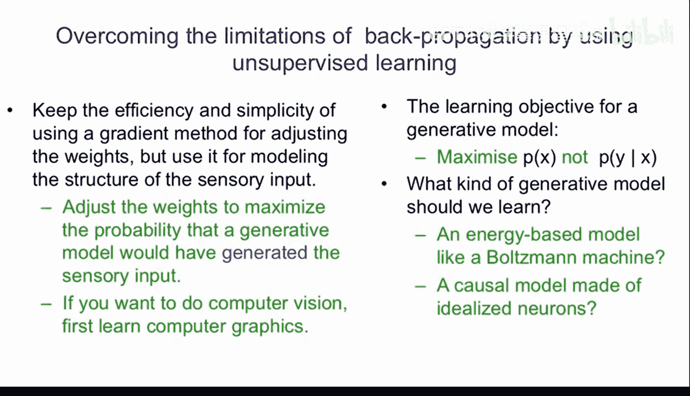
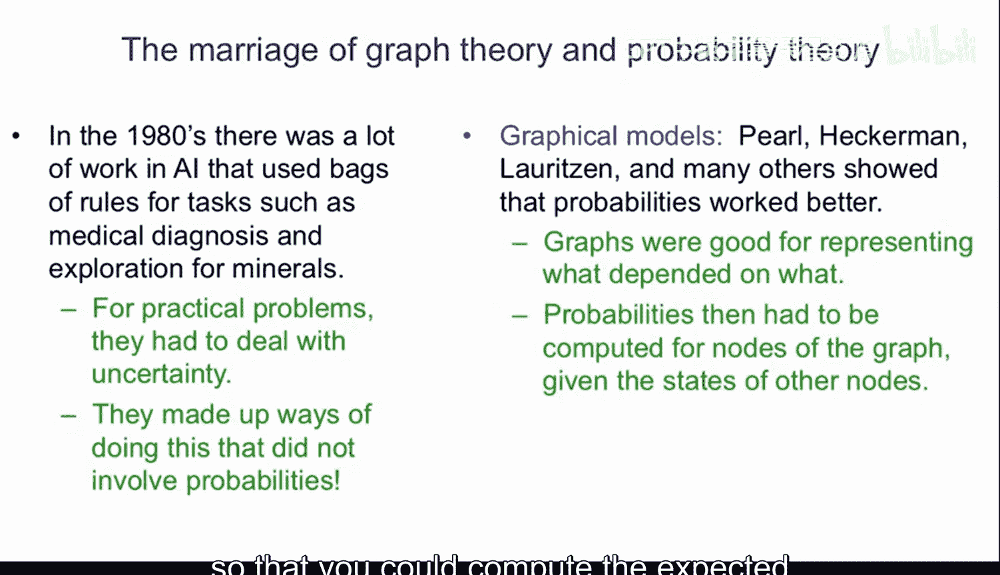
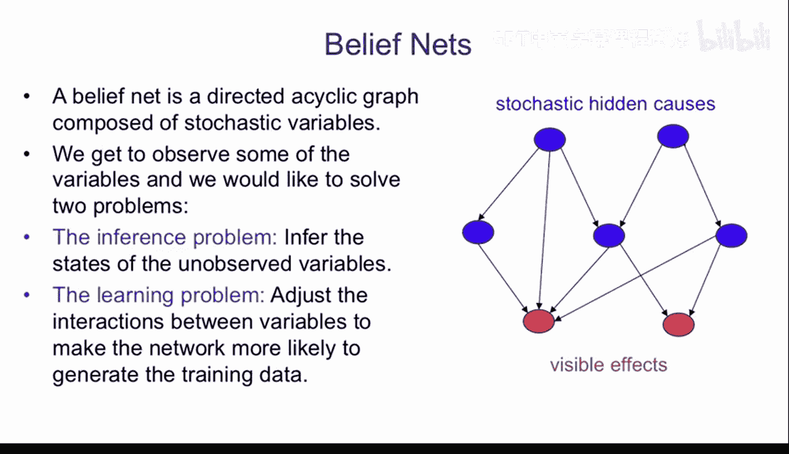
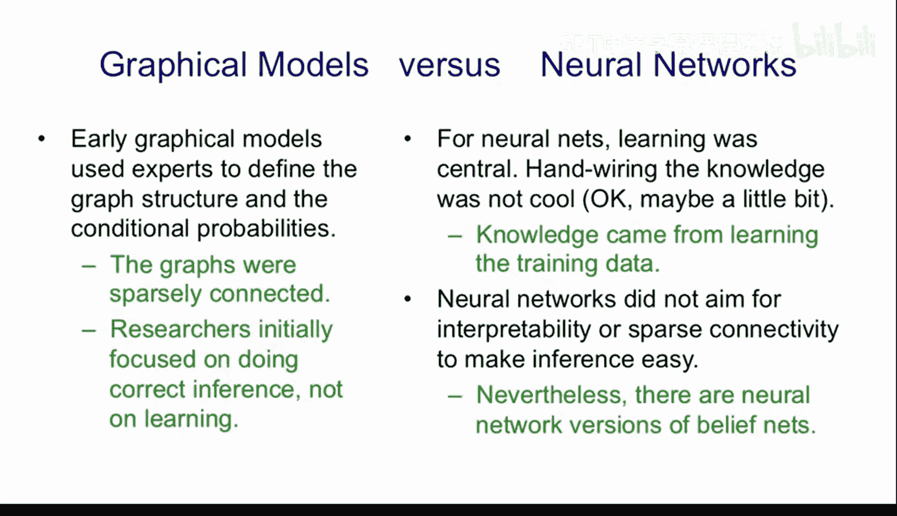
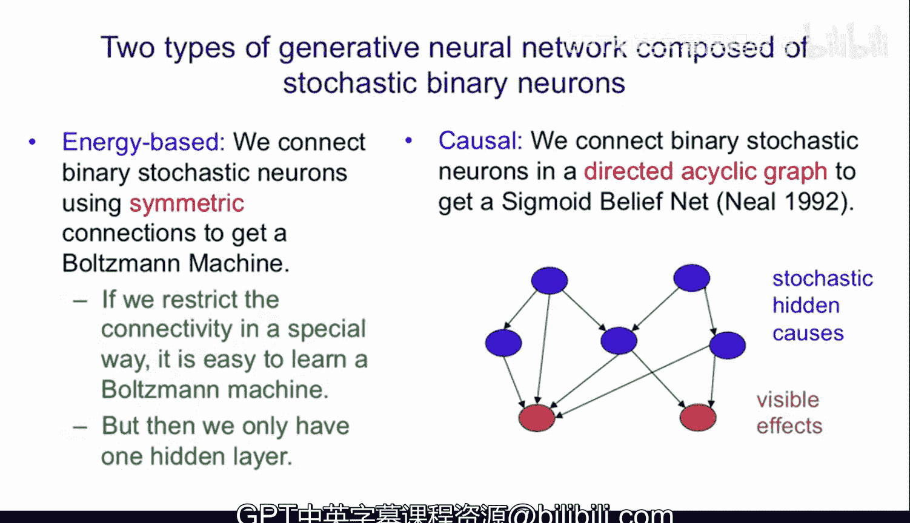

# Hinton@多伦多大学《机器学习的神经网络｜Neural Networks for Machine Learning 2016》claude-4s p61 -61-Lecture 13.2 — Belief Nets  -Neural Networks for Machine Learning-.zh_en -BV1HtkUB2EZD_p61-

In this lecture， I'll introduce belief nets。One of the reasons I abandoned back propagation in the 1990s。

Was because it required too many labels。Back then we just didn't have data sets with sufficient numbers of labels。

I was also influenced by the fact that people managed to learn with very few explicit labels。However。

 I didn't want to abandon the advantages of doing gradient descent learning to learn a whole bunch of weights。

 so the issue was was there another objective function that we could do gradient descent in。

The obvious place to look was generative models。With the objective function。

Is to model the input data rather than predicting a label。

This meshed nicely with a major movement in statistics and artificial intelligence。

 called graphical models。The idea of graphical models was to combine discrete graph structures。

For representing how variables depended on one another。With real valued computations。

That inferred the probability of one variable， given the observed values of other variables。

Boltzman machines were actually a very early example of a graphical model。

 but they were undirected graphical models。In 1992。

Rdford Neal pointed out that using the same kinds of units as we used in Baltimore machines。

We could make directed graphical models， which he called sigmoid belief nets。

And the issue then became。

How can we learn sigmoid belief nets？A second problem is that for deep networks。

 the learning time does not scale well。When there's multiple hidden layers。

 the learning was very slow。You might ask why this was。

 And we now know that one of the reasons was we did not initialize the weights in a sensible way。Yet。

 another problem。Is that back propagation can get stuck in poor local optima。

These are often quite good， so back propagation is useful。But we can now show that for deep nets。

 the local optimum you get stuck in。 if you start with small random weights are typically far from optimal。

There is the possibility of retreating to simpler models that allow convex optimization。

But I don't think this is a good idea。 Maematicians like to do that because they can prove things。

But in practice， you are just running away from the complexity of real data。

So one way to overcome the limits of back propagation is by using unsupervised learning。

The idea is that we want to keep the efficiency and simplicity。Of using a gradient method。

And stochastic minibached descent。For adjusting the weights。

But we're going to use that method for modelling the structure of a sensory input。

 not for modeling the relation between input and output。

So the idea is the weights are going to be adjusted to maximize the probability that a generative model would have generated the sensory input。

We already saw that in learning boltman machines。And one way to think about it is if you want to do computer vision。

 you should first learn to do computer graphics。To first order， computer graphics works。

 and computer vision doesn't。The learning objective for a generative model。

 as we saw with Bolam machines， is to maximize the probability of the observed data。

Not to maximize the probability of labels， given inputs。Then the question arises。

 what kind of generative model should we learn。We might learn an energy based model。

 like a Baltimore machine。Or we might learn a causal model made of idealized neurons。

 And that's what we'll look at first。

Well finally， we might learn some kind of hybrid of the two。 and that's where we'll end up。

So before I go into causal belief nets made of neurons。

I want to give a little bit of background about artificial intelligence and probability。

In the 1970s and early 1980s， people in artificial intelligence。Were unbelievably anti probability。

When I was a graduate student， if you mentioned probability。

 it was a sign that you were stupid and you just hadn't got it。

 Computers were all about discrete symbol processing。 And if you introduced any probabilities。

 they would just infect everything。It's hard to conceive of how much people were against probability。

 so here's a quote to help you。I'll read it out。Many ancient Greeks supported Socrates' opinion that deep。

 inexplicable thoughts came from the gods。Today's equivalent to those gods is the erratic。

 even probabilistic neuron。It is more likely that increased randomness of neural behaviour is the problem of the epileptic and the drunk。

 not the advantage of the brilliant。That was in。Patrick Henry Winston's first AI textbook in the first edition。

And it was the general opinion at the time。Winston was to become the leader of the MI T AI Lab。

Here's an alternative view。All of this will lead to theories of computation。

 which are much less rigidly of an all or none nature than past and present formal logic。

There are numerous indications to make us believe that this new system of formal logic will move closer to another discipline。

 which has been little linked in the past with logic。This is thermodynamics。

 primarily in the form it was received from Balsmann。

That was written by John Fon Neumann in 1957 and was part of the unfinished manuscript he left behind。

For what was to be his crowning achievement， his book on the computer in the brain。

I think if Fon Neumman had lived， the history of artificial intelligence might have been somewhat different。

So probabilities eventually found their way into AI。V something called graphical models。

Which are a marriage of graph theory and probability theory。In the 1980s。

 there was a lot of work on expert systems in AI that used bags of rules for tasks such as medical diagnosis or exploring for minerals。

Now， these were practical problems， so they had to deal with uncertainty。

 They couldn't just use toy examples where everything was certain。

People in AI dislike probability so much。That even when they were dealing with uncertainty。

 they didn't want to use probabilities， so they made up。

Their own ways of dealing with uncertainty that did not involve probabilities。

You can actually prove that this is a bad bet。Graphical models were introduced by Pearl Hackckerman Lrison and many others。

Who showed that probabilities actually worked better than the ad hoc methods developed by people doing expert systems。

Discrete graphs were good for representing what variable depend on what other variables。

But once you had those graphs， you then needed to do real valued computations that respected the rules of probability。

So that you could compute the expected values of some nodes in the graph。

 given the observed states of other nodes。

Belief nets is the name that people in graphical models give to a particular subset of graphs。

Which are directed acyclic graphs。 And typically， they use sparsely connected ones。

And if those graphs are sparsely connected。They have clever inference algorithms。

That can compute the probabilities of unobserved nodes efficiently。

But these clever algorithms are exponential in the number of nodes that influence each node。

So they won't work for densely connected nets。So a belief net is a directed acyclic graph composed of stochastic variables。

 And here's a picture of one。In general， you might observe any of the variables。

 I'm going to restrict myself to nets in which you only observe the leaf notes。

So we imagine there's these unobserved hidden causes。And they may be LED。

And they eventually give rise to some observed effects。Once we observe some variables。

 there's two problems we'd like to solve。The first is what I'll call the inference problem。

And that's to infer the states of the unobserved variables。Of course。

 we can't infer them with certainty。 So what we're after is probability distributions over unobserved variables。

And if the unobserved variables are not independent of one another， given the observed variables。

 those probability distributions are likely to be big。

 cumbersome things with an exponential number of terms in。The second problem is the learning problem。

That is， given a training set。Composed of observed vectors of states of all of the leaf nodes。

How do we adjust the interactions between variables。

To make the network more likely to generate that training data。

So adjusting the interactions will involve both deciding which node is affected by which other node。

And also， deciding on the strength of that effect。

So let me just say a little bit about the relationship between graphical models and neural networks。

The early graphical models used experts to define the graph structure and also the conditional probabilities。

They would typically take a medical expert and ask him， how likely is this to cause that。

And then they would make a graph in which the nodes had meanings。

And they typically had conditional probability tables。

That described how a set of values for the parents of a node。

Would determine the distribution of values for the node。Their grass was sparsely connected。

And the initial problem they focused on was how to do correct inference。Initially。

 they weren't interested in learning because the knowledge came from the experts。By contrast。

 for neural nets， learning was always a central issue。

And hand wiring the knowledge was regarded as not cool， although， of course。

 wiring in some basic properties， as in convolutional nets was a very sensible thing to do。

But basically， the knowledge in the net came from learning the training data， not from experts。

Neural networks didn't aim to have interpretability or sparse connectivity to make the inference easy。

 Nevertheless， there are neural network versions of belief nets。

So if we think about how to make generative models out of idealized neurons。

 there's basically two types of generative model you can make。There's energy based models。

Where you connect binary stochastic neurons using symmetric connections。

 and then you get a boltsman machine。A Bsam machine， as we've seen， is hard to learn。

 but if we restrict the connectivity。Then it's easy to learn a restricted boxman machine。However。

 when we do that。We've only learned one hidden layer。

And so we're giving up on a lot of the power of neural nets with multiple hidden layers in order to make learning easy。

The other kind of model you can make is a causal model。

That is a directed acyclic graph composed of binary stochastic neurons。And when you do that。

 you get a sigmoid belief net。In 1992， Neil introduced models like this and compared them with Bsum machines and showed that sigmmo belief nets were slightly easier to learn。

So a sigmoid belief net is just a belief net in which all of the variables are binary stochastic neurons。

To generate data from this model。You take the neurons in the top layer。

You determine whether they should be ones or zeroes， based on their biases。

So you determine that stochically。And then given the states of the neurons in the top layer。

 you'd make stochastic decisions about what the neurons in the middle there should be doing。

And then given their binary states， you'd make decisions about what the visible effect should be。

And by doing that sequence of operations， a causal sequence from layer to layer。

You would get an unbiased sample of the kinds of vectors of visible values that your neural network believes in。

So in a causal model， unlike a Bolsum machine， it's easy to generate samples。

