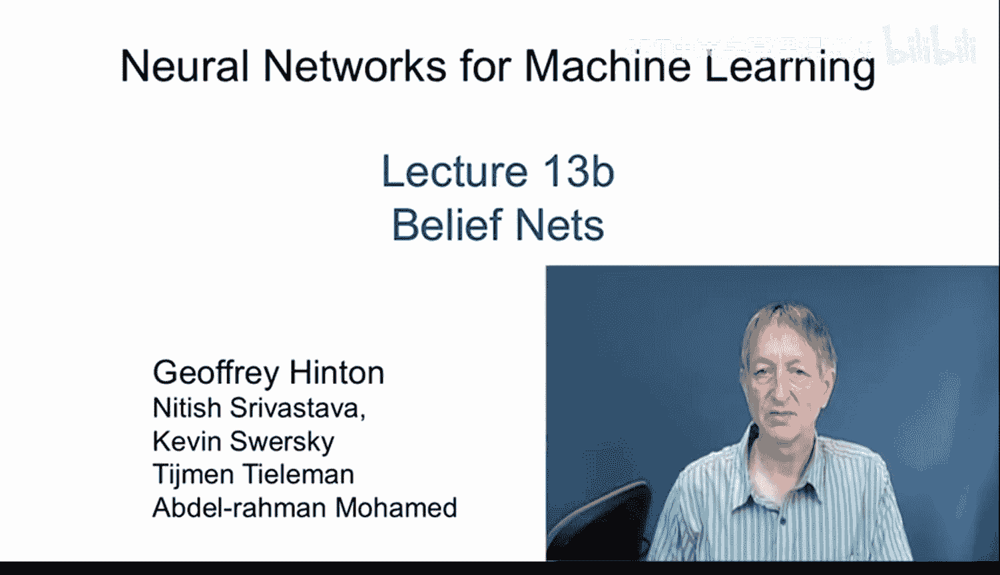
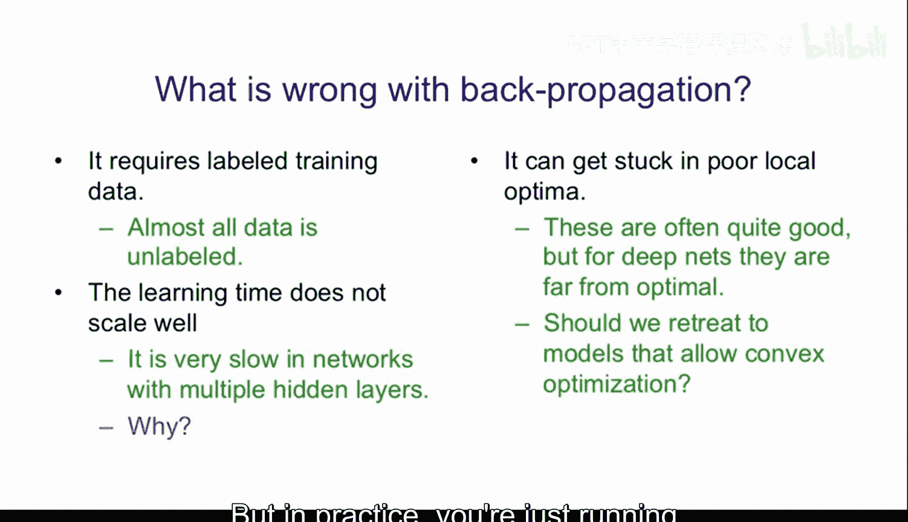
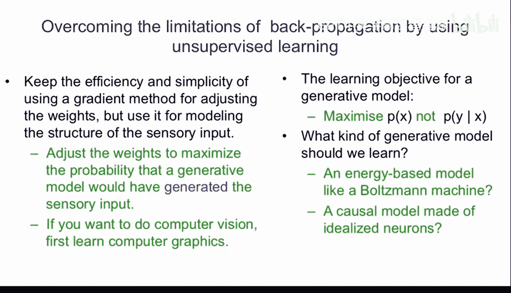
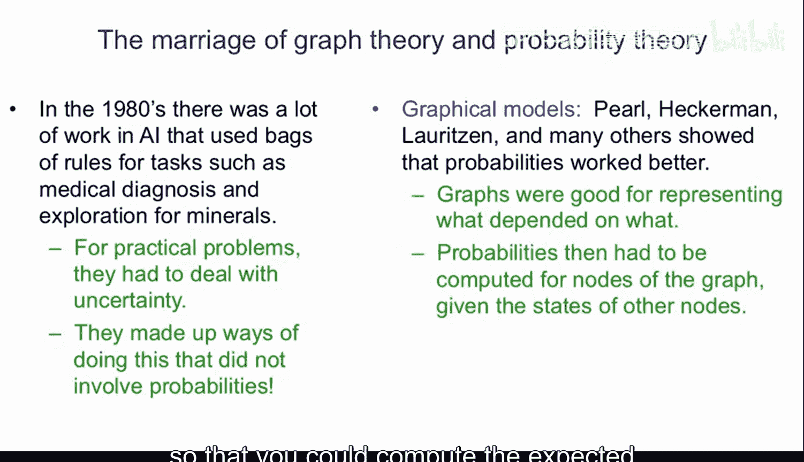
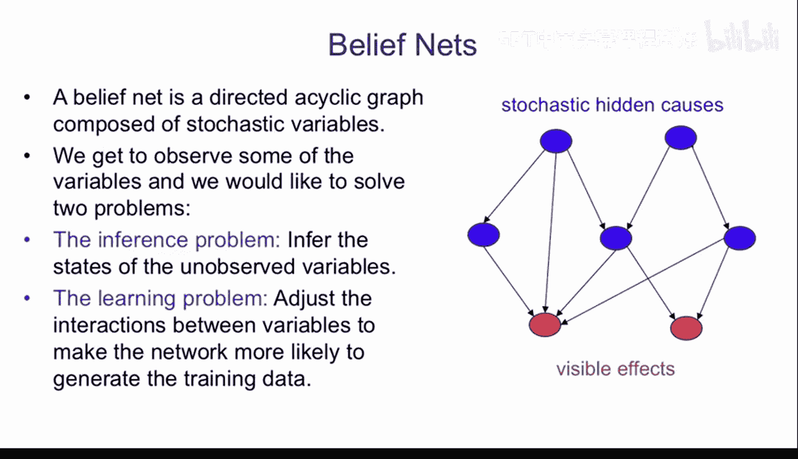
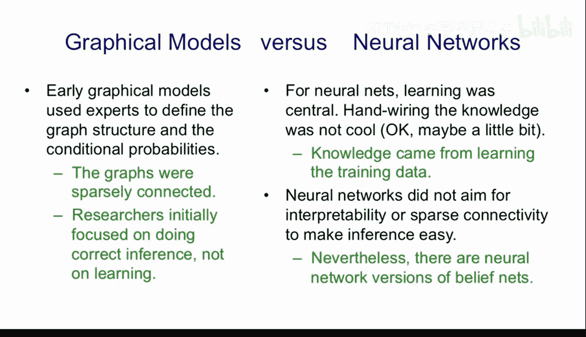
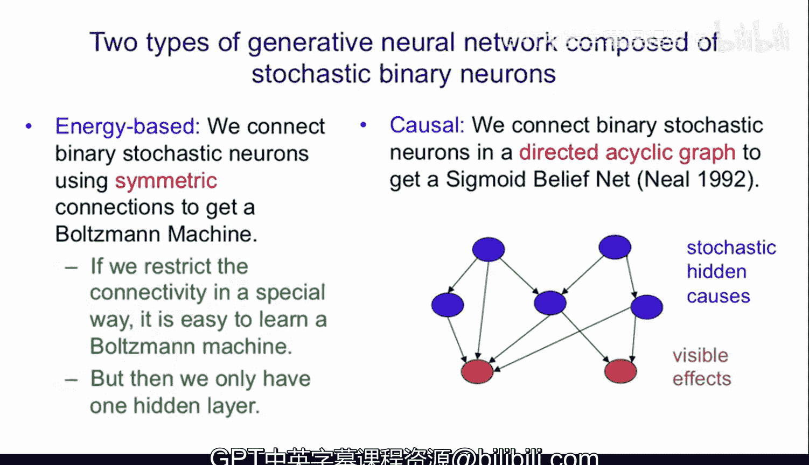

# 神经网络与机器学习：13.2：信念网络 🧠

在本节课中，我们将学习信念网络。这是一种生成模型，它通过建模输入数据的概率分布，而非预测标签，来克服反向传播算法对大量标注数据的依赖。我们将探讨其基本原理、与图形模型的关系，以及如何利用神经元构建因果模型。

---

## 放弃反向传播的原因

上一节我们介绍了反向传播的局限性，本节中我们来看看导致我在20世纪90年代放弃反向传播的主要原因。

它需要太多标签。当时我们根本没有足够多标签的数据集。

我也受到一个事实的影响：人们能够用很少的显式标签进行学习。

然而，我不想放弃使用梯度下降学习来调整大量权重的优势。

因此，问题在于是否存在另一个我们可以进行梯度下降的目标函数。

一个显而易见的研究方向是生成模型。

其目标函数是建模输入数据，而不是预测标签。

这与统计学和人工智能领域一个主要运动——图形模型——很好地结合了起来。

图形模型的思想是结合离散图结构来表示变量之间的依赖关系，以及基于实值计算来推断给定其他变量观测值时某个变量的概率。

玻尔兹曼机实际上是图形模型的一个早期例子，但它们是**无向图形模型**。

在1992年，拉德福德·尼尔指出，使用与玻尔兹曼机中相同类型的单元，我们可以构建**有向图形模型**，他称之为**Sigmoid信念网络**。

随之而来的问题是：我们如何学习Sigmoid信念网络？

---

## 深度网络的挑战

第二个问题是，对于深度网络，学习时间无法很好地扩展。

当存在多个隐藏层时，学习速度非常慢。

你可能会问为什么会这样。我们现在知道原因之一是我们没有以合理的方式初始化权重。

另一个问题是，反向传播可能会陷入较差的局部最优解。

这些局部最优解通常相当不错，因此反向传播是有用的。但我们现在可以证明，对于深度网络，如果从小随机权重开始，陷入的局部最优解通常远非最优。

存在退回到更简单模型以进行凸优化的可能性。

但我认为这不是一个好主意。数学家喜欢这样做，因为他们可以证明一些定理。

但在实践中，你只是在逃避真实数据的复杂性。

---

## 无监督学习作为解决方案

克服反向传播限制的一种方法是使用无监督学习。

其思想是，我们希望保持使用梯度方法和随机小批量下降来调整权重的效率和简单性。

但我们将使用这种方法来建模感官输入的结构，而不是建模输入和输出之间的关系。

因此，思想是调整权重，以最大化生成模型生成感官输入的概率。

我们在学习玻尔兹曼机时已经看到了这一点。一种思考方式是，如果你想做计算机视觉，你应该先学习计算机图形学。粗略地说，计算机图形学是可行的，而计算机视觉则不然。

正如我们在玻尔兹曼机中看到的，生成模型的学习目标是最大化观测数据的概率，而不是最大化给定输入时标签的概率。

---

## 生成模型的类型

那么问题来了，我们应该学习哪种生成模型？

我们可能学习一个基于能量的模型，比如玻尔兹曼机。

或者，我们可能学习一个由理想化神经元构成的因果模型。这是我们首先要看的。

最终，我们可能会学习两者的某种混合体，而这将是我们最终的目标。

---

## 人工智能与概率的背景

在深入探讨由神经元构成的因果信念网络之前，我想先介绍一下人工智能和概率的背景。

在20世纪70年代和80年代初，人工智能领域的人们难以置信地反对概率。

当我还是研究生时，如果你提到概率，那表明你很愚蠢，还没有理解。计算机完全是关于离散符号处理的。如果你引入任何概率，它们就会污染一切。

很难想象人们当时有多么反对概率，这里有一段引文可以帮助你理解。我来读一下：

> “许多古希腊人支持苏格拉底的观点，认为深刻、难以解释的思想来自神灵。今天这些神灵的等价物是反复无常、甚至具有概率性的神经元。神经行为随机性的增加更可能是癫痫患者和醉酒者的问题，而不是聪明人的优势。”

这段话出自帕特里克·亨利·温斯顿第一版的第一本AI教科书。这是当时的普遍观点。温斯顿后来成为了麻省理工学院人工智能实验室的负责人。

这里有一个相反的观点：

> “所有这些都将导致计算理论，它比过去和现在的形式逻辑更少具有全有或全无的刚性性质。有许多迹象使我们相信，这个新的形式逻辑系统将更接近另一个过去与逻辑联系甚少的学科。这就是热力学，主要是以玻尔兹曼所接受的形式。”

这段话由约翰·冯·诺依曼在1957年撰写，是他未完成手稿的一部分，本应是他关于大脑中计算机的著作的巅峰之作。

我认为如果冯·诺依曼还活着，人工智能的历史可能会有所不同。

---

## 图形模型的兴起

概率最终通过一种叫做**图形模型**的东西进入了人工智能领域。

图形模型是图论和概率论的结合。

在20世纪80年代，人工智能领域有很多关于专家系统的工作，这些系统使用规则集来处理诸如医疗诊断或矿产勘探等任务。

这些都是实际问题，因此必须处理不确定性。它们不能只使用一切都很确定的玩具例子。

人工智能领域的人们非常不喜欢概率，以至于即使他们在处理不确定性时，也不想使用概率，因此他们发明了自己处理不确定性的方法，不涉及概率。

你实际上可以证明这是一个糟糕的选择。

图形模型由珀尔、赫克曼、劳里森等人引入，他们证明了概率实际上比专家系统人员开发的临时方法效果更好。

离散图擅长表示哪些变量依赖于哪些其他变量。

但一旦有了这些图，你就需要进行实值计算，这些计算遵循概率规则，以便你可以计算图中某些节点的期望值，给定其他节点的观测状态。

---

## 信念网络的定义

信念网络是图形模型中人们对特定图子集的称呼。

这些图是**有向无环图**。通常，它们使用稀疏连接的图。

如果这些图是稀疏连接的，它们就有巧妙的推理算法，可以高效地计算未观测节点的概率。

但这些巧妙的算法在影响每个节点的节点数量上是指数级的，因此它们不适用于密集连接的网络。

所以，信念网络是由随机变量组成的有向无环图。这里有一张图。

通常，你可能观测到任何变量。我将限制自己只讨论仅观测叶节点的网络。

因此，我们想象存在这些未观测的隐藏原因。它们可能分层，最终产生一些观测到的结果。

一旦我们观测到一些变量，就有两个问题需要解决。

第一个是我称之为**推理问题**的问题，即推断未观测变量的状态。

当然，我们无法确定地推断它们。因此，我们追求的是未观测变量的概率分布。

如果未观测变量在给定观测变量的情况下彼此不独立，那么这些概率分布可能是庞大、笨重的东西，包含指数级的项。

第二个问题是**学习问题**。

即，给定一个由所有叶节点状态观测向量组成的训练集，我们如何调整变量之间的相互作用，以使网络更有可能生成该训练数据。

因此，调整相互作用将涉及决定哪个节点受哪个其他节点影响，以及决定该影响的强度。

---

## 图形模型与神经网络的关系

让我简单谈谈图形模型和神经网络之间的关系。

早期的图形模型使用专家来定义图结构以及条件概率。

他们通常会询问医学专家，某事导致另一件事的可能性有多大。然后他们会制作一个节点具有含义的图。

他们通常有**条件概率表**，描述父节点的一组值如何决定该节点值的分布。

他们的图是稀疏连接的，他们最初关注的问题是如何进行正确的推理。

最初，他们对学习不感兴趣，因为知识来自专家。

相比之下，对于神经网络，学习始终是一个核心问题。

手工编码知识被认为是不酷的，尽管当然，像在卷积网络中那样编码一些基本属性是非常明智的做法。

但基本上，网络中的知识来自学习训练数据，而不是来自专家。

神经网络的目标不是具有可解释性或稀疏连接以使推理变得容易。尽管如此，信念网络也有神经网络的版本。

---

## 基于神经元的生成模型

如果我们思考如何用理想化神经元构建生成模型，基本上有两种类型可以构建。

有**基于能量的模型**，你使用对称连接连接二元随机神经元，然后得到玻尔兹曼机。

正如我们所看到的，玻尔兹曼机很难学习，但如果我们限制连接性，那么学习一个受限玻尔兹曼机就很容易。

然而，当我们这样做时，我们只学习了一个隐藏层。因此，为了简化学习，我们放弃了具有多个隐藏层的神经网络的许多能力。

你可以构建的另一种模型是**因果模型**。

这是一个由二元随机神经元组成的有向无环图。当你这样做时，你会得到一个Sigmoid信念网络。

1992年，尼尔引入了这样的模型，并将其与玻尔兹曼机进行了比较，表明Sigmoid信念网络稍微容易学习一些。

所以，Sigmoid信念网络就是一个所有变量都是二元随机神经元的信念网络。

要从这个模型生成数据，你取顶层的神经元，根据它们的偏置随机决定它们应该是1还是0。

然后，给定顶层神经元的状态，你随机决定中间层神经元应该做什么。

然后，给定它们的二元状态，你决定可见效应应该是什么。

通过执行这一系列从层到层的因果操作，你将获得神经网络所相信的可见值向量类型的无偏样本。

因此，在因果模型中，与玻尔兹曼机不同，生成样本很容易。

---

## 总结

本节课中我们一起学习了信念网络的基本概念。我们探讨了放弃反向传播、转向生成模型的原因，了解了图形模型和概率在AI中的历史背景，并区分了基于能量的模型（如玻尔兹曼机）和因果模型（如Sigmoid信念网络）。Sigmoid信念网络作为由神经元构成的有向无环图，能够通过因果序列高效生成数据样本，为无监督学习提供了一种重要框架。